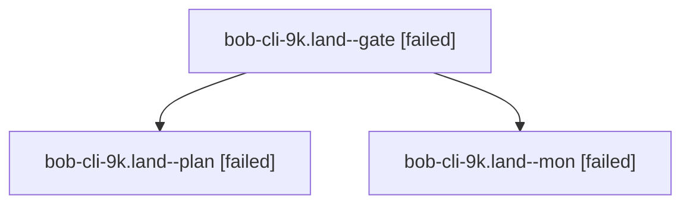

# Session: bob-cli-9k.land

[Agent Hoods](../README.md) / [bbugyi200](../users/bbugyi200/README.md) / [athena](../users/bbugyi200/machines/athena/README.md) / [bob-cli-9k](../users/bbugyi200/machines/athena/hoods/bob-cli-9k/README.md) / bob-cli-9k.land

Owner: `bbugyi200.athena` · Hood: `bob-cli-9k` · Members: 3 · Bead: [bob-cli-9k](https://github.com/bobs-org/bob-cli--beads/blob/main/pages/bob-cli-9k/README.md)

## Lineage

The diagram is an optional enhancement; the ordered table below contains the same lineage in accessible text.

| Role | Agent | State | Model / provider | Timing | Commits | Prompt | Chat |
|---|---|---|---|---|---:|---|---|
| gate | bob-cli-9k.land--gate | failed | opus / claude | 2026-10-19T00:19:40.736523+00:00 → 2026-10-19T00:20:09.031651+00:00 | 0 | — | [Chat](../agents/bbugyi200.athena.bob-cli-9k.land--gate/chat.md) |
| plan | bob-cli-9k.land--plan | failed | opus / claude | 2026-10-18T23:47:53.554588+00:00 → 2026-10-19T00:20:16.642257+00:00 | 0 | [Prompt](../agents/bbugyi200.athena.bob-cli-9k.land--plan/prompt.md) | [Chat](../agents/bbugyi200.athena.bob-cli-9k.land--plan/chat.md) |
| mon | bob-cli-9k.land--mon | failed | opus / claude | 2026-10-19T00:20:08.326878+00:00 → 2026-10-19T00:22:40.802121+00:00 | 0 | — | [Chat](../agents/bbugyi200.athena.bob-cli-9k.land--mon/chat.md) |

## Neighbors

| Agent | Relation | State |
|---|---|---|
| [bob-cli-9k.1](bbugyi200.athena.bob-cli-9k.1.md) (session · 3) | bob-cli-9k hood | completed 2, failed 1 |
| [bob-cli-9k.2](../agents/bbugyi200.athena.bob-cli-9k.2/README.md) | bob-cli-9k hood | completed |
| [bob-cli-9k.3](bbugyi200.athena.bob-cli-9k.3.md) (session · 3) | bob-cli-9k hood | completed 2, failed 1 |
| [bob-cli-9k.4](../agents/bbugyi200.athena.bob-cli-9k.4/README.md) | bob-cli-9k hood | completed |
| [bob-cli-9k.5](../agents/bbugyi200.athena.bob-cli-9k.5/README.md) | bob-cli-9k hood | completed |
| [bob-cli-9k.6](../agents/bbugyi200.athena.bob-cli-9k.6/README.md) | bob-cli-9k hood | completed |
| [bob-cli-9k.7](../agents/bbugyi200.athena.bob-cli-9k.7/README.md) | bob-cli-9k hood | completed |
| [bob-cli-9k.8.1](bbugyi200.athena.bob-cli-9k.8.1.md) (session · 3) | bob-cli-9k hood | completed 2, failed 1 |
| [bob-cli-9k.8.2](../agents/bbugyi200.athena.bob-cli-9k.8.2/README.md) | bob-cli-9k hood | completed |
| [bob-cli-9k.8.3](../agents/bbugyi200.athena.bob-cli-9k.8.3/README.md) | bob-cli-9k hood | completed |
| [bob-cli-9k.8.4](../agents/bbugyi200.athena.bob-cli-9k.8.4/README.md) | bob-cli-9k hood | completed |
| [bob-cli-9k.8.land](bbugyi200.athena.bob-cli-9k.8.land.md) (session · 5) | bob-cli-9k hood | active 1, completed 2, failed 2 |
