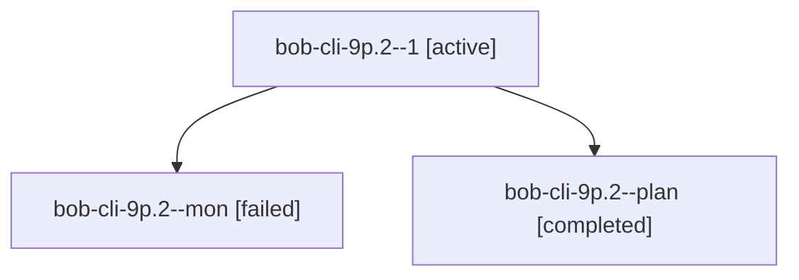

# Session: bob-cli-9p.2

[Agent Hoods](../README.md) / [bbugyi200](../users/bbugyi200/README.md) / [athena](../users/bbugyi200/machines/athena/README.md) / [bob-cli-9p](../users/bbugyi200/machines/athena/hoods/bob-cli-9p/README.md) / bob-cli-9p.2

Owner: `bbugyi200.athena` · Hood: `bob-cli-9p` · Members: 3 · Bead: [bob-cli-9p.2](https://github.com/bobs-org/bob-cli--beads/blob/main/pages/bob-cli-9p/bob-cli-9p.2.md)

## Lineage

The diagram is an optional enhancement; the ordered table below contains the same lineage in accessible text.

| Role | Agent | State | Model / provider | Timing | Commits | Prompt | Chat |
|---|---|---|---|---|---:|---|---|
| 1 | bob-cli-9p.2--1 | active | grok-4.6 / grok | 2026-10-19T12:57:24.634998+00:00 | [1](../agents/bbugyi200.athena.bob-cli-9p.2--1/README.md#commits) | [Prompt](../agents/bbugyi200.athena.bob-cli-9p.2--1/prompt.md) | — |
| mon | bob-cli-9p.2--mon | failed | grok-4.6 / grok | 2026-10-19T12:52:36.109611+00:00 → 2026-10-19T12:56:36.872233+00:00 | 0 | — | [Chat](../agents/bbugyi200.athena.bob-cli-9p.2--mon/chat.md) |
| plan | bob-cli-9p.2--plan | completed | grok-4.6 / grok | 2026-10-19T12:39:25.418337+00:00 → 2026-10-19T12:53:10.218299+00:00 | 0 | [Prompt](../agents/bbugyi200.athena.bob-cli-9p.2--plan/prompt.md) | [Chat](../agents/bbugyi200.athena.bob-cli-9p.2--plan/chat.md) |

## Commits

| Role | Repo | Commit | Subject | Committed |
|---|---|---|---|---|
| 1 | bob-cli | [`0bed62a`](https://github.com/bobs-org/bob-cli/commit/0bed62a142a24be36795d88d9db1d559cf4a04b7) | feat(highlights): report continuation counts in scan output and docs | 2026-10-19 09:00:15 EDT |

## Neighbors

| Agent | Relation | State |
|---|---|---|
| [bob-cli-9p.1](../agents/bbugyi200.athena.bob-cli-9p.1/README.md) | bob-cli-9p hood | completed |
| [bob-cli-9p.3](../agents/bbugyi200.athena.bob-cli-9p.3/README.md) | bob-cli-9p hood | completed |
| [bob-cli-9p.land](../agents/bbugyi200.athena.bob-cli-9p.land/README.md) | bob-cli-9p hood | waiting |
