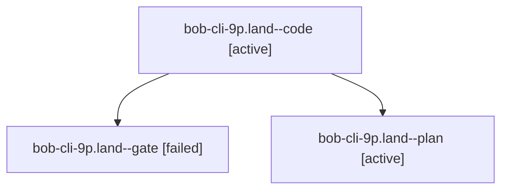

# Session: bob-cli-9p.land

[Agent Hoods](../README.md) / [bbugyi200](../users/bbugyi200/README.md) / [athena](../users/bbugyi200/machines/athena/README.md) / [bob-cli-9p](../users/bbugyi200/machines/athena/hoods/bob-cli-9p/README.md) / bob-cli-9p.land

Owner: `bbugyi200.athena` · Hood: `bob-cli-9p` · Members: 3 · Bead: [bob-cli-9p](https://github.com/bobs-org/bob-cli--beads/blob/main/pages/bob-cli-9p/README.md)

## Lineage

The diagram is an optional enhancement; the ordered table below contains the same lineage in accessible text.

| Role | Agent | State | Model / provider | Timing | Commits | Prompt | Chat |
|---|---|---|---|---|---:|---|---|
| code | bob-cli-9p.land--code | active | muse-spark-1.3-contributor / muse | 2026-10-19T13:13:44.876695+00:00 | [1](../agents/bbugyi200.athena.bob-cli-9p.land--code/README.md#commits) | — | — |
| gate | bob-cli-9p.land--gate | failed | gpt-6-astra / codex | 2026-10-19T13:12:54.066842+00:00 → 2026-10-19T13:13:21.726272+00:00 | 0 | — | [Chat](../agents/bbugyi200.athena.bob-cli-9p.land--gate/chat.md) |
| plan | bob-cli-9p.land--plan | active | gpt-6-astra / codex | 2026-10-19T13:02:27.479098+00:00 | 0 | [Prompt](../agents/bbugyi200.athena.bob-cli-9p.land--plan/prompt.md) | [Chat](../agents/bbugyi200.athena.bob-cli-9p.land--plan/chat.md) |

## Commits

| Role | Repo | Commit | Subject | Committed |
|---|---|---|---|---|
| code | bob-cli | [`1097ae9`](https://github.com/bobs-org/bob-cli/commit/1097ae90654c7d2d60c43ac0fab62d15d5266309) | fix(highlights): use checked page adjacency with overflow regression coverage | 2026-10-19 09:23:59 EDT |

## Neighbors

| Agent | Relation | State |
|---|---|---|
| [bob-cli-9p.1](../agents/bbugyi200.athena.bob-cli-9p.1/README.md) | bob-cli-9p hood | completed |
| [bob-cli-9p.2](bbugyi200.athena.bob-cli-9p.2.md) (session · 3) | bob-cli-9p hood | completed 2, failed 1 |
| [bob-cli-9p.3](../agents/bbugyi200.athena.bob-cli-9p.3/README.md) | bob-cli-9p hood | completed |
