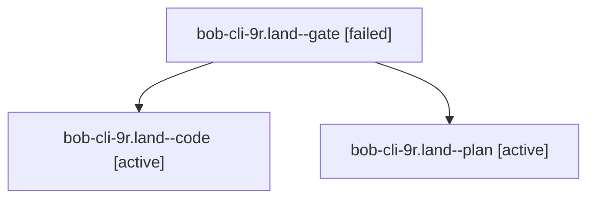

# Session: bob-cli-9r.land

[Agent Hoods](../README.md) / [bbugyi200](../users/bbugyi200/README.md) / [athena](../users/bbugyi200/machines/athena/README.md) / [bob-cli-9r](../users/bbugyi200/machines/athena/hoods/bob-cli-9r/README.md) / bob-cli-9r.land

Owner: `bbugyi200.athena` · Hood: `bob-cli-9r` · Members: 3 · Bead: [bob-cli-9r](https://github.com/bobs-org/bob-cli--beads/blob/main/pages/bob-cli-9r/README.md)

## Lineage

The diagram is an optional enhancement; the ordered table below contains the same lineage in accessible text.

| Role | Agent | State | Model / provider | Timing | Commits | Prompt | Chat |
|---|---|---|---|---|---:|---|---|
| gate | bob-cli-9r.land--gate | failed | opus / claude | 2026-10-19T15:36:16.608293+00:00 → 2026-10-19T15:37:07.820028+00:00 | 0 | — | [Chat](../agents/bbugyi200.athena.bob-cli-9r.land--gate/chat.md) |
| code | bob-cli-9r.land--code | active | muse-spark-1.3-contributor / muse | 2026-10-19T15:37:18.066997+00:00 | 0 | — | — |
| plan | bob-cli-9r.land--plan | active | opus / claude | 2026-10-19T15:12:55.749567+00:00 | 0 | [Prompt](../agents/bbugyi200.athena.bob-cli-9r.land--plan/prompt.md) | [Chat](../agents/bbugyi200.athena.bob-cli-9r.land--plan/chat.md) |

## Neighbors

| Agent | Relation | State |
|---|---|---|
| [bob-cli-9r.1](../agents/bbugyi200.athena.bob-cli-9r.1/README.md) | bob-cli-9r hood | completed |
| [bob-cli-9r.2](../agents/bbugyi200.athena.bob-cli-9r.2/README.md) | bob-cli-9r hood | completed |
| [bob-cli-9r.3](../agents/bbugyi200.athena.bob-cli-9r.3/README.md) | bob-cli-9r hood | completed |
| [bob-cli-9r.4](../agents/bbugyi200.athena.bob-cli-9r.4/README.md) | bob-cli-9r hood | completed |
| [bob-cli-9r.5](../agents/bbugyi200.athena.bob-cli-9r.5/README.md) | bob-cli-9r hood | completed |
