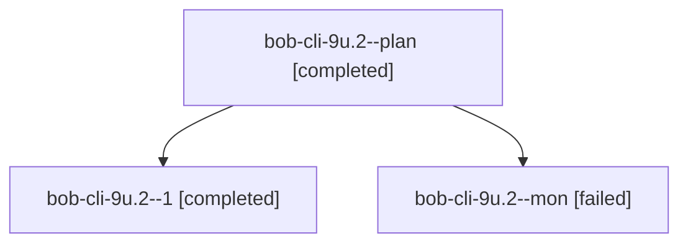

# Session: bob-cli-9u.2

[Agent Hoods](../README.md) / [bbugyi200](../users/bbugyi200/README.md) / [athena](../users/bbugyi200/machines/athena/README.md) / [bob-cli-9u](../users/bbugyi200/machines/athena/hoods/bob-cli-9u/README.md) / bob-cli-9u.2

Owner: `bbugyi200.athena` · Hood: `bob-cli-9u` · Members: 3 · Bead: [bob-cli-9u.2](https://github.com/bobs-org/bob-cli--beads/blob/main/pages/bob-cli-9u/bob-cli-9u.2.md)

## Lineage

The diagram is an optional enhancement; the ordered table below contains the same lineage in accessible text.

| Role | Agent | State | Model / provider | Timing | Commits | Prompt | Chat |
|---|---|---|---|---|---:|---|---|
| plan | bob-cli-9u.2--plan | completed | gpt-6-luna / codex | 2026-10-19T16:28:01.793438+00:00 → 2026-10-19T16:41:57.620071+00:00 | 0 | [Prompt](../agents/bbugyi200.athena.bob-cli-9u.2--plan/prompt.md) | [Chat](../agents/bbugyi200.athena.bob-cli-9u.2--plan/chat.md) |
| 1 | bob-cli-9u.2--1 | completed | gpt-6-luna / codex | 2026-10-19T16:46:05.409565+00:00 → 2026-10-19T16:51:55.701193+00:00 | [1](../agents/bbugyi200.athena.bob-cli-9u.2--1/README.md#commits) | [Prompt](../agents/bbugyi200.athena.bob-cli-9u.2--1/prompt.md) | [Chat](../agents/bbugyi200.athena.bob-cli-9u.2--1/chat.md) |
| mon | bob-cli-9u.2--mon | failed | gpt-6-luna / codex | 2026-10-19T16:41:07.214835+00:00 → 2026-10-19T16:45:28.175131+00:00 | 0 | — | [Chat](../agents/bbugyi200.athena.bob-cli-9u.2--mon/chat.md) |

## Commits

| Role | Repo | Commit | Subject | Committed |
|---|---|---|---|---|
| 1 | bob-cli | [`1dc6fe0`](https://github.com/bobs-org/bob-cli/commit/1dc6fe0606948c8741bf0dcd217a51155a1d6726) | feat(ref): report and render underline emphasis | 2026-10-19 12:50:11 EDT |

## Neighbors

| Agent | Relation | State |
|---|---|---|
| [bob-cli-9u.1](../agents/bbugyi200.athena.bob-cli-9u.1/README.md) | bob-cli-9u hood | completed |
| [bob-cli-9u.3](../agents/bbugyi200.athena.bob-cli-9u.3/README.md) | bob-cli-9u hood | completed |
| [bob-cli-9u.land](bbugyi200.athena.bob-cli-9u.land.md) (session · 3) | bob-cli-9u hood | active 2, failed 1 |
