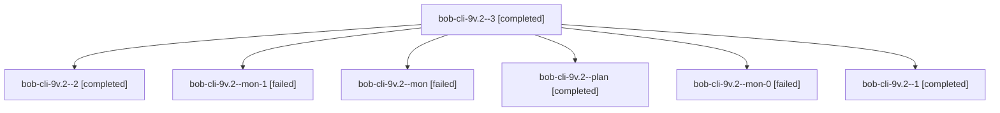

# Session: bob-cli-9v.2

[Agent Hoods](../README.md) / [bbugyi200](../users/bbugyi200/README.md) / [athena](../users/bbugyi200/machines/athena/README.md) / [bob-cli-9v](../users/bbugyi200/machines/athena/hoods/bob-cli-9v/README.md) / bob-cli-9v.2

Owner: `bbugyi200.athena` · Hood: `bob-cli-9v` · Members: 7 · Bead: [bob-cli-9v.2](https://github.com/bobs-org/bob-cli--beads/blob/main/pages/bob-cli-9v/bob-cli-9v.2.md)

## Lineage

The diagram is an optional enhancement; the ordered table below contains the same lineage in accessible text.

| Role | Agent | State | Model / provider | Timing | Commits | Prompt | Chat |
|---|---|---|---|---|---:|---|---|
| 3 | bob-cli-9v.2--3 | completed | muse-spark-1.3-contributor / muse | 2026-10-19T17:55:13.201362+00:00 → 2026-10-19T17:58:58.088775+00:00 | 0 | [Prompt](../agents/bbugyi200.athena.bob-cli-9v.2--3/prompt.md) | [Chat](../agents/bbugyi200.athena.bob-cli-9v.2--3/chat.md) |
| 2 | bob-cli-9v.2--2 | completed | muse-spark-1.3-contributor / muse | 2026-10-19T17:46:28.247761+00:00 → 2026-10-19T17:49:39.881800+00:00 | 0 | [Prompt](../agents/bbugyi200.athena.bob-cli-9v.2--2/prompt.md) | [Chat](../agents/bbugyi200.athena.bob-cli-9v.2--2/chat.md) |
| mon-1 | bob-cli-9v.2--mon-1 | failed | muse-spark-1.3-contributor / muse | 2026-10-19T17:49:10.411269+00:00 → 2026-10-19T17:54:31.659675+00:00 | 0 | — | [Chat](../agents/bbugyi200.athena.bob-cli-9v.2--mon-1/chat.md) |
| mon | bob-cli-9v.2--mon | failed | muse-spark-1.3-contributor / muse | 2026-10-19T17:14:52.400673+00:00 → 2026-10-19T17:18:19.782245+00:00 | 0 | — | [Chat](../agents/bbugyi200.athena.bob-cli-9v.2--mon/chat.md) |
| plan | bob-cli-9v.2--plan | completed | muse-spark-1.3-contributor / muse | 2026-10-19T16:57:28.365947+00:00 → 2026-10-19T17:15:25.585786+00:00 | 0 | [Prompt](../agents/bbugyi200.athena.bob-cli-9v.2--plan/prompt.md) | [Chat](../agents/bbugyi200.athena.bob-cli-9v.2--plan/chat.md) |
| mon-0 | bob-cli-9v.2--mon-0 | failed | muse-spark-1.3-contributor / muse | 2026-10-19T17:33:07.346617+00:00 → 2026-10-19T17:45:49.201124+00:00 | 0 | — | [Chat](../agents/bbugyi200.athena.bob-cli-9v.2--mon-0/chat.md) |
| 1 | bob-cli-9v.2--1 | completed | muse-spark-1.3-contributor / muse | 2026-10-19T17:19:05.615825+00:00 → 2026-10-19T17:33:44.134352+00:00 | 0 | [Prompt](../agents/bbugyi200.athena.bob-cli-9v.2--1/prompt.md) | [Chat](../agents/bbugyi200.athena.bob-cli-9v.2--1/chat.md) |

## Neighbors

| Agent | Relation | State |
|---|---|---|
| [bob-cli-9v.1](../agents/bbugyi200.athena.bob-cli-9v.1/README.md) | bob-cli-9v hood | completed |
| [bob-cli-9v.3](../agents/bbugyi200.athena.bob-cli-9v.3/README.md) | bob-cli-9v hood | completed |
| [bob-cli-9v.land](bbugyi200.athena.bob-cli-9v.land.md) (session · 3) | bob-cli-9v hood | active 2, failed 1 |
