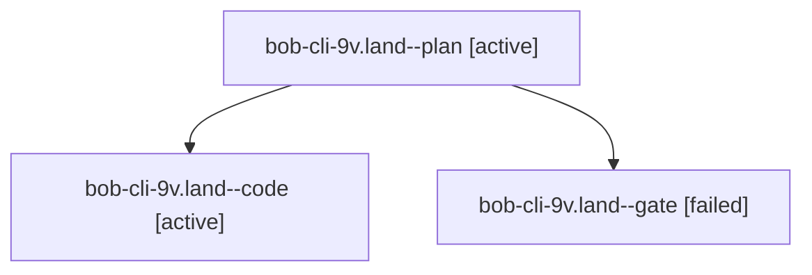

# Session: bob-cli-9v.land

[Agent Hoods](../README.md) / [bbugyi200](../users/bbugyi200/README.md) / [athena](../users/bbugyi200/machines/athena/README.md) / [bob-cli-9v](../users/bbugyi200/machines/athena/hoods/bob-cli-9v/README.md) / bob-cli-9v.land

Owner: `bbugyi200.athena` · Hood: `bob-cli-9v` · Members: 3 · Bead: [bob-cli-9v](https://github.com/bobs-org/bob-cli--beads/blob/main/pages/bob-cli-9v/README.md)

## Lineage



The diagram is an optional enhancement; the ordered table below contains the same lineage in accessible text.

| Role | Agent | State | Model / provider | Timing | Commits | Prompt | Chat |
|---|---|---|---|---|---:|---|---|
| <a id="member-plan"></a>plan | bob-cli-9v.land--plan | active | gpt-6-astra / codex | 2026-10-19T18:44:58.782788+00:00 | 0 | [Prompt](../agents/bbugyi200.athena.bob-cli-9v.land--plan/prompt.md) | [Chat](../agents/bbugyi200.athena.bob-cli-9v.land--plan/chat.md) |
| <a id="member-code"></a>code | bob-cli-9v.land--code | active | grok-4.6 / grok | 2026-10-19T19:00:16.470442+00:00 | 0 | — | — |
| <a id="member-gate"></a>gate | bob-cli-9v.land--gate | failed | gpt-6-astra / codex | 2026-10-19T18:59:00.439229+00:00 → 2026-10-19T18:59:29.877871+00:00 | 0 | — | [Chat](../agents/bbugyi200.athena.bob-cli-9v.land--gate/chat.md) |

## Variables

| Role | Variable | Value |
|---|---|---|
| plan | `artifacts` | \[{bead: bob-cli-9v, kind: file, label: bob-cli-9v landing: CI comparison, Mac image crash reproduction, source gaps, path: /home/bryan/.sase/artifacts/agents/gh\_bobs-org\_\_bob-cli/20261019123437/bob-c… |

#### artifacts

**Role:** `plan`

```yaml
- bead: bob-cli-9v
  kind: file
  label: bob-cli-9v landing: CI comparison, Mac image crash reproduction, source gaps
  path: /home/bryan/.sase/artifacts/agents/gh_bobs-org__bob-cli/20261019123437/bob-cli-9v-landing-evidence-9b69527d2818.txt
  ref: file:explicit:172ae9fb0f75b6f6bb453599
  source_path: /tmp/bob-cli-9v-landing-evidence.txt
```

Values are truncated for display; see each member's agent meta.json for the full values.

## Neighbors

| Agent | Relation | State |
|---|---|---|
| [bob-cli-9v.1](../agents/bbugyi200.athena.bob-cli-9v.1/README.md) | bob-cli-9v hood | completed |
| [bob-cli-9v.2](bbugyi200.athena.bob-cli-9v.2.md) (session · 7) | bob-cli-9v hood | completed 4, failed 3 |
| [bob-cli-9v.3](../agents/bbugyi200.athena.bob-cli-9v.3/README.md) | bob-cli-9v hood | completed |
