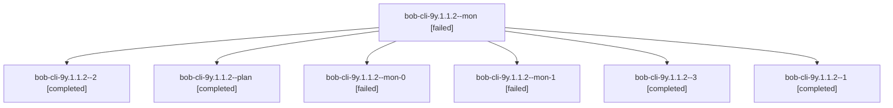

# Session: bob-cli-9y.1.1.2

[Agent Hoods](../README.md) / [bbugyi200](../users/bbugyi200/README.md) / [athena](../users/bbugyi200/machines/athena/README.md) / [bob-cli-9y](../users/bbugyi200/machines/athena/hoods/bob-cli-9y/README.md) / bob-cli-9y.1.1.2

Owner: `bbugyi200.athena` · Hood: `bob-cli-9y` · Members: 7 · Bead: [bob-cli-9y.1.1.2](https://github.com/bobs-org/bob-cli--beads/blob/main/pages/bob-cli-9y/bob-cli-9y.1.1.2.md)

## Lineage

The diagram is an optional enhancement; the ordered table below contains the same lineage in accessible text.

| Role | Agent | State | Model / provider | Timing | Commits | Prompt | Chat |
|---|---|---|---|---|---:|---|---|
| mon | bob-cli-9y.1.1.2--mon | failed | gpt-6-luna / codex | 2026-10-19T21:39:25.641024+00:00 → 2026-10-19T21:43:13.124914+00:00 | 0 | — | [Chat](../agents/bbugyi200.athena.bob-cli-9y.1.1.2--mon/chat.md) |
| 2 | bob-cli-9y.1.1.2--2 | completed | gpt-6-luna / codex | 2026-10-19T21:59:59.791866+00:00 → 2026-10-19T22:09:04.354047+00:00 | 0 | [Prompt](../agents/bbugyi200.athena.bob-cli-9y.1.1.2--2/prompt.md) | [Chat](../agents/bbugyi200.athena.bob-cli-9y.1.1.2--2/chat.md) |
| plan | bob-cli-9y.1.1.2--plan | completed | gpt-6-luna / codex | 2026-10-19T21:14:06.943086+00:00 → 2026-10-19T21:40:58.191037+00:00 | 0 | [Prompt](../agents/bbugyi200.athena.bob-cli-9y.1.1.2--plan/prompt.md) | [Chat](../agents/bbugyi200.athena.bob-cli-9y.1.1.2--plan/chat.md) |
| mon-0 | bob-cli-9y.1.1.2--mon-0 | failed | gpt-6-luna / codex | 2026-10-19T21:51:15.622796+00:00 → 2026-10-19T21:59:13.976590+00:00 | 0 | — | [Chat](../agents/bbugyi200.athena.bob-cli-9y.1.1.2--mon-0/chat.md) |
| mon-1 | bob-cli-9y.1.1.2--mon-1 | failed | gpt-6-luna / codex | 2026-10-19T22:08:24.450986+00:00 → 2026-10-19T22:12:42.080642+00:00 | 0 | — | [Chat](../agents/bbugyi200.athena.bob-cli-9y.1.1.2--mon-1/chat.md) |
| 3 | bob-cli-9y.1.1.2--3 | completed | gpt-6-luna / codex | 2026-10-19T22:13:24.656535+00:00 → 2026-10-19T22:19:01.158008+00:00 | [1](../agents/bbugyi200.athena.bob-cli-9y.1.1.2--3/README.md#commits) | [Prompt](../agents/bbugyi200.athena.bob-cli-9y.1.1.2--3/prompt.md) | [Chat](../agents/bbugyi200.athena.bob-cli-9y.1.1.2--3/chat.md) |
| 1 | bob-cli-9y.1.1.2--1 | completed | gpt-6-luna / codex | 2026-10-19T21:44:03.714866+00:00 → 2026-10-19T21:52:46.875252+00:00 | 0 | [Prompt](../agents/bbugyi200.athena.bob-cli-9y.1.1.2--1/prompt.md) | [Chat](../agents/bbugyi200.athena.bob-cli-9y.1.1.2--1/chat.md) |

## Commits

| Role | Repo | Commit | Subject | Committed |
|---|---|---|---|---|
| 3 | bob-cli | [`8b0f378`](https://github.com/bobs-org/bob-cli/commit/8b0f3782b0eeb994adce908f78876ea943cd9bdc) | feat(task-move): expose guarded task move command | 2026-10-19 18:17:11 EDT |

## Neighbors

| Agent | Relation | State |
|---|---|---|
| [bob-cli-9y.1](bbugyi200.athena.bob-cli-9y.1.md) (session · 3) | ancestor | failed 3 |
| [bob-cli-9y.1.1.1](../agents/bbugyi200.athena.bob-cli-9y.1.1.1/README.md) | bob-cli-9y.1.1 hood | completed |
| [bob-cli-9y.1.1.land](bbugyi200.athena.bob-cli-9y.1.1.land.md) (session · 3) | bob-cli-9y.1.1 hood | active 2, failed 1 |
| [bob-cli-9y.2](../agents/bbugyi200.athena.bob-cli-9y.2/README.md) | bob-cli-9y hood | completed |
| [bob-cli-9y.3](../agents/bbugyi200.athena.bob-cli-9y.3/README.md) | bob-cli-9y hood | waiting |
| [bob-cli-9y.land](../agents/bbugyi200.athena.bob-cli-9y.land/README.md) | bob-cli-9y hood | waiting |
