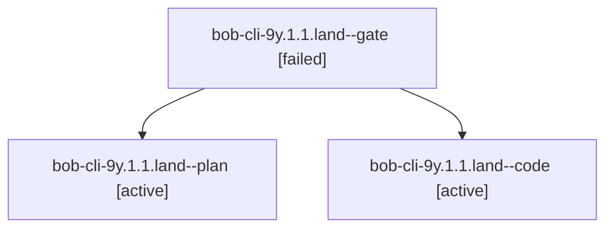

# Session: bob-cli-9y.1.1.land

[Agent Hoods](../README.md) / [bbugyi200](../users/bbugyi200/README.md) / [athena](../users/bbugyi200/machines/athena/README.md) / [bob-cli-9y](../users/bbugyi200/machines/athena/hoods/bob-cli-9y/README.md) / bob-cli-9y.1.1.land

Owner: `bbugyi200.athena` · Hood: `bob-cli-9y` · Members: 3 · Bead: [bob-cli-9y.1.1](https://github.com/bobs-org/bob-cli--beads/blob/main/pages/bob-cli-9y/bob-cli-9y.1.1.md)

## Lineage

The diagram is an optional enhancement; the ordered table below contains the same lineage in accessible text.

| Role | Agent | State | Model / provider | Timing | Commits | Prompt | Chat |
|---|---|---|---|---|---:|---|---|
| gate | bob-cli-9y.1.1.land--gate | failed | gpt-6-astra / codex | 2026-10-19T22:31:32.171740+00:00 → 2026-10-19T22:32:39.526537+00:00 | 0 | — | [Chat](../agents/bbugyi200.athena.bob-cli-9y.1.1.land--gate/chat.md) |
| plan | bob-cli-9y.1.1.land--plan | active | gpt-6-astra / codex | 2026-10-19T22:19:41.563102+00:00 | 0 | [Prompt](../agents/bbugyi200.athena.bob-cli-9y.1.1.land--plan/prompt.md) | [Chat](../agents/bbugyi200.athena.bob-cli-9y.1.1.land--plan/chat.md) |
| code | bob-cli-9y.1.1.land--code | active | grok-4.6 / grok | 2026-10-19T22:34:12.553990+00:00 | 0 | — | — |

## Neighbors

| Agent | Relation | State |
|---|---|---|
| [bob-cli-9y.1](bbugyi200.athena.bob-cli-9y.1.md) (session · 3) | ancestor | failed 3 |
| [bob-cli-9y.1.1.1](../agents/bbugyi200.athena.bob-cli-9y.1.1.1/README.md) | bob-cli-9y.1.1 hood | completed |
| [bob-cli-9y.1.1.2](bbugyi200.athena.bob-cli-9y.1.1.2.md) (session · 7) | bob-cli-9y.1.1 hood | completed 4, failed 3 |
| [bob-cli-9y.2](../agents/bbugyi200.athena.bob-cli-9y.2/README.md) | bob-cli-9y hood | completed |
| [bob-cli-9y.3](../agents/bbugyi200.athena.bob-cli-9y.3/README.md) | bob-cli-9y hood | waiting |
| [bob-cli-9y.land](../agents/bbugyi200.athena.bob-cli-9y.land/README.md) | bob-cli-9y hood | waiting |
