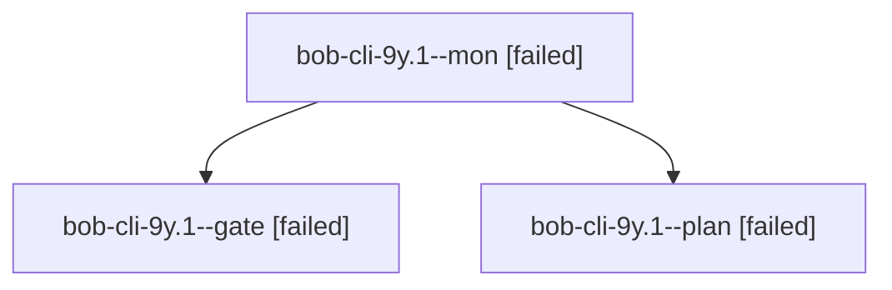

# Session: bob-cli-9y.1

[Agent Hoods](../README.md) / [bbugyi200](../users/bbugyi200/README.md) / [athena](../users/bbugyi200/machines/athena/README.md) / [bob-cli-9y](../users/bbugyi200/machines/athena/hoods/bob-cli-9y/README.md) / bob-cli-9y.1

Owner: `bbugyi200.athena` · Hood: `bob-cli-9y` · Members: 3 · Bead: [bob-cli-9y.1](https://github.com/bobs-org/bob-cli--beads/blob/main/pages/bob-cli-9y/bob-cli-9y.1.md)

## Lineage

The diagram is an optional enhancement; the ordered table below contains the same lineage in accessible text.

| Role | Agent | State | Model / provider | Timing | Commits | Prompt | Chat |
|---|---|---|---|---|---:|---|---|
| mon | bob-cli-9y.1--mon | failed | gpt-6-astra / codex | 2026-10-19T20:37:56.235760+00:00 → 2026-10-19T20:40:01.143520+00:00 | 0 | — | [Chat](../agents/bbugyi200.athena.bob-cli-9y.1--mon/chat.md) |
| gate | bob-cli-9y.1--gate | failed | gpt-6-astra / codex | 2026-10-19T20:37:28.026433+00:00 → 2026-10-19T20:37:56.792538+00:00 | 0 | — | [Chat](../agents/bbugyi200.athena.bob-cli-9y.1--gate/chat.md) |
| plan | bob-cli-9y.1--plan | failed | gpt-6-astra / codex | 2026-10-19T20:29:04.268217+00:00 → 2026-10-19T20:38:06.613986+00:00 | 0 | [Prompt](../agents/bbugyi200.athena.bob-cli-9y.1--plan/prompt.md) | [Chat](../agents/bbugyi200.athena.bob-cli-9y.1--plan/chat.md) |

## Neighbors

| Agent | Relation | State |
|---|---|---|
| [bob-cli-9y.1.1.1](../agents/bbugyi200.athena.bob-cli-9y.1.1.1/README.md) | descendant | completed |
| [bob-cli-9y.1.1.2](bbugyi200.athena.bob-cli-9y.1.1.2.md) (session · 7) | descendant | completed 4, failed 3 |
| [bob-cli-9y.1.1.land](bbugyi200.athena.bob-cli-9y.1.1.land.md) (session · 3) | descendant | active 2, failed 1 |
| [bob-cli-9y.2](../agents/bbugyi200.athena.bob-cli-9y.2/README.md) | bob-cli-9y hood | completed |
| [bob-cli-9y.3](../agents/bbugyi200.athena.bob-cli-9y.3/README.md) | bob-cli-9y hood | waiting |
| [bob-cli-9y.land](../agents/bbugyi200.athena.bob-cli-9y.land/README.md) | bob-cli-9y hood | waiting |
