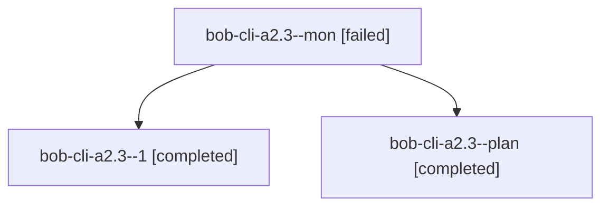

# Session: bob-cli-a2.3

[Agent Hoods](../README.md) / [bbugyi200](../users/bbugyi200/README.md) / [athena](../users/bbugyi200/machines/athena/README.md) / [bob-cli-a2](../users/bbugyi200/machines/athena/hoods/bob-cli-a2/README.md) / bob-cli-a2.3

Owner: `bbugyi200.athena` · Hood: `bob-cli-a2` · Members: 3 · Bead: [bob-cli-a2.3](https://github.com/bobs-org/bob-cli--beads/blob/main/pages/bob-cli-a2/bob-cli-a2.3.md)

## Lineage

The diagram is an optional enhancement; the ordered table below contains the same lineage in accessible text.

| Role | Agent | State | Model / provider | Timing | Commits | Prompt | Chat |
|---|---|---|---|---|---:|---|---|
| mon | bob-cli-a2.3--mon | failed | gpt-6-luna / codex | 2026-10-20T13:48:05.561516+00:00 → 2026-10-20T13:50:28.397283+00:00 | 0 | — | [Chat](../agents/bbugyi200.athena.bob-cli-a2.3--mon/chat.md) |
| 1 | bob-cli-a2.3--1 | completed | gpt-6-luna / codex | 2026-10-20T13:51:16.064293+00:00 → 2026-10-20T14:20:34.287016+00:00 | [1](../agents/bbugyi200.athena.bob-cli-a2.3--1/README.md#commits) | [Prompt](../agents/bbugyi200.athena.bob-cli-a2.3--1/prompt.md) | [Chat](../agents/bbugyi200.athena.bob-cli-a2.3--1/chat.md) |
| plan | bob-cli-a2.3--plan | completed | gpt-6-luna / codex | 2026-10-20T13:26:35.707487+00:00 → 2026-10-20T13:49:00.414886+00:00 | 0 | [Prompt](../agents/bbugyi200.athena.bob-cli-a2.3--plan/prompt.md) | [Chat](../agents/bbugyi200.athena.bob-cli-a2.3--plan/chat.md) |

## Commits

| Role | Repo | Commit | Subject | Committed |
|---|---|---|---|---|
| 1 | bob-cli | [`b88a70e`](https://github.com/bobs-org/bob-cli/commit/b88a70e6dcbe80bd129bf83651d343736a254d33) | feat(glossary): add task relation terminology | 2026-10-20 10:02:57 EDT |

## Neighbors

| Agent | Relation | State |
|---|---|---|
| [bob-cli-a2.1](../agents/bbugyi200.athena.bob-cli-a2.1/README.md) | bob-cli-a2 hood | completed |
| [bob-cli-a2.10](../agents/bbugyi200.athena.bob-cli-a2.10/README.md) | bob-cli-a2 hood | waiting |
| [bob-cli-a2.11](../agents/bbugyi200.athena.bob-cli-a2.11/README.md) | bob-cli-a2 hood | waiting |
| [bob-cli-a2.12](../agents/bbugyi200.athena.bob-cli-a2.12/README.md) | bob-cli-a2 hood | waiting |
| [bob-cli-a2.13](../agents/bbugyi200.athena.bob-cli-a2.13/README.md) | bob-cli-a2 hood | waiting |
| [bob-cli-a2.14](../agents/bbugyi200.athena.bob-cli-a2.14/README.md) | bob-cli-a2 hood | waiting |
| [bob-cli-a2.15](../agents/bbugyi200.athena.bob-cli-a2.15/README.md) | bob-cli-a2 hood | waiting |
| [bob-cli-a2.2](../agents/bbugyi200.athena.bob-cli-a2.2/README.md) | bob-cli-a2 hood | completed |
| [bob-cli-a2.4](../agents/bbugyi200.athena.bob-cli-a2.4/README.md) | bob-cli-a2 hood | active |
| [bob-cli-a2.5](../agents/bbugyi200.athena.bob-cli-a2.5/README.md) | bob-cli-a2 hood | active |
| [bob-cli-a2.6](../agents/bbugyi200.athena.bob-cli-a2.6/README.md) | bob-cli-a2 hood | waiting |
| [bob-cli-a2.7](../agents/bbugyi200.athena.bob-cli-a2.7/README.md) | bob-cli-a2 hood | waiting |
| [bob-cli-a2.8](../agents/bbugyi200.athena.bob-cli-a2.8/README.md) | bob-cli-a2 hood | active |
| [bob-cli-a2.9](../agents/bbugyi200.athena.bob-cli-a2.9/README.md) | bob-cli-a2 hood | active |
| [bob-cli-a2.land](../agents/bbugyi200.athena.bob-cli-a2.land/README.md) | bob-cli-a2 hood | waiting |
