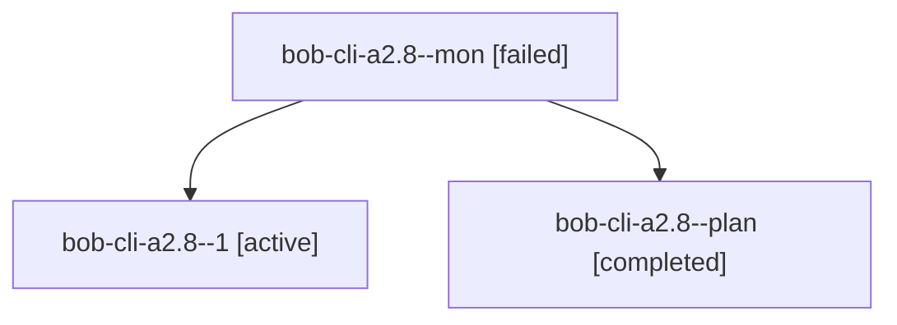

# Session: bob-cli-a2.8

[Agent Hoods](../README.md) / [bbugyi200](../users/bbugyi200/README.md) / [athena](../users/bbugyi200/machines/athena/README.md) / [bob-cli-a2](../users/bbugyi200/machines/athena/hoods/bob-cli-a2/README.md) / bob-cli-a2.8

Owner: `bbugyi200.athena` · Hood: `bob-cli-a2` · Members: 3 · Bead: [bob-cli-a2.8](https://github.com/bobs-org/bob-cli--beads/blob/main/pages/bob-cli-a2/bob-cli-a2.8.md)

## Lineage

The diagram is an optional enhancement; the ordered table below contains the same lineage in accessible text.

| Role | Agent | State | Model / provider | Timing | Commits | Prompt | Chat |
|---|---|---|---|---|---:|---|---|
| mon | bob-cli-a2.8--mon | failed | gpt-6-luna / codex | 2026-10-20T14:41:54.332834+00:00 → 2026-10-20T14:43:35.282056+00:00 | 0 | — | [Chat](../agents/bbugyi200.athena.bob-cli-a2.8--mon/chat.md) |
| 1 | bob-cli-a2.8--1 | active | gpt-6-luna / codex | 2026-10-20T14:44:39.189945+00:00 | 0 | [Prompt](../agents/bbugyi200.athena.bob-cli-a2.8--1/prompt.md) | — |
| plan | bob-cli-a2.8--plan | completed | gpt-6-luna / codex | 2026-10-20T14:21:25.654122+00:00 → 2026-10-20T14:42:27.453020+00:00 | 0 | [Prompt](../agents/bbugyi200.athena.bob-cli-a2.8--plan/prompt.md) | [Chat](../agents/bbugyi200.athena.bob-cli-a2.8--plan/chat.md) |

## Neighbors

| Agent | Relation | State |
|---|---|---|
| [bob-cli-a2.1](../agents/bbugyi200.athena.bob-cli-a2.1/README.md) | bob-cli-a2 hood | completed |
| [bob-cli-a2.10](../agents/bbugyi200.athena.bob-cli-a2.10/README.md) | bob-cli-a2 hood | waiting |
| [bob-cli-a2.11](../agents/bbugyi200.athena.bob-cli-a2.11/README.md) | bob-cli-a2 hood | waiting |
| [bob-cli-a2.12](../agents/bbugyi200.athena.bob-cli-a2.12/README.md) | bob-cli-a2 hood | waiting |
| [bob-cli-a2.13](../agents/bbugyi200.athena.bob-cli-a2.13/README.md) | bob-cli-a2 hood | waiting |
| [bob-cli-a2.14](../agents/bbugyi200.athena.bob-cli-a2.14/README.md) | bob-cli-a2 hood | waiting |
| [bob-cli-a2.15](../agents/bbugyi200.athena.bob-cli-a2.15/README.md) | bob-cli-a2 hood | waiting |
| [bob-cli-a2.2](../agents/bbugyi200.athena.bob-cli-a2.2/README.md) | bob-cli-a2 hood | completed |
| [bob-cli-a2.3](bbugyi200.athena.bob-cli-a2.3.md) (session · 3) | bob-cli-a2 hood | completed 2, failed 1 |
| [bob-cli-a2.4](../agents/bbugyi200.athena.bob-cli-a2.4/README.md) | bob-cli-a2 hood | completed |
| [bob-cli-a2.5](../agents/bbugyi200.athena.bob-cli-a2.5/README.md) | bob-cli-a2 hood | completed |
| [bob-cli-a2.6](../agents/bbugyi200.athena.bob-cli-a2.6/README.md) | bob-cli-a2 hood | active |
| [bob-cli-a2.7](../agents/bbugyi200.athena.bob-cli-a2.7/README.md) | bob-cli-a2 hood | active |
| [bob-cli-a2.9](../agents/bbugyi200.athena.bob-cli-a2.9/README.md) | bob-cli-a2 hood | completed |
| [bob-cli-a2.land](../agents/bbugyi200.athena.bob-cli-a2.land/README.md) | bob-cli-a2 hood | waiting |
