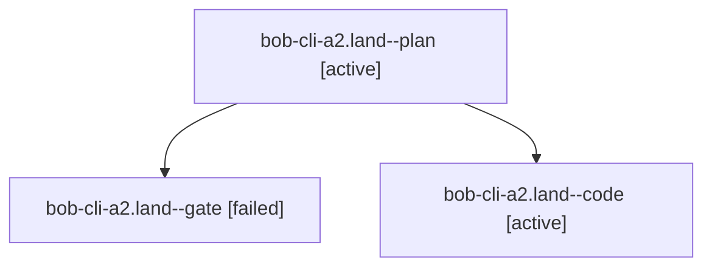

# Session: bob-cli-a2.land

[Agent Hoods](../README.md) / [bbugyi200](../users/bbugyi200/README.md) / [athena](../users/bbugyi200/machines/athena/README.md) / [bob-cli-a2](../users/bbugyi200/machines/athena/hoods/bob-cli-a2/README.md) / bob-cli-a2.land

Owner: `bbugyi200.athena` · Hood: `bob-cli-a2` · Members: 3 · Bead: [bob-cli-a2](https://github.com/bobs-org/bob-cli--beads/blob/main/pages/bob-cli-a2/README.md)

## Lineage



The diagram is an optional enhancement; the ordered table below contains the same lineage in accessible text.

| Role | Agent | State | Model / provider | Timing | Commits | Prompt | Chat |
|---|---|---|---|---|---:|---|---|
| <a id="member-plan"></a>plan | bob-cli-a2.land--plan | active | opus / claude | 2026-10-20T17:19:46.908325+00:00 | 0 | [Prompt](../agents/bbugyi200.athena.bob-cli-a2.land--plan/prompt.md) | [Chat](../agents/bbugyi200.athena.bob-cli-a2.land--plan/chat.md) |
| <a id="member-gate"></a>gate | bob-cli-a2.land--gate | failed | opus / claude | 2026-10-20T17:58:06.285584+00:00 → 2026-10-20T17:59:30.913297+00:00 | 0 | — | [Chat](../agents/bbugyi200.athena.bob-cli-a2.land--gate/chat.md) |
| <a id="member-code"></a>code | bob-cli-a2.land--code | active | muse-spark-1.3-contributor / muse | 2026-10-20T17:59:43.330525+00:00 | [1](../agents/bbugyi200.athena.bob-cli-a2.land--code/README.md#commits) | — | — |

## Commits

| Role | Repo | Commit | Subject | Committed |
|---|---|---|---|---|
| code | bob-cli | [`4907f00`](https://github.com/bobs-org/bob-cli/commit/4907f00ddd02635fe4f6698efcae21eb17b8554a) | docs(capture): quote multi-word relation labels and fix capture-parse help | 2026-10-20 14:18:59 EDT |

## Variables

| Role | Variable | Value |
|---|---|---|
| plan | `artifacts` | \[{bead: bob-cli-a2, kind: file, label: Recovered bob-cli-a2.14 bob-mac-capture diff (lost commit e128340) against 7a41234, path: /home/bryan/.sase/artifacts/agents/gh\_bobs-org\_\_bob-cli/20261020091055… |

#### artifacts

**Role:** `plan`

```yaml
- bead: bob-cli-a2
  kind: file
  label: Recovered bob-cli-a2.14 bob-mac-capture diff (lost commit e128340) against 7a41234
  path: /home/bryan/.sase/artifacts/agents/gh_bobs-org__bob-cli/20261020091055/a2.14-recovered-e128340-2b463e3762d1.diff
  ref: file:explicit:decdc28e609c23a140df59b5
  source_path: /tmp/a2land-recover/a2.14-recovered-e128340.diff
- bead: bob-cli-a2
  kind: file
  label: a2.14 recovery provenance: replay.py, gen-fixtures.sh, and the 60 muse edit patches
  path: /home/bryan/.sase/artifacts/agents/gh_bobs-org__bob-cli/20261020091055/a2.14-recovery-provenance.tar-1697b8d488e9.gz
  ref: file:explicit:ec5a23c2ae683a0b47c1c3dc
  source_path: /tmp/a2land-recover/a2.14-recovery-provenance.tar.gz
```

Values are truncated for display; see each member's agent meta.json for the full values.

## Neighbors

| Agent | Relation | State |
|---|---|---|
| [bob-cli-a2.1](../agents/bbugyi200.athena.bob-cli-a2.1/README.md) | bob-cli-a2 hood | completed |
| [bob-cli-a2.10](../agents/bbugyi200.athena.bob-cli-a2.10/README.md) | bob-cli-a2 hood | completed |
| [bob-cli-a2.11](../agents/bbugyi200.athena.bob-cli-a2.11/README.md) | bob-cli-a2 hood | completed |
| [bob-cli-a2.12](../agents/bbugyi200.athena.bob-cli-a2.12/README.md) | bob-cli-a2 hood | completed |
| [bob-cli-a2.13](../agents/bbugyi200.athena.bob-cli-a2.13/README.md) | bob-cli-a2 hood | completed |
| [bob-cli-a2.14](../agents/bbugyi200.athena.bob-cli-a2.14/README.md) | bob-cli-a2 hood | completed |
| [bob-cli-a2.15](../agents/bbugyi200.athena.bob-cli-a2.15/README.md) | bob-cli-a2 hood | completed |
| [bob-cli-a2.2](../agents/bbugyi200.athena.bob-cli-a2.2/README.md) | bob-cli-a2 hood | completed |
| [bob-cli-a2.3](bbugyi200.athena.bob-cli-a2.3.md) (session · 3) | bob-cli-a2 hood | completed 2, failed 1 |
| [bob-cli-a2.4](../agents/bbugyi200.athena.bob-cli-a2.4/README.md) | bob-cli-a2 hood | completed |
| [bob-cli-a2.5](../agents/bbugyi200.athena.bob-cli-a2.5/README.md) | bob-cli-a2 hood | completed |
| [bob-cli-a2.6](../agents/bbugyi200.athena.bob-cli-a2.6/README.md) | bob-cli-a2 hood | completed |
| [bob-cli-a2.7](../agents/bbugyi200.athena.bob-cli-a2.7/README.md) | bob-cli-a2 hood | completed |
| [bob-cli-a2.8](bbugyi200.athena.bob-cli-a2.8.md) (session · 3) | bob-cli-a2 hood | completed 2, failed 1 |
| [bob-cli-a2.9](../agents/bbugyi200.athena.bob-cli-a2.9/README.md) | bob-cli-a2 hood | completed |
