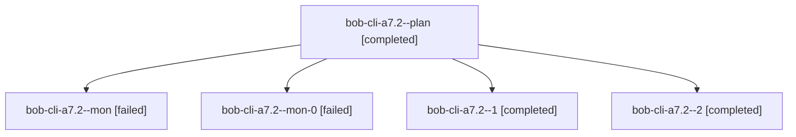

# Session: bob-cli-a7.2

[Agent Hoods](../README.md) / [bbugyi200](../users/bbugyi200/README.md) / [athena](../users/bbugyi200/machines/athena/README.md) / [bob-cli-a7](../users/bbugyi200/machines/athena/hoods/bob-cli-a7/README.md) / bob-cli-a7.2

Owner: `bbugyi200.athena` · Hood: `bob-cli-a7` · Members: 5 · Bead: [bob-cli-a7.2](https://github.com/bobs-org/bob-cli--beads/blob/main/pages/bob-cli-a7/bob-cli-a7.2.md)

## Lineage

The diagram is an optional enhancement; the ordered table below contains the same lineage in accessible text.

| Role | Agent | State | Model / provider | Timing | Commits | Prompt | Chat |
|---|---|---|---|---|---:|---|---|
| plan | bob-cli-a7.2--plan | completed | gpt-6-luna / codex | 2026-10-20T20:13:39.917662+00:00 → 2026-10-20T20:34:32.980484+00:00 | 0 | [Prompt](../agents/bbugyi200.athena.bob-cli-a7.2--plan/prompt.md) | [Chat](../agents/bbugyi200.athena.bob-cli-a7.2--plan/chat.md) |
| mon | bob-cli-a7.2--mon | failed | gpt-6-luna / codex | 2026-10-20T20:33:09.078484+00:00 → 2026-10-20T20:38:25.954541+00:00 | 0 | — | [Chat](../agents/bbugyi200.athena.bob-cli-a7.2--mon/chat.md) |
| mon-0 | bob-cli-a7.2--mon-0 | failed | gpt-6-luna / codex | 2026-10-20T20:47:02.619589+00:00 → 2026-10-20T20:52:37.493458+00:00 | 0 | — | [Chat](../agents/bbugyi200.athena.bob-cli-a7.2--mon-0/chat.md) |
| 1 | bob-cli-a7.2--1 | completed | gpt-6-luna / codex | 2026-10-20T20:39:23.195022+00:00 → 2026-10-20T20:47:49.210818+00:00 | 0 | [Prompt](../agents/bbugyi200.athena.bob-cli-a7.2--1/prompt.md) | [Chat](../agents/bbugyi200.athena.bob-cli-a7.2--1/chat.md) |
| 2 | bob-cli-a7.2--2 | completed | gpt-6-luna / codex | 2026-10-20T20:53:41.336275+00:00 → 2026-10-20T21:00:30.804818+00:00 | [1](../agents/bbugyi200.athena.bob-cli-a7.2--2/README.md#commits) | [Prompt](../agents/bbugyi200.athena.bob-cli-a7.2--2/prompt.md) | [Chat](../agents/bbugyi200.athena.bob-cli-a7.2--2/chat.md) |

## Commits

| Role | Repo | Commit | Subject | Committed |
|---|---|---|---|---|
| 2 | bob-cli | [`c300239`](https://github.com/bobs-org/bob-cli/commit/c300239ca3101aeac774664a64dee8f433ea4f00) | feat(capture): support bare Pomodoro names in links | 2026-10-20 16:58:30 EDT |

## Neighbors

| Agent | Relation | State |
|---|---|---|
| [bob-cli-a7.1](../agents/bbugyi200.athena.bob-cli-a7.1/README.md) | bob-cli-a7 hood | completed |
| [bob-cli-a7.3](../agents/bbugyi200.athena.bob-cli-a7.3/README.md) | bob-cli-a7 hood | active |
| [bob-cli-a7.land](../agents/bbugyi200.athena.bob-cli-a7.land/README.md) | bob-cli-a7 hood | waiting |
