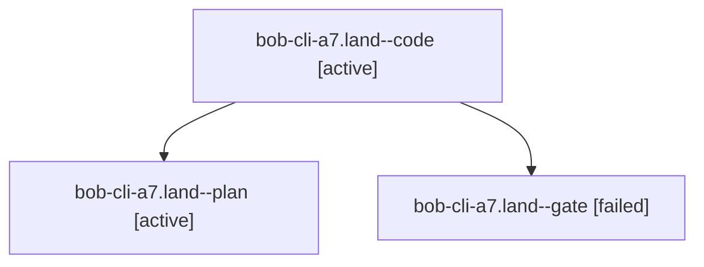

# Session: bob-cli-a7.land

[Agent Hoods](../README.md) / [bbugyi200](../users/bbugyi200/README.md) / [athena](../users/bbugyi200/machines/athena/README.md) / [bob-cli-a7](../users/bbugyi200/machines/athena/hoods/bob-cli-a7/README.md) / bob-cli-a7.land

Owner: `bbugyi200.athena` · Hood: `bob-cli-a7` · Members: 3 · Bead: [bob-cli-a7](https://github.com/bobs-org/bob-cli--beads/blob/main/pages/bob-cli-a7/README.md)

## Lineage

The diagram is an optional enhancement; the ordered table below contains the same lineage in accessible text.

| Role | Agent | State | Model / provider | Timing | Commits | Prompt | Chat |
|---|---|---|---|---|---:|---|---|
| code | bob-cli-a7.land--code | active | muse-spark-1.3-contributor / muse | 2026-10-20T21:38:25.802566+00:00 | [1](../agents/bbugyi200.athena.bob-cli-a7.land--code/README.md#commits) | — | — |
| plan | bob-cli-a7.land--plan | active | gpt-6-astra / codex | 2026-10-20T21:25:28.634301+00:00 | 0 | [Prompt](../agents/bbugyi200.athena.bob-cli-a7.land--plan/prompt.md) | [Chat](../agents/bbugyi200.athena.bob-cli-a7.land--plan/chat.md) |
| gate | bob-cli-a7.land--gate | failed | gpt-6-astra / codex | 2026-10-20T21:37:11.308320+00:00 → 2026-10-20T21:38:14.777456+00:00 | 0 | — | [Chat](../agents/bbugyi200.athena.bob-cli-a7.land--gate/chat.md) |

## Commits

| Role | Repo | Commit | Subject | Committed |
|---|---|---|---|---|
| code | bob-cli | [`7a7c1bc`](https://github.com/bobs-org/bob-cli/commit/7a7c1bca60135fbf3c78696b3dd296f481f3c3b7) | feat(capture): finish bare Pomodoro link suffix validation and landing | 2026-10-20 18:10:05 EDT |

## Neighbors

| Agent | Relation | State |
|---|---|---|
| [bob-cli-a7.1](../agents/bbugyi200.athena.bob-cli-a7.1/README.md) | bob-cli-a7 hood | completed |
| [bob-cli-a7.2](bbugyi200.athena.bob-cli-a7.2.md) (session · 5) | bob-cli-a7 hood | completed 3, failed 2 |
| [bob-cli-a7.3](../agents/bbugyi200.athena.bob-cli-a7.3/README.md) | bob-cli-a7 hood | completed |
