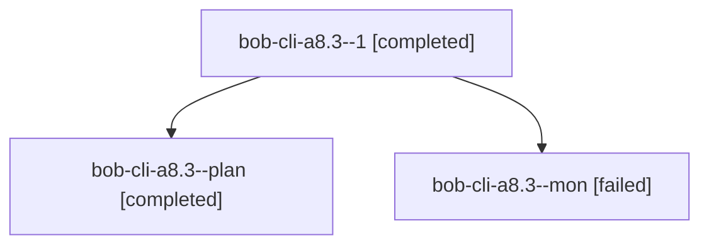

# Session: bob-cli-a8.3

[Agent Hoods](../README.md) / [bbugyi200](../users/bbugyi200/README.md) / [athena](../users/bbugyi200/machines/athena/README.md) / [bob-cli-a8](../users/bbugyi200/machines/athena/hoods/bob-cli-a8/README.md) / bob-cli-a8.3

Owner: `bbugyi200.athena` · Hood: `bob-cli-a8` · Members: 3 · Bead: [bob-cli-a8.3](https://github.com/bobs-org/bob-cli--beads/blob/main/pages/bob-cli-a8/bob-cli-a8.3.md)

## Lineage

The diagram is an optional enhancement; the ordered table below contains the same lineage in accessible text.

| Role | Agent | State | Model / provider | Timing | Commits | Prompt | Chat |
|---|---|---|---|---|---:|---|---|
| 1 | bob-cli-a8.3--1 | completed | gpt-6-luna / codex | 2026-10-20T22:29:27.943361+00:00 → 2026-10-20T22:37:30.817469+00:00 | 0 | [Prompt](../agents/bbugyi200.athena.bob-cli-a8.3--1/prompt.md) | [Chat](../agents/bbugyi200.athena.bob-cli-a8.3--1/chat.md) |
| plan | bob-cli-a8.3--plan | completed | gpt-6-luna / codex | 2026-10-20T22:09:09.492600+00:00 → 2026-10-20T22:23:17.860003+00:00 | 0 | [Prompt](../agents/bbugyi200.athena.bob-cli-a8.3--plan/prompt.md) | [Chat](../agents/bbugyi200.athena.bob-cli-a8.3--plan/chat.md) |
| mon | bob-cli-a8.3--mon | failed | gpt-6-luna / codex | 2026-10-20T22:22:02.906131+00:00 → 2026-10-20T22:27:24.593494+00:00 | 0 | — | [Chat](../agents/bbugyi200.athena.bob-cli-a8.3--mon/chat.md) |

## Neighbors

| Agent | Relation | State |
|---|---|---|
| [bob-cli-a8.1](../agents/bbugyi200.athena.bob-cli-a8.1/README.md) | bob-cli-a8 hood | completed |
| [bob-cli-a8.2](../agents/bbugyi200.athena.bob-cli-a8.2/README.md) | bob-cli-a8 hood | active |
| [bob-cli-a8.land](../agents/bbugyi200.athena.bob-cli-a8.land/README.md) | bob-cli-a8 hood | waiting |
