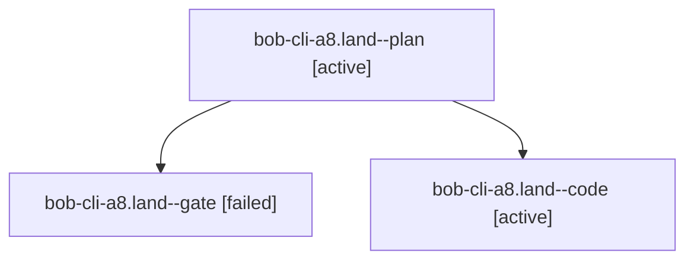

# Session: bob-cli-a8.land

[Agent Hoods](../README.md) / [bbugyi200](../users/bbugyi200/README.md) / [athena](../users/bbugyi200/machines/athena/README.md) / [bob-cli-a8](../users/bbugyi200/machines/athena/hoods/bob-cli-a8/README.md) / bob-cli-a8.land

Owner: `bbugyi200.athena` · Hood: `bob-cli-a8` · Members: 3 · Bead: [bob-cli-a8](https://github.com/bobs-org/bob-cli--beads/blob/main/pages/bob-cli-a8/README.md)

## Lineage



The diagram is an optional enhancement; the ordered table below contains the same lineage in accessible text.

| Role | Agent | State | Model / provider | Timing | Commits | Prompt | Chat |
|---|---|---|---|---|---:|---|---|
| <a id="member-plan"></a>plan | bob-cli-a8.land--plan | active | gpt-6-astra / codex | 2026-10-20T22:55:10.098485+00:00 | 0 | [Prompt](../agents/bbugyi200.athena.bob-cli-a8.land--plan/prompt.md) | [Chat](../agents/bbugyi200.athena.bob-cli-a8.land--plan/chat.md) |
| <a id="member-gate"></a>gate | bob-cli-a8.land--gate | failed | gpt-6-astra / codex | 2026-10-20T23:11:32.821448+00:00 → 2026-10-20T23:12:46.158749+00:00 | 0 | — | [Chat](../agents/bbugyi200.athena.bob-cli-a8.land--gate/chat.md) |
| <a id="member-code"></a>code | bob-cli-a8.land--code | active | muse-spark-1.3-contributor / muse | 2026-10-20T23:13:09.477560+00:00 | 0 | — | — |

## Variables

| Role | Variable | Value |
|---|---|---|
| code | `artifacts` | \[{bead: bob-cli-a8, kind: markdown, label: bob-cli-a8 closeout evidence, path: /home/bryan/.sase/artifacts/agents/gh\_bobs-org\_\_bob-cli/20261020191309/a8-closeout-evidence-232913013f58.md, ref: file:e… |
| plan | `artifacts` | \[{bead: bob-cli-a8, kind: file, label: bob-cli-a8 landing CI baseline and verification evidence, path: /home/bryan/.sase/artifacts/agents/gh\_bobs-org\_\_bob-cli/20261020173920/bob-a8-landing-evidence-0… |

#### artifacts

**Role:** `code`

```yaml
- bead: bob-cli-a8
  kind: markdown
  label: bob-cli-a8 closeout evidence
  path: /home/bryan/.sase/artifacts/agents/gh_bobs-org__bob-cli/20261020191309/a8-closeout-evidence-232913013f58.md
  ref: file:explicit:6e8d6331b082d9387b7f142e
  source_path: /tmp/a8-closeout-evidence.md
```

#### artifacts

**Role:** `plan`

```yaml
- bead: bob-cli-a8
  kind: file
  label: bob-cli-a8 landing CI baseline and verification evidence
  path: /home/bryan/.sase/artifacts/agents/gh_bobs-org__bob-cli/20261020173920/bob-a8-landing-evidence-0d623143e923.txt
  ref: file:explicit:78b480232df324bc6ff25313
  source_path: /tmp/bob-a8-landing-evidence.txt
```

Values are truncated for display; see each member's agent meta.json for the full values.

## Neighbors

| Agent | Relation | State |
|---|---|---|
| [bob-cli-a8.1](../agents/bbugyi200.athena.bob-cli-a8.1/README.md) | bob-cli-a8 hood | completed |
| [bob-cli-a8.2](../agents/bbugyi200.athena.bob-cli-a8.2/README.md) | bob-cli-a8 hood | completed |
| [bob-cli-a8.3](bbugyi200.athena.bob-cli-a8.3.md) (session · 3) | bob-cli-a8 hood | completed 2, failed 1 |
