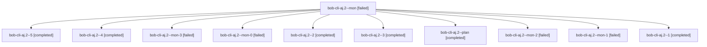

# Session: bob-cli-aj.2

[Agent Hoods](../README.md) / [bbugyi200](../users/bbugyi200/README.md) / [athena](../users/bbugyi200/machines/athena/README.md) / [bob-cli-aj](../users/bbugyi200/machines/athena/hoods/bob-cli-aj/README.md) / bob-cli-aj.2

Owner: `bbugyi200.athena` · Hood: `bob-cli-aj` · Members: 11 · Bead: [bob-cli-aj.2](https://github.com/bobs-org/bob-cli--beads/blob/main/pages/bob-cli-aj/bob-cli-aj.2.md)

## Lineage

The diagram is an optional enhancement; the ordered table below contains the same lineage in accessible text.

| Role | Agent | State | Model / provider | Timing | Commits | Prompt | Chat |
|---|---|---|---|---|---:|---|---|
| mon | bob-cli-aj.2--mon | failed | gpt-6-luna / codex | 2026-10-21T12:50:30.686977+00:00 → 2026-10-21T12:54:17.441568+00:00 | 0 | — | [Chat](../agents/bbugyi200.athena.bob-cli-aj.2--mon/chat.md) |
| 5 | bob-cli-aj.2--5 | completed | gpt-6-luna / codex | 2026-10-21T13:41:37.546247+00:00 → 2026-10-21T13:48:26.778784+00:00 | 0 | [Prompt](../agents/bbugyi200.athena.bob-cli-aj.2--5/prompt.md) | [Chat](../agents/bbugyi200.athena.bob-cli-aj.2--5/chat.md) |
| 4 | bob-cli-aj.2--4 | completed | gpt-6-luna / codex | 2026-10-21T13:24:06.031820+00:00 → 2026-10-21T13:31:57.742896+00:00 | 0 | [Prompt](../agents/bbugyi200.athena.bob-cli-aj.2--4/prompt.md) | [Chat](../agents/bbugyi200.athena.bob-cli-aj.2--4/chat.md) |
| mon-3 | bob-cli-aj.2--mon-3 | failed | gpt-6-luna / codex | 2026-10-21T13:31:07.126443+00:00 → 2026-10-21T13:40:17.853633+00:00 | 0 | — | [Chat](../agents/bbugyi200.athena.bob-cli-aj.2--mon-3/chat.md) |
| mon-0 | bob-cli-aj.2--mon-0 | failed | gpt-6-luna / codex | 2026-10-21T12:59:43.574588+00:00 → 2026-10-21T13:02:19.858530+00:00 | 0 | — | [Chat](../agents/bbugyi200.athena.bob-cli-aj.2--mon-0/chat.md) |
| 2 | bob-cli-aj.2--2 | completed | gpt-6-luna / codex | 2026-10-21T13:03:18.466395+00:00 → 2026-10-21T13:08:09.848962+00:00 | 0 | [Prompt](../agents/bbugyi200.athena.bob-cli-aj.2--2/prompt.md) | [Chat](../agents/bbugyi200.athena.bob-cli-aj.2--2/chat.md) |
| 3 | bob-cli-aj.2--3 | completed | gpt-6-luna / codex | 2026-10-21T13:15:48.524029+00:00 → 2026-10-21T13:21:52.664844+00:00 | 0 | [Prompt](../agents/bbugyi200.athena.bob-cli-aj.2--3/prompt.md) | [Chat](../agents/bbugyi200.athena.bob-cli-aj.2--3/chat.md) |
| plan | bob-cli-aj.2--plan | completed | gpt-6-luna / codex | 2026-10-21T12:31:51.216204+00:00 → 2026-10-21T12:51:03.680599+00:00 | 0 | [Prompt](../agents/bbugyi200.athena.bob-cli-aj.2--plan/prompt.md) | [Chat](../agents/bbugyi200.athena.bob-cli-aj.2--plan/chat.md) |
| mon-2 | bob-cli-aj.2--mon-2 | failed | gpt-6-luna / codex | 2026-10-21T13:21:16.032623+00:00 → 2026-10-21T13:23:05.325240+00:00 | 0 | — | [Chat](../agents/bbugyi200.athena.bob-cli-aj.2--mon-2/chat.md) |
| mon-1 | bob-cli-aj.2--mon-1 | failed | gpt-6-luna / codex | 2026-10-21T13:07:34.314554+00:00 → 2026-10-21T13:14:30.948135+00:00 | 0 | — | [Chat](../agents/bbugyi200.athena.bob-cli-aj.2--mon-1/chat.md) |
| 1 | bob-cli-aj.2--1 | completed | gpt-6-luna / codex | 2026-10-21T12:54:01.060805+00:00 → 2026-10-21T13:00:20.100983+00:00 | 0 | [Prompt](../agents/bbugyi200.athena.bob-cli-aj.2--1/prompt.md) | [Chat](../agents/bbugyi200.athena.bob-cli-aj.2--1/chat.md) |

## Neighbors

| Agent | Relation | State |
|---|---|---|
| [bob-cli-aj.1](../agents/bbugyi200.athena.bob-cli-aj.1/README.md) | bob-cli-aj hood | completed |
| [bob-cli-aj.land](bbugyi200.athena.bob-cli-aj.land.md) (session · 3) | bob-cli-aj hood | active 2, failed 1 |
