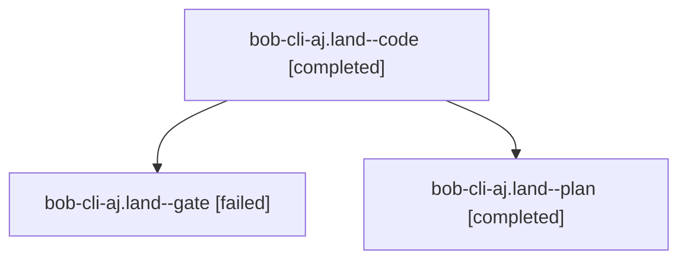

# Session: bob-cli-aj.land

[Agent Hoods](../README.md) / [bbugyi200](../users/bbugyi200/README.md) / [athena](../users/bbugyi200/machines/athena/README.md) / [bob-cli-aj](../users/bbugyi200/machines/athena/hoods/bob-cli-aj/README.md) / bob-cli-aj.land

Owner: `bbugyi200.athena` · Hood: `bob-cli-aj` · Members: 3 · Bead: [bob-cli-aj](https://github.com/bobs-org/bob-cli--beads/blob/main/pages/bob-cli-aj/README.md)

## Lineage



The diagram is an optional enhancement; the ordered table below contains the same lineage in accessible text.

| Role | Agent | State | Model / provider | Timing | Commits | Prompt | Chat |
|---|---|---|---|---|---:|---|---|
| <a id="member-code"></a>code | bob-cli-aj.land--code | completed | muse-spark-1.3-contributor / muse | 2026-10-21T14:03:44.480659+00:00 → 2026-10-21T14:32:38.115084+00:00 | [1](../agents/bbugyi200.athena.bob-cli-aj.land--code/README.md#commits) | — | [Chat](../agents/bbugyi200.athena.bob-cli-aj.land--code/chat.md) |
| <a id="member-gate"></a>gate | bob-cli-aj.land--gate | failed | gpt-6-astra / codex | 2026-10-21T14:02:23.750493+00:00 → 2026-10-21T14:03:22.284481+00:00 | 0 | — | [Chat](../agents/bbugyi200.athena.bob-cli-aj.land--gate/chat.md) |
| <a id="member-plan"></a>plan | bob-cli-aj.land--plan | completed | gpt-6-astra / codex | 2026-10-21T13:49:31.297524+00:00 → 2026-10-21T14:32:38.115084+00:00 | 0 | [Prompt](../agents/bbugyi200.athena.bob-cli-aj.land--plan/prompt.md) | [Chat](../agents/bbugyi200.athena.bob-cli-aj.land--plan/chat.md) |

## Commits

| Role | Repo | Commit | Subject | Committed |
|---|---|---|---|---|
| code | bob-cli | [`8bcc3e2`](https://github.com/bobs-org/bob-cli/commit/8bcc3e2b6d1512bb1b526729591a9356f8fe6737) | test(capture-complete): cover leading and dependency-tail relation-label ranges | 2026-10-21 10:30:12 EDT |

## Variables

| Role | Variable | Value |
|---|---|---|
| plan | `artifacts` | \[{kind: file, label: bob-cli-aj landing: extracted Swift reproduction of pre-existing stale relation label candidate, path: /home/bryan/.sase/artifacts/agents/gh\_bobs-org\_\_bob-cli/20261021080310/rela… |

#### artifacts

**Role:** `plan`

```yaml
- kind: file
  label: bob-cli-aj landing: extracted Swift reproduction of pre-existing stale relation label candidate
  path: /home/bryan/.sase/artifacts/agents/gh_bobs-org__bob-cli/20261021080310/relation-stale-repro-8b30488f12de.swift
  ref: file:explicit:dd078a92f55551184b77dfc7
```

Values are truncated for display; see each member's agent meta.json for the full values.

## Neighbors

| Agent | Relation | State |
|---|---|---|
| [bob-cli-aj.1](../agents/bbugyi200.athena.bob-cli-aj.1/README.md) | bob-cli-aj hood | completed |
| [bob-cli-aj.2](bbugyi200.athena.bob-cli-aj.2.md) (session · 11) | bob-cli-aj hood | completed 6, failed 5 |
