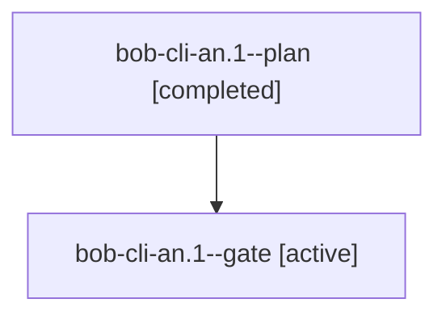

# Session: bob-cli-an.1

[Agent Hoods](../README.md) / [bbugyi200](../users/bbugyi200/README.md) / [athena](../users/bbugyi200/machines/athena/README.md) / [bob-cli-an](../users/bbugyi200/machines/athena/hoods/bob-cli-an/README.md) / bob-cli-an.1

Owner: `bbugyi200.athena` · Hood: `bob-cli-an` · Members: 2 · Bead: [bob-cli-an.1](https://github.com/bobs-org/bob-cli--beads/blob/main/pages/bob-cli-an/bob-cli-an.1.md)

## Lineage

The diagram is an optional enhancement; the ordered table below contains the same lineage in accessible text.

| Role | Agent | State | Model / provider | Timing | Commits | Prompt | Chat |
|---|---|---|---|---|---:|---|---|
| plan | bob-cli-an.1--plan | completed | gpt-6-luna / codex | 2026-10-21T17:01:28.033310+00:00 → 2026-10-21T17:26:38.534528+00:00 | 0 | [Prompt](../agents/bbugyi200.athena.bob-cli-an.1--plan/prompt.md) | [Chat](../agents/bbugyi200.athena.bob-cli-an.1--plan/chat.md) |
| gate | bob-cli-an.1--gate | active | gpt-6-luna / codex | 2026-10-21T17:25:55.203273+00:00 | 0 | — | — |

## Neighbors

| Agent | Relation | State |
|---|---|---|
| [bob-cli-an.2](../agents/bbugyi200.athena.bob-cli-an.2/README.md) | bob-cli-an hood | waiting |
| [bob-cli-an.3](../agents/bbugyi200.athena.bob-cli-an.3/README.md) | bob-cli-an hood | waiting |
| [bob-cli-an.4](../agents/bbugyi200.athena.bob-cli-an.4/README.md) | bob-cli-an hood | waiting |
| [bob-cli-an.5](../agents/bbugyi200.athena.bob-cli-an.5/README.md) | bob-cli-an hood | active |
| [bob-cli-an.land](../agents/bbugyi200.athena.bob-cli-an.land/README.md) | bob-cli-an hood | waiting |
