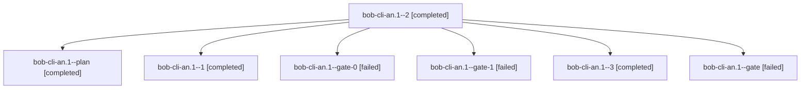

# Session: bob-cli-an.1

[Agent Hoods](../README.md) / [bbugyi200](../users/bbugyi200/README.md) / [athena](../users/bbugyi200/machines/athena/README.md) / [bob-cli-an](../users/bbugyi200/machines/athena/hoods/bob-cli-an/README.md) / bob-cli-an.1

Owner: `bbugyi200.athena` · Hood: `bob-cli-an` · Members: 7 · Bead: [bob-cli-an.1](https://github.com/bobs-org/bob-cli--beads/blob/main/pages/bob-cli-an/bob-cli-an.1.md)

## Lineage

The diagram is an optional enhancement; the ordered table below contains the same lineage in accessible text.

| Role | Agent | State | Model / provider | Timing | Commits | Prompt | Chat |
|---|---|---|---|---|---:|---|---|
| 2 | bob-cli-an.1--2 | completed | gpt-6-luna / codex | 2026-10-21T22:03:25.859722+00:00 → 2026-10-21T22:09:17.931278+00:00 | 0 | [Prompt](../agents/bbugyi200.athena.bob-cli-an.1--2/prompt.md) | [Chat](../agents/bbugyi200.athena.bob-cli-an.1--2/chat.md) |
| plan | bob-cli-an.1--plan | completed | gpt-6-luna / codex | 2026-10-21T17:01:28.033310+00:00 → 2026-10-21T17:26:38.534528+00:00 | 0 | [Prompt](../agents/bbugyi200.athena.bob-cli-an.1--plan/prompt.md) | [Chat](../agents/bbugyi200.athena.bob-cli-an.1--plan/chat.md) |
| 1 | bob-cli-an.1--1 | completed | gpt-6-luna / codex | 2026-10-21T21:55:13.786589+00:00 → 2026-10-21T22:01:00.719928+00:00 | 0 | [Prompt](../agents/bbugyi200.athena.bob-cli-an.1--1/prompt.md) | [Chat](../agents/bbugyi200.athena.bob-cli-an.1--1/chat.md) |
| gate-0 | bob-cli-an.1--gate-0 | failed | gpt-6-luna / codex | 2026-10-21T22:00:21.929228+00:00 → 2026-10-21T22:01:47.361202+00:00 | 0 | — | [Chat](../agents/bbugyi200.athena.bob-cli-an.1--gate-0/chat.md) |
| gate-1 | bob-cli-an.1--gate-1 | failed | gpt-6-luna / codex | 2026-10-21T22:08:36.145309+00:00 → 2026-10-21T22:09:37.799699+00:00 | 0 | — | [Chat](../agents/bbugyi200.athena.bob-cli-an.1--gate-1/chat.md) |
| 3 | bob-cli-an.1--3 | completed | gpt-6-luna / codex | 2026-10-21T22:11:10.142439+00:00 → 2026-10-21T22:18:13.656786+00:00 | 0 | [Prompt](../agents/bbugyi200.athena.bob-cli-an.1--3/prompt.md) | [Chat](../agents/bbugyi200.athena.bob-cli-an.1--3/chat.md) |
| gate | bob-cli-an.1--gate | failed | gpt-6-luna / codex | 2026-10-21T17:25:55.203273+00:00 → 2026-10-21T21:53:36.077538+00:00 | 0 | — | [Chat](../agents/bbugyi200.athena.bob-cli-an.1--gate/chat.md) |

## Neighbors

| Agent | Relation | State |
|---|---|---|
| [bob-cli-an.2](bbugyi200.athena.bob-cli-an.2.md) (session · 7) | bob-cli-an hood | completed 4, failed 3 |
| [bob-cli-an.3](bbugyi200.athena.bob-cli-an.3.md) (session · 6) | bob-cli-an hood | completed 3, failed 3 |
| [bob-cli-an.4](../agents/bbugyi200.athena.bob-cli-an.4/README.md) | bob-cli-an hood | completed |
| [bob-cli-an.5](../agents/bbugyi200.athena.bob-cli-an.5/README.md) | bob-cli-an hood | completed |
| [bob-cli-an.6.1](bbugyi200.athena.bob-cli-an.6.1.md) (session · 3) | bob-cli-an hood | completed 2, failed 1 |
| [bob-cli-an.6.2](bbugyi200.athena.bob-cli-an.6.2.md) (session · 7) | bob-cli-an hood | active 1, completed 3, failed 3 |
| [bob-cli-an.6.3](bbugyi200.athena.bob-cli-an.6.3.md) (session · 3) | bob-cli-an hood | completed 2, failed 1 |
| [bob-cli-an.6.4](bbugyi200.athena.bob-cli-an.6.4.md) (session · 3) | bob-cli-an hood | completed 2, failed 1 |
| [bob-cli-an.6.5](bbugyi200.athena.bob-cli-an.6.5.md) (session · 3) | bob-cli-an hood | completed 2, failed 1 |
| [bob-cli-an.6.land](../agents/bbugyi200.athena.bob-cli-an.6.land/README.md) | bob-cli-an hood | waiting |
| [bob-cli-an.land](bbugyi200.athena.bob-cli-an.land.md) (session · 3) | bob-cli-an hood | failed 3 |
| [bob-cli-an.land](../agents/bbugyi200.athena.bob-cli-an.land/README.md) | bob-cli-an hood | completed |
