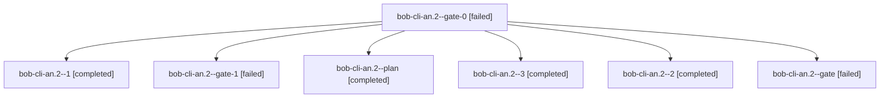

# Session: bob-cli-an.2

[Agent Hoods](../README.md) / [bbugyi200](../users/bbugyi200/README.md) / [athena](../users/bbugyi200/machines/athena/README.md) / [bob-cli-an](../users/bbugyi200/machines/athena/hoods/bob-cli-an/README.md) / bob-cli-an.2

Owner: `bbugyi200.athena` · Hood: `bob-cli-an` · Members: 7 · Bead: [bob-cli-an.2](https://github.com/bobs-org/bob-cli--beads/blob/main/pages/bob-cli-an/bob-cli-an.2.md)

## Lineage

The diagram is an optional enhancement; the ordered table below contains the same lineage in accessible text.

| Role | Agent | State | Model / provider | Timing | Commits | Prompt | Chat |
|---|---|---|---|---|---:|---|---|
| gate-0 | bob-cli-an.2--gate-0 | failed | muse-spark-1.3-contributor / muse | 2026-10-21T22:57:08.829644+00:00 → 2026-10-22T10:25:40.021407+00:00 | 0 | — | [Chat](../agents/bbugyi200.athena.bob-cli-an.2--gate-0/chat.md) |
| 1 | bob-cli-an.2--1 | completed | muse-spark-1.3-contributor / muse | 2026-10-21T22:55:40.917048+00:00 → 2026-10-21T22:57:39.150011+00:00 | 0 | [Prompt](../agents/bbugyi200.athena.bob-cli-an.2--1/prompt.md) | [Chat](../agents/bbugyi200.athena.bob-cli-an.2--1/chat.md) |
| gate-1 | bob-cli-an.2--gate-1 | failed | muse-spark-1.3-contributor / muse | 2026-10-22T10:32:33.825759+00:00 → 2026-10-22T10:36:14.307049+00:00 | 0 | — | [Chat](../agents/bbugyi200.athena.bob-cli-an.2--gate-1/chat.md) |
| plan | bob-cli-an.2--plan | completed | muse-spark-1.3-contributor / muse | 2026-10-21T22:19:36.301054+00:00 → 2026-10-21T22:45:16.828954+00:00 | 0 | [Prompt](../agents/bbugyi200.athena.bob-cli-an.2--plan/prompt.md) | [Chat](../agents/bbugyi200.athena.bob-cli-an.2--plan/chat.md) |
| 3 | bob-cli-an.2--3 | completed | muse-spark-1.3-contributor / muse | 2026-10-22T10:37:37.422922+00:00 → 2026-10-22T10:41:08.358973+00:00 | 0 | [Prompt](../agents/bbugyi200.athena.bob-cli-an.2--3/prompt.md) | [Chat](../agents/bbugyi200.athena.bob-cli-an.2--3/chat.md) |
| 2 | bob-cli-an.2--2 | completed | muse-spark-1.3-contributor / muse | 2026-10-22T10:26:51.251924+00:00 → 2026-10-22T10:33:05.141401+00:00 | 0 | [Prompt](../agents/bbugyi200.athena.bob-cli-an.2--2/prompt.md) | [Chat](../agents/bbugyi200.athena.bob-cli-an.2--2/chat.md) |
| gate | bob-cli-an.2--gate | failed | muse-spark-1.3-contributor / muse | 2026-10-21T22:44:46.876805+00:00 → 2026-10-21T22:54:03.413562+00:00 | 0 | — | [Chat](../agents/bbugyi200.athena.bob-cli-an.2--gate/chat.md) |

## Neighbors

| Agent | Relation | State |
|---|---|---|
| [bob-cli-an.1](bbugyi200.athena.bob-cli-an.1.md) (session · 7) | bob-cli-an hood | completed 4, failed 3 |
| [bob-cli-an.3](bbugyi200.athena.bob-cli-an.3.md) (session · 3) | bob-cli-an hood | active 1, completed 1, failed 1 |
| [bob-cli-an.4](../agents/bbugyi200.athena.bob-cli-an.4/README.md) | bob-cli-an hood | active |
| [bob-cli-an.5](../agents/bbugyi200.athena.bob-cli-an.5/README.md) | bob-cli-an hood | completed |
| [bob-cli-an.land](../agents/bbugyi200.athena.bob-cli-an.land/README.md) | bob-cli-an hood | waiting |
