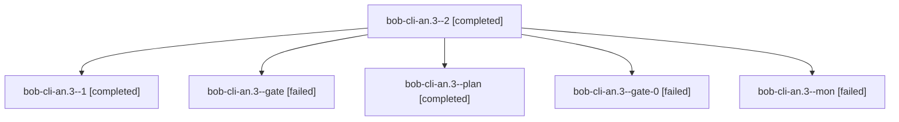

# Session: bob-cli-an.3

[Agent Hoods](../README.md) / [bbugyi200](../users/bbugyi200/README.md) / [athena](../users/bbugyi200/machines/athena/README.md) / [bob-cli-an](../users/bbugyi200/machines/athena/hoods/bob-cli-an/README.md) / bob-cli-an.3

Owner: `bbugyi200.athena` · Hood: `bob-cli-an` · Members: 6 · Bead: [bob-cli-an.3](https://github.com/bobs-org/bob-cli--beads/blob/main/pages/bob-cli-an/bob-cli-an.3.md)

## Lineage

The diagram is an optional enhancement; the ordered table below contains the same lineage in accessible text.

| Role | Agent | State | Model / provider | Timing | Commits | Prompt | Chat |
|---|---|---|---|---|---:|---|---|
| 2 | bob-cli-an.3--2 | completed | gpt-6-luna / codex | 2026-10-22T11:16:24.769296+00:00 → 2026-10-22T11:23:05.716801+00:00 | 0 | [Prompt](../agents/bbugyi200.athena.bob-cli-an.3--2/prompt.md) | [Chat](../agents/bbugyi200.athena.bob-cli-an.3--2/chat.md) |
| 1 | bob-cli-an.3--1 | completed | muse-spark-1.3-contributor / muse | 2026-10-23T15:59:01.203461+00:00 → 2026-10-23T16:04:27.612888+00:00 | 0 | [Prompt](../agents/bbugyi200.athena.bob-cli-an.3--1/prompt.md) | [Chat](../agents/bbugyi200.athena.bob-cli-an.3--1/chat.md) |
| gate | bob-cli-an.3--gate | failed | muse-spark-1.3-contributor / muse | 2026-10-23T13:26:24.010328+00:00 → 2026-10-23T15:57:51.875221+00:00 | 0 | — | [Chat](../agents/bbugyi200.athena.bob-cli-an.3--gate/chat.md) |
| plan | bob-cli-an.3--plan | completed | muse-spark-1.3-contributor / muse | 2026-10-23T13:16:22.437033+00:00 → 2026-10-23T13:26:57.736916+00:00 | 0 | [Prompt](../agents/bbugyi200.athena.bob-cli-an.3--plan/prompt.md) | [Chat](../agents/bbugyi200.athena.bob-cli-an.3--plan/chat.md) |
| gate-0 | bob-cli-an.3--gate-0 | failed | gpt-6-luna / codex | 2026-10-22T11:39:08.938467+00:00 → 2026-10-22T11:40:09.625338+00:00 | 0 | — | [Chat](../agents/bbugyi200.athena.bob-cli-an.3--gate-0/chat.md) |
| mon | bob-cli-an.3--mon | failed | gpt-6-luna / codex | 2026-10-22T10:52:33.405714+00:00 → 2026-10-22T10:55:19.548131+00:00 | 0 | — | [Chat](../agents/bbugyi200.athena.bob-cli-an.3--mon/chat.md) |

## Neighbors

| Agent | Relation | State |
|---|---|---|
| [bob-cli-an.1](bbugyi200.athena.bob-cli-an.1.md) (session · 7) | bob-cli-an hood | completed 4, failed 3 |
| [bob-cli-an.2](bbugyi200.athena.bob-cli-an.2.md) (session · 7) | bob-cli-an hood | completed 4, failed 3 |
| [bob-cli-an.4](../agents/bbugyi200.athena.bob-cli-an.4/README.md) | bob-cli-an hood | completed |
| [bob-cli-an.5](../agents/bbugyi200.athena.bob-cli-an.5/README.md) | bob-cli-an hood | completed |
| [bob-cli-an.6.1](bbugyi200.athena.bob-cli-an.6.1.md) (session · 3) | bob-cli-an hood | completed 2, failed 1 |
| [bob-cli-an.6.2](bbugyi200.athena.bob-cli-an.6.2.md) (session · 7) | bob-cli-an hood | active 1, completed 3, failed 3 |
| [bob-cli-an.6.3](bbugyi200.athena.bob-cli-an.6.3.md) (session · 3) | bob-cli-an hood | completed 2, failed 1 |
| [bob-cli-an.6.4](bbugyi200.athena.bob-cli-an.6.4.md) (session · 3) | bob-cli-an hood | completed 2, failed 1 |
| [bob-cli-an.6.5](bbugyi200.athena.bob-cli-an.6.5.md) (session · 3) | bob-cli-an hood | completed 2, failed 1 |
| [bob-cli-an.6.land](../agents/bbugyi200.athena.bob-cli-an.6.land/README.md) | bob-cli-an hood | waiting |
| [bob-cli-an.land](bbugyi200.athena.bob-cli-an.land.md) (session · 3) | bob-cli-an hood | failed 3 |
| [bob-cli-an.land](../agents/bbugyi200.athena.bob-cli-an.land/README.md) | bob-cli-an hood | completed |
