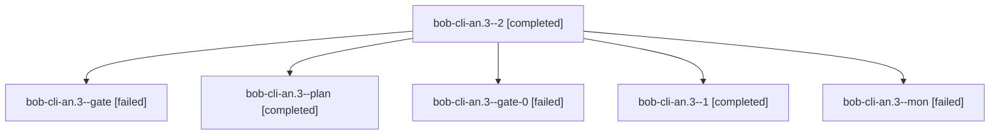

# Session: bob-cli-an.3

[Agent Hoods](../README.md) / [bbugyi200](../users/bbugyi200/README.md) / [athena](../users/bbugyi200/machines/athena/README.md) / [bob-cli-an](../users/bbugyi200/machines/athena/hoods/bob-cli-an/README.md) / bob-cli-an.3

Owner: `bbugyi200.athena` · Hood: `bob-cli-an` · Members: 6 · Bead: [bob-cli-an.3](https://github.com/bobs-org/bob-cli--beads/blob/main/pages/bob-cli-an/bob-cli-an.3.md)

## Lineage

The diagram is an optional enhancement; the ordered table below contains the same lineage in accessible text.

| Role | Agent | State | Model / provider | Timing | Commits | Prompt | Chat |
|---|---|---|---|---|---:|---|---|
| 2 | bob-cli-an.3--2 | completed | gpt-6-luna / codex | 2026-10-22T11:16:24.769296+00:00 → 2026-10-22T11:23:05.716801+00:00 | 0 | [Prompt](../agents/bbugyi200.athena.bob-cli-an.3--2/prompt.md) | [Chat](../agents/bbugyi200.athena.bob-cli-an.3--2/chat.md) |
| gate | bob-cli-an.3--gate | failed | gpt-6-luna / codex | 2026-10-22T11:08:18.757628+00:00 → 2026-10-22T11:15:17.790591+00:00 | 0 | — | [Chat](../agents/bbugyi200.athena.bob-cli-an.3--gate/chat.md) |
| plan | bob-cli-an.3--plan | completed | gpt-6-luna / codex | 2026-10-22T10:42:25.895458+00:00 → 2026-10-22T10:53:22.410066+00:00 | 0 | [Prompt](../agents/bbugyi200.athena.bob-cli-an.3--plan/prompt.md) | [Chat](../agents/bbugyi200.athena.bob-cli-an.3--plan/chat.md) |
| gate-0 | bob-cli-an.3--gate-0 | failed | gpt-6-luna / codex | 2026-10-22T11:39:08.938467+00:00 → 2026-10-22T11:40:09.625338+00:00 | 0 | — | [Chat](../agents/bbugyi200.athena.bob-cli-an.3--gate-0/chat.md) |
| 1 | bob-cli-an.3--1 | completed | gpt-6-luna / codex | 2026-10-22T10:56:15.545260+00:00 → 2026-10-22T11:09:54.249714+00:00 | 0 | [Prompt](../agents/bbugyi200.athena.bob-cli-an.3--1/prompt.md) | [Chat](../agents/bbugyi200.athena.bob-cli-an.3--1/chat.md) |
| mon | bob-cli-an.3--mon | failed | gpt-6-luna / codex | 2026-10-22T10:52:33.405714+00:00 → 2026-10-22T10:55:19.548131+00:00 | 0 | — | [Chat](../agents/bbugyi200.athena.bob-cli-an.3--mon/chat.md) |

## Neighbors

| Agent | Relation | State |
|---|---|---|
| [bob-cli-an.1](bbugyi200.athena.bob-cli-an.1.md) (session · 7) | bob-cli-an hood | completed 4, failed 3 |
| [bob-cli-an.2](bbugyi200.athena.bob-cli-an.2.md) (session · 7) | bob-cli-an hood | completed 4, failed 3 |
| [bob-cli-an.4](../agents/bbugyi200.athena.bob-cli-an.4/README.md) | bob-cli-an hood | completed |
| [bob-cli-an.5](../agents/bbugyi200.athena.bob-cli-an.5/README.md) | bob-cli-an hood | completed |
| [bob-cli-an.land](../agents/bbugyi200.athena.bob-cli-an.land/README.md) | bob-cli-an hood | waiting |
