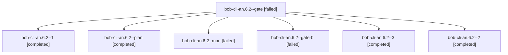

# Session: bob-cli-an.6.2

[Agent Hoods](../README.md) / [bbugyi200](../users/bbugyi200/README.md) / [athena](../users/bbugyi200/machines/athena/README.md) / [bob-cli-an](../users/bbugyi200/machines/athena/hoods/bob-cli-an/README.md) / bob-cli-an.6.2

Owner: `bbugyi200.athena` · Hood: `bob-cli-an` · Members: 7 · Bead: [bob-cli-an.6.2](https://github.com/bobs-org/bob-cli--beads/blob/main/pages/bob-cli-an/bob-cli-an.6.2.md)

## Lineage

The diagram is an optional enhancement; the ordered table below contains the same lineage in accessible text.

| Role | Agent | State | Model / provider | Timing | Commits | Prompt | Chat |
|---|---|---|---|---|---:|---|---|
| gate | bob-cli-an.6.2--gate | failed | grok-4.6 / grok | 2026-10-23T18:40:04.017603+00:00 → 2026-10-23T18:50:33.982310+00:00 | 0 | — | [Chat](../agents/bbugyi200.athena.bob-cli-an.6.2--gate/chat.md) |
| 1 | bob-cli-an.6.2--1 | completed | grok-4.6 / grok | 2026-10-23T18:52:05.934144+00:00 → 2026-10-23T19:02:29.542110+00:00 | 0 | [Prompt](../agents/bbugyi200.athena.bob-cli-an.6.2--1/prompt.md) | [Chat](../agents/bbugyi200.athena.bob-cli-an.6.2--1/chat.md) |
| plan | bob-cli-an.6.2--plan | completed | grok-4.6 / grok | 2026-10-23T18:26:49.753945+00:00 → 2026-10-23T18:40:50.291844+00:00 | 0 | [Prompt](../agents/bbugyi200.athena.bob-cli-an.6.2--plan/prompt.md) | [Chat](../agents/bbugyi200.athena.bob-cli-an.6.2--plan/chat.md) |
| mon | bob-cli-an.6.2--mon | failed | grok-4.6 / grok | 2026-10-23T19:07:29.371291+00:00 → 2026-10-23T20:31:02.582448+00:00 | 0 | — | [Chat](../agents/bbugyi200.athena.bob-cli-an.6.2--mon/chat.md) |
| gate-0 | bob-cli-an.6.2--gate-0 | failed | grok-4.6 / grok | 2026-10-23T19:01:37.745236+00:00 → 2026-10-23T19:02:51.162501+00:00 | 0 | — | [Chat](../agents/bbugyi200.athena.bob-cli-an.6.2--gate-0/chat.md) |
| 3 | bob-cli-an.6.2--3 | completed | grok-4.6 / grok | 2026-10-23T20:31:43.620714+00:00 → 2026-10-23T20:38:18.927767+00:00 | 0 | [Prompt](../agents/bbugyi200.athena.bob-cli-an.6.2--3/prompt.md) | [Chat](../agents/bbugyi200.athena.bob-cli-an.6.2--3/chat.md) |
| 2 | bob-cli-an.6.2--2 | completed | grok-4.6 / grok | 2026-10-23T19:04:03.735377+00:00 → 2026-10-23T19:08:04.317589+00:00 | 0 | [Prompt](../agents/bbugyi200.athena.bob-cli-an.6.2--2/prompt.md) | [Chat](../agents/bbugyi200.athena.bob-cli-an.6.2--2/chat.md) |

## Neighbors

| Agent | Relation | State |
|---|---|---|
| [bob-cli-an.6.1](bbugyi200.athena.bob-cli-an.6.1.md) (session · 3) | bob-cli-an.6 hood | completed 2, failed 1 |
| [bob-cli-an.6.3](bbugyi200.athena.bob-cli-an.6.3.md) (session · 3) | bob-cli-an.6 hood | completed 2, failed 1 |
| [bob-cli-an.6.4](bbugyi200.athena.bob-cli-an.6.4.md) (session · 3) | bob-cli-an.6 hood | completed 2, failed 1 |
| [bob-cli-an.6.5](bbugyi200.athena.bob-cli-an.6.5.md) (session · 3) | bob-cli-an.6 hood | completed 2, failed 1 |
| [bob-cli-an.6.6.1](../agents/bbugyi200.athena.bob-cli-an.6.6.1/README.md) | bob-cli-an.6 hood | completed |
| [bob-cli-an.6.6.2](bbugyi200.athena.bob-cli-an.6.6.2.md) (session · 2) | bob-cli-an.6 hood | active 1, completed 1 |
| [bob-cli-an.6.6.3](bbugyi200.athena.bob-cli-an.6.6.3.md) (session · 5) | bob-cli-an.6 hood | active 1, completed 2, failed 2 |
| [bob-cli-an.6.6.4](../agents/bbugyi200.athena.bob-cli-an.6.6.4/README.md) | bob-cli-an.6 hood | completed |
| [bob-cli-an.6.6.5](../agents/bbugyi200.athena.bob-cli-an.6.6.5/README.md) | bob-cli-an.6 hood | completed |
| [bob-cli-an.6.6.land](../agents/bbugyi200.athena.bob-cli-an.6.6.land/README.md) | bob-cli-an.6 hood | waiting |
| [bob-cli-an.6.land](bbugyi200.athena.bob-cli-an.6.land.md) (session · 3) | bob-cli-an.6 hood | failed 3 |
| [bob-cli-an.1](bbugyi200.athena.bob-cli-an.1.md) (session · 7) | bob-cli-an hood | completed 4, failed 3 |
| [bob-cli-an.2](bbugyi200.athena.bob-cli-an.2.md) (session · 7) | bob-cli-an hood | completed 4, failed 3 |
| [bob-cli-an.3](bbugyi200.athena.bob-cli-an.3.md) (session · 6) | bob-cli-an hood | completed 3, failed 3 |
| [bob-cli-an.4](../agents/bbugyi200.athena.bob-cli-an.4/README.md) | bob-cli-an hood | completed |
| [bob-cli-an.5](../agents/bbugyi200.athena.bob-cli-an.5/README.md) | bob-cli-an hood | completed |
| [bob-cli-an.land](bbugyi200.athena.bob-cli-an.land.md) (session · 3) | bob-cli-an hood | failed 3 |
| [bob-cli-an.land](../agents/bbugyi200.athena.bob-cli-an.land/README.md) | bob-cli-an hood | completed |
