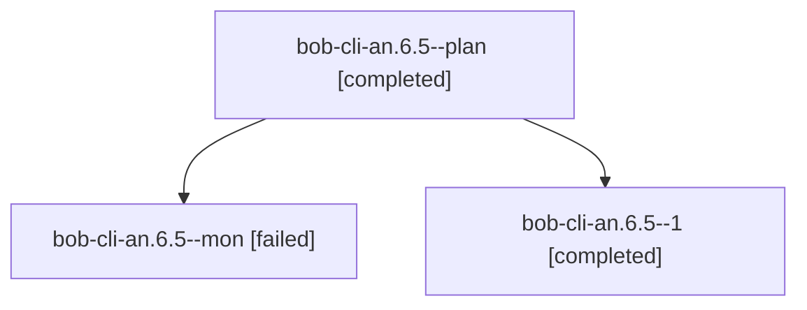

# Session: bob-cli-an.6.5

[Agent Hoods](../README.md) / [bbugyi200](../users/bbugyi200/README.md) / [athena](../users/bbugyi200/machines/athena/README.md) / [bob-cli-an](../users/bbugyi200/machines/athena/hoods/bob-cli-an/README.md) / bob-cli-an.6.5

Owner: `bbugyi200.athena` · Hood: `bob-cli-an` · Members: 3 · Bead: [bob-cli-an.6.5](https://github.com/bobs-org/bob-cli--beads/blob/main/pages/bob-cli-an/bob-cli-an.6.5.md)

## Lineage

The diagram is an optional enhancement; the ordered table below contains the same lineage in accessible text.

| Role | Agent | State | Model / provider | Timing | Commits | Prompt | Chat |
|---|---|---|---|---|---:|---|---|
| plan | bob-cli-an.6.5--plan | completed | gpt-6-luna / codex | 2026-10-23T17:02:04.378915+00:00 → 2026-10-23T17:19:34.351578+00:00 | 0 | [Prompt](../agents/bbugyi200.athena.bob-cli-an.6.5--plan/prompt.md) | [Chat](../agents/bbugyi200.athena.bob-cli-an.6.5--plan/chat.md) |
| mon | bob-cli-an.6.5--mon | failed | gpt-6-luna / codex | 2026-10-23T17:18:48.056446+00:00 → 2026-10-23T17:22:59.456753+00:00 | 0 | — | [Chat](../agents/bbugyi200.athena.bob-cli-an.6.5--mon/chat.md) |
| 1 | bob-cli-an.6.5--1 | completed | gpt-6-luna / codex | 2026-10-23T17:24:14.610930+00:00 → 2026-10-23T17:34:33.480787+00:00 | [1](../agents/bbugyi200.athena.bob-cli-an.6.5--1/README.md#commits) | [Prompt](../agents/bbugyi200.athena.bob-cli-an.6.5--1/prompt.md) | [Chat](../agents/bbugyi200.athena.bob-cli-an.6.5--1/chat.md) |

## Commits

| Role | Repo | Commit | Subject | Committed |
|---|---|---|---|---|
| 1 | bob-cli | [`9885bde`](https://github.com/bobs-org/bob-cli/commit/9885bde15100fcf41d5dcc99053c443a184d04d6) | fix(ref): allocate unique IDs from output stems | 2026-10-23 13:32:20 EDT |

## Neighbors

| Agent | Relation | State |
|---|---|---|
| [bob-cli-an.6.1](bbugyi200.athena.bob-cli-an.6.1.md) (session · 3) | bob-cli-an.6 hood | completed 2, failed 1 |
| [bob-cli-an.6.2](bbugyi200.athena.bob-cli-an.6.2.md) (session · 6) | bob-cli-an.6 hood | active 1, completed 3, failed 2 |
| [bob-cli-an.6.3](bbugyi200.athena.bob-cli-an.6.3.md) (session · 3) | bob-cli-an.6 hood | completed 2, failed 1 |
| [bob-cli-an.6.4](bbugyi200.athena.bob-cli-an.6.4.md) (session · 3) | bob-cli-an.6 hood | completed 2, failed 1 |
| [bob-cli-an.6.land](../agents/bbugyi200.athena.bob-cli-an.6.land/README.md) | bob-cli-an.6 hood | waiting |
| [bob-cli-an.1](bbugyi200.athena.bob-cli-an.1.md) (session · 7) | bob-cli-an hood | completed 4, failed 3 |
| [bob-cli-an.2](bbugyi200.athena.bob-cli-an.2.md) (session · 7) | bob-cli-an hood | completed 4, failed 3 |
| [bob-cli-an.3](bbugyi200.athena.bob-cli-an.3.md) (session · 6) | bob-cli-an hood | completed 3, failed 3 |
| [bob-cli-an.4](../agents/bbugyi200.athena.bob-cli-an.4/README.md) | bob-cli-an hood | completed |
| [bob-cli-an.5](../agents/bbugyi200.athena.bob-cli-an.5/README.md) | bob-cli-an hood | completed |
| [bob-cli-an.land](bbugyi200.athena.bob-cli-an.land.md) (session · 3) | bob-cli-an hood | failed 3 |
| [bob-cli-an.land](../agents/bbugyi200.athena.bob-cli-an.land/README.md) | bob-cli-an hood | completed |
