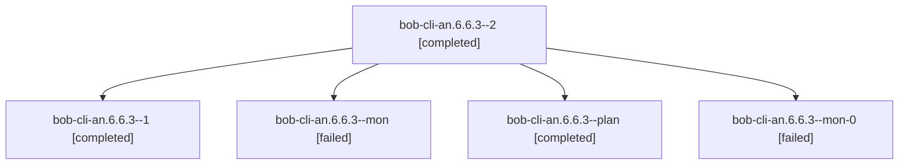

# Session: bob-cli-an.6.6.3

[Agent Hoods](../README.md) / [bbugyi200](../users/bbugyi200/README.md) / [athena](../users/bbugyi200/machines/athena/README.md) / [bob-cli-an](../users/bbugyi200/machines/athena/hoods/bob-cli-an/README.md) / bob-cli-an.6.6.3

Owner: `bbugyi200.athena` · Hood: `bob-cli-an` · Members: 5 · Bead: [bob-cli-an.6.6.3](https://github.com/bobs-org/bob-cli--beads/blob/main/pages/bob-cli-an/bob-cli-an.6.6.3.md)

## Lineage

The diagram is an optional enhancement; the ordered table below contains the same lineage in accessible text.

| Role | Agent | State | Model / provider | Timing | Commits | Prompt | Chat |
|---|---|---|---|---|---:|---|---|
| 2 | bob-cli-an.6.6.3--2 | completed | gpt-6-luna / codex | 2026-10-23T22:16:20.032133+00:00 → 2026-10-23T22:23:33.887718+00:00 | [1](../agents/bbugyi200.athena.bob-cli-an.6.6.3--2/README.md#commits) | [Prompt](../agents/bbugyi200.athena.bob-cli-an.6.6.3--2/prompt.md) | [Chat](../agents/bbugyi200.athena.bob-cli-an.6.6.3--2/chat.md) |
| 1 | bob-cli-an.6.6.3--1 | completed | gpt-6-luna / codex | 2026-10-23T21:59:23.023801+00:00 → 2026-10-23T22:11:09.902328+00:00 | 0 | [Prompt](../agents/bbugyi200.athena.bob-cli-an.6.6.3--1/prompt.md) | [Chat](../agents/bbugyi200.athena.bob-cli-an.6.6.3--1/chat.md) |
| mon | bob-cli-an.6.6.3--mon | failed | gpt-6-luna / codex | 2026-10-23T21:47:49.610632+00:00 → 2026-10-23T21:52:33.871278+00:00 | 0 | — | [Chat](../agents/bbugyi200.athena.bob-cli-an.6.6.3--mon/chat.md) |
| plan | bob-cli-an.6.6.3--plan | completed | gpt-6-luna / codex | 2026-10-23T21:31:06.671536+00:00 → 2026-10-23T21:48:34.911328+00:00 | 0 | [Prompt](../agents/bbugyi200.athena.bob-cli-an.6.6.3--plan/prompt.md) | [Chat](../agents/bbugyi200.athena.bob-cli-an.6.6.3--plan/chat.md) |
| mon-0 | bob-cli-an.6.6.3--mon-0 | failed | gpt-6-luna / codex | 2026-10-23T22:10:30.079392+00:00 → 2026-10-23T22:14:41.535376+00:00 | 0 | — | [Chat](../agents/bbugyi200.athena.bob-cli-an.6.6.3--mon-0/chat.md) |

## Commits

| Role | Repo | Commit | Subject | Committed |
|---|---|---|---|---|
| 2 | bob-cli | [`21e674d`](https://github.com/bobs-org/bob-cli/commit/21e674d7aa1e11c065fb5b5fe1ed38ffa4fc860d) | feat(time): honor configured day timezone | 2026-10-23 18:21:24 EDT |

## Neighbors

| Agent | Relation | State |
|---|---|---|
| [bob-cli-an.6.6.1](../agents/bbugyi200.athena.bob-cli-an.6.6.1/README.md) | bob-cli-an.6.6 hood | completed |
| [bob-cli-an.6.6.2](bbugyi200.athena.bob-cli-an.6.6.2.md) (session · 2) | bob-cli-an.6.6 hood | active 1, completed 1 |
| [bob-cli-an.6.6.4](../agents/bbugyi200.athena.bob-cli-an.6.6.4/README.md) | bob-cli-an.6.6 hood | completed |
| [bob-cli-an.6.6.5](../agents/bbugyi200.athena.bob-cli-an.6.6.5/README.md) | bob-cli-an.6.6 hood | completed |
| [bob-cli-an.6.6.land](../agents/bbugyi200.athena.bob-cli-an.6.6.land/README.md) | bob-cli-an.6.6 hood | waiting |
| [bob-cli-an.6.1](bbugyi200.athena.bob-cli-an.6.1.md) (session · 3) | bob-cli-an.6 hood | completed 2, failed 1 |
| [bob-cli-an.6.2](bbugyi200.athena.bob-cli-an.6.2.md) (session · 7) | bob-cli-an.6 hood | completed 4, failed 3 |
| [bob-cli-an.6.3](bbugyi200.athena.bob-cli-an.6.3.md) (session · 3) | bob-cli-an.6 hood | completed 2, failed 1 |
| [bob-cli-an.6.4](bbugyi200.athena.bob-cli-an.6.4.md) (session · 3) | bob-cli-an.6 hood | completed 2, failed 1 |
| [bob-cli-an.6.5](bbugyi200.athena.bob-cli-an.6.5.md) (session · 3) | bob-cli-an.6 hood | completed 2, failed 1 |
| [bob-cli-an.6.land](bbugyi200.athena.bob-cli-an.6.land.md) (session · 3) | bob-cli-an.6 hood | failed 3 |
| [bob-cli-an.1](bbugyi200.athena.bob-cli-an.1.md) (session · 7) | bob-cli-an hood | completed 4, failed 3 |
| [bob-cli-an.2](bbugyi200.athena.bob-cli-an.2.md) (session · 7) | bob-cli-an hood | completed 4, failed 3 |
| [bob-cli-an.3](bbugyi200.athena.bob-cli-an.3.md) (session · 6) | bob-cli-an hood | completed 3, failed 3 |
| [bob-cli-an.4](../agents/bbugyi200.athena.bob-cli-an.4/README.md) | bob-cli-an hood | completed |
| [bob-cli-an.5](../agents/bbugyi200.athena.bob-cli-an.5/README.md) | bob-cli-an hood | completed |
| [bob-cli-an.land](bbugyi200.athena.bob-cli-an.land.md) (session · 3) | bob-cli-an hood | failed 3 |
| [bob-cli-an.land](../agents/bbugyi200.athena.bob-cli-an.land/README.md) | bob-cli-an hood | completed |
