# Session: bob-cli-an.6.6.6.5.6.4

[Agent Hoods](../README.md) / [bbugyi200](../users/bbugyi200/README.md) / [athena](../users/bbugyi200/machines/athena/README.md) / [bob-cli-an](../users/bbugyi200/machines/athena/hoods/bob-cli-an/README.md) / bob-cli-an.6.6.6.5.6.4

Owner: `bbugyi200.athena` · Hood: `bob-cli-an` · Members: 13 · Bead: [bob-cli-an.6.6.6.5.6.4](https://github.com/bobs-org/bob-cli--beads/blob/main/pages/bob-cli-an/bob-cli-an.6.6.6.5.6.4.md)

## Lineage

```mermaid
flowchart TD
  n0["bob-cli-an.6.6.6.5.6.4--mon-3 [active]"]
  n1["bob-cli-an.6.6.6.5.6.4--1 [active]"]
  n0 --> n1
  n2["bob-cli-an.6.6.6.5.6.4--gate [active]"]
  n0 --> n2
  n3["bob-cli-an.6.6.6.5.6.4--mon-0 [active]"]
  n0 --> n3
  n4["bob-cli-an.6.6.6.5.6.4--4 [active]"]
  n0 --> n4
  n5["bob-cli-an.6.6.6.5.6.4--3 [active]"]
  n0 --> n5
  n6["bob-cli-an.6.6.6.5.6.4--plan [active]"]
  n0 --> n6
  n7["bob-cli-an.6.6.6.5.6.4--mon-2 [active]"]
  n0 --> n7
  n8["bob-cli-an.6.6.6.5.6.4--code [completed]"]
  n0 --> n8
  n9["bob-cli-an.6.6.6.5.6.4--2 [active]"]
  n0 --> n9
  n10["bob-cli-an.6.6.6.5.6.4--mon [failed]"]
  n0 --> n10
  n11["bob-cli-an.6.6.6.5.6.4--mon-1 [active]"]
  n0 --> n11
  n12["bob-cli-an.6.6.6.5.6.4--5 [active]"]
  n0 --> n12
```

The diagram is an optional enhancement; the ordered table below contains the same lineage in accessible text.

| Role | Agent | State | Model / provider | Timing | Commits | Prompt | Chat |
|---|---|---|---|---|---:|---|---|
| mon-3 | bob-cli-an.6.6.6.5.6.4--mon-3 | active | gpt-6-luna / codex | 2026-10-24T15:09:46.649281+00:00 | 0 | — | [Chat](../agents/bbugyi200.athena.bob-cli-an.6.6.6.5.6.4--mon-3/chat.md) |
| 1 | bob-cli-an.6.6.6.5.6.4--1 | active | gpt-6-luna / codex | 2026-10-24T14:15:18.588948+00:00 | 0 | [Prompt](../agents/bbugyi200.athena.bob-cli-an.6.6.6.5.6.4--1/prompt.md) | [Chat](../agents/bbugyi200.athena.bob-cli-an.6.6.6.5.6.4--1/chat.md) |
| gate | bob-cli-an.6.6.6.5.6.4--gate | active | gpt-6-astra / codex | 2026-10-24T14:00:01.680823+00:00 | 0 | — | [Chat](../agents/bbugyi200.athena.bob-cli-an.6.6.6.5.6.4--gate/chat.md) |
| mon-0 | bob-cli-an.6.6.6.5.6.4--mon-0 | active | gpt-6-luna / codex | 2026-10-24T14:24:15.284489+00:00 | 0 | — | [Chat](../agents/bbugyi200.athena.bob-cli-an.6.6.6.5.6.4--mon-0/chat.md) |
| 4 | bob-cli-an.6.6.6.5.6.4--4 | active | gpt-6-luna / codex | 2026-10-24T15:04:20.626278+00:00 | 0 | [Prompt](../agents/bbugyi200.athena.bob-cli-an.6.6.6.5.6.4--4/prompt.md) | [Chat](../agents/bbugyi200.athena.bob-cli-an.6.6.6.5.6.4--4/chat.md) |
| 3 | bob-cli-an.6.6.6.5.6.4--3 | active | gpt-6-luna / codex | 2026-10-24T14:50:11.044692+00:00 | 0 | [Prompt](../agents/bbugyi200.athena.bob-cli-an.6.6.6.5.6.4--3/prompt.md) | [Chat](../agents/bbugyi200.athena.bob-cli-an.6.6.6.5.6.4--3/chat.md) |
| plan | bob-cli-an.6.6.6.5.6.4--plan | active | gpt-6-astra / codex | 2026-10-24T13:52:25.423298+00:00 | 0 | [Prompt](../agents/bbugyi200.athena.bob-cli-an.6.6.6.5.6.4--plan/prompt.md) | [Chat](../agents/bbugyi200.athena.bob-cli-an.6.6.6.5.6.4--plan/chat.md) |
| mon-2 | bob-cli-an.6.6.6.5.6.4--mon-2 | active | gpt-6-luna / codex | 2026-10-24T14:55:46.898352+00:00 | 0 | — | [Chat](../agents/bbugyi200.athena.bob-cli-an.6.6.6.5.6.4--mon-2/chat.md) |
| code | bob-cli-an.6.6.6.5.6.4--code | completed | gpt-6-luna / codex | 2026-10-24T14:02:58.386638+00:00 → 2026-10-24T14:10:12.767443+00:00 | 0 | — | [Chat](../agents/bbugyi200.athena.bob-cli-an.6.6.6.5.6.4--code/chat.md) |
| 2 | bob-cli-an.6.6.6.5.6.4--2 | active | gpt-6-luna / codex | 2026-10-24T14:35:23.549088+00:00 | 0 | [Prompt](../agents/bbugyi200.athena.bob-cli-an.6.6.6.5.6.4--2/prompt.md) | [Chat](../agents/bbugyi200.athena.bob-cli-an.6.6.6.5.6.4--2/chat.md) |
| mon | bob-cli-an.6.6.6.5.6.4--mon | failed | gpt-6-luna / codex | 2026-10-24T14:09:07.763292+00:00 → 2026-10-24T14:13:07.696497+00:00 | 0 | — | [Chat](../agents/bbugyi200.athena.bob-cli-an.6.6.6.5.6.4--mon/chat.md) |
| mon-1 | bob-cli-an.6.6.6.5.6.4--mon-1 | active | gpt-6-luna / codex | 2026-10-24T14:44:24.207558+00:00 | 0 | — | [Chat](../agents/bbugyi200.athena.bob-cli-an.6.6.6.5.6.4--mon-1/chat.md) |
| 5 | bob-cli-an.6.6.6.5.6.4--5 | active | gpt-6-luna / codex | 2026-10-24T15:24:26.534050+00:00 | 0 | [Prompt](../agents/bbugyi200.athena.bob-cli-an.6.6.6.5.6.4--5/prompt.md) | [Chat](../agents/bbugyi200.athena.bob-cli-an.6.6.6.5.6.4--5/chat.md) |

## Neighbors

| Agent | Relation | State |
|---|---|---|
| [bob-cli-an.6.6.6.5.6.1](../agents/bbugyi200.athena.bob-cli-an.6.6.6.5.6.1/README.md) | bob-cli-an.6.6.6.5.6 hood | active |
| [bob-cli-an.6.6.6.5.6.2](bbugyi200.athena.bob-cli-an.6.6.6.5.6.2.md) (session · 3) | bob-cli-an.6.6.6.5.6 hood | active 2, completed 1 |
| [bob-cli-an.6.6.6.5.6.3](../agents/bbugyi200.athena.bob-cli-an.6.6.6.5.6.3/README.md) | bob-cli-an.6.6.6.5.6 hood | active |
| [bob-cli-an.6.6.6.5.6.5.1](../agents/bbugyi200.athena.bob-cli-an.6.6.6.5.6.5.1/README.md) | bob-cli-an.6.6.6.5.6 hood | active |
| [bob-cli-an.6.6.6.5.6.5.2](../agents/bbugyi200.athena.bob-cli-an.6.6.6.5.6.5.2/README.md) | bob-cli-an.6.6.6.5.6 hood | active |
| [bob-cli-an.6.6.6.5.6.5.3](bbugyi200.athena.bob-cli-an.6.6.6.5.6.5.3.md) (session · 5) | bob-cli-an.6.6.6.5.6 hood | active 5 |
| [bob-cli-an.6.6.6.5.6.5.4](../agents/bbugyi200.athena.bob-cli-an.6.6.6.5.6.5.4/README.md) | bob-cli-an.6.6.6.5.6 hood | active |
| [bob-cli-an.6.6.6.5.6.5.5.1](../agents/bbugyi200.athena.bob-cli-an.6.6.6.5.6.5.5.1/README.md) | bob-cli-an.6.6.6.5.6 hood | active |
| [bob-cli-an.6.6.6.5.6.5.5.2](../agents/bbugyi200.athena.bob-cli-an.6.6.6.5.6.5.5.2/README.md) | bob-cli-an.6.6.6.5.6 hood | active |
| [bob-cli-an.6.6.6.5.6.5.5.3](../agents/bbugyi200.athena.bob-cli-an.6.6.6.5.6.5.5.3/README.md) | bob-cli-an.6.6.6.5.6 hood | active |
| [bob-cli-an.6.6.6.5.6.5.5.4](../agents/bbugyi200.athena.bob-cli-an.6.6.6.5.6.5.5.4/README.md) | bob-cli-an.6.6.6.5.6 hood | active |
| [bob-cli-an.6.6.6.5.6.5.5.5](../agents/bbugyi200.athena.bob-cli-an.6.6.6.5.6.5.5.5/README.md) | bob-cli-an.6.6.6.5.6 hood | active |
| [bob-cli-an.6.6.6.5.6.5.5.6.1](../agents/bbugyi200.athena.bob-cli-an.6.6.6.5.6.5.5.6.1/README.md) | bob-cli-an.6.6.6.5.6 hood | active |
| [bob-cli-an.6.6.6.5.6.5.5.6.2](../agents/bbugyi200.athena.bob-cli-an.6.6.6.5.6.5.5.6.2/README.md) | bob-cli-an.6.6.6.5.6 hood | active |
| [bob-cli-an.6.6.6.5.6.5.5.6.3](../agents/bbugyi200.athena.bob-cli-an.6.6.6.5.6.5.5.6.3/README.md) | bob-cli-an.6.6.6.5.6 hood | active |
| [bob-cli-an.6.6.6.5.6.5.5.6.4](../agents/bbugyi200.athena.bob-cli-an.6.6.6.5.6.5.5.6.4/README.md) | bob-cli-an.6.6.6.5.6 hood | active |
| [bob-cli-an.6.6.6.5.6.5.5.6.5](../agents/bbugyi200.athena.bob-cli-an.6.6.6.5.6.5.5.6.5/README.md) | bob-cli-an.6.6.6.5.6 hood | active |
| [bob-cli-an.6.6.6.5.6.5.5.6.6.1](../agents/bbugyi200.athena.bob-cli-an.6.6.6.5.6.5.5.6.6.1/README.md) | bob-cli-an.6.6.6.5.6 hood | active |
| [bob-cli-an.6.6.6.5.6.5.5.6.6.2](../agents/bbugyi200.athena.bob-cli-an.6.6.6.5.6.5.5.6.6.2/README.md) | bob-cli-an.6.6.6.5.6 hood | active |
| [bob-cli-an.6.6.6.5.6.5.5.6.6.3](../agents/bbugyi200.athena.bob-cli-an.6.6.6.5.6.5.5.6.6.3/README.md) | bob-cli-an.6.6.6.5.6 hood | active |
| [bob-cli-an.6.6.6.5.6.5.5.6.6.4](../agents/bbugyi200.athena.bob-cli-an.6.6.6.5.6.5.5.6.6.4/README.md) | bob-cli-an.6.6.6.5.6 hood | active |
| [bob-cli-an.6.6.6.5.6.5.5.6.6.5](../agents/bbugyi200.athena.bob-cli-an.6.6.6.5.6.5.5.6.6.5/README.md) | bob-cli-an.6.6.6.5.6 hood | active |
| [bob-cli-an.6.6.6.5.6.5.5.6.6.6.1](bbugyi200.athena.bob-cli-an.6.6.6.5.6.5.5.6.6.6.1.md) (session · 5) | bob-cli-an.6.6.6.5.6 hood | completed 3, failed 2 |
| [bob-cli-an.6.6.6.5.6.5.5.6.6.6.1](../agents/bbugyi200.athena.bob-cli-an.6.6.6.5.6.5.5.6.6.6.1/README.md) | bob-cli-an.6.6.6.5.6 hood | completed |
| [bob-cli-an.6.6.6.5.6.5.5.6.6.6.2](../agents/bbugyi200.athena.bob-cli-an.6.6.6.5.6.5.5.6.6.6.2/README.md) | bob-cli-an.6.6.6.5.6 hood | completed |
| [bob-cli-an.6.6.6.5.6.5.5.6.6.6.3](../agents/bbugyi200.athena.bob-cli-an.6.6.6.5.6.5.5.6.6.6.3/README.md) | bob-cli-an.6.6.6.5.6 hood | completed |
| [bob-cli-an.6.6.6.5.6.5.5.6.6.6.4](../agents/bbugyi200.athena.bob-cli-an.6.6.6.5.6.5.5.6.6.6.4/README.md) | bob-cli-an.6.6.6.5.6 hood | completed |
| [bob-cli-an.6.6.6.5.6.5.5.6.6.6.5](../agents/bbugyi200.athena.bob-cli-an.6.6.6.5.6.5.5.6.6.6.5/README.md) | bob-cli-an.6.6.6.5.6 hood | completed |
| [bob-cli-an.6.6.6.5.6.5.5.6.6.6.6.1](../agents/bbugyi200.athena.bob-cli-an.6.6.6.5.6.5.5.6.6.6.6.1/README.md) | bob-cli-an.6.6.6.5.6 hood | completed |
| [bob-cli-an.6.6.6.5.6.5.5.6.6.6.6.2](bbugyi200.athena.bob-cli-an.6.6.6.5.6.5.5.6.6.6.6.2.md) (session · 3) | bob-cli-an.6.6.6.5.6 hood | completed 2, failed 1 |
| [bob-cli-an.6.6.6.5.6.5.5.6.6.6.6.3](../agents/bbugyi200.athena.bob-cli-an.6.6.6.5.6.5.5.6.6.6.6.3/README.md) | bob-cli-an.6.6.6.5.6 hood | completed |
| [bob-cli-an.6.6.6.5.6.5.5.6.6.6.6.4](../agents/bbugyi200.athena.bob-cli-an.6.6.6.5.6.5.5.6.6.6.6.4/README.md) | bob-cli-an.6.6.6.5.6 hood | completed |
| [bob-cli-an.6.6.6.5.6.5.5.6.6.6.6.5](../agents/bbugyi200.athena.bob-cli-an.6.6.6.5.6.5.5.6.6.6.6.5/README.md) | bob-cli-an.6.6.6.5.6 hood | completed |
| [bob-cli-an.6.6.6.5.6.5.5.6.6.6.6.6.1](bbugyi200.athena.bob-cli-an.6.6.6.5.6.5.5.6.6.6.6.6.1.md) (session · 4) | bob-cli-an.6.6.6.5.6 hood | active 1, completed 2, failed 1 |
| [bob-cli-an.6.6.6.5.6.5.5.6.6.6.6.6.2](../agents/bbugyi200.athena.bob-cli-an.6.6.6.5.6.5.5.6.6.6.6.6.2/README.md) | bob-cli-an.6.6.6.5.6 hood | completed |
| [bob-cli-an.6.6.6.5.6.5.5.6.6.6.6.6.3](bbugyi200.athena.bob-cli-an.6.6.6.5.6.5.5.6.6.6.6.6.3.md) (session · 7) | bob-cli-an.6.6.6.5.6 hood | completed 4, failed 3 |
| [bob-cli-an.6.6.6.5.6.5.5.6.6.6.6.6.4](bbugyi200.athena.bob-cli-an.6.6.6.5.6.5.5.6.6.6.6.6.4.md) (session · 5) | bob-cli-an.6.6.6.5.6 hood | completed 3, failed 2 |
| [bob-cli-an.6.6.6.5.6.5.5.6.6.6.6.6.5](bbugyi200.athena.bob-cli-an.6.6.6.5.6.5.5.6.6.6.6.6.5.md) (session · 3) | bob-cli-an.6.6.6.5.6 hood | completed 2, failed 1 |
| [bob-cli-an.6.6.6.5.6.5.5.6.6.6.6.6.6.1](bbugyi200.athena.bob-cli-an.6.6.6.5.6.5.5.6.6.6.6.6.6.1.md) (session · 3) | bob-cli-an.6.6.6.5.6 hood | active 2, failed 1 |
| [bob-cli-an.6.6.6.5.6.5.5.6.6.6.6.6.6.2](bbugyi200.athena.bob-cli-an.6.6.6.5.6.5.5.6.6.6.6.6.6.2.md) (session · 3) | bob-cli-an.6.6.6.5.6 hood | active 2, failed 1 |
| [bob-cli-an.6.6.6.5.6.5.5.6.6.6.6.6.6.3](../agents/bbugyi200.athena.bob-cli-an.6.6.6.5.6.5.5.6.6.6.6.6.6.3/README.md) | bob-cli-an.6.6.6.5.6 hood | active |
| [bob-cli-an.6.6.6.5.6.5.5.6.6.6.6.6.6.4](../agents/bbugyi200.athena.bob-cli-an.6.6.6.5.6.5.5.6.6.6.6.6.6.4/README.md) | bob-cli-an.6.6.6.5.6 hood | active |
| [bob-cli-an.6.6.6.5.6.5.5.6.6.6.6.6.6.5](../agents/bbugyi200.athena.bob-cli-an.6.6.6.5.6.5.5.6.6.6.6.6.6.5/README.md) | bob-cli-an.6.6.6.5.6 hood | waiting |
| [bob-cli-an.6.6.6.5.6.5.5.6.6.6.6.6.6.land](../agents/bbugyi200.athena.bob-cli-an.6.6.6.5.6.5.5.6.6.6.6.6.6.land/README.md) | bob-cli-an.6.6.6.5.6 hood | waiting |
| [bob-cli-an.6.6.6.5.6.5.5.6.6.6.6.6.land](bbugyi200.athena.bob-cli-an.6.6.6.5.6.5.5.6.6.6.6.6.land.md) (session · 3) | bob-cli-an.6.6.6.5.6 hood | failed 3 |
| [bob-cli-an.6.6.6.5.6.5.5.6.6.6.6.land](bbugyi200.athena.bob-cli-an.6.6.6.5.6.5.5.6.6.6.6.land.md) (session · 5) | bob-cli-an.6.6.6.5.6 hood | failed 5 |
| [bob-cli-an.6.6.6.5.6.5.5.6.6.6.land](bbugyi200.athena.bob-cli-an.6.6.6.5.6.5.5.6.6.6.land.md) (session · 3) | bob-cli-an.6.6.6.5.6 hood | failed 3 |
| [bob-cli-an.6.6.6.5.6.5.5.6.6.land](bbugyi200.athena.bob-cli-an.6.6.6.5.6.5.5.6.6.land.md) (session · 3) | bob-cli-an.6.6.6.5.6 hood | active 3 |
| [bob-cli-an.6.6.6.5.6.5.5.6.6.land](../agents/bbugyi200.athena.bob-cli-an.6.6.6.5.6.5.5.6.6.land/README.md) | bob-cli-an.6.6.6.5.6 hood | completed |
| [bob-cli-an.6.6.6.5.6.5.5.6.land](bbugyi200.athena.bob-cli-an.6.6.6.5.6.5.5.6.land.md) (session · 5) | bob-cli-an.6.6.6.5.6 hood | active 2, failed 3 |
| … and 4 more in the [hood roster](../users/bbugyi200/machines/athena/hoods/bob-cli-an/README.md) | bob-cli-an.6.6.6.5.6 hood | — |
| [bob-cli-an.6.6.6.5.1](../agents/bbugyi200.athena.bob-cli-an.6.6.6.5.1/README.md) | bob-cli-an.6.6.6.5 hood | active |
| [bob-cli-an.6.6.6.5.2](bbugyi200.athena.bob-cli-an.6.6.6.5.2.md) (session · 3) | bob-cli-an.6.6.6.5 hood | active 2, completed 1 |
| [bob-cli-an.6.6.6.5.3](../agents/bbugyi200.athena.bob-cli-an.6.6.6.5.3/README.md) | bob-cli-an.6.6.6.5 hood | active |
| [bob-cli-an.6.6.6.5.4](../agents/bbugyi200.athena.bob-cli-an.6.6.6.5.4/README.md) | bob-cli-an.6.6.6.5 hood | active |
| [bob-cli-an.6.6.6.5.5](bbugyi200.athena.bob-cli-an.6.6.6.5.5.md) (session · 5) | bob-cli-an.6.6.6.5 hood | active 5 |
| [bob-cli-an.6.6.6.5.land](bbugyi200.athena.bob-cli-an.6.6.6.5.land.md) (session · 3) | bob-cli-an.6.6.6.5 hood | active 3 |
| [bob-cli-an.6.6.6.5.land](../agents/bbugyi200.athena.bob-cli-an.6.6.6.5.land/README.md) | bob-cli-an.6.6.6.5 hood | completed |
| [bob-cli-an.6.6.6.1](bbugyi200.athena.bob-cli-an.6.6.6.1.md) (session · 3) | bob-cli-an.6.6.6 hood | active 3 |
| [bob-cli-an.6.6.6.2](bbugyi200.athena.bob-cli-an.6.6.6.2.md) (session · 3) | bob-cli-an.6.6.6 hood | active 3 |
| [bob-cli-an.6.6.6.3](bbugyi200.athena.bob-cli-an.6.6.6.3.md) (session · 3) | bob-cli-an.6.6.6 hood | active 3 |
| [bob-cli-an.6.6.6.4](../agents/bbugyi200.athena.bob-cli-an.6.6.6.4/README.md) | bob-cli-an.6.6.6 hood | active |
| [bob-cli-an.6.6.6.land](bbugyi200.athena.bob-cli-an.6.6.6.land.md) (session · 5) | bob-cli-an.6.6.6 hood | active 2, failed 3 |
| [bob-cli-an.6.6.1](../agents/bbugyi200.athena.bob-cli-an.6.6.1/README.md) | bob-cli-an.6.6 hood | active |
| [bob-cli-an.6.6.2](bbugyi200.athena.bob-cli-an.6.6.2.md) (session · 3) | bob-cli-an.6.6 hood | active 3 |
| [bob-cli-an.6.6.3](bbugyi200.athena.bob-cli-an.6.6.3.md) (session · 5) | bob-cli-an.6.6 hood | active 5 |
| [bob-cli-an.6.6.4](../agents/bbugyi200.athena.bob-cli-an.6.6.4/README.md) | bob-cli-an.6.6 hood | active |
| [bob-cli-an.6.6.5](../agents/bbugyi200.athena.bob-cli-an.6.6.5/README.md) | bob-cli-an.6.6 hood | active |
| [bob-cli-an.6.6.land](bbugyi200.athena.bob-cli-an.6.6.land.md) (session · 3) | bob-cli-an.6.6 hood | active 3 |
| [bob-cli-an.6.6.land](../agents/bbugyi200.athena.bob-cli-an.6.6.land/README.md) | bob-cli-an.6.6 hood | completed |
| [bob-cli-an.6.1](bbugyi200.athena.bob-cli-an.6.1.md) (session · 3) | bob-cli-an.6 hood | active 3 |
| [bob-cli-an.6.2](bbugyi200.athena.bob-cli-an.6.2.md) (session · 7) | bob-cli-an.6 hood | active 7 |
| [bob-cli-an.6.3](bbugyi200.athena.bob-cli-an.6.3.md) (session · 3) | bob-cli-an.6 hood | active 3 |
| [bob-cli-an.6.4](bbugyi200.athena.bob-cli-an.6.4.md) (session · 3) | bob-cli-an.6 hood | active 3 |
| [bob-cli-an.6.5](bbugyi200.athena.bob-cli-an.6.5.md) (session · 3) | bob-cli-an.6 hood | active 3 |
| [bob-cli-an.6.land](bbugyi200.athena.bob-cli-an.6.land.md) (session · 3) | bob-cli-an.6 hood | active 3 |
| [bob-cli-an.1](bbugyi200.athena.bob-cli-an.1.md) (session · 7) | bob-cli-an hood | active 7 |
| [bob-cli-an.2](bbugyi200.athena.bob-cli-an.2.md) (session · 7) | bob-cli-an hood | active 7 |
| [bob-cli-an.3](bbugyi200.athena.bob-cli-an.3.md) (session · 6) | bob-cli-an hood | active 3, completed 1, failed 2 |
| [bob-cli-an.4](../agents/bbugyi200.athena.bob-cli-an.4/README.md) | bob-cli-an hood | active |
| [bob-cli-an.5](../agents/bbugyi200.athena.bob-cli-an.5/README.md) | bob-cli-an hood | active |
| [bob-cli-an.land](bbugyi200.athena.bob-cli-an.land.md) (session · 3) | bob-cli-an hood | active 3 |
| [bob-cli-an.land](../agents/bbugyi200.athena.bob-cli-an.land/README.md) | bob-cli-an hood | completed |
