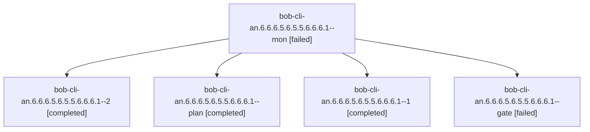

# Session: bob-cli-an.6.6.6.5.6.5.5.6.6.6.1

[Agent Hoods](../README.md) / [bbugyi200](../users/bbugyi200/README.md) / [athena](../users/bbugyi200/machines/athena/README.md) / [bob-cli-an](../users/bbugyi200/machines/athena/hoods/bob-cli-an/README.md) / bob-cli-an.6.6.6.5.6.5.5.6.6.6.1

Owner: `bbugyi200.athena` · Hood: `bob-cli-an` · Members: 5 · Bead: [bob-cli-an.6.6.6.5.6.5.5.6.6.6.1](https://github.com/bobs-org/bob-cli--beads/blob/main/pages/bob-cli-an/bob-cli-an.6.6.6.5.6.5.5.6.6.6.1.md)

## Lineage



The diagram is an optional enhancement; the ordered table below contains the same lineage in accessible text.

| Role | Agent | State | Model / provider | Timing | Commits | Prompt | Chat |
|---|---|---|---|---|---:|---|---|
| <a id="member-mon"></a>mon | bob-cli-an.6.6.6.5.6.5.5.6.6.6.1--mon | failed | gpt-6-astra / codex | 2026-10-26T11:48:45.114581+00:00 → 2026-10-26T11:57:54.928572+00:00 | 0 | — | [Chat](../agents/bbugyi200.athena.bob-cli-an.6.6.6.5.6.5.5.6.6.6.1--mon/chat.md) |
| <a id="member-2"></a>2 | bob-cli-an.6.6.6.5.6.5.5.6.6.6.1--2 | completed | gpt-6-astra / codex | 2026-10-26T11:56:57.442363+00:00 → 2026-10-26T12:01:39.206178+00:00 | 0 | [Prompt](../agents/bbugyi200.athena.bob-cli-an.6.6.6.5.6.5.5.6.6.6.1--2/prompt.md) | [Chat](../agents/bbugyi200.athena.bob-cli-an.6.6.6.5.6.5.5.6.6.6.1--2/chat.md) |
| <a id="member-plan"></a>plan | bob-cli-an.6.6.6.5.6.5.5.6.6.6.1--plan | completed | gpt-6-astra / codex | 2026-10-26T10:45:49.175168+00:00 → 2026-10-26T11:00:02.352214+00:00 | 0 | [Prompt](../agents/bbugyi200.athena.bob-cli-an.6.6.6.5.6.5.5.6.6.6.1--plan/prompt.md) | [Chat](../agents/bbugyi200.athena.bob-cli-an.6.6.6.5.6.5.5.6.6.6.1--plan/chat.md) |
| <a id="member-1"></a>1 | bob-cli-an.6.6.6.5.6.5.5.6.6.6.1--1 | completed | gpt-6-astra / codex | 2026-10-26T11:42:04.940767+00:00 → 2026-10-26T11:49:32.281795+00:00 | 0 | [Prompt](../agents/bbugyi200.athena.bob-cli-an.6.6.6.5.6.5.5.6.6.6.1--1/prompt.md) | [Chat](../agents/bbugyi200.athena.bob-cli-an.6.6.6.5.6.5.5.6.6.6.1--1/chat.md) |
| <a id="member-gate"></a>gate | bob-cli-an.6.6.6.5.6.5.5.6.6.6.1--gate | failed | gpt-6-astra / codex | 2026-10-26T11:28:03.665650+00:00 → 2026-10-26T11:40:41.271382+00:00 | 0 | — | [Chat](../agents/bbugyi200.athena.bob-cli-an.6.6.6.5.6.5.5.6.6.6.1--gate/chat.md) |

## Variables

| Role | Variable | Value |
|---|---|---|
| plan | `artifacts` | \[{bead: bob-cli-an.6.6.6.5.6.5.5.6.6.6.1, kind: file, label: Corrected live reference-id repair gate request; executable headers and fail-closed diagnostics, path: /home/bryan/.sase/artifacts/agents/… |

#### artifacts

**Role:** `plan`

```yaml
- bead: bob-cli-an.6.6.6.5.6.5.5.6.6.6.1
  kind: file
  label: Corrected live reference-id repair gate request; executable headers and fail-closed diagnostics
  path: /home/bryan/.sase/artifacts/agents/gh_bobs-org__bob-cli/20261026064452/request-439b29e2723f.json
  ref: file:explicit:ae15f0921118b08295672d5a
  source_path: /tmp/ref-id-repair-20261026/request.json
- bead: bob-cli-an.6.6.6.5.6.5.5.6.6.6.1
  kind: file
  label: Isolated fd-execution regression checks for live ref-id repair gate
  path: /home/bryan/.sase/artifacts/agents/gh_bobs-org__bob-cli/20261026064452/verify-f1d592e60cef.py
  ref: file:explicit:baf8ec102b5c1238584319c2
  source_path: /tmp/ref-id-repair-20261026/verify.py
```

Values are truncated for display; see each member's agent meta.json for the full values.

## Neighbors

| Agent | Relation | State |
|---|---|---|
| [bob-cli-an.6.6.6.5.6.5.5.6.6.6.2](../agents/bbugyi200.athena.bob-cli-an.6.6.6.5.6.5.5.6.6.6.2/README.md) | bob-cli-an.6.6.6.5.6.5.5.6.6.6 hood | completed |
| [bob-cli-an.6.6.6.5.6.5.5.6.6.6.3](../agents/bbugyi200.athena.bob-cli-an.6.6.6.5.6.5.5.6.6.6.3/README.md) | bob-cli-an.6.6.6.5.6.5.5.6.6.6 hood | completed |
| [bob-cli-an.6.6.6.5.6.5.5.6.6.6.4](../agents/bbugyi200.athena.bob-cli-an.6.6.6.5.6.5.5.6.6.6.4/README.md) | bob-cli-an.6.6.6.5.6.5.5.6.6.6 hood | completed |
| [bob-cli-an.6.6.6.5.6.5.5.6.6.6.5](../agents/bbugyi200.athena.bob-cli-an.6.6.6.5.6.5.5.6.6.6.5/README.md) | bob-cli-an.6.6.6.5.6.5.5.6.6.6 hood | completed |
| [bob-cli-an.6.6.6.5.6.5.5.6.6.6.6.1](../agents/bbugyi200.athena.bob-cli-an.6.6.6.5.6.5.5.6.6.6.6.1/README.md) | bob-cli-an.6.6.6.5.6.5.5.6.6.6 hood | completed |
| [bob-cli-an.6.6.6.5.6.5.5.6.6.6.6.2](bbugyi200.athena.bob-cli-an.6.6.6.5.6.5.5.6.6.6.6.2.md) (session · 3) | bob-cli-an.6.6.6.5.6.5.5.6.6.6 hood | completed 2, failed 1 |
| [bob-cli-an.6.6.6.5.6.5.5.6.6.6.6.3](../agents/bbugyi200.athena.bob-cli-an.6.6.6.5.6.5.5.6.6.6.6.3/README.md) | bob-cli-an.6.6.6.5.6.5.5.6.6.6 hood | completed |
| [bob-cli-an.6.6.6.5.6.5.5.6.6.6.6.4](../agents/bbugyi200.athena.bob-cli-an.6.6.6.5.6.5.5.6.6.6.6.4/README.md) | bob-cli-an.6.6.6.5.6.5.5.6.6.6 hood | completed |
| [bob-cli-an.6.6.6.5.6.5.5.6.6.6.6.5](../agents/bbugyi200.athena.bob-cli-an.6.6.6.5.6.5.5.6.6.6.6.5/README.md) | bob-cli-an.6.6.6.5.6.5.5.6.6.6 hood | completed |
| [bob-cli-an.6.6.6.5.6.5.5.6.6.6.6.6.1](bbugyi200.athena.bob-cli-an.6.6.6.5.6.5.5.6.6.6.6.6.1.md) (session · 4) | bob-cli-an.6.6.6.5.6.5.5.6.6.6 hood | active 1, completed 2, failed 1 |
| [bob-cli-an.6.6.6.5.6.5.5.6.6.6.6.6.2](../agents/bbugyi200.athena.bob-cli-an.6.6.6.5.6.5.5.6.6.6.6.6.2/README.md) | bob-cli-an.6.6.6.5.6.5.5.6.6.6 hood | completed |
| [bob-cli-an.6.6.6.5.6.5.5.6.6.6.6.6.3](bbugyi200.athena.bob-cli-an.6.6.6.5.6.5.5.6.6.6.6.6.3.md) (session · 7) | bob-cli-an.6.6.6.5.6.5.5.6.6.6 hood | completed 4, failed 3 |
| [bob-cli-an.6.6.6.5.6.5.5.6.6.6.6.6.4](bbugyi200.athena.bob-cli-an.6.6.6.5.6.5.5.6.6.6.6.6.4.md) (session · 5) | bob-cli-an.6.6.6.5.6.5.5.6.6.6 hood | completed 3, failed 2 |
| [bob-cli-an.6.6.6.5.6.5.5.6.6.6.6.6.5](bbugyi200.athena.bob-cli-an.6.6.6.5.6.5.5.6.6.6.6.6.5.md) (session · 3) | bob-cli-an.6.6.6.5.6.5.5.6.6.6 hood | completed 2, failed 1 |
| [bob-cli-an.6.6.6.5.6.5.5.6.6.6.6.6.6.1](bbugyi200.athena.bob-cli-an.6.6.6.5.6.5.5.6.6.6.6.6.6.1.md) (session · 13) | bob-cli-an.6.6.6.5.6.5.5.6.6.6 hood | completed 7, failed 6 |
| [bob-cli-an.6.6.6.5.6.5.5.6.6.6.6.6.6.2](bbugyi200.athena.bob-cli-an.6.6.6.5.6.5.5.6.6.6.6.6.6.2.md) (session · 11) | bob-cli-an.6.6.6.5.6.5.5.6.6.6 hood | completed 6, failed 5 |
| [bob-cli-an.6.6.6.5.6.5.5.6.6.6.6.6.6.3](../agents/bbugyi200.athena.bob-cli-an.6.6.6.5.6.5.5.6.6.6.6.6.6.3/README.md) | bob-cli-an.6.6.6.5.6.5.5.6.6.6 hood | completed |
| [bob-cli-an.6.6.6.5.6.5.5.6.6.6.6.6.6.4](../agents/bbugyi200.athena.bob-cli-an.6.6.6.5.6.5.5.6.6.6.6.6.6.4/README.md) | bob-cli-an.6.6.6.5.6.5.5.6.6.6 hood | completed |
| [bob-cli-an.6.6.6.5.6.5.5.6.6.6.6.6.6.5](../agents/bbugyi200.athena.bob-cli-an.6.6.6.5.6.5.5.6.6.6.6.6.6.5/README.md) | bob-cli-an.6.6.6.5.6.5.5.6.6.6 hood | completed |
| [bob-cli-an.6.6.6.5.6.5.5.6.6.6.6.6.6.land](../agents/bbugyi200.athena.bob-cli-an.6.6.6.5.6.5.5.6.6.6.6.6.6.land/README.md) | bob-cli-an.6.6.6.5.6.5.5.6.6.6 hood | active |
| [bob-cli-an.6.6.6.5.6.5.5.6.6.6.6.6.land](bbugyi200.athena.bob-cli-an.6.6.6.5.6.5.5.6.6.6.6.6.land.md) (session · 3) | bob-cli-an.6.6.6.5.6.5.5.6.6.6 hood | failed 3 |
| [bob-cli-an.6.6.6.5.6.5.5.6.6.6.6.6.land](../agents/bbugyi200.athena.bob-cli-an.6.6.6.5.6.5.5.6.6.6.6.6.land/README.md) | bob-cli-an.6.6.6.5.6.5.5.6.6.6 hood | completed |
| [bob-cli-an.6.6.6.5.6.5.5.6.6.6.6.land](bbugyi200.athena.bob-cli-an.6.6.6.5.6.5.5.6.6.6.6.land.md) (session · 5) | bob-cli-an.6.6.6.5.6.5.5.6.6.6 hood | failed 5 |
| [bob-cli-an.6.6.6.5.6.5.5.6.6.6.land](bbugyi200.athena.bob-cli-an.6.6.6.5.6.5.5.6.6.6.land.md) (session · 3) | bob-cli-an.6.6.6.5.6.5.5.6.6.6 hood | failed 3 |
| [bob-cli-an.6.6.6.5.6.5.5.6.6.1](../agents/bbugyi200.athena.bob-cli-an.6.6.6.5.6.5.5.6.6.1/README.md) | bob-cli-an.6.6.6.5.6.5.5.6.6 hood | active |
| [bob-cli-an.6.6.6.5.6.5.5.6.6.2](../agents/bbugyi200.athena.bob-cli-an.6.6.6.5.6.5.5.6.6.2/README.md) | bob-cli-an.6.6.6.5.6.5.5.6.6 hood | active |
| [bob-cli-an.6.6.6.5.6.5.5.6.6.3](../agents/bbugyi200.athena.bob-cli-an.6.6.6.5.6.5.5.6.6.3/README.md) | bob-cli-an.6.6.6.5.6.5.5.6.6 hood | active |
| [bob-cli-an.6.6.6.5.6.5.5.6.6.4](../agents/bbugyi200.athena.bob-cli-an.6.6.6.5.6.5.5.6.6.4/README.md) | bob-cli-an.6.6.6.5.6.5.5.6.6 hood | active |
| [bob-cli-an.6.6.6.5.6.5.5.6.6.5](../agents/bbugyi200.athena.bob-cli-an.6.6.6.5.6.5.5.6.6.5/README.md) | bob-cli-an.6.6.6.5.6.5.5.6.6 hood | active |
| [bob-cli-an.6.6.6.5.6.5.5.6.6.land](bbugyi200.athena.bob-cli-an.6.6.6.5.6.5.5.6.6.land.md) (session · 3) | bob-cli-an.6.6.6.5.6.5.5.6.6 hood | active 3 |
| [bob-cli-an.6.6.6.5.6.5.5.6.6.land](../agents/bbugyi200.athena.bob-cli-an.6.6.6.5.6.5.5.6.6.land/README.md) | bob-cli-an.6.6.6.5.6.5.5.6.6 hood | completed |
| [bob-cli-an.6.6.6.5.6.5.5.6.1](../agents/bbugyi200.athena.bob-cli-an.6.6.6.5.6.5.5.6.1/README.md) | bob-cli-an.6.6.6.5.6.5.5.6 hood | active |
| [bob-cli-an.6.6.6.5.6.5.5.6.2](../agents/bbugyi200.athena.bob-cli-an.6.6.6.5.6.5.5.6.2/README.md) | bob-cli-an.6.6.6.5.6.5.5.6 hood | active |
| [bob-cli-an.6.6.6.5.6.5.5.6.3](../agents/bbugyi200.athena.bob-cli-an.6.6.6.5.6.5.5.6.3/README.md) | bob-cli-an.6.6.6.5.6.5.5.6 hood | active |
| [bob-cli-an.6.6.6.5.6.5.5.6.4](../agents/bbugyi200.athena.bob-cli-an.6.6.6.5.6.5.5.6.4/README.md) | bob-cli-an.6.6.6.5.6.5.5.6 hood | active |
| [bob-cli-an.6.6.6.5.6.5.5.6.5](../agents/bbugyi200.athena.bob-cli-an.6.6.6.5.6.5.5.6.5/README.md) | bob-cli-an.6.6.6.5.6.5.5.6 hood | active |
| [bob-cli-an.6.6.6.5.6.5.5.6.land](bbugyi200.athena.bob-cli-an.6.6.6.5.6.5.5.6.land.md) (session · 5) | bob-cli-an.6.6.6.5.6.5.5.6 hood | active 2, failed 3 |
| [bob-cli-an.6.6.6.5.6.5.5.1](../agents/bbugyi200.athena.bob-cli-an.6.6.6.5.6.5.5.1/README.md) | bob-cli-an.6.6.6.5.6.5.5 hood | active |
| [bob-cli-an.6.6.6.5.6.5.5.2](../agents/bbugyi200.athena.bob-cli-an.6.6.6.5.6.5.5.2/README.md) | bob-cli-an.6.6.6.5.6.5.5 hood | active |
| [bob-cli-an.6.6.6.5.6.5.5.3](../agents/bbugyi200.athena.bob-cli-an.6.6.6.5.6.5.5.3/README.md) | bob-cli-an.6.6.6.5.6.5.5 hood | active |
| [bob-cli-an.6.6.6.5.6.5.5.4](../agents/bbugyi200.athena.bob-cli-an.6.6.6.5.6.5.5.4/README.md) | bob-cli-an.6.6.6.5.6.5.5 hood | active |
| [bob-cli-an.6.6.6.5.6.5.5.5](../agents/bbugyi200.athena.bob-cli-an.6.6.6.5.6.5.5.5/README.md) | bob-cli-an.6.6.6.5.6.5.5 hood | active |
| [bob-cli-an.6.6.6.5.6.5.5.land](bbugyi200.athena.bob-cli-an.6.6.6.5.6.5.5.land.md) (session · 3) | bob-cli-an.6.6.6.5.6.5.5 hood | active 3 |
| [bob-cli-an.6.6.6.5.6.5.1](../agents/bbugyi200.athena.bob-cli-an.6.6.6.5.6.5.1/README.md) | bob-cli-an.6.6.6.5.6.5 hood | active |
| [bob-cli-an.6.6.6.5.6.5.2](../agents/bbugyi200.athena.bob-cli-an.6.6.6.5.6.5.2/README.md) | bob-cli-an.6.6.6.5.6.5 hood | active |
| [bob-cli-an.6.6.6.5.6.5.3](bbugyi200.athena.bob-cli-an.6.6.6.5.6.5.3.md) (session · 5) | bob-cli-an.6.6.6.5.6.5 hood | active 5 |
| [bob-cli-an.6.6.6.5.6.5.4](../agents/bbugyi200.athena.bob-cli-an.6.6.6.5.6.5.4/README.md) | bob-cli-an.6.6.6.5.6.5 hood | active |
| [bob-cli-an.6.6.6.5.6.5.land](bbugyi200.athena.bob-cli-an.6.6.6.5.6.5.land.md) (session · 33) | bob-cli-an.6.6.6.5.6.5 hood | active 4, completed 15, failed 14 |
| [bob-cli-an.6.6.6.5.6.5.land](../agents/bbugyi200.athena.bob-cli-an.6.6.6.5.6.5.land/README.md) | bob-cli-an.6.6.6.5.6.5 hood | completed |
| [bob-cli-an.6.6.6.5.6.1](../agents/bbugyi200.athena.bob-cli-an.6.6.6.5.6.1/README.md) | bob-cli-an.6.6.6.5.6 hood | active |
| [bob-cli-an.6.6.6.5.6.2](bbugyi200.athena.bob-cli-an.6.6.6.5.6.2.md) (session · 3) | bob-cli-an.6.6.6.5.6 hood | active 2, completed 1 |
| [bob-cli-an.6.6.6.5.6.3](../agents/bbugyi200.athena.bob-cli-an.6.6.6.5.6.3/README.md) | bob-cli-an.6.6.6.5.6 hood | active |
| [bob-cli-an.6.6.6.5.6.4](bbugyi200.athena.bob-cli-an.6.6.6.5.6.4.md) (session · 13) | bob-cli-an.6.6.6.5.6 hood | active 11, completed 1, failed 1 |
| [bob-cli-an.6.6.6.5.6.land](bbugyi200.athena.bob-cli-an.6.6.6.5.6.land.md) (session · 7) | bob-cli-an.6.6.6.5.6 hood | active 7 |
| [bob-cli-an.6.6.6.5.1](../agents/bbugyi200.athena.bob-cli-an.6.6.6.5.1/README.md) | bob-cli-an.6.6.6.5 hood | active |
| [bob-cli-an.6.6.6.5.2](bbugyi200.athena.bob-cli-an.6.6.6.5.2.md) (session · 3) | bob-cli-an.6.6.6.5 hood | active 2, completed 1 |
| [bob-cli-an.6.6.6.5.3](../agents/bbugyi200.athena.bob-cli-an.6.6.6.5.3/README.md) | bob-cli-an.6.6.6.5 hood | active |
| [bob-cli-an.6.6.6.5.4](../agents/bbugyi200.athena.bob-cli-an.6.6.6.5.4/README.md) | bob-cli-an.6.6.6.5 hood | active |
| [bob-cli-an.6.6.6.5.5](bbugyi200.athena.bob-cli-an.6.6.6.5.5.md) (session · 5) | bob-cli-an.6.6.6.5 hood | active 5 |
| [bob-cli-an.6.6.6.5.land](bbugyi200.athena.bob-cli-an.6.6.6.5.land.md) (session · 3) | bob-cli-an.6.6.6.5 hood | active 3 |
| [bob-cli-an.6.6.6.5.land](../agents/bbugyi200.athena.bob-cli-an.6.6.6.5.land/README.md) | bob-cli-an.6.6.6.5 hood | completed |
| [bob-cli-an.6.6.6.1](bbugyi200.athena.bob-cli-an.6.6.6.1.md) (session · 3) | bob-cli-an.6.6.6 hood | active 3 |
| [bob-cli-an.6.6.6.2](bbugyi200.athena.bob-cli-an.6.6.6.2.md) (session · 3) | bob-cli-an.6.6.6 hood | active 3 |
| [bob-cli-an.6.6.6.3](bbugyi200.athena.bob-cli-an.6.6.6.3.md) (session · 3) | bob-cli-an.6.6.6 hood | active 3 |
| [bob-cli-an.6.6.6.4](../agents/bbugyi200.athena.bob-cli-an.6.6.6.4/README.md) | bob-cli-an.6.6.6 hood | active |
| [bob-cli-an.6.6.6.land](bbugyi200.athena.bob-cli-an.6.6.6.land.md) (session · 5) | bob-cli-an.6.6.6 hood | active 2, failed 3 |
| [bob-cli-an.6.6.1](../agents/bbugyi200.athena.bob-cli-an.6.6.1/README.md) | bob-cli-an.6.6 hood | active |
| [bob-cli-an.6.6.2](bbugyi200.athena.bob-cli-an.6.6.2.md) (session · 3) | bob-cli-an.6.6 hood | active 3 |
| [bob-cli-an.6.6.3](bbugyi200.athena.bob-cli-an.6.6.3.md) (session · 5) | bob-cli-an.6.6 hood | active 5 |
| [bob-cli-an.6.6.4](../agents/bbugyi200.athena.bob-cli-an.6.6.4/README.md) | bob-cli-an.6.6 hood | active |
| [bob-cli-an.6.6.5](../agents/bbugyi200.athena.bob-cli-an.6.6.5/README.md) | bob-cli-an.6.6 hood | active |
| [bob-cli-an.6.6.land](bbugyi200.athena.bob-cli-an.6.6.land.md) (session · 3) | bob-cli-an.6.6 hood | active 3 |
| [bob-cli-an.6.6.land](../agents/bbugyi200.athena.bob-cli-an.6.6.land/README.md) | bob-cli-an.6.6 hood | completed |
| [bob-cli-an.6.1](bbugyi200.athena.bob-cli-an.6.1.md) (session · 3) | bob-cli-an.6 hood | active 3 |
| [bob-cli-an.6.2](bbugyi200.athena.bob-cli-an.6.2.md) (session · 7) | bob-cli-an.6 hood | active 7 |
| [bob-cli-an.6.3](bbugyi200.athena.bob-cli-an.6.3.md) (session · 3) | bob-cli-an.6 hood | active 3 |
| [bob-cli-an.6.4](bbugyi200.athena.bob-cli-an.6.4.md) (session · 3) | bob-cli-an.6 hood | active 3 |
| [bob-cli-an.6.5](bbugyi200.athena.bob-cli-an.6.5.md) (session · 3) | bob-cli-an.6 hood | active 3 |
| [bob-cli-an.6.land](bbugyi200.athena.bob-cli-an.6.land.md) (session · 3) | bob-cli-an.6 hood | active 3 |
| [bob-cli-an.1](bbugyi200.athena.bob-cli-an.1.md) (session · 7) | bob-cli-an hood | active 7 |
| [bob-cli-an.2](bbugyi200.athena.bob-cli-an.2.md) (session · 7) | bob-cli-an hood | active 7 |
| [bob-cli-an.3](bbugyi200.athena.bob-cli-an.3.md) (session · 6) | bob-cli-an hood | active 3, completed 1, failed 2 |
| [bob-cli-an.4](../agents/bbugyi200.athena.bob-cli-an.4/README.md) | bob-cli-an hood | active |
| [bob-cli-an.5](../agents/bbugyi200.athena.bob-cli-an.5/README.md) | bob-cli-an hood | active |
| [bob-cli-an.land](bbugyi200.athena.bob-cli-an.land.md) (session · 3) | bob-cli-an hood | active 3 |
| [bob-cli-an.land](../agents/bbugyi200.athena.bob-cli-an.land/README.md) | bob-cli-an hood | completed |
