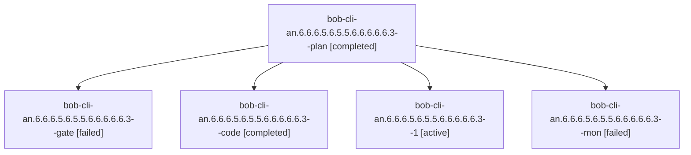

# Session: bob-cli-an.6.6.6.5.6.5.5.6.6.6.6.6.3

[Agent Hoods](../README.md) / [bbugyi200](../users/bbugyi200/README.md) / [athena](../users/bbugyi200/machines/athena/README.md) / [bob-cli-an](../users/bbugyi200/machines/athena/hoods/bob-cli-an/README.md) / bob-cli-an.6.6.6.5.6.5.5.6.6.6.6.6.3

Owner: `bbugyi200.athena` · Hood: `bob-cli-an` · Members: 5 · Bead: [bob-cli-an.6.6.6.5.6.5.5.6.6.6.6.6.3](https://github.com/bobs-org/bob-cli--beads/blob/main/pages/bob-cli-an/bob-cli-an.6.6.6.5.6.5.5.6.6.6.6.6.3.md)

## Lineage

The diagram is an optional enhancement; the ordered table below contains the same lineage in accessible text.

| Role | Agent | State | Model / provider | Timing | Commits | Prompt | Chat |
|---|---|---|---|---|---:|---|---|
| plan | bob-cli-an.6.6.6.5.6.5.5.6.6.6.6.6.3--plan | completed | gpt-6-astra / codex | 2026-10-26T14:50:09.980846+00:00 → 2026-10-26T15:04:54.674690+00:00 | 0 | [Prompt](../agents/bbugyi200.athena.bob-cli-an.6.6.6.5.6.5.5.6.6.6.6.6.3--plan/prompt.md) | [Chat](../agents/bbugyi200.athena.bob-cli-an.6.6.6.5.6.5.5.6.6.6.6.6.3--plan/chat.md) |
| gate | bob-cli-an.6.6.6.5.6.5.5.6.6.6.6.6.3--gate | failed | gpt-6-astra / codex | 2026-10-26T14:58:43.035530+00:00 → 2026-10-26T14:59:19.790468+00:00 | 0 | — | [Chat](../agents/bbugyi200.athena.bob-cli-an.6.6.6.5.6.5.5.6.6.6.6.6.3--gate/chat.md) |
| code | bob-cli-an.6.6.6.5.6.5.5.6.6.6.6.6.3--code | completed | gpt-6-luna / codex | 2026-10-26T14:59:44.584549+00:00 → 2026-10-26T15:04:54.674690+00:00 | 0 | — | [Chat](../agents/bbugyi200.athena.bob-cli-an.6.6.6.5.6.5.5.6.6.6.6.6.3--code/chat.md) |
| 1 | bob-cli-an.6.6.6.5.6.5.5.6.6.6.6.6.3--1 | active | gpt-6-luna / codex | 2026-10-26T15:09:23.405181+00:00 | 0 | [Prompt](../agents/bbugyi200.athena.bob-cli-an.6.6.6.5.6.5.5.6.6.6.6.6.3--1/prompt.md) | — |
| mon | bob-cli-an.6.6.6.5.6.5.5.6.6.6.6.6.3--mon | failed | gpt-6-luna / codex | 2026-10-26T15:04:20.133393+00:00 → 2026-10-26T15:08:27.691150+00:00 | 0 | — | [Chat](../agents/bbugyi200.athena.bob-cli-an.6.6.6.5.6.5.5.6.6.6.6.6.3--mon/chat.md) |

## Neighbors

| Agent | Relation | State |
|---|---|---|
| [bob-cli-an.6.6.6.5.6.5.5.6.6.6.6.6.1](bbugyi200.athena.bob-cli-an.6.6.6.5.6.5.5.6.6.6.6.6.1.md) (session · 2) | bob-cli-an.6.6.6.5.6.5.5.6.6.6.6.6 hood | active 1, completed 1 |
| [bob-cli-an.6.6.6.5.6.5.5.6.6.6.6.6.2](../agents/bbugyi200.athena.bob-cli-an.6.6.6.5.6.5.5.6.6.6.6.6.2/README.md) | bob-cli-an.6.6.6.5.6.5.5.6.6.6.6.6 hood | waiting |
| [bob-cli-an.6.6.6.5.6.5.5.6.6.6.6.6.4](bbugyi200.athena.bob-cli-an.6.6.6.5.6.5.5.6.6.6.6.6.4.md) (session · 5) | bob-cli-an.6.6.6.5.6.5.5.6.6.6.6.6 hood | active 1, completed 2, failed 2 |
| [bob-cli-an.6.6.6.5.6.5.5.6.6.6.6.6.5](bbugyi200.athena.bob-cli-an.6.6.6.5.6.5.5.6.6.6.6.6.5.md) (session · 3) | bob-cli-an.6.6.6.5.6.5.5.6.6.6.6.6 hood | active 2, failed 1 |
| [bob-cli-an.6.6.6.5.6.5.5.6.6.6.6.6.land](../agents/bbugyi200.athena.bob-cli-an.6.6.6.5.6.5.5.6.6.6.6.6.land/README.md) | bob-cli-an.6.6.6.5.6.5.5.6.6.6.6.6 hood | waiting |
| [bob-cli-an.6.6.6.5.6.5.5.6.6.6.6.1](../agents/bbugyi200.athena.bob-cli-an.6.6.6.5.6.5.5.6.6.6.6.1/README.md) | bob-cli-an.6.6.6.5.6.5.5.6.6.6.6 hood | completed |
| [bob-cli-an.6.6.6.5.6.5.5.6.6.6.6.2](bbugyi200.athena.bob-cli-an.6.6.6.5.6.5.5.6.6.6.6.2.md) (session · 3) | bob-cli-an.6.6.6.5.6.5.5.6.6.6.6 hood | completed 2, failed 1 |
| [bob-cli-an.6.6.6.5.6.5.5.6.6.6.6.3](../agents/bbugyi200.athena.bob-cli-an.6.6.6.5.6.5.5.6.6.6.6.3/README.md) | bob-cli-an.6.6.6.5.6.5.5.6.6.6.6 hood | completed |
| [bob-cli-an.6.6.6.5.6.5.5.6.6.6.6.4](../agents/bbugyi200.athena.bob-cli-an.6.6.6.5.6.5.5.6.6.6.6.4/README.md) | bob-cli-an.6.6.6.5.6.5.5.6.6.6.6 hood | completed |
| [bob-cli-an.6.6.6.5.6.5.5.6.6.6.6.5](../agents/bbugyi200.athena.bob-cli-an.6.6.6.5.6.5.5.6.6.6.6.5/README.md) | bob-cli-an.6.6.6.5.6.5.5.6.6.6.6 hood | completed |
| [bob-cli-an.6.6.6.5.6.5.5.6.6.6.6.land](bbugyi200.athena.bob-cli-an.6.6.6.5.6.5.5.6.6.6.6.land.md) (session · 5) | bob-cli-an.6.6.6.5.6.5.5.6.6.6.6 hood | failed 5 |
| [bob-cli-an.6.6.6.5.6.5.5.6.6.6.1](bbugyi200.athena.bob-cli-an.6.6.6.5.6.5.5.6.6.6.1.md) (session · 5) | bob-cli-an.6.6.6.5.6.5.5.6.6.6 hood | completed 3, failed 2 |
| [bob-cli-an.6.6.6.5.6.5.5.6.6.6.1](../agents/bbugyi200.athena.bob-cli-an.6.6.6.5.6.5.5.6.6.6.1/README.md) | bob-cli-an.6.6.6.5.6.5.5.6.6.6 hood | completed |
| [bob-cli-an.6.6.6.5.6.5.5.6.6.6.2](../agents/bbugyi200.athena.bob-cli-an.6.6.6.5.6.5.5.6.6.6.2/README.md) | bob-cli-an.6.6.6.5.6.5.5.6.6.6 hood | completed |
| [bob-cli-an.6.6.6.5.6.5.5.6.6.6.3](../agents/bbugyi200.athena.bob-cli-an.6.6.6.5.6.5.5.6.6.6.3/README.md) | bob-cli-an.6.6.6.5.6.5.5.6.6.6 hood | completed |
| [bob-cli-an.6.6.6.5.6.5.5.6.6.6.4](../agents/bbugyi200.athena.bob-cli-an.6.6.6.5.6.5.5.6.6.6.4/README.md) | bob-cli-an.6.6.6.5.6.5.5.6.6.6 hood | completed |
| [bob-cli-an.6.6.6.5.6.5.5.6.6.6.5](../agents/bbugyi200.athena.bob-cli-an.6.6.6.5.6.5.5.6.6.6.5/README.md) | bob-cli-an.6.6.6.5.6.5.5.6.6.6 hood | completed |
| [bob-cli-an.6.6.6.5.6.5.5.6.6.6.land](bbugyi200.athena.bob-cli-an.6.6.6.5.6.5.5.6.6.6.land.md) (session · 3) | bob-cli-an.6.6.6.5.6.5.5.6.6.6 hood | failed 3 |
| [bob-cli-an.6.6.6.5.6.5.5.6.6.1](../agents/bbugyi200.athena.bob-cli-an.6.6.6.5.6.5.5.6.6.1/README.md) | bob-cli-an.6.6.6.5.6.5.5.6.6 hood | active |
| [bob-cli-an.6.6.6.5.6.5.5.6.6.2](../agents/bbugyi200.athena.bob-cli-an.6.6.6.5.6.5.5.6.6.2/README.md) | bob-cli-an.6.6.6.5.6.5.5.6.6 hood | active |
| [bob-cli-an.6.6.6.5.6.5.5.6.6.3](../agents/bbugyi200.athena.bob-cli-an.6.6.6.5.6.5.5.6.6.3/README.md) | bob-cli-an.6.6.6.5.6.5.5.6.6 hood | active |
| [bob-cli-an.6.6.6.5.6.5.5.6.6.4](../agents/bbugyi200.athena.bob-cli-an.6.6.6.5.6.5.5.6.6.4/README.md) | bob-cli-an.6.6.6.5.6.5.5.6.6 hood | active |
| [bob-cli-an.6.6.6.5.6.5.5.6.6.5](../agents/bbugyi200.athena.bob-cli-an.6.6.6.5.6.5.5.6.6.5/README.md) | bob-cli-an.6.6.6.5.6.5.5.6.6 hood | active |
| [bob-cli-an.6.6.6.5.6.5.5.6.6.land](bbugyi200.athena.bob-cli-an.6.6.6.5.6.5.5.6.6.land.md) (session · 3) | bob-cli-an.6.6.6.5.6.5.5.6.6 hood | active 3 |
| [bob-cli-an.6.6.6.5.6.5.5.6.6.land](../agents/bbugyi200.athena.bob-cli-an.6.6.6.5.6.5.5.6.6.land/README.md) | bob-cli-an.6.6.6.5.6.5.5.6.6 hood | completed |
| [bob-cli-an.6.6.6.5.6.5.5.6.1](../agents/bbugyi200.athena.bob-cli-an.6.6.6.5.6.5.5.6.1/README.md) | bob-cli-an.6.6.6.5.6.5.5.6 hood | active |
| [bob-cli-an.6.6.6.5.6.5.5.6.2](../agents/bbugyi200.athena.bob-cli-an.6.6.6.5.6.5.5.6.2/README.md) | bob-cli-an.6.6.6.5.6.5.5.6 hood | active |
| [bob-cli-an.6.6.6.5.6.5.5.6.3](../agents/bbugyi200.athena.bob-cli-an.6.6.6.5.6.5.5.6.3/README.md) | bob-cli-an.6.6.6.5.6.5.5.6 hood | active |
| [bob-cli-an.6.6.6.5.6.5.5.6.4](../agents/bbugyi200.athena.bob-cli-an.6.6.6.5.6.5.5.6.4/README.md) | bob-cli-an.6.6.6.5.6.5.5.6 hood | active |
| [bob-cli-an.6.6.6.5.6.5.5.6.5](../agents/bbugyi200.athena.bob-cli-an.6.6.6.5.6.5.5.6.5/README.md) | bob-cli-an.6.6.6.5.6.5.5.6 hood | active |
| [bob-cli-an.6.6.6.5.6.5.5.6.land](bbugyi200.athena.bob-cli-an.6.6.6.5.6.5.5.6.land.md) (session · 5) | bob-cli-an.6.6.6.5.6.5.5.6 hood | active 2, failed 3 |
| [bob-cli-an.6.6.6.5.6.5.5.1](../agents/bbugyi200.athena.bob-cli-an.6.6.6.5.6.5.5.1/README.md) | bob-cli-an.6.6.6.5.6.5.5 hood | active |
| [bob-cli-an.6.6.6.5.6.5.5.2](../agents/bbugyi200.athena.bob-cli-an.6.6.6.5.6.5.5.2/README.md) | bob-cli-an.6.6.6.5.6.5.5 hood | active |
| [bob-cli-an.6.6.6.5.6.5.5.3](../agents/bbugyi200.athena.bob-cli-an.6.6.6.5.6.5.5.3/README.md) | bob-cli-an.6.6.6.5.6.5.5 hood | active |
| [bob-cli-an.6.6.6.5.6.5.5.4](../agents/bbugyi200.athena.bob-cli-an.6.6.6.5.6.5.5.4/README.md) | bob-cli-an.6.6.6.5.6.5.5 hood | active |
| [bob-cli-an.6.6.6.5.6.5.5.5](../agents/bbugyi200.athena.bob-cli-an.6.6.6.5.6.5.5.5/README.md) | bob-cli-an.6.6.6.5.6.5.5 hood | active |
| [bob-cli-an.6.6.6.5.6.5.5.land](bbugyi200.athena.bob-cli-an.6.6.6.5.6.5.5.land.md) (session · 3) | bob-cli-an.6.6.6.5.6.5.5 hood | active 3 |
| [bob-cli-an.6.6.6.5.6.5.1](../agents/bbugyi200.athena.bob-cli-an.6.6.6.5.6.5.1/README.md) | bob-cli-an.6.6.6.5.6.5 hood | active |
| [bob-cli-an.6.6.6.5.6.5.2](../agents/bbugyi200.athena.bob-cli-an.6.6.6.5.6.5.2/README.md) | bob-cli-an.6.6.6.5.6.5 hood | active |
| [bob-cli-an.6.6.6.5.6.5.3](bbugyi200.athena.bob-cli-an.6.6.6.5.6.5.3.md) (session · 5) | bob-cli-an.6.6.6.5.6.5 hood | active 5 |
| [bob-cli-an.6.6.6.5.6.5.4](../agents/bbugyi200.athena.bob-cli-an.6.6.6.5.6.5.4/README.md) | bob-cli-an.6.6.6.5.6.5 hood | active |
| [bob-cli-an.6.6.6.5.6.5.land](bbugyi200.athena.bob-cli-an.6.6.6.5.6.5.land.md) (session · 33) | bob-cli-an.6.6.6.5.6.5 hood | active 4, completed 15, failed 14 |
| [bob-cli-an.6.6.6.5.6.5.land](../agents/bbugyi200.athena.bob-cli-an.6.6.6.5.6.5.land/README.md) | bob-cli-an.6.6.6.5.6.5 hood | completed |
| [bob-cli-an.6.6.6.5.6.1](../agents/bbugyi200.athena.bob-cli-an.6.6.6.5.6.1/README.md) | bob-cli-an.6.6.6.5.6 hood | active |
| [bob-cli-an.6.6.6.5.6.2](bbugyi200.athena.bob-cli-an.6.6.6.5.6.2.md) (session · 3) | bob-cli-an.6.6.6.5.6 hood | active 2, completed 1 |
| [bob-cli-an.6.6.6.5.6.3](../agents/bbugyi200.athena.bob-cli-an.6.6.6.5.6.3/README.md) | bob-cli-an.6.6.6.5.6 hood | active |
| [bob-cli-an.6.6.6.5.6.4](bbugyi200.athena.bob-cli-an.6.6.6.5.6.4.md) (session · 13) | bob-cli-an.6.6.6.5.6 hood | active 11, completed 1, failed 1 |
| [bob-cli-an.6.6.6.5.6.land](bbugyi200.athena.bob-cli-an.6.6.6.5.6.land.md) (session · 7) | bob-cli-an.6.6.6.5.6 hood | active 7 |
| [bob-cli-an.6.6.6.5.1](../agents/bbugyi200.athena.bob-cli-an.6.6.6.5.1/README.md) | bob-cli-an.6.6.6.5 hood | active |
| [bob-cli-an.6.6.6.5.2](bbugyi200.athena.bob-cli-an.6.6.6.5.2.md) (session · 3) | bob-cli-an.6.6.6.5 hood | active 2, completed 1 |
| [bob-cli-an.6.6.6.5.3](../agents/bbugyi200.athena.bob-cli-an.6.6.6.5.3/README.md) | bob-cli-an.6.6.6.5 hood | active |
| [bob-cli-an.6.6.6.5.4](../agents/bbugyi200.athena.bob-cli-an.6.6.6.5.4/README.md) | bob-cli-an.6.6.6.5 hood | active |
| [bob-cli-an.6.6.6.5.5](bbugyi200.athena.bob-cli-an.6.6.6.5.5.md) (session · 5) | bob-cli-an.6.6.6.5 hood | active 5 |
| [bob-cli-an.6.6.6.5.land](bbugyi200.athena.bob-cli-an.6.6.6.5.land.md) (session · 3) | bob-cli-an.6.6.6.5 hood | active 3 |
| [bob-cli-an.6.6.6.5.land](../agents/bbugyi200.athena.bob-cli-an.6.6.6.5.land/README.md) | bob-cli-an.6.6.6.5 hood | completed |
| [bob-cli-an.6.6.6.1](bbugyi200.athena.bob-cli-an.6.6.6.1.md) (session · 3) | bob-cli-an.6.6.6 hood | active 3 |
| [bob-cli-an.6.6.6.2](bbugyi200.athena.bob-cli-an.6.6.6.2.md) (session · 3) | bob-cli-an.6.6.6 hood | active 3 |
| [bob-cli-an.6.6.6.3](bbugyi200.athena.bob-cli-an.6.6.6.3.md) (session · 3) | bob-cli-an.6.6.6 hood | active 3 |
| [bob-cli-an.6.6.6.4](../agents/bbugyi200.athena.bob-cli-an.6.6.6.4/README.md) | bob-cli-an.6.6.6 hood | active |
| [bob-cli-an.6.6.6.land](bbugyi200.athena.bob-cli-an.6.6.6.land.md) (session · 5) | bob-cli-an.6.6.6 hood | active 2, failed 3 |
| [bob-cli-an.6.6.1](../agents/bbugyi200.athena.bob-cli-an.6.6.1/README.md) | bob-cli-an.6.6 hood | active |
| [bob-cli-an.6.6.2](bbugyi200.athena.bob-cli-an.6.6.2.md) (session · 3) | bob-cli-an.6.6 hood | active 3 |
| [bob-cli-an.6.6.3](bbugyi200.athena.bob-cli-an.6.6.3.md) (session · 5) | bob-cli-an.6.6 hood | active 5 |
| [bob-cli-an.6.6.4](../agents/bbugyi200.athena.bob-cli-an.6.6.4/README.md) | bob-cli-an.6.6 hood | active |
| [bob-cli-an.6.6.5](../agents/bbugyi200.athena.bob-cli-an.6.6.5/README.md) | bob-cli-an.6.6 hood | active |
| [bob-cli-an.6.6.land](bbugyi200.athena.bob-cli-an.6.6.land.md) (session · 3) | bob-cli-an.6.6 hood | active 3 |
| [bob-cli-an.6.6.land](../agents/bbugyi200.athena.bob-cli-an.6.6.land/README.md) | bob-cli-an.6.6 hood | completed |
| [bob-cli-an.6.1](bbugyi200.athena.bob-cli-an.6.1.md) (session · 3) | bob-cli-an.6 hood | active 3 |
| [bob-cli-an.6.2](bbugyi200.athena.bob-cli-an.6.2.md) (session · 7) | bob-cli-an.6 hood | active 7 |
| [bob-cli-an.6.3](bbugyi200.athena.bob-cli-an.6.3.md) (session · 3) | bob-cli-an.6 hood | active 3 |
| [bob-cli-an.6.4](bbugyi200.athena.bob-cli-an.6.4.md) (session · 3) | bob-cli-an.6 hood | active 3 |
| [bob-cli-an.6.5](bbugyi200.athena.bob-cli-an.6.5.md) (session · 3) | bob-cli-an.6 hood | active 3 |
| [bob-cli-an.6.land](bbugyi200.athena.bob-cli-an.6.land.md) (session · 3) | bob-cli-an.6 hood | active 3 |
| [bob-cli-an.1](bbugyi200.athena.bob-cli-an.1.md) (session · 7) | bob-cli-an hood | active 7 |
| [bob-cli-an.2](bbugyi200.athena.bob-cli-an.2.md) (session · 7) | bob-cli-an hood | active 7 |
| [bob-cli-an.3](bbugyi200.athena.bob-cli-an.3.md) (session · 6) | bob-cli-an hood | active 3, completed 1, failed 2 |
| [bob-cli-an.4](../agents/bbugyi200.athena.bob-cli-an.4/README.md) | bob-cli-an hood | active |
| [bob-cli-an.5](../agents/bbugyi200.athena.bob-cli-an.5/README.md) | bob-cli-an hood | active |
| [bob-cli-an.land](bbugyi200.athena.bob-cli-an.land.md) (session · 3) | bob-cli-an hood | active 3 |
| [bob-cli-an.land](../agents/bbugyi200.athena.bob-cli-an.land/README.md) | bob-cli-an hood | completed |
