# Session: bob-cli-an.6.6.6.5.6.5.5.6.6.6.6.6.6.1

[Agent Hoods](../README.md) / [bbugyi200](../users/bbugyi200/README.md) / [athena](../users/bbugyi200/machines/athena/README.md) / [bob-cli-an](../users/bbugyi200/machines/athena/hoods/bob-cli-an/README.md) / bob-cli-an.6.6.6.5.6.5.5.6.6.6.6.6.6.1

Owner: `bbugyi200.athena` · Hood: `bob-cli-an` · Members: 13 · Bead: [bob-cli-an.6.6.6.5.6.5.5.6.6.6.6.6.6.1](https://github.com/bobs-org/bob-cli--beads/blob/main/pages/bob-cli-an/bob-cli-an.6.6.6.5.6.5.5.6.6.6.6.6.6.1.md)

## Lineage

```mermaid
flowchart TD
  n0["bob-cli-an.6.6.6.5.6.5.5.6.6.6.6.6.6.1--mon-2 [dismissed]"]
  n1["bob-cli-an.6.6.6.5.6.5.5.6.6.6.6.6.6.1--4 [dismissed]"]
  n0 --> n1
  n2["bob-cli-an.6.6.6.5.6.5.5.6.6.6.6.6.6.1--plan [dismissed]"]
  n0 --> n2
  n3["bob-cli-an.6.6.6.5.6.5.5.6.6.6.6.6.6.1--code [completed]"]
  n0 --> n3
  n4["bob-cli-an.6.6.6.5.6.5.5.6.6.6.6.6.6.1--5 [dismissed]"]
  n0 --> n4
  n5["bob-cli-an.6.6.6.5.6.5.5.6.6.6.6.6.6.1--1 [dismissed]"]
  n0 --> n5
  n6["bob-cli-an.6.6.6.5.6.5.5.6.6.6.6.6.6.1--gate-0 [dismissed]"]
  n0 --> n6
  n7["bob-cli-an.6.6.6.5.6.5.5.6.6.6.6.6.6.1--3 [dismissed]"]
  n0 --> n7
  n8["bob-cli-an.6.6.6.5.6.5.5.6.6.6.6.6.6.1--mon-0 [dismissed]"]
  n0 --> n8
  n9["bob-cli-an.6.6.6.5.6.5.5.6.6.6.6.6.6.1--gate [dismissed]"]
  n0 --> n9
  n10["bob-cli-an.6.6.6.5.6.5.5.6.6.6.6.6.6.1--mon-1 [dismissed]"]
  n0 --> n10
  n11["bob-cli-an.6.6.6.5.6.5.5.6.6.6.6.6.6.1--2 [dismissed]"]
  n0 --> n11
  n12["bob-cli-an.6.6.6.5.6.5.5.6.6.6.6.6.6.1--mon [failed]"]
  n0 --> n12
```

The diagram is an optional enhancement; the ordered table below contains the same lineage in accessible text.

| Role | Agent | State | Model / provider | Timing | Commits | Prompt | Chat |
|---|---|---|---|---|---:|---|---|
| mon-2 | bob-cli-an.6.6.6.5.6.5.5.6.6.6.6.6.6.1--mon-2 | dismissed | grok-4.6 / grok | 2026-10-26T14:23:39.442641 → 2026-10-26T14:29:31.507662 | 0 | — | [Chat](../agents/bbugyi200.athena.bob-cli-an.6.6.6.5.6.5.5.6.6.6.6.6.6.1--mon-2/chat.md) |
| 4 | bob-cli-an.6.6.6.5.6.5.5.6.6.6.6.6.6.1--4 | dismissed | grok-4.6 / grok | 2026-10-26T14:16:21.386102 → 2026-10-26T14:24:31.434237 | 0 | [Prompt](../agents/bbugyi200.athena.bob-cli-an.6.6.6.5.6.5.5.6.6.6.6.6.6.1--4/prompt.md) | — |
| plan | bob-cli-an.6.6.6.5.6.5.5.6.6.6.6.6.6.1--plan | dismissed | gpt-6-astra / codex | 2026-10-26T13:02:04.529166 → 2026-10-26T13:35:21.232583 | 0 | [Prompt](../agents/bbugyi200.athena.bob-cli-an.6.6.6.5.6.5.5.6.6.6.6.6.6.1--plan/prompt.md) | [Chat](../agents/bbugyi200.athena.bob-cli-an.6.6.6.5.6.5.5.6.6.6.6.6.6.1--plan/chat.md) |
| code | bob-cli-an.6.6.6.5.6.5.5.6.6.6.6.6.6.1--code | completed | gpt-6-luna / codex | 2026-10-26T17:13:58.866022+00:00 → 2026-10-26T17:35:21.206535+00:00 | 0 | — | — |
| 5 | bob-cli-an.6.6.6.5.6.5.5.6.6.6.6.6.6.1--5 | dismissed | grok-4.6 / grok | 2026-10-26T14:34:49.911181 → 2026-10-26T14:43:40.695030 | [1](../agents/bbugyi200.athena.bob-cli-an.6.6.6.5.6.5.5.6.6.6.6.6.6.1--5/README.md#commits) | [Prompt](../agents/bbugyi200.athena.bob-cli-an.6.6.6.5.6.5.5.6.6.6.6.6.6.1--5/prompt.md) | — |
| 1 | bob-cli-an.6.6.6.5.6.5.5.6.6.6.6.6.6.1--1 | dismissed | gpt-6-luna / codex | 2026-10-26T13:37:57.348687 → 2026-10-26T13:43:33.756484 | 0 | — | — |
| gate-0 | bob-cli-an.6.6.6.5.6.5.5.6.6.6.6.6.6.1--gate-0 | dismissed | grok-4.6 / grok | 2026-10-26T14:13:53.918163 → 2026-10-26T14:14:33 | 0 | — | [Chat](../agents/bbugyi200.athena.bob-cli-an.6.6.6.5.6.5.5.6.6.6.6.6.6.1--gate-0/chat.md) |
| 3 | bob-cli-an.6.6.6.5.6.5.5.6.6.6.6.6.6.1--3 | dismissed | grok-4.6 / grok | 2026-10-26T13:55:27.104557 → 2026-10-26T14:13:58.785263 | 0 | [Prompt](../agents/bbugyi200.athena.bob-cli-an.6.6.6.5.6.5.5.6.6.6.6.6.6.1--3/prompt.md) | — |
| mon-0 | bob-cli-an.6.6.6.5.6.5.5.6.6.6.6.6.6.1--mon-0 | dismissed | gpt-6-luna / codex | 2026-10-26T13:42:37.499783 → 2026-10-26T13:44:08.897573 | 0 | — | — |
| gate | bob-cli-an.6.6.6.5.6.5.5.6.6.6.6.6.6.1--gate | dismissed | gpt-6-astra / codex | 2026-10-26T13:11:30.643050 → 2026-10-26T13:13:45 | 0 | — | [Chat](../agents/bbugyi200.athena.bob-cli-an.6.6.6.5.6.5.5.6.6.6.6.6.6.1--gate/chat.md) |
| mon-1 | bob-cli-an.6.6.6.5.6.5.5.6.6.6.6.6.6.1--mon-1 | dismissed | gpt-6-luna / codex | 2026-10-26T13:51:53.039263 → 2026-10-26T13:52:47.560598 | 0 | — | — |
| 2 | bob-cli-an.6.6.6.5.6.5.5.6.6.6.6.6.6.1--2 | dismissed | gpt-6-luna / codex | 2026-10-26T13:46:35.202830 → 2026-10-26T13:52:57.024375 | 0 | — | — |
| mon | bob-cli-an.6.6.6.5.6.5.5.6.6.6.6.6.6.1--mon | failed | gpt-6-luna / codex | 2026-10-26T17:34:20.692839+00:00 → 2026-10-26T17:38:56.255324+00:00 | 0 | — | [Chat](../agents/bbugyi200.athena.bob-cli-an.6.6.6.5.6.5.5.6.6.6.6.6.6.1--mon/chat.md) |

## Commits

| Role | Repo | Commit | Subject | Committed |
|---|---|---|---|---|
| 5 | — | `c4922e6` | fix(freshness): refuse Pomodoro ledger rows at stamp placement | 2026-10-26 14:41:47 EDT |

## Neighbors

| Agent | Relation | State |
|---|---|---|
| [bob-cli-an.6.6.6.5.6.5.5.6.6.6.6.6.6.2](bbugyi200.athena.bob-cli-an.6.6.6.5.6.5.5.6.6.6.6.6.6.2.md) (session · 11) | bob-cli-an.6.6.6.5.6.5.5.6.6.6.6.6.6 hood | completed 1, dismissed 9, failed 1 |
| [bob-cli-an.6.6.6.5.6.5.5.6.6.6.6.6.6.3](../agents/bbugyi200.athena.bob-cli-an.6.6.6.5.6.5.5.6.6.6.6.6.6.3/README.md) | bob-cli-an.6.6.6.5.6.5.5.6.6.6.6.6.6 hood | dismissed |
| [bob-cli-an.6.6.6.5.6.5.5.6.6.6.6.6.6.4](../agents/bbugyi200.athena.bob-cli-an.6.6.6.5.6.5.5.6.6.6.6.6.6.4/README.md) | bob-cli-an.6.6.6.5.6.5.5.6.6.6.6.6.6 hood | dismissed |
| [bob-cli-an.6.6.6.5.6.5.5.6.6.6.6.6.6.5](../agents/bbugyi200.athena.bob-cli-an.6.6.6.5.6.5.5.6.6.6.6.6.6.5/README.md) | bob-cli-an.6.6.6.5.6.5.5.6.6.6.6.6.6 hood | dismissed |
| [bob-cli-an.6.6.6.5.6.5.5.6.6.6.6.6.6.6.1](bbugyi200.athena.bob-cli-an.6.6.6.5.6.5.5.6.6.6.6.6.6.6.1.md) (session · 3) | bob-cli-an.6.6.6.5.6.5.5.6.6.6.6.6.6 hood | dismissed 3 |
| [bob-cli-an.6.6.6.5.6.5.5.6.6.6.6.6.6.6.1](../agents/bbugyi200.athena.bob-cli-an.6.6.6.5.6.5.5.6.6.6.6.6.6.6.1/README.md) | bob-cli-an.6.6.6.5.6.5.5.6.6.6.6.6.6 hood | completed |
| [bob-cli-an.6.6.6.5.6.5.5.6.6.6.6.6.6.6.2](bbugyi200.athena.bob-cli-an.6.6.6.5.6.5.5.6.6.6.6.6.6.6.2.md) (session · 3) | bob-cli-an.6.6.6.5.6.5.5.6.6.6.6.6.6 hood | dismissed 3 |
| [bob-cli-an.6.6.6.5.6.5.5.6.6.6.6.6.6.6.2.1.1](bbugyi200.athena.bob-cli-an.6.6.6.5.6.5.5.6.6.6.6.6.6.6.2.1.1.md) (session · 3) | bob-cli-an.6.6.6.5.6.5.5.6.6.6.6.6.6 hood | dismissed 3 |
| [bob-cli-an.6.6.6.5.6.5.5.6.6.6.6.6.6.6.2.1.2](../agents/bbugyi200.athena.bob-cli-an.6.6.6.5.6.5.5.6.6.6.6.6.6.6.2.1.2/README.md) | bob-cli-an.6.6.6.5.6.5.5.6.6.6.6.6.6 hood | dismissed |
| [bob-cli-an.6.6.6.5.6.5.5.6.6.6.6.6.6.6.2.1.3](bbugyi200.athena.bob-cli-an.6.6.6.5.6.5.5.6.6.6.6.6.6.6.2.1.3.md) (session · 3) | bob-cli-an.6.6.6.5.6.5.5.6.6.6.6.6.6 hood | dismissed 3 |
| [bob-cli-an.6.6.6.5.6.5.5.6.6.6.6.6.6.6.2.1.4](../agents/bbugyi200.athena.bob-cli-an.6.6.6.5.6.5.5.6.6.6.6.6.6.6.2.1.4/README.md) | bob-cli-an.6.6.6.5.6.5.5.6.6.6.6.6.6 hood | dismissed |
| [bob-cli-an.6.6.6.5.6.5.5.6.6.6.6.6.6.6.2.1.5](bbugyi200.athena.bob-cli-an.6.6.6.5.6.5.5.6.6.6.6.6.6.6.2.1.5.md) (session · 7) | bob-cli-an.6.6.6.5.6.5.5.6.6.6.6.6.6 hood | dismissed 7 |
| [bob-cli-an.6.6.6.5.6.5.5.6.6.6.6.6.6.6.2.1.land](bbugyi200.athena.bob-cli-an.6.6.6.5.6.5.5.6.6.6.6.6.6.6.2.1.land.md) (session · 3) | bob-cli-an.6.6.6.5.6.5.5.6.6.6.6.6.6 hood | completed 1, dismissed 2 |
| [bob-cli-an.6.6.6.5.6.5.5.6.6.6.6.6.6.6.3](bbugyi200.athena.bob-cli-an.6.6.6.5.6.5.5.6.6.6.6.6.6.6.3.md) (session · 3) | bob-cli-an.6.6.6.5.6.5.5.6.6.6.6.6.6 hood | active 1, completed 1, dismissed 1 |
| [bob-cli-an.6.6.6.5.6.5.5.6.6.6.6.6.6.6.4](bbugyi200.athena.bob-cli-an.6.6.6.5.6.5.5.6.6.6.6.6.6.6.4.md) (session · 5) | bob-cli-an.6.6.6.5.6.5.5.6.6.6.6.6.6 hood | active 1, completed 1, dismissed 2, failed 1 |
| [bob-cli-an.6.6.6.5.6.5.5.6.6.6.6.6.6.6.5](../agents/bbugyi200.athena.bob-cli-an.6.6.6.5.6.5.5.6.6.6.6.6.6.6.5/README.md) | bob-cli-an.6.6.6.5.6.5.5.6.6.6.6.6.6 hood | dismissed |
| [bob-cli-an.6.6.6.5.6.5.5.6.6.6.6.6.6.6.6.1](bbugyi200.athena.bob-cli-an.6.6.6.5.6.5.5.6.6.6.6.6.6.6.6.1.md) (session · 7) | bob-cli-an.6.6.6.5.6.5.5.6.6.6.6.6.6 hood | active 1, dismissed 6 |
| [bob-cli-an.6.6.6.5.6.5.5.6.6.6.6.6.6.6.6.2](bbugyi200.athena.bob-cli-an.6.6.6.5.6.5.5.6.6.6.6.6.6.6.6.2.md) (session · 9) | bob-cli-an.6.6.6.5.6.5.5.6.6.6.6.6.6 hood | completed 1, dismissed 7, failed 1 |
| [bob-cli-an.6.6.6.5.6.5.5.6.6.6.6.6.6.6.6.3](bbugyi200.athena.bob-cli-an.6.6.6.5.6.5.5.6.6.6.6.6.6.6.6.3.md) (session · 3) | bob-cli-an.6.6.6.5.6.5.5.6.6.6.6.6.6 hood | completed 1, dismissed 2 |
| [bob-cli-an.6.6.6.5.6.5.5.6.6.6.6.6.6.6.6.4](../agents/bbugyi200.athena.bob-cli-an.6.6.6.5.6.5.5.6.6.6.6.6.6.6.6.4/README.md) | bob-cli-an.6.6.6.5.6.5.5.6.6.6.6.6.6 hood | dismissed |
| [bob-cli-an.6.6.6.5.6.5.5.6.6.6.6.6.6.6.6.5](bbugyi200.athena.bob-cli-an.6.6.6.5.6.5.5.6.6.6.6.6.6.6.6.5.md) (session · 3) | bob-cli-an.6.6.6.5.6.5.5.6.6.6.6.6.6 hood | completed 1, dismissed 2 |
| [bob-cli-an.6.6.6.5.6.5.5.6.6.6.6.6.6.6.6.6.1](bbugyi200.athena.bob-cli-an.6.6.6.5.6.5.5.6.6.6.6.6.6.6.6.6.1.md) (session · 11) | bob-cli-an.6.6.6.5.6.5.5.6.6.6.6.6.6 hood | completed 1, dismissed 9, failed 1 |
| [bob-cli-an.6.6.6.5.6.5.5.6.6.6.6.6.6.6.6.6.2](../agents/bbugyi200.athena.bob-cli-an.6.6.6.5.6.5.5.6.6.6.6.6.6.6.6.6.2/README.md) | bob-cli-an.6.6.6.5.6.5.5.6.6.6.6.6.6 hood | dismissed |
| [bob-cli-an.6.6.6.5.6.5.5.6.6.6.6.6.6.6.6.6.3](bbugyi200.athena.bob-cli-an.6.6.6.5.6.5.5.6.6.6.6.6.6.6.6.6.3.md) (session · 3) | bob-cli-an.6.6.6.5.6.5.5.6.6.6.6.6.6 hood | completed 1, dismissed 2 |
| [bob-cli-an.6.6.6.5.6.5.5.6.6.6.6.6.6.6.6.6.4](bbugyi200.athena.bob-cli-an.6.6.6.5.6.5.5.6.6.6.6.6.6.6.6.6.4.md) (session · 33) | bob-cli-an.6.6.6.5.6.5.5.6.6.6.6.6.6 hood | active 1, completed 1, dismissed 30, failed 1 |
| [bob-cli-an.6.6.6.5.6.5.5.6.6.6.6.6.6.6.6.6.5](bbugyi200.athena.bob-cli-an.6.6.6.5.6.5.5.6.6.6.6.6.6.6.6.6.5.md) (session · 3) | bob-cli-an.6.6.6.5.6.5.5.6.6.6.6.6.6 hood | dismissed 3 |
| [bob-cli-an.6.6.6.5.6.5.5.6.6.6.6.6.6.6.6.6.6.1](../agents/bbugyi200.athena.bob-cli-an.6.6.6.5.6.5.5.6.6.6.6.6.6.6.6.6.6.1/README.md) | bob-cli-an.6.6.6.5.6.5.5.6.6.6.6.6.6 hood | dismissed |
| [bob-cli-an.6.6.6.5.6.5.5.6.6.6.6.6.6.6.6.6.6.2](bbugyi200.athena.bob-cli-an.6.6.6.5.6.5.5.6.6.6.6.6.6.6.6.6.6.2.md) (session · 11) | bob-cli-an.6.6.6.5.6.5.5.6.6.6.6.6.6 hood | completed 1, dismissed 9, failed 1 |
| [bob-cli-an.6.6.6.5.6.5.5.6.6.6.6.6.6.6.6.6.6.3](bbugyi200.athena.bob-cli-an.6.6.6.5.6.5.5.6.6.6.6.6.6.6.6.6.6.3.md) (session · 5) | bob-cli-an.6.6.6.5.6.5.5.6.6.6.6.6.6 hood | completed 1, dismissed 3, failed 1 |
| [bob-cli-an.6.6.6.5.6.5.5.6.6.6.6.6.6.6.6.6.6.4](bbugyi200.athena.bob-cli-an.6.6.6.5.6.5.5.6.6.6.6.6.6.6.6.6.6.4.md) (session · 3) | bob-cli-an.6.6.6.5.6.5.5.6.6.6.6.6.6 hood | dismissed 3 |
| [bob-cli-an.6.6.6.5.6.5.5.6.6.6.6.6.6.6.6.6.6.land](bbugyi200.athena.bob-cli-an.6.6.6.5.6.5.5.6.6.6.6.6.6.6.6.6.6.land.md) (session · 3) | bob-cli-an.6.6.6.5.6.5.5.6.6.6.6.6.6 hood | completed 1, dismissed 2 |
| [bob-cli-an.6.6.6.5.6.5.5.6.6.6.6.6.6.6.6.6.land](bbugyi200.athena.bob-cli-an.6.6.6.5.6.5.5.6.6.6.6.6.6.6.6.6.land.md) (session · 3) | bob-cli-an.6.6.6.5.6.5.5.6.6.6.6.6.6 hood | dismissed 3 |
| [bob-cli-an.6.6.6.5.6.5.5.6.6.6.6.6.6.6.6.6.land](../agents/bbugyi200.athena.bob-cli-an.6.6.6.5.6.5.5.6.6.6.6.6.6.6.6.6.land/README.md) | bob-cli-an.6.6.6.5.6.5.5.6.6.6.6.6.6 hood | completed |
| [bob-cli-an.6.6.6.5.6.5.5.6.6.6.6.6.6.6.6.land](bbugyi200.athena.bob-cli-an.6.6.6.5.6.5.5.6.6.6.6.6.6.6.6.land.md) (session · 3) | bob-cli-an.6.6.6.5.6.5.5.6.6.6.6.6.6 hood | dismissed 3 |
| [bob-cli-an.6.6.6.5.6.5.5.6.6.6.6.6.6.6.6.land](../agents/bbugyi200.athena.bob-cli-an.6.6.6.5.6.5.5.6.6.6.6.6.6.6.6.land/README.md) | bob-cli-an.6.6.6.5.6.5.5.6.6.6.6.6.6 hood | completed |
| [bob-cli-an.6.6.6.5.6.5.5.6.6.6.6.6.6.6.land](bbugyi200.athena.bob-cli-an.6.6.6.5.6.5.5.6.6.6.6.6.6.6.land.md) (session · 3) | bob-cli-an.6.6.6.5.6.5.5.6.6.6.6.6.6 hood | dismissed 3 |
| [bob-cli-an.6.6.6.5.6.5.5.6.6.6.6.6.6.6.land](../agents/bbugyi200.athena.bob-cli-an.6.6.6.5.6.5.5.6.6.6.6.6.6.6.land/README.md) | bob-cli-an.6.6.6.5.6.5.5.6.6.6.6.6.6 hood | completed |
| [bob-cli-an.6.6.6.5.6.5.5.6.6.6.6.6.6.land](bbugyi200.athena.bob-cli-an.6.6.6.5.6.5.5.6.6.6.6.6.6.land.md) (session · 3) | bob-cli-an.6.6.6.5.6.5.5.6.6.6.6.6.6 hood | dismissed 3 |
| [bob-cli-an.6.6.6.5.6.5.5.6.6.6.6.6.6.land](../agents/bbugyi200.athena.bob-cli-an.6.6.6.5.6.5.5.6.6.6.6.6.6.land/README.md) | bob-cli-an.6.6.6.5.6.5.5.6.6.6.6.6.6 hood | completed |
| [bob-cli-an.6.6.6.5.6.5.5.6.6.6.6.6.1](bbugyi200.athena.bob-cli-an.6.6.6.5.6.5.5.6.6.6.6.6.1.md) (session · 4) | bob-cli-an.6.6.6.5.6.5.5.6.6.6.6.6 hood | active 1, dismissed 3 |
| [bob-cli-an.6.6.6.5.6.5.5.6.6.6.6.6.2](../agents/bbugyi200.athena.bob-cli-an.6.6.6.5.6.5.5.6.6.6.6.6.2/README.md) | bob-cli-an.6.6.6.5.6.5.5.6.6.6.6.6 hood | dismissed |
| [bob-cli-an.6.6.6.5.6.5.5.6.6.6.6.6.3](bbugyi200.athena.bob-cli-an.6.6.6.5.6.5.5.6.6.6.6.6.3.md) (session · 7) | bob-cli-an.6.6.6.5.6.5.5.6.6.6.6.6 hood | completed 1, dismissed 5, failed 1 |
| [bob-cli-an.6.6.6.5.6.5.5.6.6.6.6.6.4](bbugyi200.athena.bob-cli-an.6.6.6.5.6.5.5.6.6.6.6.6.4.md) (session · 5) | bob-cli-an.6.6.6.5.6.5.5.6.6.6.6.6 hood | completed 1, dismissed 3, failed 1 |
| [bob-cli-an.6.6.6.5.6.5.5.6.6.6.6.6.5](bbugyi200.athena.bob-cli-an.6.6.6.5.6.5.5.6.6.6.6.6.5.md) (session · 3) | bob-cli-an.6.6.6.5.6.5.5.6.6.6.6.6 hood | completed 1, dismissed 2 |
| [bob-cli-an.6.6.6.5.6.5.5.6.6.6.6.6.land](bbugyi200.athena.bob-cli-an.6.6.6.5.6.5.5.6.6.6.6.6.land.md) (session · 3) | bob-cli-an.6.6.6.5.6.5.5.6.6.6.6.6 hood | active 1, dismissed 2 |
| [bob-cli-an.6.6.6.5.6.5.5.6.6.6.6.6.land](../agents/bbugyi200.athena.bob-cli-an.6.6.6.5.6.5.5.6.6.6.6.6.land/README.md) | bob-cli-an.6.6.6.5.6.5.5.6.6.6.6.6 hood | completed |
| [bob-cli-an.6.6.6.5.6.5.5.6.6.6.6.1](../agents/bbugyi200.athena.bob-cli-an.6.6.6.5.6.5.5.6.6.6.6.1/README.md) | bob-cli-an.6.6.6.5.6.5.5.6.6.6.6 hood | dismissed |
| [bob-cli-an.6.6.6.5.6.5.5.6.6.6.6.2](bbugyi200.athena.bob-cli-an.6.6.6.5.6.5.5.6.6.6.6.2.md) (session · 3) | bob-cli-an.6.6.6.5.6.5.5.6.6.6.6 hood | active 1, dismissed 2 |
| [bob-cli-an.6.6.6.5.6.5.5.6.6.6.6.3](../agents/bbugyi200.athena.bob-cli-an.6.6.6.5.6.5.5.6.6.6.6.3/README.md) | bob-cli-an.6.6.6.5.6.5.5.6.6.6.6 hood | dismissed |
| [bob-cli-an.6.6.6.5.6.5.5.6.6.6.6.4](../agents/bbugyi200.athena.bob-cli-an.6.6.6.5.6.5.5.6.6.6.6.4/README.md) | bob-cli-an.6.6.6.5.6.5.5.6.6.6.6 hood | dismissed |
| [bob-cli-an.6.6.6.5.6.5.5.6.6.6.6.5](../agents/bbugyi200.athena.bob-cli-an.6.6.6.5.6.5.5.6.6.6.6.5/README.md) | bob-cli-an.6.6.6.5.6.5.5.6.6.6.6 hood | dismissed |
| [bob-cli-an.6.6.6.5.6.5.5.6.6.6.6.land](bbugyi200.athena.bob-cli-an.6.6.6.5.6.5.5.6.6.6.6.land.md) (session · 5) | bob-cli-an.6.6.6.5.6.5.5.6.6.6.6 hood | dismissed 2, failed 3 |
| [bob-cli-an.6.6.6.5.6.5.5.6.6.6.1](bbugyi200.athena.bob-cli-an.6.6.6.5.6.5.5.6.6.6.1.md) (session · 5) | bob-cli-an.6.6.6.5.6.5.5.6.6.6 hood | dismissed 5 |
| [bob-cli-an.6.6.6.5.6.5.5.6.6.6.1](../agents/bbugyi200.athena.bob-cli-an.6.6.6.5.6.5.5.6.6.6.1/README.md) | bob-cli-an.6.6.6.5.6.5.5.6.6.6 hood | completed |
| [bob-cli-an.6.6.6.5.6.5.5.6.6.6.2](../agents/bbugyi200.athena.bob-cli-an.6.6.6.5.6.5.5.6.6.6.2/README.md) | bob-cli-an.6.6.6.5.6.5.5.6.6.6 hood | dismissed |
| [bob-cli-an.6.6.6.5.6.5.5.6.6.6.3](../agents/bbugyi200.athena.bob-cli-an.6.6.6.5.6.5.5.6.6.6.3/README.md) | bob-cli-an.6.6.6.5.6.5.5.6.6.6 hood | dismissed |
| [bob-cli-an.6.6.6.5.6.5.5.6.6.6.4](../agents/bbugyi200.athena.bob-cli-an.6.6.6.5.6.5.5.6.6.6.4/README.md) | bob-cli-an.6.6.6.5.6.5.5.6.6.6 hood | dismissed |
| [bob-cli-an.6.6.6.5.6.5.5.6.6.6.5](../agents/bbugyi200.athena.bob-cli-an.6.6.6.5.6.5.5.6.6.6.5/README.md) | bob-cli-an.6.6.6.5.6.5.5.6.6.6 hood | dismissed |
| [bob-cli-an.6.6.6.5.6.5.5.6.6.6.land](bbugyi200.athena.bob-cli-an.6.6.6.5.6.5.5.6.6.6.land.md) (session · 3) | bob-cli-an.6.6.6.5.6.5.5.6.6.6 hood | dismissed 3 |
| [bob-cli-an.6.6.6.5.6.5.5.6.6.1](../agents/bbugyi200.athena.bob-cli-an.6.6.6.5.6.5.5.6.6.1/README.md) | bob-cli-an.6.6.6.5.6.5.5.6.6 hood | dismissed |
| [bob-cli-an.6.6.6.5.6.5.5.6.6.2](../agents/bbugyi200.athena.bob-cli-an.6.6.6.5.6.5.5.6.6.2/README.md) | bob-cli-an.6.6.6.5.6.5.5.6.6 hood | dismissed |
| [bob-cli-an.6.6.6.5.6.5.5.6.6.3](../agents/bbugyi200.athena.bob-cli-an.6.6.6.5.6.5.5.6.6.3/README.md) | bob-cli-an.6.6.6.5.6.5.5.6.6 hood | dismissed |
| [bob-cli-an.6.6.6.5.6.5.5.6.6.4](../agents/bbugyi200.athena.bob-cli-an.6.6.6.5.6.5.5.6.6.4/README.md) | bob-cli-an.6.6.6.5.6.5.5.6.6 hood | dismissed |
| [bob-cli-an.6.6.6.5.6.5.5.6.6.5](../agents/bbugyi200.athena.bob-cli-an.6.6.6.5.6.5.5.6.6.5/README.md) | bob-cli-an.6.6.6.5.6.5.5.6.6 hood | dismissed |
| [bob-cli-an.6.6.6.5.6.5.5.6.6.land](bbugyi200.athena.bob-cli-an.6.6.6.5.6.5.5.6.6.land.md) (session · 3) | bob-cli-an.6.6.6.5.6.5.5.6.6 hood | dismissed 3 |
| [bob-cli-an.6.6.6.5.6.5.5.6.6.land](../agents/bbugyi200.athena.bob-cli-an.6.6.6.5.6.5.5.6.6.land/README.md) | bob-cli-an.6.6.6.5.6.5.5.6.6 hood | completed |
| [bob-cli-an.6.6.6.5.6.5.5.6.1](../agents/bbugyi200.athena.bob-cli-an.6.6.6.5.6.5.5.6.1/README.md) | bob-cli-an.6.6.6.5.6.5.5.6 hood | dismissed |
| [bob-cli-an.6.6.6.5.6.5.5.6.2](../agents/bbugyi200.athena.bob-cli-an.6.6.6.5.6.5.5.6.2/README.md) | bob-cli-an.6.6.6.5.6.5.5.6 hood | dismissed |
| [bob-cli-an.6.6.6.5.6.5.5.6.3](../agents/bbugyi200.athena.bob-cli-an.6.6.6.5.6.5.5.6.3/README.md) | bob-cli-an.6.6.6.5.6.5.5.6 hood | dismissed |
| [bob-cli-an.6.6.6.5.6.5.5.6.4](../agents/bbugyi200.athena.bob-cli-an.6.6.6.5.6.5.5.6.4/README.md) | bob-cli-an.6.6.6.5.6.5.5.6 hood | dismissed |
| [bob-cli-an.6.6.6.5.6.5.5.6.5](../agents/bbugyi200.athena.bob-cli-an.6.6.6.5.6.5.5.6.5/README.md) | bob-cli-an.6.6.6.5.6.5.5.6 hood | dismissed |
| [bob-cli-an.6.6.6.5.6.5.5.6.land](bbugyi200.athena.bob-cli-an.6.6.6.5.6.5.5.6.land.md) (session · 5) | bob-cli-an.6.6.6.5.6.5.5.6 hood | dismissed 2, failed 3 |
| [bob-cli-an.6.6.6.5.6.5.5.1](../agents/bbugyi200.athena.bob-cli-an.6.6.6.5.6.5.5.1/README.md) | bob-cli-an.6.6.6.5.6.5.5 hood | dismissed |
| [bob-cli-an.6.6.6.5.6.5.5.2](../agents/bbugyi200.athena.bob-cli-an.6.6.6.5.6.5.5.2/README.md) | bob-cli-an.6.6.6.5.6.5.5 hood | dismissed |
| [bob-cli-an.6.6.6.5.6.5.5.3](../agents/bbugyi200.athena.bob-cli-an.6.6.6.5.6.5.5.3/README.md) | bob-cli-an.6.6.6.5.6.5.5 hood | dismissed |
| [bob-cli-an.6.6.6.5.6.5.5.4](../agents/bbugyi200.athena.bob-cli-an.6.6.6.5.6.5.5.4/README.md) | bob-cli-an.6.6.6.5.6.5.5 hood | dismissed |
| [bob-cli-an.6.6.6.5.6.5.5.5](../agents/bbugyi200.athena.bob-cli-an.6.6.6.5.6.5.5.5/README.md) | bob-cli-an.6.6.6.5.6.5.5 hood | dismissed |
| [bob-cli-an.6.6.6.5.6.5.5.land](bbugyi200.athena.bob-cli-an.6.6.6.5.6.5.5.land.md) (session · 3) | bob-cli-an.6.6.6.5.6.5.5 hood | dismissed 3 |
| [bob-cli-an.6.6.6.5.6.5.1](../agents/bbugyi200.athena.bob-cli-an.6.6.6.5.6.5.1/README.md) | bob-cli-an.6.6.6.5.6.5 hood | dismissed |
| [bob-cli-an.6.6.6.5.6.5.2](../agents/bbugyi200.athena.bob-cli-an.6.6.6.5.6.5.2/README.md) | bob-cli-an.6.6.6.5.6.5 hood | dismissed |
| [bob-cli-an.6.6.6.5.6.5.3](bbugyi200.athena.bob-cli-an.6.6.6.5.6.5.3.md) (session · 5) | bob-cli-an.6.6.6.5.6.5 hood | dismissed 5 |
| [bob-cli-an.6.6.6.5.6.5.4](../agents/bbugyi200.athena.bob-cli-an.6.6.6.5.6.5.4/README.md) | bob-cli-an.6.6.6.5.6.5 hood | dismissed |
| [bob-cli-an.6.6.6.5.6.5.land](bbugyi200.athena.bob-cli-an.6.6.6.5.6.5.land.md) (session · 33) | bob-cli-an.6.6.6.5.6.5 hood | active 1, completed 15, dismissed 3, failed 14 |
| [bob-cli-an.6.6.6.5.6.5.land](../agents/bbugyi200.athena.bob-cli-an.6.6.6.5.6.5.land/README.md) | bob-cli-an.6.6.6.5.6.5 hood | completed |
| [bob-cli-an.6.6.6.5.6.1](../agents/bbugyi200.athena.bob-cli-an.6.6.6.5.6.1/README.md) | bob-cli-an.6.6.6.5.6 hood | dismissed |
| [bob-cli-an.6.6.6.5.6.2](bbugyi200.athena.bob-cli-an.6.6.6.5.6.2.md) (session · 3) | bob-cli-an.6.6.6.5.6 hood | completed 1, dismissed 2 |
| [bob-cli-an.6.6.6.5.6.3](../agents/bbugyi200.athena.bob-cli-an.6.6.6.5.6.3/README.md) | bob-cli-an.6.6.6.5.6 hood | dismissed |
| [bob-cli-an.6.6.6.5.6.4](bbugyi200.athena.bob-cli-an.6.6.6.5.6.4.md) (session · 13) | bob-cli-an.6.6.6.5.6 hood | completed 1, dismissed 11, failed 1 |
| [bob-cli-an.6.6.6.5.6.land](bbugyi200.athena.bob-cli-an.6.6.6.5.6.land.md) (session · 7) | bob-cli-an.6.6.6.5.6 hood | active 1, dismissed 6 |
| [bob-cli-an.6.6.6.5.1](../agents/bbugyi200.athena.bob-cli-an.6.6.6.5.1/README.md) | bob-cli-an.6.6.6.5 hood | dismissed |
| [bob-cli-an.6.6.6.5.2](bbugyi200.athena.bob-cli-an.6.6.6.5.2.md) (session · 3) | bob-cli-an.6.6.6.5 hood | completed 1, dismissed 2 |
| [bob-cli-an.6.6.6.5.3](../agents/bbugyi200.athena.bob-cli-an.6.6.6.5.3/README.md) | bob-cli-an.6.6.6.5 hood | active |
| [bob-cli-an.6.6.6.5.4](../agents/bbugyi200.athena.bob-cli-an.6.6.6.5.4/README.md) | bob-cli-an.6.6.6.5 hood | dismissed |
| [bob-cli-an.6.6.6.5.5](bbugyi200.athena.bob-cli-an.6.6.6.5.5.md) (session · 5) | bob-cli-an.6.6.6.5 hood | active 1, dismissed 4 |
| [bob-cli-an.6.6.6.5.land](bbugyi200.athena.bob-cli-an.6.6.6.5.land.md) (session · 3) | bob-cli-an.6.6.6.5 hood | dismissed 3 |
| [bob-cli-an.6.6.6.5.land](../agents/bbugyi200.athena.bob-cli-an.6.6.6.5.land/README.md) | bob-cli-an.6.6.6.5 hood | completed |
| [bob-cli-an.6.6.6.1](bbugyi200.athena.bob-cli-an.6.6.6.1.md) (session · 3) | bob-cli-an.6.6.6 hood | dismissed 3 |
| [bob-cli-an.6.6.6.2](bbugyi200.athena.bob-cli-an.6.6.6.2.md) (session · 3) | bob-cli-an.6.6.6 hood | dismissed 3 |
| [bob-cli-an.6.6.6.3](bbugyi200.athena.bob-cli-an.6.6.6.3.md) (session · 3) | bob-cli-an.6.6.6 hood | dismissed 3 |
| [bob-cli-an.6.6.6.4](../agents/bbugyi200.athena.bob-cli-an.6.6.6.4/README.md) | bob-cli-an.6.6.6 hood | dismissed |
| [bob-cli-an.6.6.6.land](bbugyi200.athena.bob-cli-an.6.6.6.land.md) (session · 5) | bob-cli-an.6.6.6 hood | dismissed 2, failed 3 |
| [bob-cli-an.6.6.1](../agents/bbugyi200.athena.bob-cli-an.6.6.1/README.md) | bob-cli-an.6.6 hood | dismissed |
| [bob-cli-an.6.6.2](bbugyi200.athena.bob-cli-an.6.6.2.md) (session · 3) | bob-cli-an.6.6 hood | dismissed 3 |
| [bob-cli-an.6.6.3](bbugyi200.athena.bob-cli-an.6.6.3.md) (session · 5) | bob-cli-an.6.6 hood | dismissed 5 |
| [bob-cli-an.6.6.4](../agents/bbugyi200.athena.bob-cli-an.6.6.4/README.md) | bob-cli-an.6.6 hood | dismissed |
| [bob-cli-an.6.6.5](../agents/bbugyi200.athena.bob-cli-an.6.6.5/README.md) | bob-cli-an.6.6 hood | dismissed |
| [bob-cli-an.6.6.land](bbugyi200.athena.bob-cli-an.6.6.land.md) (session · 3) | bob-cli-an.6.6 hood | dismissed 3 |
| [bob-cli-an.6.6.land](../agents/bbugyi200.athena.bob-cli-an.6.6.land/README.md) | bob-cli-an.6.6 hood | completed |
| [bob-cli-an.6.1](bbugyi200.athena.bob-cli-an.6.1.md) (session · 3) | bob-cli-an.6 hood | dismissed 3 |
| [bob-cli-an.6.2](bbugyi200.athena.bob-cli-an.6.2.md) (session · 7) | bob-cli-an.6 hood | dismissed 7 |
| [bob-cli-an.6.3](bbugyi200.athena.bob-cli-an.6.3.md) (session · 3) | bob-cli-an.6 hood | dismissed 3 |
| [bob-cli-an.6.4](bbugyi200.athena.bob-cli-an.6.4.md) (session · 3) | bob-cli-an.6 hood | dismissed 3 |
| [bob-cli-an.6.5](bbugyi200.athena.bob-cli-an.6.5.md) (session · 3) | bob-cli-an.6 hood | dismissed 3 |
| [bob-cli-an.6.land](bbugyi200.athena.bob-cli-an.6.land.md) (session · 3) | bob-cli-an.6 hood | dismissed 3 |
| [bob-cli-an.1](bbugyi200.athena.bob-cli-an.1.md) (session · 7) | bob-cli-an hood | dismissed 7 |
| [bob-cli-an.2](bbugyi200.athena.bob-cli-an.2.md) (session · 7) | bob-cli-an hood | dismissed 7 |
| [bob-cli-an.3](bbugyi200.athena.bob-cli-an.3.md) (session · 6) | bob-cli-an hood | completed 1, dismissed 3, failed 2 |
| [bob-cli-an.4](../agents/bbugyi200.athena.bob-cli-an.4/README.md) | bob-cli-an hood | dismissed |
| [bob-cli-an.5](../agents/bbugyi200.athena.bob-cli-an.5/README.md) | bob-cli-an hood | dismissed |
| [bob-cli-an.land](bbugyi200.athena.bob-cli-an.land.md) (session · 3) | bob-cli-an hood | active 1, dismissed 2 |
| [bob-cli-an.land](../agents/bbugyi200.athena.bob-cli-an.land/README.md) | bob-cli-an hood | completed |
