# Session: bob-cli-an.6.6.6.5.6.5.5.6.6.6.6.6.6.6.6.6.4

[Agent Hoods](../README.md) / [bbugyi200](../users/bbugyi200/README.md) / [athena](../users/bbugyi200/machines/athena/README.md) / [bob-cli-an](../users/bbugyi200/machines/athena/hoods/bob-cli-an/README.md) / bob-cli-an.6.6.6.5.6.5.5.6.6.6.6.6.6.6.6.6.4

Owner: `bbugyi200.athena` · Hood: `bob-cli-an` · Members: 33 · Bead: [bob-cli-an.6.6.6.5.6.5.5.6.6.6.6.6.6.6.6.6.4](https://github.com/bobs-org/bob-cli--beads/blob/main/pages/bob-cli-an/bob-cli-an.6.6.6.5.6.5.5.6.6.6.6.6.6.6.6.6.4.md)

## Lineage

```mermaid
flowchart TD
  n0["bob-cli-an.6.6.6.5.6.5.5.6.6.6.6.6.6.6.6.6.4--7 [dismissed]"]
  n1["bob-cli-an.6.6.6.5.6.5.5.6.6.6.6.6.6.6.6.6.4--mon [failed]"]
  n0 --> n1
  n2["bob-cli-an.6.6.6.5.6.5.5.6.6.6.6.6.6.6.6.6.4--mon-5 [dismissed]"]
  n0 --> n2
  n3["bob-cli-an.6.6.6.5.6.5.5.6.6.6.6.6.6.6.6.6.4--4 [dismissed]"]
  n0 --> n3
  n4["bob-cli-an.6.6.6.5.6.5.5.6.6.6.6.6.6.6.6.6.4--e [dismissed]"]
  n0 --> n4
  n5["bob-cli-an.6.6.6.5.6.5.5.6.6.6.6.6.6.6.6.6.4--mon-c [dismissed]"]
  n0 --> n5
  n6["bob-cli-an.6.6.6.5.6.5.5.6.6.6.6.6.6.6.6.6.4--3 [dismissed]"]
  n0 --> n6
  n7["bob-cli-an.6.6.6.5.6.5.5.6.6.6.6.6.6.6.6.6.4--f [dismissed]"]
  n0 --> n7
  n8["bob-cli-an.6.6.6.5.6.5.5.6.6.6.6.6.6.6.6.6.4--mon-7 [dismissed]"]
  n0 --> n8
  n9["bob-cli-an.6.6.6.5.6.5.5.6.6.6.6.6.6.6.6.6.4--plan [dismissed]"]
  n0 --> n9
  n10["bob-cli-an.6.6.6.5.6.5.5.6.6.6.6.6.6.6.6.6.4--5 [dismissed]"]
  n0 --> n10
  n11["bob-cli-an.6.6.6.5.6.5.5.6.6.6.6.6.6.6.6.6.4--mon-d [dismissed]"]
  n0 --> n11
  n12["bob-cli-an.6.6.6.5.6.5.5.6.6.6.6.6.6.6.6.6.4--mon-9 [dismissed]"]
  n0 --> n12
  n13["bob-cli-an.6.6.6.5.6.5.5.6.6.6.6.6.6.6.6.6.4--mon-6 [dismissed]"]
  n0 --> n13
  n14["bob-cli-an.6.6.6.5.6.5.5.6.6.6.6.6.6.6.6.6.4--mon-3 [dismissed]"]
  n0 --> n14
  n15["bob-cli-an.6.6.6.5.6.5.5.6.6.6.6.6.6.6.6.6.4--2 [dismissed]"]
  n0 --> n15
  n16["bob-cli-an.6.6.6.5.6.5.5.6.6.6.6.6.6.6.6.6.4--gate [dismissed]"]
  n0 --> n16
  n17["bob-cli-an.6.6.6.5.6.5.5.6.6.6.6.6.6.6.6.6.4--a [dismissed]"]
  n0 --> n17
  n18["bob-cli-an.6.6.6.5.6.5.5.6.6.6.6.6.6.6.6.6.4--d [dismissed]"]
  n0 --> n18
  n19["bob-cli-an.6.6.6.5.6.5.5.6.6.6.6.6.6.6.6.6.4--mon-4 [dismissed]"]
  n0 --> n19
  n20["bob-cli-an.6.6.6.5.6.5.5.6.6.6.6.6.6.6.6.6.4--b [dismissed]"]
  n0 --> n20
  n21["bob-cli-an.6.6.6.5.6.5.5.6.6.6.6.6.6.6.6.6.4--mon-a [dismissed]"]
  n0 --> n21
  n22["bob-cli-an.6.6.6.5.6.5.5.6.6.6.6.6.6.6.6.6.4--1 [dismissed]"]
  n0 --> n22
  n23["bob-cli-an.6.6.6.5.6.5.5.6.6.6.6.6.6.6.6.6.4--mon-2 [dismissed]"]
  n0 --> n23
  n24["bob-cli-an.6.6.6.5.6.5.5.6.6.6.6.6.6.6.6.6.4--mon-0 [dismissed]"]
  n0 --> n24
  n25["bob-cli-an.6.6.6.5.6.5.5.6.6.6.6.6.6.6.6.6.4--mon-1 [dismissed]"]
  n0 --> n25
  n26["bob-cli-an.6.6.6.5.6.5.5.6.6.6.6.6.6.6.6.6.4--c [dismissed]"]
  n0 --> n26
  n27["bob-cli-an.6.6.6.5.6.5.5.6.6.6.6.6.6.6.6.6.4--mon-b [dismissed]"]
  n0 --> n27
  n28["bob-cli-an.6.6.6.5.6.5.5.6.6.6.6.6.6.6.6.6.4--code [completed]"]
  n0 --> n28
  n29["bob-cli-an.6.6.6.5.6.5.5.6.6.6.6.6.6.6.6.6.4--9 [dismissed]"]
  n0 --> n29
  n30["bob-cli-an.6.6.6.5.6.5.5.6.6.6.6.6.6.6.6.6.4--8 [dismissed]"]
  n0 --> n30
  n31["bob-cli-an.6.6.6.5.6.5.5.6.6.6.6.6.6.6.6.6.4--mon-8 [dismissed]"]
  n0 --> n31
  n32["bob-cli-an.6.6.6.5.6.5.5.6.6.6.6.6.6.6.6.6.4--6 [dismissed]"]
  n0 --> n32
```

The diagram is an optional enhancement; the ordered table below contains the same lineage in accessible text.

| Role | Agent | State | Model / provider | Timing | Commits | Prompt | Chat |
|---|---|---|---|---|---:|---|---|
| 7 | bob-cli-an.6.6.6.5.6.5.5.6.6.6.6.6.6.6.6.6.4--7 | dismissed | gpt-6-luna / codex | 2026-10-27T07:51:03.146680 → 2026-10-27T07:54:00.995667 | 0 | [Prompt](../agents/bbugyi200.athena.bob-cli-an.6.6.6.5.6.5.5.6.6.6.6.6.6.6.6.6.4--7/prompt.md) | [Chat](../agents/bbugyi200.athena.bob-cli-an.6.6.6.5.6.5.5.6.6.6.6.6.6.6.6.6.4--7/chat.md) |
| mon | bob-cli-an.6.6.6.5.6.5.5.6.6.6.6.6.6.6.6.6.4--mon | failed | gpt-6-luna / codex | 2026-10-27T10:46:08.343782+00:00 → 2026-10-27T10:49:11.381533+00:00 | 0 | — | [Chat](../agents/bbugyi200.athena.bob-cli-an.6.6.6.5.6.5.5.6.6.6.6.6.6.6.6.6.4--mon/chat.md) |
| mon-5 | bob-cli-an.6.6.6.5.6.5.5.6.6.6.6.6.6.6.6.6.4--mon-5 | dismissed | gpt-6-luna / codex | 2026-10-27T07:47:27.963675 → 2026-10-27T07:47:35.459468 | 0 | — | [Chat](../agents/bbugyi200.athena.bob-cli-an.6.6.6.5.6.5.5.6.6.6.6.6.6.6.6.6.4--mon-5/chat.md) |
| 4 | bob-cli-an.6.6.6.5.6.5.5.6.6.6.6.6.6.6.6.6.4--4 | dismissed | gpt-6-luna / codex | 2026-10-27T07:19:26.441137 → 2026-10-27T07:23:51.812787 | 0 | [Prompt](../agents/bbugyi200.athena.bob-cli-an.6.6.6.5.6.5.5.6.6.6.6.6.6.6.6.6.4--4/prompt.md) | [Chat](../agents/bbugyi200.athena.bob-cli-an.6.6.6.5.6.5.5.6.6.6.6.6.6.6.6.6.4--4/chat.md) |
| e | bob-cli-an.6.6.6.5.6.5.5.6.6.6.6.6.6.6.6.6.4--e | dismissed | gpt-6-luna / codex | 2026-10-27T09:09:29.003236 → 2026-10-27T09:26:34.631938 | 0 | [Prompt](../agents/bbugyi200.athena.bob-cli-an.6.6.6.5.6.5.5.6.6.6.6.6.6.6.6.6.4--e/prompt.md) | [Chat](../agents/bbugyi200.athena.bob-cli-an.6.6.6.5.6.5.5.6.6.6.6.6.6.6.6.6.4--e/chat.md) |
| mon-c | bob-cli-an.6.6.6.5.6.5.5.6.6.6.6.6.6.6.6.6.4--mon-c | dismissed | gpt-6-luna / codex | 2026-10-27T09:04:53.219407 → 2026-10-27T09:07:15.586506 | 0 | — | [Chat](../agents/bbugyi200.athena.bob-cli-an.6.6.6.5.6.5.5.6.6.6.6.6.6.6.6.6.4--mon-c/chat.md) |
| 3 | bob-cli-an.6.6.6.5.6.5.5.6.6.6.6.6.6.6.6.6.4--3 | dismissed | gpt-6-luna / codex | 2026-10-27T07:09:18.048763 → 2026-10-27T07:16:27.881173 | 0 | [Prompt](../agents/bbugyi200.athena.bob-cli-an.6.6.6.5.6.5.5.6.6.6.6.6.6.6.6.6.4--3/prompt.md) | [Chat](../agents/bbugyi200.athena.bob-cli-an.6.6.6.5.6.5.5.6.6.6.6.6.6.6.6.6.4--3/chat.md) |
| f | bob-cli-an.6.6.6.5.6.5.5.6.6.6.6.6.6.6.6.6.4--f | dismissed | gpt-6-luna / codex | 2026-10-27T09:30:00.212981 → 2026-10-27T09:44:58.437116 | [1](../agents/bbugyi200.athena.bob-cli-an.6.6.6.5.6.5.5.6.6.6.6.6.6.6.6.6.4--f/README.md#commits) | [Prompt](../agents/bbugyi200.athena.bob-cli-an.6.6.6.5.6.5.5.6.6.6.6.6.6.6.6.6.4--f/prompt.md) | [Chat](../agents/bbugyi200.athena.bob-cli-an.6.6.6.5.6.5.5.6.6.6.6.6.6.6.6.6.4--f/chat.md) |
| mon-7 | bob-cli-an.6.6.6.5.6.5.5.6.6.6.6.6.6.6.6.6.4--mon-7 | dismissed | gpt-6-luna / codex | 2026-10-27T08:05:57.149972 → 2026-10-27T08:06:05.977038 | 0 | — | [Chat](../agents/bbugyi200.athena.bob-cli-an.6.6.6.5.6.5.5.6.6.6.6.6.6.6.6.6.4--mon-7/chat.md) |
| plan | bob-cli-an.6.6.6.5.6.5.5.6.6.6.6.6.6.6.6.6.4--plan | dismissed | gpt-6-astra / codex | 2026-10-27T06:27:29.669076 → 2026-10-27T06:47:16.650520 | 0 | [Prompt](../agents/bbugyi200.athena.bob-cli-an.6.6.6.5.6.5.5.6.6.6.6.6.6.6.6.6.4--plan/prompt.md) | [Chat](../agents/bbugyi200.athena.bob-cli-an.6.6.6.5.6.5.5.6.6.6.6.6.6.6.6.6.4--plan/chat.md) |
| 5 | bob-cli-an.6.6.6.5.6.5.5.6.6.6.6.6.6.6.6.6.4--5 | dismissed | gpt-6-luna / codex | 2026-10-27T07:27:39.160945 → 2026-10-27T07:32:24.537244 | 0 | [Prompt](../agents/bbugyi200.athena.bob-cli-an.6.6.6.5.6.5.5.6.6.6.6.6.6.6.6.6.4--5/prompt.md) | [Chat](../agents/bbugyi200.athena.bob-cli-an.6.6.6.5.6.5.5.6.6.6.6.6.6.6.6.6.4--5/chat.md) |
| mon-d | bob-cli-an.6.6.6.5.6.5.5.6.6.6.6.6.6.6.6.6.4--mon-d | dismissed | gpt-6-luna / codex | 2026-10-27T09:25:38.653282 → 2026-10-27T09:27:46.164392 | 0 | — | [Chat](../agents/bbugyi200.athena.bob-cli-an.6.6.6.5.6.5.5.6.6.6.6.6.6.6.6.6.4--mon-d/chat.md) |
| mon-9 | bob-cli-an.6.6.6.5.6.5.5.6.6.6.6.6.6.6.6.6.4--mon-9 | dismissed | gpt-6-luna / codex | 2026-10-27T08:23:37.781205 → 2026-10-27T08:34:01.628248 | 0 | — | [Chat](../agents/bbugyi200.athena.bob-cli-an.6.6.6.5.6.5.5.6.6.6.6.6.6.6.6.6.4--mon-9/chat.md) |
| mon-6 | bob-cli-an.6.6.6.5.6.5.5.6.6.6.6.6.6.6.6.6.4--mon-6 | dismissed | gpt-6-luna / codex | 2026-10-27T07:53:07.583474 → 2026-10-27T07:59:16.460231 | 0 | — | [Chat](../agents/bbugyi200.athena.bob-cli-an.6.6.6.5.6.5.5.6.6.6.6.6.6.6.6.6.4--mon-6/chat.md) |
| mon-3 | bob-cli-an.6.6.6.5.6.5.5.6.6.6.6.6.6.6.6.6.4--mon-3 | dismissed | gpt-6-luna / codex | 2026-10-27T07:22:40.632917 → 2026-10-27T07:24:57.852630 | 0 | — | [Chat](../agents/bbugyi200.athena.bob-cli-an.6.6.6.5.6.5.5.6.6.6.6.6.6.6.6.6.4--mon-3/chat.md) |
| 2 | bob-cli-an.6.6.6.5.6.5.5.6.6.6.6.6.6.6.6.6.4--2 | dismissed | gpt-6-luna / codex | 2026-10-27T06:59:19.320622 → 2026-10-27T07:06:47.187661 | 0 | [Prompt](../agents/bbugyi200.athena.bob-cli-an.6.6.6.5.6.5.5.6.6.6.6.6.6.6.6.6.4--2/prompt.md) | [Chat](../agents/bbugyi200.athena.bob-cli-an.6.6.6.5.6.5.5.6.6.6.6.6.6.6.6.6.4--2/chat.md) |
| gate | bob-cli-an.6.6.6.5.6.5.5.6.6.6.6.6.6.6.6.6.4--gate | dismissed | gpt-6-astra / codex | 2026-10-27T06:32:48.275195 → 2026-10-27T06:33:27 | 0 | — | [Chat](../agents/bbugyi200.athena.bob-cli-an.6.6.6.5.6.5.5.6.6.6.6.6.6.6.6.6.4--gate/chat.md) |
| a | bob-cli-an.6.6.6.5.6.5.5.6.6.6.6.6.6.6.6.6.4--a | dismissed | gpt-6-luna / codex | 2026-10-27T08:20:06.724707 → 2026-10-27T08:24:27.987513 | 0 | [Prompt](../agents/bbugyi200.athena.bob-cli-an.6.6.6.5.6.5.5.6.6.6.6.6.6.6.6.6.4--a/prompt.md) | [Chat](../agents/bbugyi200.athena.bob-cli-an.6.6.6.5.6.5.5.6.6.6.6.6.6.6.6.6.4--a/chat.md) |
| d | bob-cli-an.6.6.6.5.6.5.5.6.6.6.6.6.6.6.6.6.4--d | dismissed | gpt-6-luna / codex | 2026-10-27T09:01:53.711753 → 2026-10-27T09:05:30.860758 | 0 | [Prompt](../agents/bbugyi200.athena.bob-cli-an.6.6.6.5.6.5.5.6.6.6.6.6.6.6.6.6.4--d/prompt.md) | [Chat](../agents/bbugyi200.athena.bob-cli-an.6.6.6.5.6.5.5.6.6.6.6.6.6.6.6.6.4--d/chat.md) |
| mon-4 | bob-cli-an.6.6.6.5.6.5.5.6.6.6.6.6.6.6.6.6.4--mon-4 | dismissed | gpt-6-luna / codex | 2026-10-27T07:31:27.970514 → 2026-10-27T07:37:23.987825 | 0 | — | [Chat](../agents/bbugyi200.athena.bob-cli-an.6.6.6.5.6.5.5.6.6.6.6.6.6.6.6.6.4--mon-4/chat.md) |
| b | bob-cli-an.6.6.6.5.6.5.5.6.6.6.6.6.6.6.6.6.4--b | dismissed | gpt-6-luna / codex | 2026-10-27T08:37:23.989178 → 2026-10-27T08:42:06.271875 | 0 | [Prompt](../agents/bbugyi200.athena.bob-cli-an.6.6.6.5.6.5.5.6.6.6.6.6.6.6.6.6.4--b/prompt.md) | [Chat](../agents/bbugyi200.athena.bob-cli-an.6.6.6.5.6.5.5.6.6.6.6.6.6.6.6.6.4--b/chat.md) |
| mon-a | bob-cli-an.6.6.6.5.6.5.5.6.6.6.6.6.6.6.6.6.4--mon-a | dismissed | gpt-6-luna / codex | 2026-10-27T08:41:13.950526 → 2026-10-27T08:51:38.919332 | 0 | — | [Chat](../agents/bbugyi200.athena.bob-cli-an.6.6.6.5.6.5.5.6.6.6.6.6.6.6.6.6.4--mon-a/chat.md) |
| 1 | bob-cli-an.6.6.6.5.6.5.5.6.6.6.6.6.6.6.6.6.4--1 | dismissed | gpt-6-luna / codex | 2026-10-27T06:50:18.708769 → 2026-10-27T06:55:02.481246 | 0 | [Prompt](../agents/bbugyi200.athena.bob-cli-an.6.6.6.5.6.5.5.6.6.6.6.6.6.6.6.6.4--1/prompt.md) | [Chat](../agents/bbugyi200.athena.bob-cli-an.6.6.6.5.6.5.5.6.6.6.6.6.6.6.6.6.4--1/chat.md) |
| mon-2 | bob-cli-an.6.6.6.5.6.5.5.6.6.6.6.6.6.6.6.6.4--mon-2 | dismissed | gpt-6-luna / codex | 2026-10-27T07:15:34.540442 → 2026-10-27T07:17:16.586612 | 0 | — | [Chat](../agents/bbugyi200.athena.bob-cli-an.6.6.6.5.6.5.5.6.6.6.6.6.6.6.6.6.4--mon-2/chat.md) |
| mon-0 | bob-cli-an.6.6.6.5.6.5.5.6.6.6.6.6.6.6.6.6.4--mon-0 | dismissed | gpt-6-luna / codex | 2026-10-27T06:53:31.865612 → 2026-10-27T06:56:19.156098 | 0 | — | [Chat](../agents/bbugyi200.athena.bob-cli-an.6.6.6.5.6.5.5.6.6.6.6.6.6.6.6.6.4--mon-0/chat.md) |
| mon-1 | bob-cli-an.6.6.6.5.6.5.5.6.6.6.6.6.6.6.6.6.4--mon-1 | dismissed | gpt-6-luna / codex | 2026-10-27T07:06:07.524792 → 2026-10-27T07:06:59.536816 | 0 | — | [Chat](../agents/bbugyi200.athena.bob-cli-an.6.6.6.5.6.5.5.6.6.6.6.6.6.6.6.6.4--mon-1/chat.md) |
| c | bob-cli-an.6.6.6.5.6.5.5.6.6.6.6.6.6.6.6.6.4--c | dismissed | gpt-6-luna / codex | 2026-10-27T08:53:45.271062 → 2026-10-27T08:59:41.732584 | 0 | [Prompt](../agents/bbugyi200.athena.bob-cli-an.6.6.6.5.6.5.5.6.6.6.6.6.6.6.6.6.4--c/prompt.md) | [Chat](../agents/bbugyi200.athena.bob-cli-an.6.6.6.5.6.5.5.6.6.6.6.6.6.6.6.6.4--c/chat.md) |
| mon-b | bob-cli-an.6.6.6.5.6.5.5.6.6.6.6.6.6.6.6.6.4--mon-b | dismissed | gpt-6-luna / codex | 2026-10-27T08:58:50.609781 → 2026-10-27T08:59:10.756155 | 0 | — | [Chat](../agents/bbugyi200.athena.bob-cli-an.6.6.6.5.6.5.5.6.6.6.6.6.6.6.6.6.4--mon-b/chat.md) |
| code | bob-cli-an.6.6.6.5.6.5.5.6.6.6.6.6.6.6.6.6.4--code | completed | gpt-6-luna / codex | 2026-10-27T10:33:59.540413+00:00 → 2026-10-27T10:47:16.584418+00:00 | 0 | — | [Chat](../agents/bbugyi200.athena.bob-cli-an.6.6.6.5.6.5.5.6.6.6.6.6.6.6.6.6.4--code/chat.md) |
| 9 | bob-cli-an.6.6.6.5.6.5.5.6.6.6.6.6.6.6.6.6.4--9 | dismissed | gpt-6-luna / codex | 2026-10-27T08:09:52.109259 → 2026-10-27T08:12:44.986823 | 0 | [Prompt](../agents/bbugyi200.athena.bob-cli-an.6.6.6.5.6.5.5.6.6.6.6.6.6.6.6.6.4--9/prompt.md) | [Chat](../agents/bbugyi200.athena.bob-cli-an.6.6.6.5.6.5.5.6.6.6.6.6.6.6.6.6.4--9/chat.md) |
| 8 | bob-cli-an.6.6.6.5.6.5.5.6.6.6.6.6.6.6.6.6.4--8 | dismissed | gpt-6-luna / codex | 2026-10-27T08:01:36.289226 → 2026-10-27T08:06:54.432828 | 0 | [Prompt](../agents/bbugyi200.athena.bob-cli-an.6.6.6.5.6.5.5.6.6.6.6.6.6.6.6.6.4--8/prompt.md) | [Chat](../agents/bbugyi200.athena.bob-cli-an.6.6.6.5.6.5.5.6.6.6.6.6.6.6.6.6.4--8/chat.md) |
| mon-8 | bob-cli-an.6.6.6.5.6.5.5.6.6.6.6.6.6.6.6.6.4--mon-8 | dismissed | gpt-6-luna / codex | 2026-10-27T08:12:06.624479 → 2026-10-27T08:17:19.080743 | 0 | — | [Chat](../agents/bbugyi200.athena.bob-cli-an.6.6.6.5.6.5.5.6.6.6.6.6.6.6.6.6.4--mon-8/chat.md) |
| 6 | bob-cli-an.6.6.6.5.6.5.5.6.6.6.6.6.6.6.6.6.4--6 | dismissed | gpt-6-luna / codex | 2026-10-27T07:39:42.880360 → 2026-10-27T07:48:08.254886 | 0 | [Prompt](../agents/bbugyi200.athena.bob-cli-an.6.6.6.5.6.5.5.6.6.6.6.6.6.6.6.6.4--6/prompt.md) | [Chat](../agents/bbugyi200.athena.bob-cli-an.6.6.6.5.6.5.5.6.6.6.6.6.6.6.6.6.4--6/chat.md) |

## Commits

| Role | Repo | Commit | Subject | Committed |
|---|---|---|---|---|
| f | — | `af3a8fd` | feat(highlights-ref)!: report dirty scan targets as per-PDF holds | 2026-10-27 09:40:32 EDT |

## Neighbors

| Agent | Relation | State |
|---|---|---|
| [bob-cli-an.6.6.6.5.6.5.5.6.6.6.6.6.6.6.6.6.1](bbugyi200.athena.bob-cli-an.6.6.6.5.6.5.5.6.6.6.6.6.6.6.6.6.1.md) (session · 11) | bob-cli-an.6.6.6.5.6.5.5.6.6.6.6.6.6.6.6.6 hood | completed 1, dismissed 9, failed 1 |
| [bob-cli-an.6.6.6.5.6.5.5.6.6.6.6.6.6.6.6.6.2](../agents/bbugyi200.athena.bob-cli-an.6.6.6.5.6.5.5.6.6.6.6.6.6.6.6.6.2/README.md) | bob-cli-an.6.6.6.5.6.5.5.6.6.6.6.6.6.6.6.6 hood | dismissed |
| [bob-cli-an.6.6.6.5.6.5.5.6.6.6.6.6.6.6.6.6.3](bbugyi200.athena.bob-cli-an.6.6.6.5.6.5.5.6.6.6.6.6.6.6.6.6.3.md) (session · 3) | bob-cli-an.6.6.6.5.6.5.5.6.6.6.6.6.6.6.6.6 hood | completed 1, dismissed 2 |
| [bob-cli-an.6.6.6.5.6.5.5.6.6.6.6.6.6.6.6.6.5](bbugyi200.athena.bob-cli-an.6.6.6.5.6.5.5.6.6.6.6.6.6.6.6.6.5.md) (session · 3) | bob-cli-an.6.6.6.5.6.5.5.6.6.6.6.6.6.6.6.6 hood | dismissed 3 |
| [bob-cli-an.6.6.6.5.6.5.5.6.6.6.6.6.6.6.6.6.6.1](../agents/bbugyi200.athena.bob-cli-an.6.6.6.5.6.5.5.6.6.6.6.6.6.6.6.6.6.1/README.md) | bob-cli-an.6.6.6.5.6.5.5.6.6.6.6.6.6.6.6.6 hood | dismissed |
| [bob-cli-an.6.6.6.5.6.5.5.6.6.6.6.6.6.6.6.6.6.2](bbugyi200.athena.bob-cli-an.6.6.6.5.6.5.5.6.6.6.6.6.6.6.6.6.6.2.md) (session · 11) | bob-cli-an.6.6.6.5.6.5.5.6.6.6.6.6.6.6.6.6 hood | completed 1, dismissed 9, failed 1 |
| [bob-cli-an.6.6.6.5.6.5.5.6.6.6.6.6.6.6.6.6.6.3](bbugyi200.athena.bob-cli-an.6.6.6.5.6.5.5.6.6.6.6.6.6.6.6.6.6.3.md) (session · 5) | bob-cli-an.6.6.6.5.6.5.5.6.6.6.6.6.6.6.6.6 hood | completed 1, dismissed 3, failed 1 |
| [bob-cli-an.6.6.6.5.6.5.5.6.6.6.6.6.6.6.6.6.6.4](bbugyi200.athena.bob-cli-an.6.6.6.5.6.5.5.6.6.6.6.6.6.6.6.6.6.4.md) (session · 3) | bob-cli-an.6.6.6.5.6.5.5.6.6.6.6.6.6.6.6.6 hood | dismissed 3 |
| [bob-cli-an.6.6.6.5.6.5.5.6.6.6.6.6.6.6.6.6.6.land](bbugyi200.athena.bob-cli-an.6.6.6.5.6.5.5.6.6.6.6.6.6.6.6.6.6.land.md) (session · 3) | bob-cli-an.6.6.6.5.6.5.5.6.6.6.6.6.6.6.6.6 hood | completed 1, dismissed 2 |
| [bob-cli-an.6.6.6.5.6.5.5.6.6.6.6.6.6.6.6.6.land](bbugyi200.athena.bob-cli-an.6.6.6.5.6.5.5.6.6.6.6.6.6.6.6.6.land.md) (session · 3) | bob-cli-an.6.6.6.5.6.5.5.6.6.6.6.6.6.6.6.6 hood | dismissed 3 |
| [bob-cli-an.6.6.6.5.6.5.5.6.6.6.6.6.6.6.6.6.land](../agents/bbugyi200.athena.bob-cli-an.6.6.6.5.6.5.5.6.6.6.6.6.6.6.6.6.land/README.md) | bob-cli-an.6.6.6.5.6.5.5.6.6.6.6.6.6.6.6.6 hood | completed |
| [bob-cli-an.6.6.6.5.6.5.5.6.6.6.6.6.6.6.6.1](bbugyi200.athena.bob-cli-an.6.6.6.5.6.5.5.6.6.6.6.6.6.6.6.1.md) (session · 7) | bob-cli-an.6.6.6.5.6.5.5.6.6.6.6.6.6.6.6 hood | dismissed 7 |
| [bob-cli-an.6.6.6.5.6.5.5.6.6.6.6.6.6.6.6.2](bbugyi200.athena.bob-cli-an.6.6.6.5.6.5.5.6.6.6.6.6.6.6.6.2.md) (session · 9) | bob-cli-an.6.6.6.5.6.5.5.6.6.6.6.6.6.6.6 hood | completed 1, dismissed 7, failed 1 |
| [bob-cli-an.6.6.6.5.6.5.5.6.6.6.6.6.6.6.6.3](bbugyi200.athena.bob-cli-an.6.6.6.5.6.5.5.6.6.6.6.6.6.6.6.3.md) (session · 3) | bob-cli-an.6.6.6.5.6.5.5.6.6.6.6.6.6.6.6 hood | completed 1, dismissed 2 |
| [bob-cli-an.6.6.6.5.6.5.5.6.6.6.6.6.6.6.6.4](../agents/bbugyi200.athena.bob-cli-an.6.6.6.5.6.5.5.6.6.6.6.6.6.6.6.4/README.md) | bob-cli-an.6.6.6.5.6.5.5.6.6.6.6.6.6.6.6 hood | dismissed |
| [bob-cli-an.6.6.6.5.6.5.5.6.6.6.6.6.6.6.6.5](bbugyi200.athena.bob-cli-an.6.6.6.5.6.5.5.6.6.6.6.6.6.6.6.5.md) (session · 3) | bob-cli-an.6.6.6.5.6.5.5.6.6.6.6.6.6.6.6 hood | completed 1, dismissed 2 |
| [bob-cli-an.6.6.6.5.6.5.5.6.6.6.6.6.6.6.6.land](bbugyi200.athena.bob-cli-an.6.6.6.5.6.5.5.6.6.6.6.6.6.6.6.land.md) (session · 3) | bob-cli-an.6.6.6.5.6.5.5.6.6.6.6.6.6.6.6 hood | dismissed 3 |
| [bob-cli-an.6.6.6.5.6.5.5.6.6.6.6.6.6.6.6.land](../agents/bbugyi200.athena.bob-cli-an.6.6.6.5.6.5.5.6.6.6.6.6.6.6.6.land/README.md) | bob-cli-an.6.6.6.5.6.5.5.6.6.6.6.6.6.6.6 hood | completed |
| [bob-cli-an.6.6.6.5.6.5.5.6.6.6.6.6.6.6.1](bbugyi200.athena.bob-cli-an.6.6.6.5.6.5.5.6.6.6.6.6.6.6.1.md) (session · 3) | bob-cli-an.6.6.6.5.6.5.5.6.6.6.6.6.6.6 hood | dismissed 3 |
| [bob-cli-an.6.6.6.5.6.5.5.6.6.6.6.6.6.6.1](../agents/bbugyi200.athena.bob-cli-an.6.6.6.5.6.5.5.6.6.6.6.6.6.6.1/README.md) | bob-cli-an.6.6.6.5.6.5.5.6.6.6.6.6.6.6 hood | completed |
| [bob-cli-an.6.6.6.5.6.5.5.6.6.6.6.6.6.6.2](bbugyi200.athena.bob-cli-an.6.6.6.5.6.5.5.6.6.6.6.6.6.6.2.md) (session · 3) | bob-cli-an.6.6.6.5.6.5.5.6.6.6.6.6.6.6 hood | dismissed 3 |
| [bob-cli-an.6.6.6.5.6.5.5.6.6.6.6.6.6.6.2.1.1](bbugyi200.athena.bob-cli-an.6.6.6.5.6.5.5.6.6.6.6.6.6.6.2.1.1.md) (session · 3) | bob-cli-an.6.6.6.5.6.5.5.6.6.6.6.6.6.6 hood | dismissed 3 |
| [bob-cli-an.6.6.6.5.6.5.5.6.6.6.6.6.6.6.2.1.2](../agents/bbugyi200.athena.bob-cli-an.6.6.6.5.6.5.5.6.6.6.6.6.6.6.2.1.2/README.md) | bob-cli-an.6.6.6.5.6.5.5.6.6.6.6.6.6.6 hood | dismissed |
| [bob-cli-an.6.6.6.5.6.5.5.6.6.6.6.6.6.6.2.1.3](bbugyi200.athena.bob-cli-an.6.6.6.5.6.5.5.6.6.6.6.6.6.6.2.1.3.md) (session · 3) | bob-cli-an.6.6.6.5.6.5.5.6.6.6.6.6.6.6 hood | dismissed 3 |
| [bob-cli-an.6.6.6.5.6.5.5.6.6.6.6.6.6.6.2.1.4](../agents/bbugyi200.athena.bob-cli-an.6.6.6.5.6.5.5.6.6.6.6.6.6.6.2.1.4/README.md) | bob-cli-an.6.6.6.5.6.5.5.6.6.6.6.6.6.6 hood | dismissed |
| [bob-cli-an.6.6.6.5.6.5.5.6.6.6.6.6.6.6.2.1.5](bbugyi200.athena.bob-cli-an.6.6.6.5.6.5.5.6.6.6.6.6.6.6.2.1.5.md) (session · 7) | bob-cli-an.6.6.6.5.6.5.5.6.6.6.6.6.6.6 hood | dismissed 7 |
| [bob-cli-an.6.6.6.5.6.5.5.6.6.6.6.6.6.6.2.1.land](bbugyi200.athena.bob-cli-an.6.6.6.5.6.5.5.6.6.6.6.6.6.6.2.1.land.md) (session · 3) | bob-cli-an.6.6.6.5.6.5.5.6.6.6.6.6.6.6 hood | completed 1, dismissed 2 |
| [bob-cli-an.6.6.6.5.6.5.5.6.6.6.6.6.6.6.3](bbugyi200.athena.bob-cli-an.6.6.6.5.6.5.5.6.6.6.6.6.6.6.3.md) (session · 3) | bob-cli-an.6.6.6.5.6.5.5.6.6.6.6.6.6.6 hood | completed 1, dismissed 2 |
| [bob-cli-an.6.6.6.5.6.5.5.6.6.6.6.6.6.6.4](bbugyi200.athena.bob-cli-an.6.6.6.5.6.5.5.6.6.6.6.6.6.6.4.md) (session · 5) | bob-cli-an.6.6.6.5.6.5.5.6.6.6.6.6.6.6 hood | completed 1, dismissed 3, failed 1 |
| [bob-cli-an.6.6.6.5.6.5.5.6.6.6.6.6.6.6.5](../agents/bbugyi200.athena.bob-cli-an.6.6.6.5.6.5.5.6.6.6.6.6.6.6.5/README.md) | bob-cli-an.6.6.6.5.6.5.5.6.6.6.6.6.6.6 hood | dismissed |
| [bob-cli-an.6.6.6.5.6.5.5.6.6.6.6.6.6.6.land](bbugyi200.athena.bob-cli-an.6.6.6.5.6.5.5.6.6.6.6.6.6.6.land.md) (session · 3) | bob-cli-an.6.6.6.5.6.5.5.6.6.6.6.6.6.6 hood | dismissed 3 |
| [bob-cli-an.6.6.6.5.6.5.5.6.6.6.6.6.6.6.land](../agents/bbugyi200.athena.bob-cli-an.6.6.6.5.6.5.5.6.6.6.6.6.6.6.land/README.md) | bob-cli-an.6.6.6.5.6.5.5.6.6.6.6.6.6.6 hood | completed |
| [bob-cli-an.6.6.6.5.6.5.5.6.6.6.6.6.6.1](bbugyi200.athena.bob-cli-an.6.6.6.5.6.5.5.6.6.6.6.6.6.1.md) (session · 13) | bob-cli-an.6.6.6.5.6.5.5.6.6.6.6.6.6 hood | completed 1, dismissed 11, failed 1 |
| [bob-cli-an.6.6.6.5.6.5.5.6.6.6.6.6.6.2](bbugyi200.athena.bob-cli-an.6.6.6.5.6.5.5.6.6.6.6.6.6.2.md) (session · 11) | bob-cli-an.6.6.6.5.6.5.5.6.6.6.6.6.6 hood | completed 1, dismissed 9, failed 1 |
| [bob-cli-an.6.6.6.5.6.5.5.6.6.6.6.6.6.3](../agents/bbugyi200.athena.bob-cli-an.6.6.6.5.6.5.5.6.6.6.6.6.6.3/README.md) | bob-cli-an.6.6.6.5.6.5.5.6.6.6.6.6.6 hood | dismissed |
| [bob-cli-an.6.6.6.5.6.5.5.6.6.6.6.6.6.4](../agents/bbugyi200.athena.bob-cli-an.6.6.6.5.6.5.5.6.6.6.6.6.6.4/README.md) | bob-cli-an.6.6.6.5.6.5.5.6.6.6.6.6.6 hood | dismissed |
| [bob-cli-an.6.6.6.5.6.5.5.6.6.6.6.6.6.5](../agents/bbugyi200.athena.bob-cli-an.6.6.6.5.6.5.5.6.6.6.6.6.6.5/README.md) | bob-cli-an.6.6.6.5.6.5.5.6.6.6.6.6.6 hood | dismissed |
| [bob-cli-an.6.6.6.5.6.5.5.6.6.6.6.6.6.land](bbugyi200.athena.bob-cli-an.6.6.6.5.6.5.5.6.6.6.6.6.6.land.md) (session · 3) | bob-cli-an.6.6.6.5.6.5.5.6.6.6.6.6.6 hood | dismissed 3 |
| [bob-cli-an.6.6.6.5.6.5.5.6.6.6.6.6.6.land](../agents/bbugyi200.athena.bob-cli-an.6.6.6.5.6.5.5.6.6.6.6.6.6.land/README.md) | bob-cli-an.6.6.6.5.6.5.5.6.6.6.6.6.6 hood | completed |
| [bob-cli-an.6.6.6.5.6.5.5.6.6.6.6.6.1](bbugyi200.athena.bob-cli-an.6.6.6.5.6.5.5.6.6.6.6.6.1.md) (session · 4) | bob-cli-an.6.6.6.5.6.5.5.6.6.6.6.6 hood | active 1, dismissed 3 |
| [bob-cli-an.6.6.6.5.6.5.5.6.6.6.6.6.2](../agents/bbugyi200.athena.bob-cli-an.6.6.6.5.6.5.5.6.6.6.6.6.2/README.md) | bob-cli-an.6.6.6.5.6.5.5.6.6.6.6.6 hood | dismissed |
| [bob-cli-an.6.6.6.5.6.5.5.6.6.6.6.6.3](bbugyi200.athena.bob-cli-an.6.6.6.5.6.5.5.6.6.6.6.6.3.md) (session · 7) | bob-cli-an.6.6.6.5.6.5.5.6.6.6.6.6 hood | completed 1, dismissed 5, failed 1 |
| [bob-cli-an.6.6.6.5.6.5.5.6.6.6.6.6.4](bbugyi200.athena.bob-cli-an.6.6.6.5.6.5.5.6.6.6.6.6.4.md) (session · 5) | bob-cli-an.6.6.6.5.6.5.5.6.6.6.6.6 hood | completed 1, dismissed 3, failed 1 |
| [bob-cli-an.6.6.6.5.6.5.5.6.6.6.6.6.5](bbugyi200.athena.bob-cli-an.6.6.6.5.6.5.5.6.6.6.6.6.5.md) (session · 3) | bob-cli-an.6.6.6.5.6.5.5.6.6.6.6.6 hood | completed 1, dismissed 2 |
| [bob-cli-an.6.6.6.5.6.5.5.6.6.6.6.6.land](bbugyi200.athena.bob-cli-an.6.6.6.5.6.5.5.6.6.6.6.6.land.md) (session · 3) | bob-cli-an.6.6.6.5.6.5.5.6.6.6.6.6 hood | dismissed 3 |
| [bob-cli-an.6.6.6.5.6.5.5.6.6.6.6.6.land](../agents/bbugyi200.athena.bob-cli-an.6.6.6.5.6.5.5.6.6.6.6.6.land/README.md) | bob-cli-an.6.6.6.5.6.5.5.6.6.6.6.6 hood | completed |
| [bob-cli-an.6.6.6.5.6.5.5.6.6.6.6.1](../agents/bbugyi200.athena.bob-cli-an.6.6.6.5.6.5.5.6.6.6.6.1/README.md) | bob-cli-an.6.6.6.5.6.5.5.6.6.6.6 hood | dismissed |
| [bob-cli-an.6.6.6.5.6.5.5.6.6.6.6.2](bbugyi200.athena.bob-cli-an.6.6.6.5.6.5.5.6.6.6.6.2.md) (session · 3) | bob-cli-an.6.6.6.5.6.5.5.6.6.6.6 hood | dismissed 3 |
| [bob-cli-an.6.6.6.5.6.5.5.6.6.6.6.3](../agents/bbugyi200.athena.bob-cli-an.6.6.6.5.6.5.5.6.6.6.6.3/README.md) | bob-cli-an.6.6.6.5.6.5.5.6.6.6.6 hood | dismissed |
| [bob-cli-an.6.6.6.5.6.5.5.6.6.6.6.4](../agents/bbugyi200.athena.bob-cli-an.6.6.6.5.6.5.5.6.6.6.6.4/README.md) | bob-cli-an.6.6.6.5.6.5.5.6.6.6.6 hood | dismissed |
| [bob-cli-an.6.6.6.5.6.5.5.6.6.6.6.5](../agents/bbugyi200.athena.bob-cli-an.6.6.6.5.6.5.5.6.6.6.6.5/README.md) | bob-cli-an.6.6.6.5.6.5.5.6.6.6.6 hood | dismissed |
| [bob-cli-an.6.6.6.5.6.5.5.6.6.6.6.land](bbugyi200.athena.bob-cli-an.6.6.6.5.6.5.5.6.6.6.6.land.md) (session · 5) | bob-cli-an.6.6.6.5.6.5.5.6.6.6.6 hood | dismissed 2, failed 3 |
| [bob-cli-an.6.6.6.5.6.5.5.6.6.6.1](bbugyi200.athena.bob-cli-an.6.6.6.5.6.5.5.6.6.6.1.md) (session · 5) | bob-cli-an.6.6.6.5.6.5.5.6.6.6 hood | dismissed 5 |
| [bob-cli-an.6.6.6.5.6.5.5.6.6.6.1](../agents/bbugyi200.athena.bob-cli-an.6.6.6.5.6.5.5.6.6.6.1/README.md) | bob-cli-an.6.6.6.5.6.5.5.6.6.6 hood | completed |
| [bob-cli-an.6.6.6.5.6.5.5.6.6.6.2](../agents/bbugyi200.athena.bob-cli-an.6.6.6.5.6.5.5.6.6.6.2/README.md) | bob-cli-an.6.6.6.5.6.5.5.6.6.6 hood | dismissed |
| [bob-cli-an.6.6.6.5.6.5.5.6.6.6.3](../agents/bbugyi200.athena.bob-cli-an.6.6.6.5.6.5.5.6.6.6.3/README.md) | bob-cli-an.6.6.6.5.6.5.5.6.6.6 hood | dismissed |
| [bob-cli-an.6.6.6.5.6.5.5.6.6.6.4](../agents/bbugyi200.athena.bob-cli-an.6.6.6.5.6.5.5.6.6.6.4/README.md) | bob-cli-an.6.6.6.5.6.5.5.6.6.6 hood | dismissed |
| [bob-cli-an.6.6.6.5.6.5.5.6.6.6.5](../agents/bbugyi200.athena.bob-cli-an.6.6.6.5.6.5.5.6.6.6.5/README.md) | bob-cli-an.6.6.6.5.6.5.5.6.6.6 hood | dismissed |
| [bob-cli-an.6.6.6.5.6.5.5.6.6.6.land](bbugyi200.athena.bob-cli-an.6.6.6.5.6.5.5.6.6.6.land.md) (session · 3) | bob-cli-an.6.6.6.5.6.5.5.6.6.6 hood | dismissed 3 |
| [bob-cli-an.6.6.6.5.6.5.5.6.6.1](../agents/bbugyi200.athena.bob-cli-an.6.6.6.5.6.5.5.6.6.1/README.md) | bob-cli-an.6.6.6.5.6.5.5.6.6 hood | dismissed |
| [bob-cli-an.6.6.6.5.6.5.5.6.6.2](../agents/bbugyi200.athena.bob-cli-an.6.6.6.5.6.5.5.6.6.2/README.md) | bob-cli-an.6.6.6.5.6.5.5.6.6 hood | dismissed |
| [bob-cli-an.6.6.6.5.6.5.5.6.6.3](../agents/bbugyi200.athena.bob-cli-an.6.6.6.5.6.5.5.6.6.3/README.md) | bob-cli-an.6.6.6.5.6.5.5.6.6 hood | dismissed |
| [bob-cli-an.6.6.6.5.6.5.5.6.6.4](../agents/bbugyi200.athena.bob-cli-an.6.6.6.5.6.5.5.6.6.4/README.md) | bob-cli-an.6.6.6.5.6.5.5.6.6 hood | dismissed |
| [bob-cli-an.6.6.6.5.6.5.5.6.6.5](../agents/bbugyi200.athena.bob-cli-an.6.6.6.5.6.5.5.6.6.5/README.md) | bob-cli-an.6.6.6.5.6.5.5.6.6 hood | dismissed |
| [bob-cli-an.6.6.6.5.6.5.5.6.6.land](bbugyi200.athena.bob-cli-an.6.6.6.5.6.5.5.6.6.land.md) (session · 3) | bob-cli-an.6.6.6.5.6.5.5.6.6 hood | dismissed 3 |
| [bob-cli-an.6.6.6.5.6.5.5.6.6.land](../agents/bbugyi200.athena.bob-cli-an.6.6.6.5.6.5.5.6.6.land/README.md) | bob-cli-an.6.6.6.5.6.5.5.6.6 hood | completed |
| [bob-cli-an.6.6.6.5.6.5.5.6.1](../agents/bbugyi200.athena.bob-cli-an.6.6.6.5.6.5.5.6.1/README.md) | bob-cli-an.6.6.6.5.6.5.5.6 hood | dismissed |
| [bob-cli-an.6.6.6.5.6.5.5.6.2](../agents/bbugyi200.athena.bob-cli-an.6.6.6.5.6.5.5.6.2/README.md) | bob-cli-an.6.6.6.5.6.5.5.6 hood | dismissed |
| [bob-cli-an.6.6.6.5.6.5.5.6.3](../agents/bbugyi200.athena.bob-cli-an.6.6.6.5.6.5.5.6.3/README.md) | bob-cli-an.6.6.6.5.6.5.5.6 hood | dismissed |
| [bob-cli-an.6.6.6.5.6.5.5.6.4](../agents/bbugyi200.athena.bob-cli-an.6.6.6.5.6.5.5.6.4/README.md) | bob-cli-an.6.6.6.5.6.5.5.6 hood | dismissed |
| [bob-cli-an.6.6.6.5.6.5.5.6.5](../agents/bbugyi200.athena.bob-cli-an.6.6.6.5.6.5.5.6.5/README.md) | bob-cli-an.6.6.6.5.6.5.5.6 hood | dismissed |
| [bob-cli-an.6.6.6.5.6.5.5.6.land](bbugyi200.athena.bob-cli-an.6.6.6.5.6.5.5.6.land.md) (session · 5) | bob-cli-an.6.6.6.5.6.5.5.6 hood | dismissed 2, failed 3 |
| [bob-cli-an.6.6.6.5.6.5.5.1](../agents/bbugyi200.athena.bob-cli-an.6.6.6.5.6.5.5.1/README.md) | bob-cli-an.6.6.6.5.6.5.5 hood | dismissed |
| [bob-cli-an.6.6.6.5.6.5.5.2](../agents/bbugyi200.athena.bob-cli-an.6.6.6.5.6.5.5.2/README.md) | bob-cli-an.6.6.6.5.6.5.5 hood | dismissed |
| [bob-cli-an.6.6.6.5.6.5.5.3](../agents/bbugyi200.athena.bob-cli-an.6.6.6.5.6.5.5.3/README.md) | bob-cli-an.6.6.6.5.6.5.5 hood | dismissed |
| [bob-cli-an.6.6.6.5.6.5.5.4](../agents/bbugyi200.athena.bob-cli-an.6.6.6.5.6.5.5.4/README.md) | bob-cli-an.6.6.6.5.6.5.5 hood | dismissed |
| [bob-cli-an.6.6.6.5.6.5.5.5](../agents/bbugyi200.athena.bob-cli-an.6.6.6.5.6.5.5.5/README.md) | bob-cli-an.6.6.6.5.6.5.5 hood | dismissed |
| [bob-cli-an.6.6.6.5.6.5.5.land](bbugyi200.athena.bob-cli-an.6.6.6.5.6.5.5.land.md) (session · 3) | bob-cli-an.6.6.6.5.6.5.5 hood | dismissed 3 |
| [bob-cli-an.6.6.6.5.6.5.1](../agents/bbugyi200.athena.bob-cli-an.6.6.6.5.6.5.1/README.md) | bob-cli-an.6.6.6.5.6.5 hood | dismissed |
| [bob-cli-an.6.6.6.5.6.5.2](../agents/bbugyi200.athena.bob-cli-an.6.6.6.5.6.5.2/README.md) | bob-cli-an.6.6.6.5.6.5 hood | dismissed |
| [bob-cli-an.6.6.6.5.6.5.3](bbugyi200.athena.bob-cli-an.6.6.6.5.6.5.3.md) (session · 5) | bob-cli-an.6.6.6.5.6.5 hood | dismissed 5 |
| [bob-cli-an.6.6.6.5.6.5.4](../agents/bbugyi200.athena.bob-cli-an.6.6.6.5.6.5.4/README.md) | bob-cli-an.6.6.6.5.6.5 hood | dismissed |
| [bob-cli-an.6.6.6.5.6.5.land](bbugyi200.athena.bob-cli-an.6.6.6.5.6.5.land.md) (session · 33) | bob-cli-an.6.6.6.5.6.5 hood | active 1, completed 15, dismissed 3, failed 14 |
| [bob-cli-an.6.6.6.5.6.5.land](../agents/bbugyi200.athena.bob-cli-an.6.6.6.5.6.5.land/README.md) | bob-cli-an.6.6.6.5.6.5 hood | completed |
| [bob-cli-an.6.6.6.5.6.1](../agents/bbugyi200.athena.bob-cli-an.6.6.6.5.6.1/README.md) | bob-cli-an.6.6.6.5.6 hood | dismissed |
| [bob-cli-an.6.6.6.5.6.2](bbugyi200.athena.bob-cli-an.6.6.6.5.6.2.md) (session · 3) | bob-cli-an.6.6.6.5.6 hood | completed 1, dismissed 2 |
| [bob-cli-an.6.6.6.5.6.3](../agents/bbugyi200.athena.bob-cli-an.6.6.6.5.6.3/README.md) | bob-cli-an.6.6.6.5.6 hood | dismissed |
| [bob-cli-an.6.6.6.5.6.4](bbugyi200.athena.bob-cli-an.6.6.6.5.6.4.md) (session · 13) | bob-cli-an.6.6.6.5.6 hood | completed 1, dismissed 11, failed 1 |
| [bob-cli-an.6.6.6.5.6.land](bbugyi200.athena.bob-cli-an.6.6.6.5.6.land.md) (session · 7) | bob-cli-an.6.6.6.5.6 hood | dismissed 7 |
| [bob-cli-an.6.6.6.5.1](../agents/bbugyi200.athena.bob-cli-an.6.6.6.5.1/README.md) | bob-cli-an.6.6.6.5 hood | dismissed |
| [bob-cli-an.6.6.6.5.2](bbugyi200.athena.bob-cli-an.6.6.6.5.2.md) (session · 3) | bob-cli-an.6.6.6.5 hood | completed 1, dismissed 2 |
| [bob-cli-an.6.6.6.5.3](../agents/bbugyi200.athena.bob-cli-an.6.6.6.5.3/README.md) | bob-cli-an.6.6.6.5 hood | dismissed |
| [bob-cli-an.6.6.6.5.4](../agents/bbugyi200.athena.bob-cli-an.6.6.6.5.4/README.md) | bob-cli-an.6.6.6.5 hood | dismissed |
| [bob-cli-an.6.6.6.5.5](bbugyi200.athena.bob-cli-an.6.6.6.5.5.md) (session · 5) | bob-cli-an.6.6.6.5 hood | dismissed 5 |
| [bob-cli-an.6.6.6.5.land](bbugyi200.athena.bob-cli-an.6.6.6.5.land.md) (session · 3) | bob-cli-an.6.6.6.5 hood | dismissed 3 |
| [bob-cli-an.6.6.6.5.land](../agents/bbugyi200.athena.bob-cli-an.6.6.6.5.land/README.md) | bob-cli-an.6.6.6.5 hood | completed |
| [bob-cli-an.6.6.6.1](bbugyi200.athena.bob-cli-an.6.6.6.1.md) (session · 3) | bob-cli-an.6.6.6 hood | dismissed 3 |
| [bob-cli-an.6.6.6.2](bbugyi200.athena.bob-cli-an.6.6.6.2.md) (session · 3) | bob-cli-an.6.6.6 hood | dismissed 3 |
| [bob-cli-an.6.6.6.3](bbugyi200.athena.bob-cli-an.6.6.6.3.md) (session · 3) | bob-cli-an.6.6.6 hood | dismissed 3 |
| [bob-cli-an.6.6.6.4](../agents/bbugyi200.athena.bob-cli-an.6.6.6.4/README.md) | bob-cli-an.6.6.6 hood | dismissed |
| [bob-cli-an.6.6.6.land](bbugyi200.athena.bob-cli-an.6.6.6.land.md) (session · 5) | bob-cli-an.6.6.6 hood | dismissed 2, failed 3 |
| [bob-cli-an.6.6.1](../agents/bbugyi200.athena.bob-cli-an.6.6.1/README.md) | bob-cli-an.6.6 hood | dismissed |
| [bob-cli-an.6.6.2](bbugyi200.athena.bob-cli-an.6.6.2.md) (session · 3) | bob-cli-an.6.6 hood | dismissed 3 |
| [bob-cli-an.6.6.3](bbugyi200.athena.bob-cli-an.6.6.3.md) (session · 5) | bob-cli-an.6.6 hood | dismissed 5 |
| [bob-cli-an.6.6.4](../agents/bbugyi200.athena.bob-cli-an.6.6.4/README.md) | bob-cli-an.6.6 hood | dismissed |
| [bob-cli-an.6.6.5](../agents/bbugyi200.athena.bob-cli-an.6.6.5/README.md) | bob-cli-an.6.6 hood | dismissed |
| [bob-cli-an.6.6.land](bbugyi200.athena.bob-cli-an.6.6.land.md) (session · 3) | bob-cli-an.6.6 hood | dismissed 3 |
| [bob-cli-an.6.6.land](../agents/bbugyi200.athena.bob-cli-an.6.6.land/README.md) | bob-cli-an.6.6 hood | completed |
| [bob-cli-an.6.1](bbugyi200.athena.bob-cli-an.6.1.md) (session · 3) | bob-cli-an.6 hood | dismissed 3 |
| [bob-cli-an.6.2](bbugyi200.athena.bob-cli-an.6.2.md) (session · 7) | bob-cli-an.6 hood | dismissed 7 |
| [bob-cli-an.6.3](bbugyi200.athena.bob-cli-an.6.3.md) (session · 3) | bob-cli-an.6 hood | dismissed 3 |
| [bob-cli-an.6.4](bbugyi200.athena.bob-cli-an.6.4.md) (session · 3) | bob-cli-an.6 hood | dismissed 3 |
| [bob-cli-an.6.5](bbugyi200.athena.bob-cli-an.6.5.md) (session · 3) | bob-cli-an.6 hood | dismissed 3 |
| [bob-cli-an.6.land](bbugyi200.athena.bob-cli-an.6.land.md) (session · 3) | bob-cli-an.6 hood | dismissed 3 |
| [bob-cli-an.1](bbugyi200.athena.bob-cli-an.1.md) (session · 7) | bob-cli-an hood | dismissed 7 |
| [bob-cli-an.2](bbugyi200.athena.bob-cli-an.2.md) (session · 7) | bob-cli-an hood | dismissed 7 |
| [bob-cli-an.3](bbugyi200.athena.bob-cli-an.3.md) (session · 6) | bob-cli-an hood | completed 1, dismissed 3, failed 2 |
| [bob-cli-an.4](../agents/bbugyi200.athena.bob-cli-an.4/README.md) | bob-cli-an hood | dismissed |
| [bob-cli-an.5](../agents/bbugyi200.athena.bob-cli-an.5/README.md) | bob-cli-an hood | dismissed |
| [bob-cli-an.land](bbugyi200.athena.bob-cli-an.land.md) (session · 3) | bob-cli-an hood | dismissed 3 |
| [bob-cli-an.land](../agents/bbugyi200.athena.bob-cli-an.land/README.md) | bob-cli-an hood | completed |
