# Session: bob-cli-an.6.6.6.5.6.5.land

[Agent Hoods](../README.md) / [bbugyi200](../users/bbugyi200/README.md) / [athena](../users/bbugyi200/machines/athena/README.md) / [bob-cli-an](../users/bbugyi200/machines/athena/hoods/bob-cli-an/README.md) / bob-cli-an.6.6.6.5.6.5.land

Owner: `bbugyi200.athena` · Hood: `bob-cli-an` · Members: 33 · Bead: [bob-cli-an.6.6.6.5.6.5](https://github.com/bobs-org/bob-cli--beads/blob/main/pages/bob-cli-an/bob-cli-an.6.6.6.5.6.5.md)

## Lineage

```mermaid
flowchart TD
  n0["bob-cli-an.6.6.6.5.6.5.land--c [completed]"]
  n1["bob-cli-an.6.6.6.5.6.5.land--mon-1 [failed]"]
  n0 --> n1
  n2["bob-cli-an.6.6.6.5.6.5.land--mon-8 [failed]"]
  n0 --> n2
  n3["bob-cli-an.6.6.6.5.6.5.land--f [active]"]
  n0 --> n3
  n4["bob-cli-an.6.6.6.5.6.5.land--mon-a [failed]"]
  n0 --> n4
  n5["bob-cli-an.6.6.6.5.6.5.land--mon-c [failed]"]
  n0 --> n5
  n6["bob-cli-an.6.6.6.5.6.5.land--mon-5 [failed]"]
  n0 --> n6
  n7["bob-cli-an.6.6.6.5.6.5.land--mon-9 [failed]"]
  n0 --> n7
  n8["bob-cli-an.6.6.6.5.6.5.land--mon [active]"]
  n0 --> n8
  n9["bob-cli-an.6.6.6.5.6.5.land--1 [completed]"]
  n0 --> n9
  n10["bob-cli-an.6.6.6.5.6.5.land--mon-4 [failed]"]
  n0 --> n10
  n11["bob-cli-an.6.6.6.5.6.5.land--mon-3 [failed]"]
  n0 --> n11
  n12["bob-cli-an.6.6.6.5.6.5.land--code [completed]"]
  n0 --> n12
  n13["bob-cli-an.6.6.6.5.6.5.land--8 [completed]"]
  n0 --> n13
  n14["bob-cli-an.6.6.6.5.6.5.land--mon-b [failed]"]
  n0 --> n14
  n15["bob-cli-an.6.6.6.5.6.5.land--7 [completed]"]
  n0 --> n15
  n16["bob-cli-an.6.6.6.5.6.5.land--mon-6 [failed]"]
  n0 --> n16
  n17["bob-cli-an.6.6.6.5.6.5.land--a [completed]"]
  n0 --> n17
  n18["bob-cli-an.6.6.6.5.6.5.land--b [completed]"]
  n0 --> n18
  n19["bob-cli-an.6.6.6.5.6.5.land--2 [completed]"]
  n0 --> n19
  n20["bob-cli-an.6.6.6.5.6.5.land--e [completed]"]
  n0 --> n20
  n21["bob-cli-an.6.6.6.5.6.5.land--3 [completed]"]
  n0 --> n21
  n22["bob-cli-an.6.6.6.5.6.5.land--6 [completed]"]
  n0 --> n22
  n23["bob-cli-an.6.6.6.5.6.5.land--5 [completed]"]
  n0 --> n23
  n24["bob-cli-an.6.6.6.5.6.5.land--mon-7 [failed]"]
  n0 --> n24
  n25["bob-cli-an.6.6.6.5.6.5.land--mon-d [failed]"]
  n0 --> n25
  n26["bob-cli-an.6.6.6.5.6.5.land--gate [active]"]
  n0 --> n26
  n27["bob-cli-an.6.6.6.5.6.5.land--mon-0 [failed]"]
  n0 --> n27
  n28["bob-cli-an.6.6.6.5.6.5.land--9 [completed]"]
  n0 --> n28
  n29["bob-cli-an.6.6.6.5.6.5.land--4 [completed]"]
  n0 --> n29
  n30["bob-cli-an.6.6.6.5.6.5.land--mon-2 [failed]"]
  n0 --> n30
  n31["bob-cli-an.6.6.6.5.6.5.land--d [completed]"]
  n0 --> n31
  n32["bob-cli-an.6.6.6.5.6.5.land--plan [active]"]
  n0 --> n32
```

The diagram is an optional enhancement; the ordered table below contains the same lineage in accessible text.

| Role | Agent | State | Model / provider | Timing | Commits | Prompt | Chat |
|---|---|---|---|---|---:|---|---|
| c | bob-cli-an.6.6.6.5.6.5.land--c | completed | gpt-6-luna / codex | 2026-10-24T21:24:40.936976+00:00 → 2026-10-24T21:30:05.433819+00:00 | 0 | [Prompt](../agents/bbugyi200.athena.bob-cli-an.6.6.6.5.6.5.land--c/prompt.md) | [Chat](../agents/bbugyi200.athena.bob-cli-an.6.6.6.5.6.5.land--c/chat.md) |
| mon-1 | bob-cli-an.6.6.6.5.6.5.land--mon-1 | failed | gpt-6-luna / codex | 2026-10-24T18:27:07.933249+00:00 → 2026-10-24T18:38:24.423984+00:00 | 0 | — | [Chat](../agents/bbugyi200.athena.bob-cli-an.6.6.6.5.6.5.land--mon-1/chat.md) |
| mon-8 | bob-cli-an.6.6.6.5.6.5.land--mon-8 | failed | gpt-6-luna / codex | 2026-10-24T20:39:10.408794+00:00 → 2026-10-24T20:50:25.323317+00:00 | 0 | — | [Chat](../agents/bbugyi200.athena.bob-cli-an.6.6.6.5.6.5.land--mon-8/chat.md) |
| f | bob-cli-an.6.6.6.5.6.5.land--f | active | gpt-6-luna / codex | 20261024181257 | 0 | [Prompt](../agents/bbugyi200.athena.bob-cli-an.6.6.6.5.6.5.land--f/prompt.md) | — |
| mon-a | bob-cli-an.6.6.6.5.6.5.land--mon-a | failed | gpt-6-luna / codex | 2026-10-24T21:12:33.686038+00:00 → 2026-10-24T21:23:47.447766+00:00 | 0 | — | [Chat](../agents/bbugyi200.athena.bob-cli-an.6.6.6.5.6.5.land--mon-a/chat.md) |
| mon-c | bob-cli-an.6.6.6.5.6.5.land--mon-c | failed | gpt-6-luna / codex | 2026-10-24T21:45:57.951361+00:00 → 2026-10-24T21:57:12.471044+00:00 | 0 | — | [Chat](../agents/bbugyi200.athena.bob-cli-an.6.6.6.5.6.5.land--mon-c/chat.md) |
| mon-5 | bob-cli-an.6.6.6.5.6.5.land--mon-5 | failed | gpt-6-luna / codex | 2026-10-24T19:46:57.862275+00:00 → 2026-10-24T19:58:13.341107+00:00 | 0 | — | [Chat](../agents/bbugyi200.athena.bob-cli-an.6.6.6.5.6.5.land--mon-5/chat.md) |
| mon-9 | bob-cli-an.6.6.6.5.6.5.land--mon-9 | failed | gpt-6-luna / codex | 2026-10-24T20:55:54.200070+00:00 → 2026-10-24T21:07:08.723229+00:00 | 0 | — | [Chat](../agents/bbugyi200.athena.bob-cli-an.6.6.6.5.6.5.land--mon-9/chat.md) |
| mon | bob-cli-an.6.6.6.5.6.5.land--mon | active | opus / claude | 2026-10-25T11:49:03.852884+00:00 | 0 | — | [Chat](../agents/bbugyi200.athena.bob-cli-an.6.6.6.5.6.5.land--mon/chat.md) |
| 1 | bob-cli-an.6.6.6.5.6.5.land--1 | completed | gpt-6-luna / codex | 2026-10-24T17:51:06.394967+00:00 → 2026-10-24T18:04:35.203502+00:00 | 0 | [Prompt](../agents/bbugyi200.athena.bob-cli-an.6.6.6.5.6.5.land--1/prompt.md) | [Chat](../agents/bbugyi200.athena.bob-cli-an.6.6.6.5.6.5.land--1/chat.md) |
| mon-4 | bob-cli-an.6.6.6.5.6.5.land--mon-4 | failed | gpt-6-luna / codex | 2026-10-24T19:25:09.841485+00:00 → 2026-10-24T19:39:20.564607+00:00 | 0 | — | [Chat](../agents/bbugyi200.athena.bob-cli-an.6.6.6.5.6.5.land--mon-4/chat.md) |
| mon-3 | bob-cli-an.6.6.6.5.6.5.land--mon-3 | failed | gpt-6-luna / codex | 2026-10-24T19:08:23.945484+00:00 → 2026-10-24T19:19:40.068309+00:00 | 0 | — | [Chat](../agents/bbugyi200.athena.bob-cli-an.6.6.6.5.6.5.land--mon-3/chat.md) |
| code | bob-cli-an.6.6.6.5.6.5.land--code | completed | gpt-6-luna / codex | 2026-10-24T17:34:07.657569+00:00 → 2026-10-24T17:41:50.386679+00:00 | 0 | — | [Chat](../agents/bbugyi200.athena.bob-cli-an.6.6.6.5.6.5.land--code/chat.md) |
| 8 | bob-cli-an.6.6.6.5.6.5.land--8 | completed | gpt-6-luna / codex | 2026-10-24T20:18:12.685501+00:00 → 2026-10-24T20:23:18.470568+00:00 | 0 | [Prompt](../agents/bbugyi200.athena.bob-cli-an.6.6.6.5.6.5.land--8/prompt.md) | [Chat](../agents/bbugyi200.athena.bob-cli-an.6.6.6.5.6.5.land--8/chat.md) |
| mon-b | bob-cli-an.6.6.6.5.6.5.land--mon-b | failed | gpt-6-luna / codex | 2026-10-24T21:29:19.307668+00:00 → 2026-10-24T21:40:55.816819+00:00 | 0 | — | [Chat](../agents/bbugyi200.athena.bob-cli-an.6.6.6.5.6.5.land--mon-b/chat.md) |
| 7 | bob-cli-an.6.6.6.5.6.5.land--7 | completed | gpt-6-luna / codex | 2026-10-24T19:59:51.924505+00:00 → 2026-10-24T20:06:19.679931+00:00 | 0 | [Prompt](../agents/bbugyi200.athena.bob-cli-an.6.6.6.5.6.5.land--7/prompt.md) | [Chat](../agents/bbugyi200.athena.bob-cli-an.6.6.6.5.6.5.land--7/chat.md) |
| mon-6 | bob-cli-an.6.6.6.5.6.5.land--mon-6 | failed | gpt-6-luna / codex | 2026-10-24T20:05:39.471221+00:00 → 2026-10-24T20:17:15.491716+00:00 | 0 | — | [Chat](../agents/bbugyi200.athena.bob-cli-an.6.6.6.5.6.5.land--mon-6/chat.md) |
| a | bob-cli-an.6.6.6.5.6.5.land--a | completed | gpt-6-luna / codex | 2026-10-24T20:51:23.561566+00:00 → 2026-10-24T20:56:26.360124+00:00 | 0 | [Prompt](../agents/bbugyi200.athena.bob-cli-an.6.6.6.5.6.5.land--a/prompt.md) | [Chat](../agents/bbugyi200.athena.bob-cli-an.6.6.6.5.6.5.land--a/chat.md) |
| b | bob-cli-an.6.6.6.5.6.5.land--b | completed | gpt-6-luna / codex | 2026-10-24T21:08:06.473318+00:00 → 2026-10-24T21:13:08.240125+00:00 | 0 | [Prompt](../agents/bbugyi200.athena.bob-cli-an.6.6.6.5.6.5.land--b/prompt.md) | [Chat](../agents/bbugyi200.athena.bob-cli-an.6.6.6.5.6.5.land--b/chat.md) |
| 2 | bob-cli-an.6.6.6.5.6.5.land--2 | completed | gpt-6-luna / codex | 2026-10-24T18:18:08.889810+00:00 → 2026-10-24T18:29:36.091792+00:00 | 0 | [Prompt](../agents/bbugyi200.athena.bob-cli-an.6.6.6.5.6.5.land--2/prompt.md) | [Chat](../agents/bbugyi200.athena.bob-cli-an.6.6.6.5.6.5.land--2/chat.md) |
| e | bob-cli-an.6.6.6.5.6.5.land--e | completed | gpt-6-luna / codex | 2026-10-24T21:58:18.525302+00:00 → 2026-10-24T22:03:15.491709+00:00 | 0 | [Prompt](../agents/bbugyi200.athena.bob-cli-an.6.6.6.5.6.5.land--e/prompt.md) | [Chat](../agents/bbugyi200.athena.bob-cli-an.6.6.6.5.6.5.land--e/chat.md) |
| 3 | bob-cli-an.6.6.6.5.6.5.land--3 | completed | gpt-6-luna / codex | 2026-10-24T18:40:16.239908+00:00 → 2026-10-24T18:48:17.422278+00:00 | 0 | [Prompt](../agents/bbugyi200.athena.bob-cli-an.6.6.6.5.6.5.land--3/prompt.md) | [Chat](../agents/bbugyi200.athena.bob-cli-an.6.6.6.5.6.5.land--3/chat.md) |
| 6 | bob-cli-an.6.6.6.5.6.5.land--6 | completed | gpt-6-luna / codex | 2026-10-24T19:39:18.995037+00:00 → 2026-10-24T19:47:58.323723+00:00 | 0 | [Prompt](../agents/bbugyi200.athena.bob-cli-an.6.6.6.5.6.5.land--6/prompt.md) | [Chat](../agents/bbugyi200.athena.bob-cli-an.6.6.6.5.6.5.land--6/chat.md) |
| 5 | bob-cli-an.6.6.6.5.6.5.land--5 | completed | gpt-6-luna / codex | 2026-10-24T19:20:42.028470+00:00 → 2026-10-24T19:25:54.751436+00:00 | 0 | [Prompt](../agents/bbugyi200.athena.bob-cli-an.6.6.6.5.6.5.land--5/prompt.md) | [Chat](../agents/bbugyi200.athena.bob-cli-an.6.6.6.5.6.5.land--5/chat.md) |
| mon-7 | bob-cli-an.6.6.6.5.6.5.land--mon-7 | failed | gpt-6-luna / codex | 2026-10-24T20:22:26.641217+00:00 → 2026-10-24T20:33:52.196502+00:00 | 0 | — | [Chat](../agents/bbugyi200.athena.bob-cli-an.6.6.6.5.6.5.land--mon-7/chat.md) |
| mon-d | bob-cli-an.6.6.6.5.6.5.land--mon-d | failed | gpt-6-luna / codex | 2026-10-24T22:02:42.293987+00:00 → 2026-10-24T22:13:57.883606+00:00 | 0 | — | [Chat](../agents/bbugyi200.athena.bob-cli-an.6.6.6.5.6.5.land--mon-d/chat.md) |
| gate | bob-cli-an.6.6.6.5.6.5.land--gate | active | opus / claude | 2026-10-25T11:46:26.165659+00:00 | 0 | — | [Chat](../agents/bbugyi200.athena.bob-cli-an.6.6.6.5.6.5.land--gate/chat.md) |
| mon-0 | bob-cli-an.6.6.6.5.6.5.land--mon-0 | failed | gpt-6-luna / codex | 2026-10-24T18:03:58.070625+00:00 → 2026-10-24T18:15:21.726819+00:00 | 0 | — | [Chat](../agents/bbugyi200.athena.bob-cli-an.6.6.6.5.6.5.land--mon-0/chat.md) |
| 9 | bob-cli-an.6.6.6.5.6.5.land--9 | completed | gpt-6-luna / codex | 2026-10-24T20:34:52.200956+00:00 → 2026-10-24T20:39:52.852924+00:00 | 0 | [Prompt](../agents/bbugyi200.athena.bob-cli-an.6.6.6.5.6.5.land--9/prompt.md) | [Chat](../agents/bbugyi200.athena.bob-cli-an.6.6.6.5.6.5.land--9/chat.md) |
| 4 | bob-cli-an.6.6.6.5.6.5.land--4 | completed | gpt-6-luna / codex | 2026-10-24T19:00:18.862585+00:00 → 2026-10-24T19:09:00.540242+00:00 | 0 | [Prompt](../agents/bbugyi200.athena.bob-cli-an.6.6.6.5.6.5.land--4/prompt.md) | [Chat](../agents/bbugyi200.athena.bob-cli-an.6.6.6.5.6.5.land--4/chat.md) |
| mon-2 | bob-cli-an.6.6.6.5.6.5.land--mon-2 | failed | gpt-6-luna / codex | 2026-10-24T18:47:43.287962+00:00 → 2026-10-24T18:58:59.373417+00:00 | 0 | — | [Chat](../agents/bbugyi200.athena.bob-cli-an.6.6.6.5.6.5.land--mon-2/chat.md) |
| d | bob-cli-an.6.6.6.5.6.5.land--d | completed | gpt-6-luna / codex | 2026-10-24T21:41:49.907678+00:00 → 2026-10-24T21:46:50.482821+00:00 | 0 | [Prompt](../agents/bbugyi200.athena.bob-cli-an.6.6.6.5.6.5.land--d/prompt.md) | [Chat](../agents/bbugyi200.athena.bob-cli-an.6.6.6.5.6.5.land--d/chat.md) |
| plan | bob-cli-an.6.6.6.5.6.5.land--plan | active | opus / claude | 2026-10-25T11:22:15.637519+00:00 | [1](../agents/bbugyi200.athena.bob-cli-an.6.6.6.5.6.5.land--plan/README.md#commits) | [Prompt](../agents/bbugyi200.athena.bob-cli-an.6.6.6.5.6.5.land--plan/prompt.md) | [Chat](../agents/bbugyi200.athena.bob-cli-an.6.6.6.5.6.5.land--plan/chat.md) |

## Commits

| Role | Repo | Commit | Subject | Committed |
|---|---|---|---|---|
| plan | bob-cli | [`a75c55f`](https://github.com/bobs-org/bob-cli/commit/a75c55f990ece7b12521c22f0c61f4bc1e45b38c) | fix(highlights-ref): limit the %40 URL identity alias to Medium author paths | 2026-10-25 07:44:19 EDT |

## Neighbors

| Agent | Relation | State |
|---|---|---|
| [bob-cli-an.6.6.6.5.6.5.1](../agents/bbugyi200.athena.bob-cli-an.6.6.6.5.6.5.1/README.md) | bob-cli-an.6.6.6.5.6.5 hood | active |
| [bob-cli-an.6.6.6.5.6.5.2](../agents/bbugyi200.athena.bob-cli-an.6.6.6.5.6.5.2/README.md) | bob-cli-an.6.6.6.5.6.5 hood | active |
| [bob-cli-an.6.6.6.5.6.5.3](bbugyi200.athena.bob-cli-an.6.6.6.5.6.5.3.md) (session · 5) | bob-cli-an.6.6.6.5.6.5 hood | active 5 |
| [bob-cli-an.6.6.6.5.6.5.4](../agents/bbugyi200.athena.bob-cli-an.6.6.6.5.6.5.4/README.md) | bob-cli-an.6.6.6.5.6.5 hood | active |
| [bob-cli-an.6.6.6.5.6.5.5.1](../agents/bbugyi200.athena.bob-cli-an.6.6.6.5.6.5.5.1/README.md) | bob-cli-an.6.6.6.5.6.5 hood | active |
| [bob-cli-an.6.6.6.5.6.5.5.2](../agents/bbugyi200.athena.bob-cli-an.6.6.6.5.6.5.5.2/README.md) | bob-cli-an.6.6.6.5.6.5 hood | active |
| [bob-cli-an.6.6.6.5.6.5.5.3](../agents/bbugyi200.athena.bob-cli-an.6.6.6.5.6.5.5.3/README.md) | bob-cli-an.6.6.6.5.6.5 hood | active |
| [bob-cli-an.6.6.6.5.6.5.5.4](../agents/bbugyi200.athena.bob-cli-an.6.6.6.5.6.5.5.4/README.md) | bob-cli-an.6.6.6.5.6.5 hood | active |
| [bob-cli-an.6.6.6.5.6.5.5.5](../agents/bbugyi200.athena.bob-cli-an.6.6.6.5.6.5.5.5/README.md) | bob-cli-an.6.6.6.5.6.5 hood | active |
| [bob-cli-an.6.6.6.5.6.5.5.6.1](../agents/bbugyi200.athena.bob-cli-an.6.6.6.5.6.5.5.6.1/README.md) | bob-cli-an.6.6.6.5.6.5 hood | active |
| [bob-cli-an.6.6.6.5.6.5.5.6.2](../agents/bbugyi200.athena.bob-cli-an.6.6.6.5.6.5.5.6.2/README.md) | bob-cli-an.6.6.6.5.6.5 hood | active |
| [bob-cli-an.6.6.6.5.6.5.5.6.3](../agents/bbugyi200.athena.bob-cli-an.6.6.6.5.6.5.5.6.3/README.md) | bob-cli-an.6.6.6.5.6.5 hood | active |
| [bob-cli-an.6.6.6.5.6.5.5.6.4](../agents/bbugyi200.athena.bob-cli-an.6.6.6.5.6.5.5.6.4/README.md) | bob-cli-an.6.6.6.5.6.5 hood | active |
| [bob-cli-an.6.6.6.5.6.5.5.6.5](../agents/bbugyi200.athena.bob-cli-an.6.6.6.5.6.5.5.6.5/README.md) | bob-cli-an.6.6.6.5.6.5 hood | active |
| [bob-cli-an.6.6.6.5.6.5.5.6.6.1](../agents/bbugyi200.athena.bob-cli-an.6.6.6.5.6.5.5.6.6.1/README.md) | bob-cli-an.6.6.6.5.6.5 hood | active |
| [bob-cli-an.6.6.6.5.6.5.5.6.6.2](../agents/bbugyi200.athena.bob-cli-an.6.6.6.5.6.5.5.6.6.2/README.md) | bob-cli-an.6.6.6.5.6.5 hood | active |
| [bob-cli-an.6.6.6.5.6.5.5.6.6.3](../agents/bbugyi200.athena.bob-cli-an.6.6.6.5.6.5.5.6.6.3/README.md) | bob-cli-an.6.6.6.5.6.5 hood | active |
| [bob-cli-an.6.6.6.5.6.5.5.6.6.4](../agents/bbugyi200.athena.bob-cli-an.6.6.6.5.6.5.5.6.6.4/README.md) | bob-cli-an.6.6.6.5.6.5 hood | active |
| [bob-cli-an.6.6.6.5.6.5.5.6.6.5](../agents/bbugyi200.athena.bob-cli-an.6.6.6.5.6.5.5.6.6.5/README.md) | bob-cli-an.6.6.6.5.6.5 hood | active |
| [bob-cli-an.6.6.6.5.6.5.5.6.6.6.1](bbugyi200.athena.bob-cli-an.6.6.6.5.6.5.5.6.6.6.1.md) (session · 5) | bob-cli-an.6.6.6.5.6.5 hood | completed 3, failed 2 |
| [bob-cli-an.6.6.6.5.6.5.5.6.6.6.1](../agents/bbugyi200.athena.bob-cli-an.6.6.6.5.6.5.5.6.6.6.1/README.md) | bob-cli-an.6.6.6.5.6.5 hood | completed |
| [bob-cli-an.6.6.6.5.6.5.5.6.6.6.2](../agents/bbugyi200.athena.bob-cli-an.6.6.6.5.6.5.5.6.6.6.2/README.md) | bob-cli-an.6.6.6.5.6.5 hood | completed |
| [bob-cli-an.6.6.6.5.6.5.5.6.6.6.3](../agents/bbugyi200.athena.bob-cli-an.6.6.6.5.6.5.5.6.6.6.3/README.md) | bob-cli-an.6.6.6.5.6.5 hood | completed |
| [bob-cli-an.6.6.6.5.6.5.5.6.6.6.4](../agents/bbugyi200.athena.bob-cli-an.6.6.6.5.6.5.5.6.6.6.4/README.md) | bob-cli-an.6.6.6.5.6.5 hood | completed |
| [bob-cli-an.6.6.6.5.6.5.5.6.6.6.5](../agents/bbugyi200.athena.bob-cli-an.6.6.6.5.6.5.5.6.6.6.5/README.md) | bob-cli-an.6.6.6.5.6.5 hood | completed |
| [bob-cli-an.6.6.6.5.6.5.5.6.6.6.6.1](../agents/bbugyi200.athena.bob-cli-an.6.6.6.5.6.5.5.6.6.6.6.1/README.md) | bob-cli-an.6.6.6.5.6.5 hood | completed |
| [bob-cli-an.6.6.6.5.6.5.5.6.6.6.6.2](bbugyi200.athena.bob-cli-an.6.6.6.5.6.5.5.6.6.6.6.2.md) (session · 3) | bob-cli-an.6.6.6.5.6.5 hood | completed 2, failed 1 |
| [bob-cli-an.6.6.6.5.6.5.5.6.6.6.6.3](../agents/bbugyi200.athena.bob-cli-an.6.6.6.5.6.5.5.6.6.6.6.3/README.md) | bob-cli-an.6.6.6.5.6.5 hood | completed |
| [bob-cli-an.6.6.6.5.6.5.5.6.6.6.6.4](../agents/bbugyi200.athena.bob-cli-an.6.6.6.5.6.5.5.6.6.6.6.4/README.md) | bob-cli-an.6.6.6.5.6.5 hood | completed |
| [bob-cli-an.6.6.6.5.6.5.5.6.6.6.6.5](../agents/bbugyi200.athena.bob-cli-an.6.6.6.5.6.5.5.6.6.6.6.5/README.md) | bob-cli-an.6.6.6.5.6.5 hood | completed |
| [bob-cli-an.6.6.6.5.6.5.5.6.6.6.6.6.1](bbugyi200.athena.bob-cli-an.6.6.6.5.6.5.5.6.6.6.6.6.1.md) (session · 4) | bob-cli-an.6.6.6.5.6.5 hood | active 1, completed 2, failed 1 |
| [bob-cli-an.6.6.6.5.6.5.5.6.6.6.6.6.2](../agents/bbugyi200.athena.bob-cli-an.6.6.6.5.6.5.5.6.6.6.6.6.2/README.md) | bob-cli-an.6.6.6.5.6.5 hood | completed |
| [bob-cli-an.6.6.6.5.6.5.5.6.6.6.6.6.3](bbugyi200.athena.bob-cli-an.6.6.6.5.6.5.5.6.6.6.6.6.3.md) (session · 7) | bob-cli-an.6.6.6.5.6.5 hood | completed 4, failed 3 |
| [bob-cli-an.6.6.6.5.6.5.5.6.6.6.6.6.4](bbugyi200.athena.bob-cli-an.6.6.6.5.6.5.5.6.6.6.6.6.4.md) (session · 5) | bob-cli-an.6.6.6.5.6.5 hood | completed 3, failed 2 |
| [bob-cli-an.6.6.6.5.6.5.5.6.6.6.6.6.5](bbugyi200.athena.bob-cli-an.6.6.6.5.6.5.5.6.6.6.6.6.5.md) (session · 3) | bob-cli-an.6.6.6.5.6.5 hood | completed 2, failed 1 |
| [bob-cli-an.6.6.6.5.6.5.5.6.6.6.6.6.6.1](bbugyi200.athena.bob-cli-an.6.6.6.5.6.5.5.6.6.6.6.6.6.1.md) (session · 13) | bob-cli-an.6.6.6.5.6.5 hood | completed 7, failed 6 |
| [bob-cli-an.6.6.6.5.6.5.5.6.6.6.6.6.6.2](bbugyi200.athena.bob-cli-an.6.6.6.5.6.5.5.6.6.6.6.6.6.2.md) (session · 11) | bob-cli-an.6.6.6.5.6.5 hood | completed 6, failed 5 |
| [bob-cli-an.6.6.6.5.6.5.5.6.6.6.6.6.6.3](../agents/bbugyi200.athena.bob-cli-an.6.6.6.5.6.5.5.6.6.6.6.6.6.3/README.md) | bob-cli-an.6.6.6.5.6.5 hood | completed |
| [bob-cli-an.6.6.6.5.6.5.5.6.6.6.6.6.6.4](../agents/bbugyi200.athena.bob-cli-an.6.6.6.5.6.5.5.6.6.6.6.6.6.4/README.md) | bob-cli-an.6.6.6.5.6.5 hood | completed |
| [bob-cli-an.6.6.6.5.6.5.5.6.6.6.6.6.6.5](../agents/bbugyi200.athena.bob-cli-an.6.6.6.5.6.5.5.6.6.6.6.6.6.5/README.md) | bob-cli-an.6.6.6.5.6.5 hood | completed |
| [bob-cli-an.6.6.6.5.6.5.5.6.6.6.6.6.6.6.1](bbugyi200.athena.bob-cli-an.6.6.6.5.6.5.5.6.6.6.6.6.6.6.1.md) (session · 3) | bob-cli-an.6.6.6.5.6.5 hood | completed 2, failed 1 |
| [bob-cli-an.6.6.6.5.6.5.5.6.6.6.6.6.6.6.1](../agents/bbugyi200.athena.bob-cli-an.6.6.6.5.6.5.5.6.6.6.6.6.6.6.1/README.md) | bob-cli-an.6.6.6.5.6.5 hood | completed |
| [bob-cli-an.6.6.6.5.6.5.5.6.6.6.6.6.6.6.2](bbugyi200.athena.bob-cli-an.6.6.6.5.6.5.5.6.6.6.6.6.6.6.2.md) (session · 3) | bob-cli-an.6.6.6.5.6.5 hood | failed 3 |
| [bob-cli-an.6.6.6.5.6.5.5.6.6.6.6.6.6.6.2.1.1](bbugyi200.athena.bob-cli-an.6.6.6.5.6.5.5.6.6.6.6.6.6.6.2.1.1.md) (session · 3) | bob-cli-an.6.6.6.5.6.5 hood | completed 2, failed 1 |
| [bob-cli-an.6.6.6.5.6.5.5.6.6.6.6.6.6.6.2.1.2](../agents/bbugyi200.athena.bob-cli-an.6.6.6.5.6.5.5.6.6.6.6.6.6.6.2.1.2/README.md) | bob-cli-an.6.6.6.5.6.5 hood | active |
| [bob-cli-an.6.6.6.5.6.5.5.6.6.6.6.6.6.6.2.1.3](bbugyi200.athena.bob-cli-an.6.6.6.5.6.5.5.6.6.6.6.6.6.6.2.1.3.md) (session · 3) | bob-cli-an.6.6.6.5.6.5 hood | active 1, completed 1, failed 1 |
| [bob-cli-an.6.6.6.5.6.5.5.6.6.6.6.6.6.6.2.1.4](../agents/bbugyi200.athena.bob-cli-an.6.6.6.5.6.5.5.6.6.6.6.6.6.6.2.1.4/README.md) | bob-cli-an.6.6.6.5.6.5 hood | waiting |
| [bob-cli-an.6.6.6.5.6.5.5.6.6.6.6.6.6.6.2.1.5](../agents/bbugyi200.athena.bob-cli-an.6.6.6.5.6.5.5.6.6.6.6.6.6.6.2.1.5/README.md) | bob-cli-an.6.6.6.5.6.5 hood | waiting |
| [bob-cli-an.6.6.6.5.6.5.5.6.6.6.6.6.6.6.2.1.land](../agents/bbugyi200.athena.bob-cli-an.6.6.6.5.6.5.5.6.6.6.6.6.6.6.2.1.land/README.md) | bob-cli-an.6.6.6.5.6.5 hood | waiting |
| [bob-cli-an.6.6.6.5.6.5.5.6.6.6.6.6.6.6.3](bbugyi200.athena.bob-cli-an.6.6.6.5.6.5.5.6.6.6.6.6.6.6.3.md) (session · 3) | bob-cli-an.6.6.6.5.6.5 hood | completed 2, failed 1 |
| … and 13 more in the [hood roster](../users/bbugyi200/machines/athena/hoods/bob-cli-an/README.md) | bob-cli-an.6.6.6.5.6.5 hood | — |
| [bob-cli-an.6.6.6.5.6.1](../agents/bbugyi200.athena.bob-cli-an.6.6.6.5.6.1/README.md) | bob-cli-an.6.6.6.5.6 hood | active |
| [bob-cli-an.6.6.6.5.6.2](bbugyi200.athena.bob-cli-an.6.6.6.5.6.2.md) (session · 3) | bob-cli-an.6.6.6.5.6 hood | active 2, completed 1 |
| [bob-cli-an.6.6.6.5.6.3](../agents/bbugyi200.athena.bob-cli-an.6.6.6.5.6.3/README.md) | bob-cli-an.6.6.6.5.6 hood | active |
| [bob-cli-an.6.6.6.5.6.4](bbugyi200.athena.bob-cli-an.6.6.6.5.6.4.md) (session · 13) | bob-cli-an.6.6.6.5.6 hood | active 11, completed 1, failed 1 |
| [bob-cli-an.6.6.6.5.6.land](bbugyi200.athena.bob-cli-an.6.6.6.5.6.land.md) (session · 7) | bob-cli-an.6.6.6.5.6 hood | active 7 |
| [bob-cli-an.6.6.6.5.1](../agents/bbugyi200.athena.bob-cli-an.6.6.6.5.1/README.md) | bob-cli-an.6.6.6.5 hood | active |
| [bob-cli-an.6.6.6.5.2](bbugyi200.athena.bob-cli-an.6.6.6.5.2.md) (session · 3) | bob-cli-an.6.6.6.5 hood | active 2, completed 1 |
| [bob-cli-an.6.6.6.5.3](../agents/bbugyi200.athena.bob-cli-an.6.6.6.5.3/README.md) | bob-cli-an.6.6.6.5 hood | active |
| [bob-cli-an.6.6.6.5.4](../agents/bbugyi200.athena.bob-cli-an.6.6.6.5.4/README.md) | bob-cli-an.6.6.6.5 hood | active |
| [bob-cli-an.6.6.6.5.5](bbugyi200.athena.bob-cli-an.6.6.6.5.5.md) (session · 5) | bob-cli-an.6.6.6.5 hood | active 5 |
| [bob-cli-an.6.6.6.5.land](bbugyi200.athena.bob-cli-an.6.6.6.5.land.md) (session · 3) | bob-cli-an.6.6.6.5 hood | active 3 |
| [bob-cli-an.6.6.6.5.land](../agents/bbugyi200.athena.bob-cli-an.6.6.6.5.land/README.md) | bob-cli-an.6.6.6.5 hood | completed |
| [bob-cli-an.6.6.6.1](bbugyi200.athena.bob-cli-an.6.6.6.1.md) (session · 3) | bob-cli-an.6.6.6 hood | active 3 |
| [bob-cli-an.6.6.6.2](bbugyi200.athena.bob-cli-an.6.6.6.2.md) (session · 3) | bob-cli-an.6.6.6 hood | active 3 |
| [bob-cli-an.6.6.6.3](bbugyi200.athena.bob-cli-an.6.6.6.3.md) (session · 3) | bob-cli-an.6.6.6 hood | active 3 |
| [bob-cli-an.6.6.6.4](../agents/bbugyi200.athena.bob-cli-an.6.6.6.4/README.md) | bob-cli-an.6.6.6 hood | active |
| [bob-cli-an.6.6.6.land](bbugyi200.athena.bob-cli-an.6.6.6.land.md) (session · 5) | bob-cli-an.6.6.6 hood | active 2, failed 3 |
| [bob-cli-an.6.6.1](../agents/bbugyi200.athena.bob-cli-an.6.6.1/README.md) | bob-cli-an.6.6 hood | active |
| [bob-cli-an.6.6.2](bbugyi200.athena.bob-cli-an.6.6.2.md) (session · 3) | bob-cli-an.6.6 hood | active 3 |
| [bob-cli-an.6.6.3](bbugyi200.athena.bob-cli-an.6.6.3.md) (session · 5) | bob-cli-an.6.6 hood | active 5 |
| [bob-cli-an.6.6.4](../agents/bbugyi200.athena.bob-cli-an.6.6.4/README.md) | bob-cli-an.6.6 hood | active |
| [bob-cli-an.6.6.5](../agents/bbugyi200.athena.bob-cli-an.6.6.5/README.md) | bob-cli-an.6.6 hood | active |
| [bob-cli-an.6.6.land](bbugyi200.athena.bob-cli-an.6.6.land.md) (session · 3) | bob-cli-an.6.6 hood | active 3 |
| [bob-cli-an.6.6.land](../agents/bbugyi200.athena.bob-cli-an.6.6.land/README.md) | bob-cli-an.6.6 hood | completed |
| [bob-cli-an.6.1](bbugyi200.athena.bob-cli-an.6.1.md) (session · 3) | bob-cli-an.6 hood | active 3 |
| [bob-cli-an.6.2](bbugyi200.athena.bob-cli-an.6.2.md) (session · 7) | bob-cli-an.6 hood | active 7 |
| [bob-cli-an.6.3](bbugyi200.athena.bob-cli-an.6.3.md) (session · 3) | bob-cli-an.6 hood | active 3 |
| [bob-cli-an.6.4](bbugyi200.athena.bob-cli-an.6.4.md) (session · 3) | bob-cli-an.6 hood | active 3 |
| [bob-cli-an.6.5](bbugyi200.athena.bob-cli-an.6.5.md) (session · 3) | bob-cli-an.6 hood | active 3 |
| [bob-cli-an.6.land](bbugyi200.athena.bob-cli-an.6.land.md) (session · 3) | bob-cli-an.6 hood | active 3 |
| [bob-cli-an.1](bbugyi200.athena.bob-cli-an.1.md) (session · 7) | bob-cli-an hood | active 7 |
| [bob-cli-an.2](bbugyi200.athena.bob-cli-an.2.md) (session · 7) | bob-cli-an hood | active 7 |
| [bob-cli-an.3](bbugyi200.athena.bob-cli-an.3.md) (session · 6) | bob-cli-an hood | active 3, completed 1, failed 2 |
| [bob-cli-an.4](../agents/bbugyi200.athena.bob-cli-an.4/README.md) | bob-cli-an hood | active |
| [bob-cli-an.5](../agents/bbugyi200.athena.bob-cli-an.5/README.md) | bob-cli-an hood | active |
| [bob-cli-an.land](bbugyi200.athena.bob-cli-an.land.md) (session · 3) | bob-cli-an hood | active 3 |
| [bob-cli-an.land](../agents/bbugyi200.athena.bob-cli-an.land/README.md) | bob-cli-an hood | completed |
