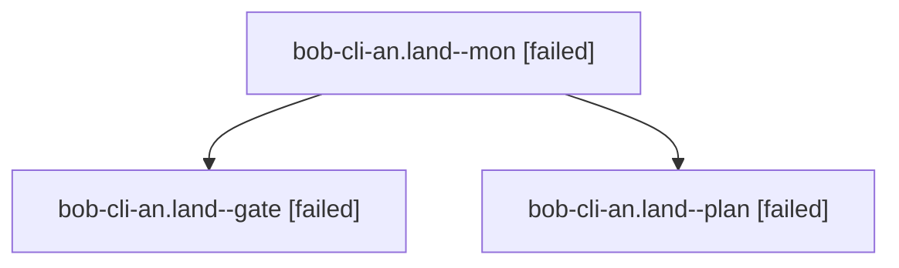

# Session: bob-cli-an.land

[Agent Hoods](../README.md) / [bbugyi200](../users/bbugyi200/README.md) / [athena](../users/bbugyi200/machines/athena/README.md) / [bob-cli-an](../users/bbugyi200/machines/athena/hoods/bob-cli-an/README.md) / bob-cli-an.land

Owner: `bbugyi200.athena` · Hood: `bob-cli-an` · Members: 3 · Bead: [bob-cli-an](https://github.com/bobs-org/bob-cli--beads/blob/main/pages/bob-cli-an/README.md)

## Lineage

The diagram is an optional enhancement; the ordered table below contains the same lineage in accessible text.

| Role | Agent | State | Model / provider | Timing | Commits | Prompt | Chat |
|---|---|---|---|---|---:|---|---|
| mon | bob-cli-an.land--mon | failed | opus / claude | 2026-10-23T16:41:05.438244+00:00 → 2026-10-23T16:44:12.217224+00:00 | 0 | — | [Chat](../agents/bbugyi200.athena.bob-cli-an.land--mon/chat.md) |
| gate | bob-cli-an.land--gate | failed | opus / claude | 2026-10-23T16:40:27.116492+00:00 → 2026-10-23T16:41:06.272393+00:00 | 0 | — | [Chat](../agents/bbugyi200.athena.bob-cli-an.land--gate/chat.md) |
| plan | bob-cli-an.land--plan | failed | opus / claude | 2026-10-23T16:05:52.593093+00:00 → 2026-10-23T16:41:14.713037+00:00 | [1](../agents/bbugyi200.athena.bob-cli-an.land--plan/README.md#commits) | [Prompt](../agents/bbugyi200.athena.bob-cli-an.land--plan/prompt.md) | [Chat](../agents/bbugyi200.athena.bob-cli-an.land--plan/chat.md) |

## Commits

| Role | Repo | Commit | Subject | Committed |
|---|---|---|---|---|
| plan | bob-cli | [`e860379`](https://github.com/bobs-org/bob-cli/commit/e860379a3561eaa400275365ce6788226388aaf9) | docs(vault-sync): justify the gkeep migrate-tasks receipt exclusion | 2026-10-23 12:37:43 EDT |

## Neighbors

| Agent | Relation | State |
|---|---|---|
| [bob-cli-an.1](bbugyi200.athena.bob-cli-an.1.md) (session · 7) | bob-cli-an hood | completed 4, failed 3 |
| [bob-cli-an.2](bbugyi200.athena.bob-cli-an.2.md) (session · 7) | bob-cli-an hood | completed 4, failed 3 |
| [bob-cli-an.3](bbugyi200.athena.bob-cli-an.3.md) (session · 6) | bob-cli-an hood | completed 3, failed 3 |
| [bob-cli-an.4](../agents/bbugyi200.athena.bob-cli-an.4/README.md) | bob-cli-an hood | completed |
| [bob-cli-an.5](../agents/bbugyi200.athena.bob-cli-an.5/README.md) | bob-cli-an hood | completed |
| [bob-cli-an.6.1](bbugyi200.athena.bob-cli-an.6.1.md) (session · 3) | bob-cli-an hood | completed 2, failed 1 |
| [bob-cli-an.6.2](bbugyi200.athena.bob-cli-an.6.2.md) (session · 7) | bob-cli-an hood | completed 4, failed 3 |
| [bob-cli-an.6.3](bbugyi200.athena.bob-cli-an.6.3.md) (session · 3) | bob-cli-an hood | completed 2, failed 1 |
| [bob-cli-an.6.4](bbugyi200.athena.bob-cli-an.6.4.md) (session · 3) | bob-cli-an hood | completed 2, failed 1 |
| [bob-cli-an.6.5](bbugyi200.athena.bob-cli-an.6.5.md) (session · 3) | bob-cli-an hood | completed 2, failed 1 |
| [bob-cli-an.6.land](../agents/bbugyi200.athena.bob-cli-an.6.land/README.md) | bob-cli-an hood | active |
