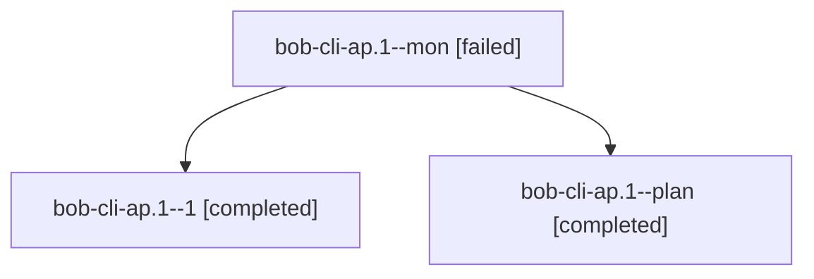

# Session: bob-cli-ap.1

[Agent Hoods](../README.md) / [bbugyi200](../users/bbugyi200/README.md) / [athena](../users/bbugyi200/machines/athena/README.md) / [bob-cli-ap](../users/bbugyi200/machines/athena/hoods/bob-cli-ap/README.md) / bob-cli-ap.1

Owner: `bbugyi200.athena` · Hood: `bob-cli-ap` · Members: 3 · Bead: [bob-cli-ap.1](https://github.com/bobs-org/bob-cli--beads/blob/main/pages/bob-cli-ap/bob-cli-ap.1.md)

## Lineage

The diagram is an optional enhancement; the ordered table below contains the same lineage in accessible text.

| Role | Agent | State | Model / provider | Timing | Commits | Prompt | Chat |
|---|---|---|---|---|---:|---|---|
| mon | bob-cli-ap.1--mon | failed | gpt-6-luna / codex | 2026-10-23T09:47:49.500158+00:00 → 2026-10-23T09:51:53.259326+00:00 | 0 | — | [Chat](../agents/bbugyi200.athena.bob-cli-ap.1--mon/chat.md) |
| 1 | bob-cli-ap.1--1 | completed | gpt-6-luna / codex | 2026-10-23T09:52:38.330060+00:00 → 2026-10-23T10:04:21.425628+00:00 | [1](../agents/bbugyi200.athena.bob-cli-ap.1--1/README.md#commits) | [Prompt](../agents/bbugyi200.athena.bob-cli-ap.1--1/prompt.md) | [Chat](../agents/bbugyi200.athena.bob-cli-ap.1--1/chat.md) |
| plan | bob-cli-ap.1--plan | completed | gpt-6-luna / codex | 2026-10-23T09:27:40.498450+00:00 → 2026-10-23T09:48:39.781818+00:00 | 0 | [Prompt](../agents/bbugyi200.athena.bob-cli-ap.1--plan/prompt.md) | [Chat](../agents/bbugyi200.athena.bob-cli-ap.1--plan/chat.md) |

## Commits

| Role | Repo | Commit | Subject | Committed |
|---|---|---|---|---|
| 1 | bob-cli | [`5376dc6`](https://github.com/bobs-org/bob-cli/commit/5376dc6e7bf2511f7239820fa7e4f55e93772faf) | feat(highlights-ref): render continuation pieces as tucked groups | 2026-10-23 06:02:53 EDT |

## Neighbors

| Agent | Relation | State |
|---|---|---|
| [bob-cli-ap.2](../agents/bbugyi200.athena.bob-cli-ap.2/README.md) | bob-cli-ap hood | completed |
| [bob-cli-ap.3](../agents/bbugyi200.athena.bob-cli-ap.3/README.md) | bob-cli-ap hood | completed |
| [bob-cli-ap.land](bbugyi200.athena.bob-cli-ap.land.md) (session · 3) | bob-cli-ap hood | completed 2, failed 1 |
