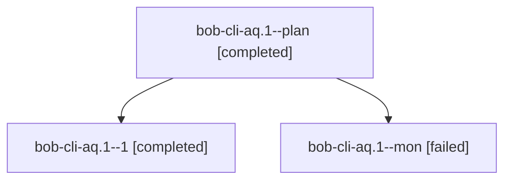

# Session: bob-cli-aq.1

[Agent Hoods](../README.md) / [bbugyi200](../users/bbugyi200/README.md) / [athena](../users/bbugyi200/machines/athena/README.md) / [bob-cli-aq](../users/bbugyi200/machines/athena/hoods/bob-cli-aq/README.md) / bob-cli-aq.1

Owner: `bbugyi200.athena` · Hood: `bob-cli-aq` · Members: 3 · Bead: [bob-cli-aq.1](https://github.com/bobs-org/bob-cli--beads/blob/main/pages/bob-cli-aq/bob-cli-aq.1.md)

## Lineage

The diagram is an optional enhancement; the ordered table below contains the same lineage in accessible text.

| Role | Agent | State | Model / provider | Timing | Commits | Prompt | Chat |
|---|---|---|---|---|---:|---|---|
| plan | bob-cli-aq.1--plan | completed | gpt-6-luna / codex | 2026-10-23T10:37:13.305232+00:00 → 2026-10-23T11:00:46.620597+00:00 | 0 | [Prompt](../agents/bbugyi200.athena.bob-cli-aq.1--plan/prompt.md) | [Chat](../agents/bbugyi200.athena.bob-cli-aq.1--plan/chat.md) |
| 1 | bob-cli-aq.1--1 | completed | gpt-6-luna / codex | 2026-10-23T11:02:51.355338+00:00 → 2026-10-23T11:15:40.796999+00:00 | 0 | [Prompt](../agents/bbugyi200.athena.bob-cli-aq.1--1/prompt.md) | [Chat](../agents/bbugyi200.athena.bob-cli-aq.1--1/chat.md) |
| mon | bob-cli-aq.1--mon | failed | gpt-6-luna / codex | 2026-10-23T10:59:58.323010+00:00 → 2026-10-23T11:02:05.068074+00:00 | 0 | — | [Chat](../agents/bbugyi200.athena.bob-cli-aq.1--mon/chat.md) |

## Neighbors

| Agent | Relation | State |
|---|---|---|
| [bob-cli-aq.2](../agents/bbugyi200.athena.bob-cli-aq.2/README.md) | bob-cli-aq hood | completed |
| [bob-cli-aq.3](../agents/bbugyi200.athena.bob-cli-aq.3/README.md) | bob-cli-aq hood | completed |
| [bob-cli-aq.4](../agents/bbugyi200.athena.bob-cli-aq.4/README.md) | bob-cli-aq hood | completed |
| [bob-cli-aq.land](bbugyi200.athena.bob-cli-aq.land.md) (session · 5) | bob-cli-aq hood | active 1, completed 2, failed 2 |
