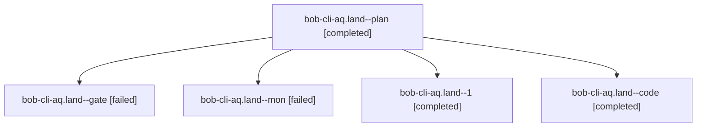

# Session: bob-cli-aq.land

[Agent Hoods](../README.md) / [bbugyi200](../users/bbugyi200/README.md) / [athena](../users/bbugyi200/machines/athena/README.md) / [bob-cli-aq](../users/bbugyi200/machines/athena/hoods/bob-cli-aq/README.md) / bob-cli-aq.land

Owner: `bbugyi200.athena` · Hood: `bob-cli-aq` · Members: 5 · Bead: [bob-cli-aq](https://github.com/bobs-org/bob-cli--beads/blob/main/pages/bob-cli-aq/README.md)

## Lineage



The diagram is an optional enhancement; the ordered table below contains the same lineage in accessible text.

| Role | Agent | State | Model / provider | Timing | Commits | Prompt | Chat |
|---|---|---|---|---|---:|---|---|
| <a id="member-plan"></a>plan | bob-cli-aq.land--plan | completed | gpt-6-astra / codex | 2026-10-23T11:55:13.968351+00:00 → 2026-10-23T12:20:12.752052+00:00 | 0 | [Prompt](../agents/bbugyi200.athena.bob-cli-aq.land--plan/prompt.md) | [Chat](../agents/bbugyi200.athena.bob-cli-aq.land--plan/chat.md) |
| <a id="member-gate"></a>gate | bob-cli-aq.land--gate | failed | gpt-6-astra / codex | 2026-10-23T12:12:10.906280+00:00 → 2026-10-23T12:12:38.752203+00:00 | 0 | — | [Chat](../agents/bbugyi200.athena.bob-cli-aq.land--gate/chat.md) |
| <a id="member-mon"></a>mon | bob-cli-aq.land--mon | failed | gpt-6-luna / codex | 2026-10-23T12:19:25.614353+00:00 → 2026-10-23T12:21:32.733622+00:00 | 0 | — | [Chat](../agents/bbugyi200.athena.bob-cli-aq.land--mon/chat.md) |
| <a id="member-1"></a>1 | bob-cli-aq.land--1 | completed | gpt-6-luna / codex | 2026-10-23T12:22:17.347271+00:00 → 2026-10-23T12:37:21.540953+00:00 | 0 | [Prompt](../agents/bbugyi200.athena.bob-cli-aq.land--1/prompt.md) | [Chat](../agents/bbugyi200.athena.bob-cli-aq.land--1/chat.md) |
| <a id="member-code"></a>code | bob-cli-aq.land--code | completed | gpt-6-luna / codex | 2026-10-23T12:13:00.961053+00:00 → 2026-10-23T12:20:12.752052+00:00 | 0 | — | [Chat](../agents/bbugyi200.athena.bob-cli-aq.land--code/chat.md) |

## Variables

| Role | Variable | Value |
|---|---|---|
| plan | `artifacts` | \[{bead: bob-cli-aq, kind: file, label: bob-cli-aq landing: plugin suite at 060395d, 3456 pass and six known failures, path: /home/bryan/.sase/artifacts/agents/gh\_bobs-org\_\_bob-cli/20261023063611/bob-… |

#### artifacts

**Role:** `plan`

```yaml
- bead: bob-cli-aq
  kind: file
  label: bob-cli-aq landing: plugin suite at 060395d, 3456 pass and six known failures
  path: /home/bryan/.sase/artifacts/agents/gh_bobs-org__bob-cli/20261023063611/bob-cli-aq-npm-test-be6d57c35040.log
  ref: file:explicit:0a34f570c8df4a1a3090c7f9
  source_path: /tmp/bob-cli-aq-npm-test.log
```

Values are truncated for display; see each member's agent meta.json for the full values.

## Neighbors

| Agent | Relation | State |
|---|---|---|
| [bob-cli-aq.1](bbugyi200.athena.bob-cli-aq.1.md) (session · 3) | bob-cli-aq hood | completed 2, failed 1 |
| [bob-cli-aq.2](../agents/bbugyi200.athena.bob-cli-aq.2/README.md) | bob-cli-aq hood | completed |
| [bob-cli-aq.3](../agents/bbugyi200.athena.bob-cli-aq.3/README.md) | bob-cli-aq hood | completed |
| [bob-cli-aq.4](../agents/bbugyi200.athena.bob-cli-aq.4/README.md) | bob-cli-aq hood | completed |
