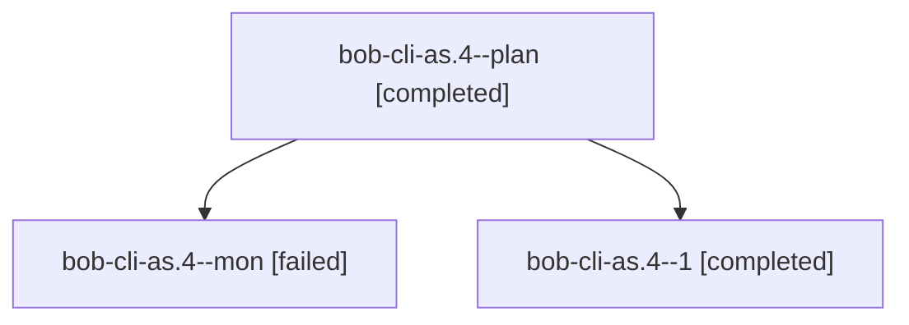

# Session: bob-cli-as.4

[Agent Hoods](../README.md) / [bbugyi200](../users/bbugyi200/README.md) / [athena](../users/bbugyi200/machines/athena/README.md) / [bob-cli-as](../users/bbugyi200/machines/athena/hoods/bob-cli-as/README.md) / bob-cli-as.4

Owner: `bbugyi200.athena` · Hood: `bob-cli-as` · Members: 3 · Bead: [bob-cli-as.4](https://github.com/bobs-org/bob-cli--beads/blob/main/pages/bob-cli-as/bob-cli-as.4.md)

## Lineage

The diagram is an optional enhancement; the ordered table below contains the same lineage in accessible text.

| Role | Agent | State | Model / provider | Timing | Commits | Prompt | Chat |
|---|---|---|---|---|---:|---|---|
| plan | bob-cli-as.4--plan | completed | gpt-6-astra / codex | 2026-10-23T13:29:12.948427+00:00 → 2026-10-23T13:51:22.207298+00:00 | 0 | [Prompt](../agents/bbugyi200.athena.bob-cli-as.4--plan/prompt.md) | [Chat](../agents/bbugyi200.athena.bob-cli-as.4--plan/chat.md) |
| mon | bob-cli-as.4--mon | failed | gpt-6-astra / codex | 2026-10-23T13:47:50.275727+00:00 → 2026-10-23T13:52:41.374315+00:00 | 0 | — | [Chat](../agents/bbugyi200.athena.bob-cli-as.4--mon/chat.md) |
| 1 | bob-cli-as.4--1 | completed | gpt-6-astra / codex | 2026-10-23T13:54:57.414140+00:00 → 2026-10-23T14:05:10.868551+00:00 | 0 | [Prompt](../agents/bbugyi200.athena.bob-cli-as.4--1/prompt.md) | [Chat](../agents/bbugyi200.athena.bob-cli-as.4--1/chat.md) |

## Neighbors

| Agent | Relation | State |
|---|---|---|
| [bob-cli-as.1](../agents/bbugyi200.athena.bob-cli-as.1/README.md) | bob-cli-as hood | completed |
| [bob-cli-as.2](../agents/bbugyi200.athena.bob-cli-as.2/README.md) | bob-cli-as hood | completed |
| [bob-cli-as.3](../agents/bbugyi200.athena.bob-cli-as.3/README.md) | bob-cli-as hood | completed |
| [bob-cli-as.5](../agents/bbugyi200.athena.bob-cli-as.5/README.md) | bob-cli-as hood | active |
| [bob-cli-as.6](../agents/bbugyi200.athena.bob-cli-as.6/README.md) | bob-cli-as hood | waiting |
| [bob-cli-as.7](../agents/bbugyi200.athena.bob-cli-as.7/README.md) | bob-cli-as hood | waiting |
| [bob-cli-as.8](../agents/bbugyi200.athena.bob-cli-as.8/README.md) | bob-cli-as hood | completed |
| [bob-cli-as.9](../agents/bbugyi200.athena.bob-cli-as.9/README.md) | bob-cli-as hood | waiting |
| [bob-cli-as.land](../agents/bbugyi200.athena.bob-cli-as.land/README.md) | bob-cli-as hood | waiting |
