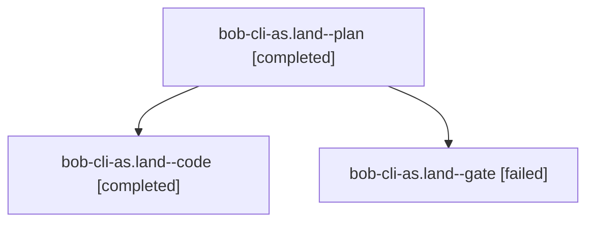

# Session: bob-cli-as.land

[Agent Hoods](../README.md) / [bbugyi200](../users/bbugyi200/README.md) / [athena](../users/bbugyi200/machines/athena/README.md) / [bob-cli-as](../users/bbugyi200/machines/athena/hoods/bob-cli-as/README.md) / bob-cli-as.land

Owner: `bbugyi200.athena` · Hood: `bob-cli-as` · Members: 3 · Bead: [bob-cli-as](https://github.com/bobs-org/bob-cli--beads/blob/main/pages/bob-cli-as/README.md)

## Lineage

The diagram is an optional enhancement; the ordered table below contains the same lineage in accessible text.

| Role | Agent | State | Model / provider | Timing | Commits | Prompt | Chat |
|---|---|---|---|---|---:|---|---|
| plan | bob-cli-as.land--plan | completed | opus / claude | 2026-10-23T15:18:21.243963+00:00 → 2026-10-23T16:02:25.443364+00:00 | 0 | [Prompt](../agents/bbugyi200.athena.bob-cli-as.land--plan/prompt.md) | [Chat](../agents/bbugyi200.athena.bob-cli-as.land--plan/chat.md) |
| code | bob-cli-as.land--code | completed | muse-spark-1.3-contributor / muse | 2026-10-23T15:40:14.694097+00:00 → 2026-10-23T16:02:25.443364+00:00 | [1](../agents/bbugyi200.athena.bob-cli-as.land--code/README.md#commits) | — | [Chat](../agents/bbugyi200.athena.bob-cli-as.land--code/chat.md) |
| gate | bob-cli-as.land--gate | failed | opus / claude | 2026-10-23T15:39:18.666917+00:00 → 2026-10-23T15:39:50.641926+00:00 | 0 | — | [Chat](../agents/bbugyi200.athena.bob-cli-as.land--gate/chat.md) |

## Commits

| Role | Repo | Commit | Subject | Committed |
|---|---|---|---|---|
| code | bob-cli | [`c07a65c`](https://github.com/bobs-org/bob-cli/commit/c07a65cc704bc33a31cda61a918e310fabe5d2f9) | feat(rotten-log): land Rotten Log consequence tests and docs | 2026-10-23 11:59:45 EDT |

## Neighbors

| Agent | Relation | State |
|---|---|---|
| [bob-cli-as.1](../agents/bbugyi200.athena.bob-cli-as.1/README.md) | bob-cli-as hood | completed |
| [bob-cli-as.2](../agents/bbugyi200.athena.bob-cli-as.2/README.md) | bob-cli-as hood | completed |
| [bob-cli-as.3](../agents/bbugyi200.athena.bob-cli-as.3/README.md) | bob-cli-as hood | completed |
| [bob-cli-as.4](bbugyi200.athena.bob-cli-as.4.md) (session · 3) | bob-cli-as hood | completed 2, failed 1 |
| [bob-cli-as.4](../agents/bbugyi200.athena.bob-cli-as.4/README.md) | bob-cli-as hood | active |
| [bob-cli-as.5](../agents/bbugyi200.athena.bob-cli-as.5/README.md) | bob-cli-as hood | completed |
| [bob-cli-as.6](../agents/bbugyi200.athena.bob-cli-as.6/README.md) | bob-cli-as hood | completed |
| [bob-cli-as.7](../agents/bbugyi200.athena.bob-cli-as.7/README.md) | bob-cli-as hood | completed |
| [bob-cli-as.8](../agents/bbugyi200.athena.bob-cli-as.8/README.md) | bob-cli-as hood | completed |
| [bob-cli-as.9](../agents/bbugyi200.athena.bob-cli-as.9/README.md) | bob-cli-as hood | completed |
