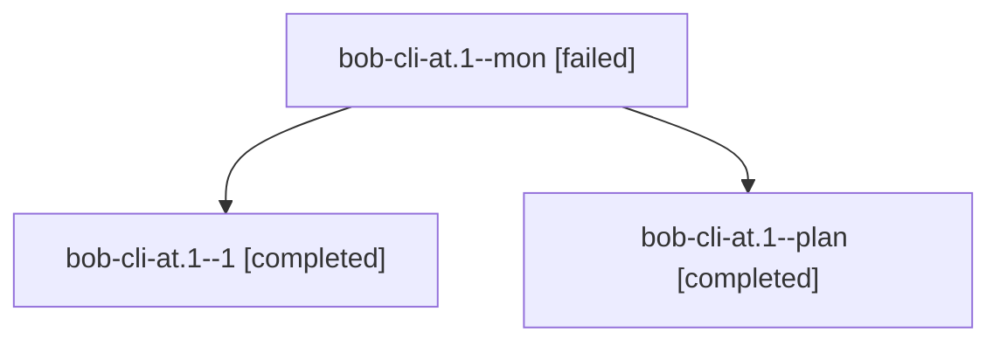

# Session: bob-cli-at.1

[Agent Hoods](../README.md) / [bbugyi200](../users/bbugyi200/README.md) / [athena](../users/bbugyi200/machines/athena/README.md) / [bob-cli-at](../users/bbugyi200/machines/athena/hoods/bob-cli-at/README.md) / bob-cli-at.1

Owner: `bbugyi200.athena` · Hood: `bob-cli-at` · Members: 3 · Bead: [bob-cli-at.1](https://github.com/bobs-org/bob-cli--beads/blob/main/pages/bob-cli-at/bob-cli-at.1.md)

## Lineage

The diagram is an optional enhancement; the ordered table below contains the same lineage in accessible text.

| Role | Agent | State | Model / provider | Timing | Commits | Prompt | Chat |
|---|---|---|---|---|---:|---|---|
| mon | bob-cli-at.1--mon | failed | gpt-6-astra / codex | 2026-10-23T16:30:42.738334+00:00 → 2026-10-23T16:37:47.144305+00:00 | 0 | — | [Chat](../agents/bbugyi200.athena.bob-cli-at.1--mon/chat.md) |
| 1 | bob-cli-at.1--1 | completed | gpt-6-astra / codex | 2026-10-23T16:38:39.959086+00:00 → 2026-10-23T16:46:08.382589+00:00 | [1](../agents/bbugyi200.athena.bob-cli-at.1--1/README.md#commits) | [Prompt](../agents/bbugyi200.athena.bob-cli-at.1--1/prompt.md) | [Chat](../agents/bbugyi200.athena.bob-cli-at.1--1/chat.md) |
| plan | bob-cli-at.1--plan | completed | gpt-6-astra / codex | 2026-10-23T16:17:38.319911+00:00 → 2026-10-23T16:31:16.346245+00:00 | 0 | [Prompt](../agents/bbugyi200.athena.bob-cli-at.1--plan/prompt.md) | [Chat](../agents/bbugyi200.athena.bob-cli-at.1--plan/chat.md) |

## Commits

| Role | Repo | Commit | Subject | Committed |
|---|---|---|---|---|
| 1 | bob-cli | [`0aec807`](https://github.com/bobs-org/bob-cli/commit/0aec807c422c4a1d3d1be6ba5daa078473242071) | feat(native): add bounded macOS file coordination | 2026-10-23 12:44:36 EDT |

## Neighbors

| Agent | Relation | State |
|---|---|---|
| [bob-cli-at.2](bbugyi200.athena.bob-cli-at.2.md) (session · 5) | bob-cli-at hood | completed 3, failed 2 |
| [bob-cli-at.3](../agents/bbugyi200.athena.bob-cli-at.3/README.md) | bob-cli-at hood | completed |
| [bob-cli-at.4](../agents/bbugyi200.athena.bob-cli-at.4/README.md) | bob-cli-at hood | completed |
| [bob-cli-at.5](bbugyi200.athena.bob-cli-at.5.md) (session · 11) | bob-cli-at hood | completed 6, failed 5 |
| [bob-cli-at.6](../agents/bbugyi200.athena.bob-cli-at.6/README.md) | bob-cli-at hood | completed |
| [bob-cli-at.7](../agents/bbugyi200.athena.bob-cli-at.7/README.md) | bob-cli-at hood | active |
| [bob-cli-at.land](../agents/bbugyi200.athena.bob-cli-at.land/README.md) | bob-cli-at hood | waiting |
