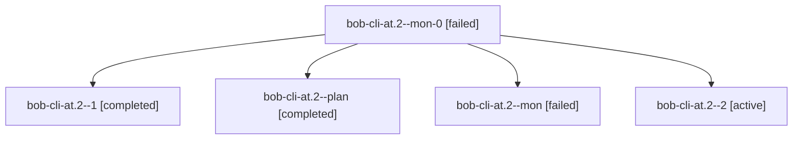

# Session: bob-cli-at.2

[Agent Hoods](../README.md) / [bbugyi200](../users/bbugyi200/README.md) / [athena](../users/bbugyi200/machines/athena/README.md) / [bob-cli-at](../users/bbugyi200/machines/athena/hoods/bob-cli-at/README.md) / bob-cli-at.2

Owner: `bbugyi200.athena` · Hood: `bob-cli-at` · Members: 5 · Bead: [bob-cli-at.2](https://github.com/bobs-org/bob-cli--beads/blob/main/pages/bob-cli-at/bob-cli-at.2.md)

## Lineage

The diagram is an optional enhancement; the ordered table below contains the same lineage in accessible text.

| Role | Agent | State | Model / provider | Timing | Commits | Prompt | Chat |
|---|---|---|---|---|---:|---|---|
| mon-0 | bob-cli-at.2--mon-0 | failed | gpt-6-luna / codex | 2026-10-23T16:06:23.202985+00:00 → 2026-10-23T16:14:44.726045+00:00 | 0 | — | [Chat](../agents/bbugyi200.athena.bob-cli-at.2--mon-0/chat.md) |
| 1 | bob-cli-at.2--1 | completed | gpt-6-luna / codex | 2026-10-23T15:59:51.447824+00:00 → 2026-10-23T16:08:20.705224+00:00 | 0 | [Prompt](../agents/bbugyi200.athena.bob-cli-at.2--1/prompt.md) | [Chat](../agents/bbugyi200.athena.bob-cli-at.2--1/chat.md) |
| plan | bob-cli-at.2--plan | completed | gpt-6-luna / codex | 2026-10-23T15:46:46.452129+00:00 → 2026-10-23T15:57:13.880084+00:00 | 0 | [Prompt](../agents/bbugyi200.athena.bob-cli-at.2--plan/prompt.md) | [Chat](../agents/bbugyi200.athena.bob-cli-at.2--plan/chat.md) |
| mon | bob-cli-at.2--mon | failed | gpt-6-luna / codex | 2026-10-23T15:56:04.997205+00:00 → 2026-10-23T15:58:51.274286+00:00 | 0 | — | [Chat](../agents/bbugyi200.athena.bob-cli-at.2--mon/chat.md) |
| 2 | bob-cli-at.2--2 | active | grok-4.6 / grok | 2026-10-23T16:17:00.828919+00:00 | [1](../agents/bbugyi200.athena.bob-cli-at.2--2/README.md#commits) | [Prompt](../agents/bbugyi200.athena.bob-cli-at.2--2/prompt.md) | — |

## Commits

| Role | Repo | Commit | Subject | Committed |
|---|---|---|---|---|
| 2 | bob-cli | [`6480e7c`](https://github.com/bobs-org/bob-cli/commit/6480e7cc7c84d168559cad6b4d3ec9c5831af3d6) | feat(highlights-ref): stage PDF write policy and reading-activity probe | 2026-10-23 12:21:55 EDT |

## Neighbors

| Agent | Relation | State |
|---|---|---|
| [bob-cli-at.1](../agents/bbugyi200.athena.bob-cli-at.1/README.md) | bob-cli-at hood | active |
| [bob-cli-at.3](../agents/bbugyi200.athena.bob-cli-at.3/README.md) | bob-cli-at hood | waiting |
| [bob-cli-at.4](../agents/bbugyi200.athena.bob-cli-at.4/README.md) | bob-cli-at hood | waiting |
| [bob-cli-at.5](../agents/bbugyi200.athena.bob-cli-at.5/README.md) | bob-cli-at hood | waiting |
| [bob-cli-at.6](../agents/bbugyi200.athena.bob-cli-at.6/README.md) | bob-cli-at hood | waiting |
| [bob-cli-at.7](../agents/bbugyi200.athena.bob-cli-at.7/README.md) | bob-cli-at hood | waiting |
| [bob-cli-at.land](../agents/bbugyi200.athena.bob-cli-at.land/README.md) | bob-cli-at hood | waiting |
