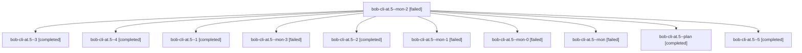

# Session: bob-cli-at.5

[Agent Hoods](../README.md) / [bbugyi200](../users/bbugyi200/README.md) / [athena](../users/bbugyi200/machines/athena/README.md) / [bob-cli-at](../users/bbugyi200/machines/athena/hoods/bob-cli-at/README.md) / bob-cli-at.5

Owner: `bbugyi200.athena` · Hood: `bob-cli-at` · Members: 11 · Bead: [bob-cli-at.5](https://github.com/bobs-org/bob-cli--beads/blob/main/pages/bob-cli-at/bob-cli-at.5.md)

## Lineage

The diagram is an optional enhancement; the ordered table below contains the same lineage in accessible text.

| Role | Agent | State | Model / provider | Timing | Commits | Prompt | Chat |
|---|---|---|---|---|---:|---|---|
| mon-2 | bob-cli-at.5--mon-2 | failed | gpt-6-luna / codex | 2026-10-23T19:11:00.520328+00:00 → 2026-10-23T19:13:35.744172+00:00 | 0 | — | [Chat](../agents/bbugyi200.athena.bob-cli-at.5--mon-2/chat.md) |
| 3 | bob-cli-at.5--3 | completed | gpt-6-luna / codex | 2026-10-23T19:06:10.722325+00:00 → 2026-10-23T19:11:53.286927+00:00 | 0 | [Prompt](../agents/bbugyi200.athena.bob-cli-at.5--3/prompt.md) | [Chat](../agents/bbugyi200.athena.bob-cli-at.5--3/chat.md) |
| 4 | bob-cli-at.5--4 | completed | gpt-6-luna / codex | 2026-10-23T19:14:34.443764+00:00 → 2026-10-23T19:20:24.395217+00:00 | 0 | [Prompt](../agents/bbugyi200.athena.bob-cli-at.5--4/prompt.md) | [Chat](../agents/bbugyi200.athena.bob-cli-at.5--4/chat.md) |
| 1 | bob-cli-at.5--1 | completed | gpt-6-luna / codex | 2026-10-23T18:47:16.385893+00:00 → 2026-10-23T18:53:13.068302+00:00 | 0 | [Prompt](../agents/bbugyi200.athena.bob-cli-at.5--1/prompt.md) | [Chat](../agents/bbugyi200.athena.bob-cli-at.5--1/chat.md) |
| mon-3 | bob-cli-at.5--mon-3 | failed | gpt-6-luna / codex | 2026-10-23T19:19:30.919264+00:00 → 2026-10-23T19:22:53.930927+00:00 | 0 | — | [Chat](../agents/bbugyi200.athena.bob-cli-at.5--mon-3/chat.md) |
| 2 | bob-cli-at.5--2 | completed | gpt-6-luna / codex | 2026-10-23T18:56:29.825576+00:00 → 2026-10-23T19:02:36.155638+00:00 | 0 | [Prompt](../agents/bbugyi200.athena.bob-cli-at.5--2/prompt.md) | [Chat](../agents/bbugyi200.athena.bob-cli-at.5--2/chat.md) |
| mon-1 | bob-cli-at.5--mon-1 | failed | gpt-6-luna / codex | 2026-10-23T19:02:04.532930+00:00 → 2026-10-23T19:05:12.301704+00:00 | 0 | — | [Chat](../agents/bbugyi200.athena.bob-cli-at.5--mon-1/chat.md) |
| mon-0 | bob-cli-at.5--mon-0 | failed | gpt-6-luna / codex | 2026-10-23T18:52:36.696888+00:00 → 2026-10-23T18:56:28.194958+00:00 | 0 | — | [Chat](../agents/bbugyi200.athena.bob-cli-at.5--mon-0/chat.md) |
| mon | bob-cli-at.5--mon | failed | gpt-6-luna / codex | 2026-10-23T18:43:35.820968+00:00 → 2026-10-23T18:46:02.552167+00:00 | 0 | — | [Chat](../agents/bbugyi200.athena.bob-cli-at.5--mon/chat.md) |
| plan | bob-cli-at.5--plan | completed | gpt-6-luna / codex | 2026-10-23T18:34:31.299703+00:00 → 2026-10-23T18:44:34.378965+00:00 | 0 | [Prompt](../agents/bbugyi200.athena.bob-cli-at.5--plan/prompt.md) | [Chat](../agents/bbugyi200.athena.bob-cli-at.5--plan/chat.md) |
| 5 | bob-cli-at.5--5 | completed | gpt-6-luna / codex | 2026-10-23T19:23:50.137392+00:00 → 2026-10-23T19:30:03.364768+00:00 | 0 | [Prompt](../agents/bbugyi200.athena.bob-cli-at.5--5/prompt.md) | [Chat](../agents/bbugyi200.athena.bob-cli-at.5--5/chat.md) |

## Neighbors

| Agent | Relation | State |
|---|---|---|
| [bob-cli-at.1](bbugyi200.athena.bob-cli-at.1.md) (session · 3) | bob-cli-at hood | completed 2, failed 1 |
| [bob-cli-at.2](bbugyi200.athena.bob-cli-at.2.md) (session · 5) | bob-cli-at hood | completed 3, failed 2 |
| [bob-cli-at.3](../agents/bbugyi200.athena.bob-cli-at.3/README.md) | bob-cli-at hood | completed |
| [bob-cli-at.4](../agents/bbugyi200.athena.bob-cli-at.4/README.md) | bob-cli-at hood | completed |
| [bob-cli-at.6](../agents/bbugyi200.athena.bob-cli-at.6/README.md) | bob-cli-at hood | active |
| [bob-cli-at.7](../agents/bbugyi200.athena.bob-cli-at.7/README.md) | bob-cli-at hood | waiting |
| [bob-cli-at.land](../agents/bbugyi200.athena.bob-cli-at.land/README.md) | bob-cli-at hood | waiting |
