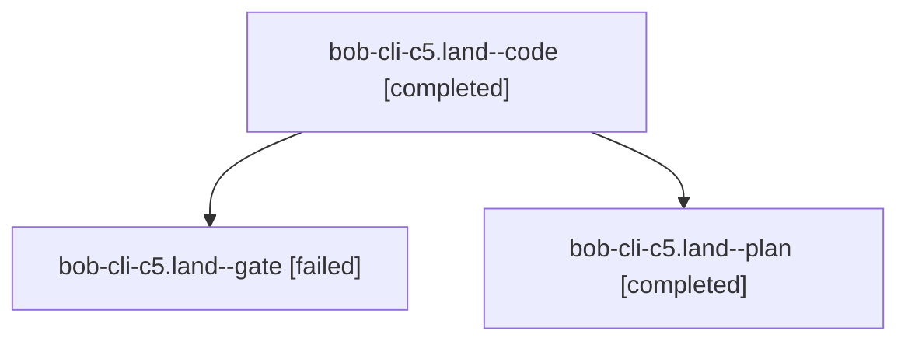

# Session: bob-cli-c5.land

[Agent Hoods](../README.md) / [bbugyi200](../users/bbugyi200/README.md) / [athena](../users/bbugyi200/machines/athena/README.md) / [bob-cli-c5](../users/bbugyi200/machines/athena/hoods/bob-cli-c5/README.md) / bob-cli-c5.land

Owner: `bbugyi200.athena` · Hood: `bob-cli-c5` · Members: 3 · Bead: [bob-cli-c5](https://github.com/bobs-org/bob-cli--beads/blob/main/pages/bob-cli-c5/README.md)

## Lineage



The diagram is an optional enhancement; the ordered table below contains the same lineage in accessible text.

| Role | Agent | State | Model / provider | Timing | Commits | Prompt | Chat |
|---|---|---|---|---|---:|---|---|
| <a id="member-code"></a>code | bob-cli-c5.land--code | completed | muse-spark-1.3-contributor / muse | 2026-10-25T16:34:59.716952+00:00 → 2026-10-25T16:56:56.689197+00:00 | [1](../agents/bbugyi200.athena.bob-cli-c5.land--code/README.md#commits) | — | [Chat](../agents/bbugyi200.athena.bob-cli-c5.land--code/chat.md) |
| <a id="member-gate"></a>gate | bob-cli-c5.land--gate | failed | opus / claude | 2026-10-25T16:33:56.992825+00:00 → 2026-10-25T16:34:30.192508+00:00 | 0 | — | [Chat](../agents/bbugyi200.athena.bob-cli-c5.land--gate/chat.md) |
| <a id="member-plan"></a>plan | bob-cli-c5.land--plan | completed | opus / claude | 2026-10-25T16:18:57.554410+00:00 → 2026-10-25T16:56:56.689197+00:00 | 0 | [Prompt](../agents/bbugyi200.athena.bob-cli-c5.land--plan/prompt.md) | [Chat](../agents/bbugyi200.athena.bob-cli-c5.land--plan/chat.md) |

## Commits

| Role | Repo | Commit | Subject | Committed |
|---|---|---|---|---|
| code | bob-cli | [`4e3a391`](https://github.com/bobs-org/bob-cli/commit/4e3a39150c37f83a0134baf6a61035992af42430) | docs(stats): distinct colours per root parent in Day strip and dash | 2026-10-25 12:54:48 EDT |

## Variables

| Role | Variable | Value |
|---|---|---|
| code | `artifacts` | \[{bead: bob-cli-c5, kind: image, label: Day strip same-area roots get distinct hues (light, 700px), path: /home/bryan/.sase/artifacts/agents/gh\_bobs-org\_\_bob-cli/20261025123459/day-strip-700-light-2a… |

#### artifacts

**Role:** `code`

```yaml
- bead: bob-cli-c5
  kind: image
  label: Day strip same-area roots get distinct hues (light, 700px)
  path: /home/bryan/.sase/artifacts/agents/gh_bobs-org__bob-cli/20261025123459/day-strip-700-light-2a9c6588ecc5.png
  ref: file:explicit:7ab52cb4f56575ba18bda295
  source_path: /tmp/bob-day-strip-preview/day-strip-700-light.png
- bead: bob-cli-c5
  kind: image
  label: Day strip same-area roots get distinct hues (dark, 700px)
  path: /home/bryan/.sase/artifacts/agents/gh_bobs-org__bob-cli/20261025123459/day-strip-700-dark-5a2641f445bf.png
  ref: file:explicit:63ae84e2d7c276db27a5cf47
  source_path: /tmp/bob-day-strip-preview/day-strip-700-dark.png
```

Values are truncated for display; see each member's agent meta.json for the full values.

## Neighbors

| Agent | Relation | State |
|---|---|---|
| [bob-cli-c5.1](../agents/bbugyi200.athena.bob-cli-c5.1/README.md) | bob-cli-c5 hood | completed |
| [bob-cli-c5.2](../agents/bbugyi200.athena.bob-cli-c5.2/README.md) | bob-cli-c5 hood | completed |
| [bob-cli-c5.3](../agents/bbugyi200.athena.bob-cli-c5.3/README.md) | bob-cli-c5 hood | completed |
| [bob-cli-c5.4](../agents/bbugyi200.athena.bob-cli-c5.4/README.md) | bob-cli-c5 hood | completed |
| [bob-cli-c5.5](../agents/bbugyi200.athena.bob-cli-c5.5/README.md) | bob-cli-c5 hood | completed |
