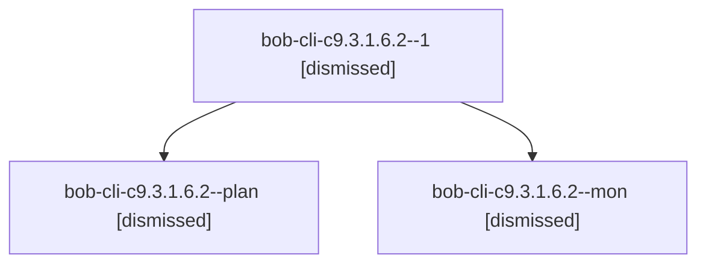

# Session: bob-cli-c9.3.1.6.2

[Agent Hoods](../README.md) / [bbugyi200](../users/bbugyi200/README.md) / [athena](../users/bbugyi200/machines/athena/README.md) / [bob-cli-c9](../users/bbugyi200/machines/athena/hoods/bob-cli-c9/README.md) / bob-cli-c9.3.1.6.2

Owner: `bbugyi200.athena` · Hood: `bob-cli-c9` · Members: 3 · Bead: [bob-cli-c9.3.1.6.2](https://github.com/bobs-org/bob-cli--beads/blob/main/pages/bob-cli-c9/bob-cli-c9.3.1.6.2.md)

## Lineage

The diagram is an optional enhancement; the ordered table below contains the same lineage in accessible text.

| Role | Agent | State | Model / provider | Timing | Commits | Prompt | Chat |
|---|---|---|---|---|---:|---|---|
| 1 | bob-cli-c9.3.1.6.2--1 | dismissed | gpt-6-luna / codex | 2026-10-25T20:25:50.711771 → 2026-10-25T20:32:12.755126 | [1](../agents/bbugyi200.athena.bob-cli-c9.3.1.6.2--1/README.md#commits) | [Prompt](../agents/bbugyi200.athena.bob-cli-c9.3.1.6.2--1/prompt.md) | [Chat](../agents/bbugyi200.athena.bob-cli-c9.3.1.6.2--1/chat.md) |
| plan | bob-cli-c9.3.1.6.2--plan | dismissed | gpt-6-luna / codex | 2026-10-25T20:03:03.377157 → 2026-10-25T20:23:25.038950 | 0 | [Prompt](../agents/bbugyi200.athena.bob-cli-c9.3.1.6.2--plan/prompt.md) | [Chat](../agents/bbugyi200.athena.bob-cli-c9.3.1.6.2--plan/chat.md) |
| mon | bob-cli-c9.3.1.6.2--mon | dismissed | gpt-6-luna / codex | 2026-10-25T20:22:46.458722 → 2026-10-25T20:22:47.821349 | 0 | — | [Chat](../agents/bbugyi200.athena.bob-cli-c9.3.1.6.2--mon/chat.md) |

## Commits

| Role | Repo | Commit | Subject | Committed |
|---|---|---|---|---|
| 1 | — | `e35773e` | fix(ref): preserve family identity for rereads | 2026-10-25 20:30:46 EDT |

## Neighbors

| Agent | Relation | State |
|---|---|---|
| [bob-cli-c9.3](bbugyi200.athena.bob-cli-c9.3.md) (session · 3) | ancestor | failed 3 |
| [bob-cli-c9.3.1.6.1](../agents/bbugyi200.athena.bob-cli-c9.3.1.6.1/README.md) | bob-cli-c9.3.1.6 hood | dismissed |
| [bob-cli-c9.3.1.6.3](../agents/bbugyi200.athena.bob-cli-c9.3.1.6.3/README.md) | bob-cli-c9.3.1.6 hood | dismissed |
| [bob-cli-c9.3.1.6.4](../agents/bbugyi200.athena.bob-cli-c9.3.1.6.4/README.md) | bob-cli-c9.3.1.6 hood | dismissed |
| [bob-cli-c9.3.1.6.land](bbugyi200.athena.bob-cli-c9.3.1.6.land.md) (session · 5) | bob-cli-c9.3.1.6 hood | completed 1, dismissed 3, failed 1 |
| [bob-cli-c9.3.1.1](../agents/bbugyi200.athena.bob-cli-c9.3.1.1/README.md) | bob-cli-c9.3.1 hood | dismissed |
| [bob-cli-c9.3.1.2](../agents/bbugyi200.athena.bob-cli-c9.3.1.2/README.md) | bob-cli-c9.3.1 hood | dismissed |
| [bob-cli-c9.3.1.3](../agents/bbugyi200.athena.bob-cli-c9.3.1.3/README.md) | bob-cli-c9.3.1 hood | dismissed |
| [bob-cli-c9.3.1.4](../agents/bbugyi200.athena.bob-cli-c9.3.1.4/README.md) | bob-cli-c9.3.1 hood | dismissed |
| [bob-cli-c9.3.1.5](../agents/bbugyi200.athena.bob-cli-c9.3.1.5/README.md) | bob-cli-c9.3.1 hood | dismissed |
| [bob-cli-c9.3.1.land](bbugyi200.athena.bob-cli-c9.3.1.land.md) (session · 3) | bob-cli-c9.3.1 hood | dismissed 3 |
| [bob-cli-c9.1](../agents/bbugyi200.athena.bob-cli-c9.1/README.md) | bob-cli-c9 hood | completed |
| [bob-cli-c9.2](../agents/bbugyi200.athena.bob-cli-c9.2/README.md) | bob-cli-c9 hood | completed |
| [bob-cli-c9.4](bbugyi200.athena.bob-cli-c9.4.md) (session · 3) | bob-cli-c9 hood | failed 3 |
| [bob-cli-c9.4.1.1](../agents/bbugyi200.athena.bob-cli-c9.4.1.1/README.md) | bob-cli-c9 hood | dismissed |
| [bob-cli-c9.4.1.2](bbugyi200.athena.bob-cli-c9.4.1.2.md) (session · 5) | bob-cli-c9 hood | dismissed 5 |
| [bob-cli-c9.4.1.3](../agents/bbugyi200.athena.bob-cli-c9.4.1.3/README.md) | bob-cli-c9 hood | dismissed |
| [bob-cli-c9.4.1.4](../agents/bbugyi200.athena.bob-cli-c9.4.1.4/README.md) | bob-cli-c9 hood | dismissed |
| [bob-cli-c9.4.1.5](../agents/bbugyi200.athena.bob-cli-c9.4.1.5/README.md) | bob-cli-c9 hood | dismissed |
| [bob-cli-c9.4.1.6](../agents/bbugyi200.athena.bob-cli-c9.4.1.6/README.md) | bob-cli-c9 hood | dismissed |
| [bob-cli-c9.4.1.7](bbugyi200.athena.bob-cli-c9.4.1.7.md) (session · 3) | bob-cli-c9 hood | dismissed 3 |
| [bob-cli-c9.4.1.8](../agents/bbugyi200.athena.bob-cli-c9.4.1.8/README.md) | bob-cli-c9 hood | dismissed |
| [bob-cli-c9.4.1.9.1](../agents/bbugyi200.athena.bob-cli-c9.4.1.9.1/README.md) | bob-cli-c9 hood | completed |
| [bob-cli-c9.4.1.9.2](../agents/bbugyi200.athena.bob-cli-c9.4.1.9.2/README.md) | bob-cli-c9 hood | completed |
| [bob-cli-c9.4.1.9.3](../agents/bbugyi200.athena.bob-cli-c9.4.1.9.3/README.md) | bob-cli-c9 hood | completed |
| [bob-cli-c9.4.1.9.land](bbugyi200.athena.bob-cli-c9.4.1.9.land.md) (session · 3) | bob-cli-c9 hood | completed 2, failed 1 |
| [bob-cli-c9.4.1.land](bbugyi200.athena.bob-cli-c9.4.1.land.md) (session · 3) | bob-cli-c9 hood | dismissed 3 |
| [bob-cli-c9.5](bbugyi200.athena.bob-cli-c9.5.md) (session · 3) | bob-cli-c9 hood | failed 3 |
| [bob-cli-c9.5.1.1](../agents/bbugyi200.athena.bob-cli-c9.5.1.1/README.md) | bob-cli-c9 hood | completed |
| [bob-cli-c9.5.1.2](bbugyi200.athena.bob-cli-c9.5.1.2.md) (session · 3) | bob-cli-c9 hood | completed 2, failed 1 |
| [bob-cli-c9.5.1.3](../agents/bbugyi200.athena.bob-cli-c9.5.1.3/README.md) | bob-cli-c9 hood | completed |
| [bob-cli-c9.5.1.4](../agents/bbugyi200.athena.bob-cli-c9.5.1.4/README.md) | bob-cli-c9 hood | completed |
| [bob-cli-c9.5.1.5](../agents/bbugyi200.athena.bob-cli-c9.5.1.5/README.md) | bob-cli-c9 hood | completed |
| [bob-cli-c9.5.1.land](bbugyi200.athena.bob-cli-c9.5.1.land.md) (session · 5) | bob-cli-c9 hood | completed 3, failed 2 |
| [bob-cli-c9.6](../agents/bbugyi200.athena.bob-cli-c9.6/README.md) | bob-cli-c9 hood | completed |
| [bob-cli-c9.land](../agents/bbugyi200.athena.bob-cli-c9.land/README.md) | bob-cli-c9 hood | dismissed |
