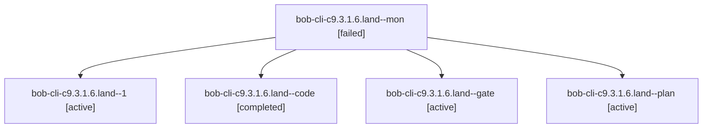

# Session: bob-cli-c9.3.1.6.land

[Agent Hoods](../README.md) / [bbugyi200](../users/bbugyi200/README.md) / [athena](../users/bbugyi200/machines/athena/README.md) / [bob-cli-c9](../users/bbugyi200/machines/athena/hoods/bob-cli-c9/README.md) / bob-cli-c9.3.1.6.land

Owner: `bbugyi200.athena` · Hood: `bob-cli-c9` · Members: 5 · Bead: [bob-cli-c9.3.1.6](https://github.com/bobs-org/bob-cli--beads/blob/main/pages/bob-cli-c9/bob-cli-c9.3.1.6.md)

## Lineage

The diagram is an optional enhancement; the ordered table below contains the same lineage in accessible text.

| Role | Agent | State | Model / provider | Timing | Commits | Prompt | Chat |
|---|---|---|---|---|---:|---|---|
| mon | bob-cli-c9.3.1.6.land--mon | failed | gpt-6-luna / codex | 2026-10-26T02:10:01.537176+00:00 → 2026-10-26T02:15:18.401637+00:00 | 0 | — | [Chat](../agents/bbugyi200.athena.bob-cli-c9.3.1.6.land--mon/chat.md) |
| 1 | bob-cli-c9.3.1.6.land--1 | active | grok-4.6 / grok | 2026-10-26T02:16:13.848614+00:00 | [1](../agents/bbugyi200.athena.bob-cli-c9.3.1.6.land--1/README.md#commits) | [Prompt](../agents/bbugyi200.athena.bob-cli-c9.3.1.6.land--1/prompt.md) | [Chat](../agents/bbugyi200.athena.bob-cli-c9.3.1.6.land--1/chat.md) |
| code | bob-cli-c9.3.1.6.land--code | completed | gpt-6-luna / codex | 2026-10-26T01:57:10.878222+00:00 → 2026-10-26T02:10:44.899643+00:00 | 0 | — | [Chat](../agents/bbugyi200.athena.bob-cli-c9.3.1.6.land--code/chat.md) |
| gate | bob-cli-c9.3.1.6.land--gate | active | gpt-6-astra / codex | 2026-10-26T01:56:11.254036+00:00 | 0 | — | [Chat](../agents/bbugyi200.athena.bob-cli-c9.3.1.6.land--gate/chat.md) |
| plan | bob-cli-c9.3.1.6.land--plan | active | gpt-6-astra / codex | 2026-10-26T01:41:54.419833+00:00 | 0 | [Prompt](../agents/bbugyi200.athena.bob-cli-c9.3.1.6.land--plan/prompt.md) | [Chat](../agents/bbugyi200.athena.bob-cli-c9.3.1.6.land--plan/chat.md) |

## Commits

| Role | Repo | Commit | Subject | Committed |
|---|---|---|---|---|
| 1 | bob-cli | [`b48bd93`](https://github.com/bobs-org/bob-cli/commit/b48bd939cb33a5c5a6e9afea690bc4bed06fc3f4) | fix(ref): name newest narrated reading and resolve exact-output overwrite paths | 2026-10-25 22:22:43 EDT |

## Neighbors

| Agent | Relation | State |
|---|---|---|
| [bob-cli-c9.3](bbugyi200.athena.bob-cli-c9.3.md) (session · 3) | ancestor | failed 3 |
| [bob-cli-c9.3.1.6.1](../agents/bbugyi200.athena.bob-cli-c9.3.1.6.1/README.md) | bob-cli-c9.3.1.6 hood | active |
| [bob-cli-c9.3.1.6.2](bbugyi200.athena.bob-cli-c9.3.1.6.2.md) (session · 3) | bob-cli-c9.3.1.6 hood | active 3 |
| [bob-cli-c9.3.1.6.3](../agents/bbugyi200.athena.bob-cli-c9.3.1.6.3/README.md) | bob-cli-c9.3.1.6 hood | active |
| [bob-cli-c9.3.1.6.4](../agents/bbugyi200.athena.bob-cli-c9.3.1.6.4/README.md) | bob-cli-c9.3.1.6 hood | active |
| [bob-cli-c9.3.1.1](../agents/bbugyi200.athena.bob-cli-c9.3.1.1/README.md) | bob-cli-c9.3.1 hood | active |
| [bob-cli-c9.3.1.2](../agents/bbugyi200.athena.bob-cli-c9.3.1.2/README.md) | bob-cli-c9.3.1 hood | active |
| [bob-cli-c9.3.1.3](../agents/bbugyi200.athena.bob-cli-c9.3.1.3/README.md) | bob-cli-c9.3.1 hood | active |
| [bob-cli-c9.3.1.4](../agents/bbugyi200.athena.bob-cli-c9.3.1.4/README.md) | bob-cli-c9.3.1 hood | active |
| [bob-cli-c9.3.1.5](../agents/bbugyi200.athena.bob-cli-c9.3.1.5/README.md) | bob-cli-c9.3.1 hood | active |
| [bob-cli-c9.3.1.land](bbugyi200.athena.bob-cli-c9.3.1.land.md) (session · 3) | bob-cli-c9.3.1 hood | active 3 |
| [bob-cli-c9.1](../agents/bbugyi200.athena.bob-cli-c9.1/README.md) | bob-cli-c9 hood | completed |
| [bob-cli-c9.2](../agents/bbugyi200.athena.bob-cli-c9.2/README.md) | bob-cli-c9 hood | completed |
| [bob-cli-c9.4](bbugyi200.athena.bob-cli-c9.4.md) (session · 3) | bob-cli-c9 hood | failed 3 |
| [bob-cli-c9.4.1.1](../agents/bbugyi200.athena.bob-cli-c9.4.1.1/README.md) | bob-cli-c9 hood | active |
| [bob-cli-c9.4.1.2](bbugyi200.athena.bob-cli-c9.4.1.2.md) (session · 5) | bob-cli-c9 hood | active 5 |
| [bob-cli-c9.4.1.3](../agents/bbugyi200.athena.bob-cli-c9.4.1.3/README.md) | bob-cli-c9 hood | active |
| [bob-cli-c9.4.1.4](../agents/bbugyi200.athena.bob-cli-c9.4.1.4/README.md) | bob-cli-c9 hood | active |
| [bob-cli-c9.4.1.5](../agents/bbugyi200.athena.bob-cli-c9.4.1.5/README.md) | bob-cli-c9 hood | active |
| [bob-cli-c9.4.1.6](../agents/bbugyi200.athena.bob-cli-c9.4.1.6/README.md) | bob-cli-c9 hood | active |
| [bob-cli-c9.4.1.7](bbugyi200.athena.bob-cli-c9.4.1.7.md) (session · 3) | bob-cli-c9 hood | active 3 |
| [bob-cli-c9.4.1.8](../agents/bbugyi200.athena.bob-cli-c9.4.1.8/README.md) | bob-cli-c9 hood | active |
| [bob-cli-c9.4.1.9.1](../agents/bbugyi200.athena.bob-cli-c9.4.1.9.1/README.md) | bob-cli-c9 hood | completed |
| [bob-cli-c9.4.1.9.2](../agents/bbugyi200.athena.bob-cli-c9.4.1.9.2/README.md) | bob-cli-c9 hood | active |
| [bob-cli-c9.4.1.9.3](../agents/bbugyi200.athena.bob-cli-c9.4.1.9.3/README.md) | bob-cli-c9 hood | waiting |
| [bob-cli-c9.4.1.9.land](../agents/bbugyi200.athena.bob-cli-c9.4.1.9.land/README.md) | bob-cli-c9 hood | waiting |
| [bob-cli-c9.4.1.land](bbugyi200.athena.bob-cli-c9.4.1.land.md) (session · 3) | bob-cli-c9 hood | active 3 |
| [bob-cli-c9.5](../agents/bbugyi200.athena.bob-cli-c9.5/README.md) | bob-cli-c9 hood | waiting |
| [bob-cli-c9.6](../agents/bbugyi200.athena.bob-cli-c9.6/README.md) | bob-cli-c9 hood | waiting |
| [bob-cli-c9.land](../agents/bbugyi200.athena.bob-cli-c9.land/README.md) | bob-cli-c9 hood | waiting |
