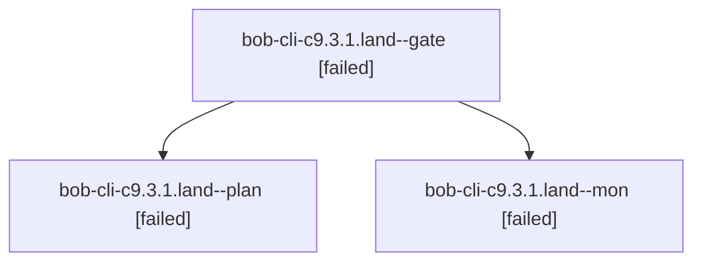

# Session: bob-cli-c9.3.1.land

[Agent Hoods](../README.md) / [bbugyi200](../users/bbugyi200/README.md) / [athena](../users/bbugyi200/machines/athena/README.md) / [bob-cli-c9](../users/bbugyi200/machines/athena/hoods/bob-cli-c9/README.md) / bob-cli-c9.3.1.land

Owner: `bbugyi200.athena` · Hood: `bob-cli-c9` · Members: 3 · Bead: [bob-cli-c9.3.1](https://github.com/bobs-org/bob-cli--beads/blob/main/pages/bob-cli-c9/bob-cli-c9.3.1.md)

## Lineage

The diagram is an optional enhancement; the ordered table below contains the same lineage in accessible text.

| Role | Agent | State | Model / provider | Timing | Commits | Prompt | Chat |
|---|---|---|---|---|---:|---|---|
| gate | bob-cli-c9.3.1.land--gate | failed | opus / claude | 2026-10-25T23:47:59.253894+00:00 → 2026-10-25T23:48:30.073875+00:00 | 0 | — | [Chat](../agents/bbugyi200.athena.bob-cli-c9.3.1.land--gate/chat.md) |
| plan | bob-cli-c9.3.1.land--plan | failed | opus / claude | 2026-10-25T23:18:24.254379+00:00 → 2026-10-25T23:48:39.273891+00:00 | 0 | [Prompt](../agents/bbugyi200.athena.bob-cli-c9.3.1.land--plan/prompt.md) | [Chat](../agents/bbugyi200.athena.bob-cli-c9.3.1.land--plan/chat.md) |
| mon | bob-cli-c9.3.1.land--mon | failed | opus / claude | 2026-10-25T23:48:29.495969+00:00 → 2026-10-25T23:51:00.667416+00:00 | 0 | — | [Chat](../agents/bbugyi200.athena.bob-cli-c9.3.1.land--mon/chat.md) |

## Neighbors

| Agent | Relation | State |
|---|---|---|
| [bob-cli-c9.3](bbugyi200.athena.bob-cli-c9.3.md) (session · 3) | ancestor | failed 3 |
| [bob-cli-c9.3.1.1](../agents/bbugyi200.athena.bob-cli-c9.3.1.1/README.md) | bob-cli-c9.3.1 hood | completed |
| [bob-cli-c9.3.1.2](../agents/bbugyi200.athena.bob-cli-c9.3.1.2/README.md) | bob-cli-c9.3.1 hood | completed |
| [bob-cli-c9.3.1.3](../agents/bbugyi200.athena.bob-cli-c9.3.1.3/README.md) | bob-cli-c9.3.1 hood | completed |
| [bob-cli-c9.3.1.4](../agents/bbugyi200.athena.bob-cli-c9.3.1.4/README.md) | bob-cli-c9.3.1 hood | completed |
| [bob-cli-c9.3.1.5](../agents/bbugyi200.athena.bob-cli-c9.3.1.5/README.md) | bob-cli-c9.3.1 hood | completed |
| [bob-cli-c9.3.1.6.1](../agents/bbugyi200.athena.bob-cli-c9.3.1.6.1/README.md) | bob-cli-c9.3.1 hood | completed |
| [bob-cli-c9.3.1.6.2](bbugyi200.athena.bob-cli-c9.3.1.6.2.md) (session · 3) | bob-cli-c9.3.1 hood | active 1, completed 1, failed 1 |
| [bob-cli-c9.3.1.6.3](../agents/bbugyi200.athena.bob-cli-c9.3.1.6.3/README.md) | bob-cli-c9.3.1 hood | waiting |
| [bob-cli-c9.3.1.6.4](../agents/bbugyi200.athena.bob-cli-c9.3.1.6.4/README.md) | bob-cli-c9.3.1 hood | waiting |
| [bob-cli-c9.3.1.6.land](../agents/bbugyi200.athena.bob-cli-c9.3.1.6.land/README.md) | bob-cli-c9.3.1 hood | waiting |
| [bob-cli-c9.1](../agents/bbugyi200.athena.bob-cli-c9.1/README.md) | bob-cli-c9 hood | completed |
| [bob-cli-c9.2](../agents/bbugyi200.athena.bob-cli-c9.2/README.md) | bob-cli-c9 hood | completed |
| [bob-cli-c9.4](../agents/bbugyi200.athena.bob-cli-c9.4/README.md) | bob-cli-c9 hood | waiting |
| [bob-cli-c9.5](../agents/bbugyi200.athena.bob-cli-c9.5/README.md) | bob-cli-c9 hood | waiting |
| [bob-cli-c9.6](../agents/bbugyi200.athena.bob-cli-c9.6/README.md) | bob-cli-c9 hood | waiting |
| [bob-cli-c9.land](../agents/bbugyi200.athena.bob-cli-c9.land/README.md) | bob-cli-c9 hood | waiting |
