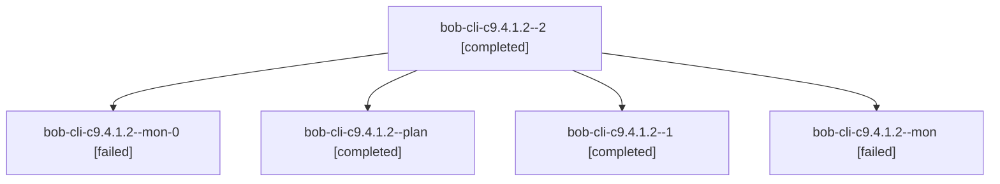

# Session: bob-cli-c9.4.1.2

[Agent Hoods](../README.md) / [bbugyi200](../users/bbugyi200/README.md) / [athena](../users/bbugyi200/machines/athena/README.md) / [bob-cli-c9](../users/bbugyi200/machines/athena/hoods/bob-cli-c9/README.md) / bob-cli-c9.4.1.2

Owner: `bbugyi200.athena` · Hood: `bob-cli-c9` · Members: 5 · Bead: [bob-cli-c9.4.1.2](https://github.com/bobs-org/bob-cli--beads/blob/main/pages/bob-cli-c9/bob-cli-c9.4.1.2.md)

## Lineage

The diagram is an optional enhancement; the ordered table below contains the same lineage in accessible text.

| Role | Agent | State | Model / provider | Timing | Commits | Prompt | Chat |
|---|---|---|---|---|---:|---|---|
| 2 | bob-cli-c9.4.1.2--2 | completed | gpt-6-luna / codex | 2026-10-26T03:47:44.124791+00:00 → 2026-10-26T03:54:25.114429+00:00 | [1](../agents/bbugyi200.athena.bob-cli-c9.4.1.2--2/README.md#commits) | [Prompt](../agents/bbugyi200.athena.bob-cli-c9.4.1.2--2/prompt.md) | [Chat](../agents/bbugyi200.athena.bob-cli-c9.4.1.2--2/chat.md) |
| mon-0 | bob-cli-c9.4.1.2--mon-0 | failed | gpt-6-luna / codex | 2026-10-26T03:41:24.538852+00:00 → 2026-10-26T03:46:49.741207+00:00 | 0 | — | [Chat](../agents/bbugyi200.athena.bob-cli-c9.4.1.2--mon-0/chat.md) |
| plan | bob-cli-c9.4.1.2--plan | completed | gpt-6-luna / codex | 2026-10-26T03:01:26.030412+00:00 → 2026-10-26T03:23:12.465938+00:00 | 0 | [Prompt](../agents/bbugyi200.athena.bob-cli-c9.4.1.2--plan/prompt.md) | [Chat](../agents/bbugyi200.athena.bob-cli-c9.4.1.2--plan/chat.md) |
| 1 | bob-cli-c9.4.1.2--1 | completed | gpt-6-luna / codex | 2026-10-26T03:29:12.032452+00:00 → 2026-10-26T03:42:01.896378+00:00 | 0 | [Prompt](../agents/bbugyi200.athena.bob-cli-c9.4.1.2--1/prompt.md) | [Chat](../agents/bbugyi200.athena.bob-cli-c9.4.1.2--1/chat.md) |
| mon | bob-cli-c9.4.1.2--mon | failed | gpt-6-luna / codex | 2026-10-26T03:22:30.736733+00:00 → 2026-10-26T03:28:11.016177+00:00 | 0 | — | [Chat](../agents/bbugyi200.athena.bob-cli-c9.4.1.2--mon/chat.md) |

## Commits

| Role | Repo | Commit | Subject | Committed |
|---|---|---|---|---|
| 2 | bob-cli | [`419e84f`](https://github.com/bobs-org/bob-cli/commit/419e84f31ab6519eed507dc04bbb33a086842450) | feat(ref): prepare safe in-place overwrite preflight | 2026-10-25 23:52:53 EDT |

## Neighbors

| Agent | Relation | State |
|---|---|---|
| [bob-cli-c9.4](bbugyi200.athena.bob-cli-c9.4.md) (session · 3) | ancestor | failed 3 |
| [bob-cli-c9.4.1.1](../agents/bbugyi200.athena.bob-cli-c9.4.1.1/README.md) | bob-cli-c9.4.1 hood | completed |
| [bob-cli-c9.4.1.3](../agents/bbugyi200.athena.bob-cli-c9.4.1.3/README.md) | bob-cli-c9.4.1 hood | completed |
| [bob-cli-c9.4.1.4](../agents/bbugyi200.athena.bob-cli-c9.4.1.4/README.md) | bob-cli-c9.4.1 hood | completed |
| [bob-cli-c9.4.1.5](../agents/bbugyi200.athena.bob-cli-c9.4.1.5/README.md) | bob-cli-c9.4.1 hood | completed |
| [bob-cli-c9.4.1.6](../agents/bbugyi200.athena.bob-cli-c9.4.1.6/README.md) | bob-cli-c9.4.1 hood | active |
| [bob-cli-c9.4.1.7](../agents/bbugyi200.athena.bob-cli-c9.4.1.7/README.md) | bob-cli-c9.4.1 hood | waiting |
| [bob-cli-c9.4.1.8](../agents/bbugyi200.athena.bob-cli-c9.4.1.8/README.md) | bob-cli-c9.4.1 hood | waiting |
| [bob-cli-c9.4.1.land](../agents/bbugyi200.athena.bob-cli-c9.4.1.land/README.md) | bob-cli-c9.4.1 hood | waiting |
| [bob-cli-c9.1](../agents/bbugyi200.athena.bob-cli-c9.1/README.md) | bob-cli-c9 hood | completed |
| [bob-cli-c9.2](../agents/bbugyi200.athena.bob-cli-c9.2/README.md) | bob-cli-c9 hood | completed |
| [bob-cli-c9.3](bbugyi200.athena.bob-cli-c9.3.md) (session · 3) | bob-cli-c9 hood | failed 3 |
| [bob-cli-c9.3.1.1](../agents/bbugyi200.athena.bob-cli-c9.3.1.1/README.md) | bob-cli-c9 hood | completed |
| [bob-cli-c9.3.1.2](../agents/bbugyi200.athena.bob-cli-c9.3.1.2/README.md) | bob-cli-c9 hood | completed |
| [bob-cli-c9.3.1.3](../agents/bbugyi200.athena.bob-cli-c9.3.1.3/README.md) | bob-cli-c9 hood | completed |
| [bob-cli-c9.3.1.4](../agents/bbugyi200.athena.bob-cli-c9.3.1.4/README.md) | bob-cli-c9 hood | completed |
| [bob-cli-c9.3.1.5](../agents/bbugyi200.athena.bob-cli-c9.3.1.5/README.md) | bob-cli-c9 hood | completed |
| [bob-cli-c9.3.1.6.1](../agents/bbugyi200.athena.bob-cli-c9.3.1.6.1/README.md) | bob-cli-c9 hood | completed |
| [bob-cli-c9.3.1.6.2](bbugyi200.athena.bob-cli-c9.3.1.6.2.md) (session · 3) | bob-cli-c9 hood | completed 2, failed 1 |
| [bob-cli-c9.3.1.6.3](../agents/bbugyi200.athena.bob-cli-c9.3.1.6.3/README.md) | bob-cli-c9 hood | completed |
| [bob-cli-c9.3.1.6.4](../agents/bbugyi200.athena.bob-cli-c9.3.1.6.4/README.md) | bob-cli-c9 hood | completed |
| [bob-cli-c9.3.1.6.land](bbugyi200.athena.bob-cli-c9.3.1.6.land.md) (session · 5) | bob-cli-c9 hood | completed 3, failed 2 |
| [bob-cli-c9.3.1.land](bbugyi200.athena.bob-cli-c9.3.1.land.md) (session · 3) | bob-cli-c9 hood | failed 3 |
| [bob-cli-c9.5](../agents/bbugyi200.athena.bob-cli-c9.5/README.md) | bob-cli-c9 hood | waiting |
| [bob-cli-c9.6](../agents/bbugyi200.athena.bob-cli-c9.6/README.md) | bob-cli-c9 hood | waiting |
| [bob-cli-c9.land](../agents/bbugyi200.athena.bob-cli-c9.land/README.md) | bob-cli-c9 hood | waiting |
