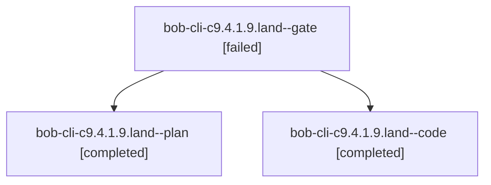

# Session: bob-cli-c9.4.1.9.land

[Agent Hoods](../README.md) / [bbugyi200](../users/bbugyi200/README.md) / [athena](../users/bbugyi200/machines/athena/README.md) / [bob-cli-c9](../users/bbugyi200/machines/athena/hoods/bob-cli-c9/README.md) / bob-cli-c9.4.1.9.land

Owner: `bbugyi200.athena` · Hood: `bob-cli-c9` · Members: 3 · Bead: [bob-cli-c9.4.1.9](https://github.com/bobs-org/bob-cli--beads/blob/main/pages/bob-cli-c9/bob-cli-c9.4.1.9.md)

## Lineage

The diagram is an optional enhancement; the ordered table below contains the same lineage in accessible text.

| Role | Agent | State | Model / provider | Timing | Commits | Prompt | Chat |
|---|---|---|---|---|---:|---|---|
| gate | bob-cli-c9.4.1.9.land--gate | failed | gpt-6-astra / codex | 2026-10-26T10:46:51.174051+00:00 → 2026-10-26T10:47:25.190620+00:00 | 0 | — | [Chat](../agents/bbugyi200.athena.bob-cli-c9.4.1.9.land--gate/chat.md) |
| plan | bob-cli-c9.4.1.9.land--plan | completed | gpt-6-astra / codex | 2026-10-26T10:29:03.467805+00:00 → 2026-10-26T11:29:30.620230+00:00 | 0 | [Prompt](../agents/bbugyi200.athena.bob-cli-c9.4.1.9.land--plan/prompt.md) | [Chat](../agents/bbugyi200.athena.bob-cli-c9.4.1.9.land--plan/chat.md) |
| code | bob-cli-c9.4.1.9.land--code | completed | muse-spark-1.3-contributor / muse | 2026-10-26T10:47:56.962464+00:00 → 2026-10-26T11:29:30.620230+00:00 | [1](../agents/bbugyi200.athena.bob-cli-c9.4.1.9.land--code/README.md#commits) | — | [Chat](../agents/bbugyi200.athena.bob-cli-c9.4.1.9.land--code/chat.md) |

## Commits

| Role | Repo | Commit | Subject | Committed |
|---|---|---|---|---|
| code | bob-cli | [`4ee76d1`](https://github.com/bobs-org/bob-cli/commit/4ee76d114ab76a912350cf62bbe2acea29d87fd7) | fix(highlights): repair overwrite identity, narration, selection, and rollback proof | 2026-10-26 07:27:34 EDT |

## Neighbors

| Agent | Relation | State |
|---|---|---|
| [bob-cli-c9.4](bbugyi200.athena.bob-cli-c9.4.md) (session · 3) | ancestor | failed 3 |
| [bob-cli-c9.4.1.9.1](../agents/bbugyi200.athena.bob-cli-c9.4.1.9.1/README.md) | bob-cli-c9.4.1.9 hood | completed |
| [bob-cli-c9.4.1.9.2](../agents/bbugyi200.athena.bob-cli-c9.4.1.9.2/README.md) | bob-cli-c9.4.1.9 hood | completed |
| [bob-cli-c9.4.1.9.3](../agents/bbugyi200.athena.bob-cli-c9.4.1.9.3/README.md) | bob-cli-c9.4.1.9 hood | completed |
| [bob-cli-c9.4.1.1](../agents/bbugyi200.athena.bob-cli-c9.4.1.1/README.md) | bob-cli-c9.4.1 hood | active |
| [bob-cli-c9.4.1.2](bbugyi200.athena.bob-cli-c9.4.1.2.md) (session · 5) | bob-cli-c9.4.1 hood | active 5 |
| [bob-cli-c9.4.1.3](../agents/bbugyi200.athena.bob-cli-c9.4.1.3/README.md) | bob-cli-c9.4.1 hood | active |
| [bob-cli-c9.4.1.4](../agents/bbugyi200.athena.bob-cli-c9.4.1.4/README.md) | bob-cli-c9.4.1 hood | active |
| [bob-cli-c9.4.1.5](../agents/bbugyi200.athena.bob-cli-c9.4.1.5/README.md) | bob-cli-c9.4.1 hood | active |
| [bob-cli-c9.4.1.6](../agents/bbugyi200.athena.bob-cli-c9.4.1.6/README.md) | bob-cli-c9.4.1 hood | active |
| [bob-cli-c9.4.1.7](bbugyi200.athena.bob-cli-c9.4.1.7.md) (session · 3) | bob-cli-c9.4.1 hood | active 3 |
| [bob-cli-c9.4.1.8](../agents/bbugyi200.athena.bob-cli-c9.4.1.8/README.md) | bob-cli-c9.4.1 hood | active |
| [bob-cli-c9.4.1.land](bbugyi200.athena.bob-cli-c9.4.1.land.md) (session · 3) | bob-cli-c9.4.1 hood | active 3 |
| [bob-cli-c9.1](../agents/bbugyi200.athena.bob-cli-c9.1/README.md) | bob-cli-c9 hood | completed |
| [bob-cli-c9.2](../agents/bbugyi200.athena.bob-cli-c9.2/README.md) | bob-cli-c9 hood | completed |
| [bob-cli-c9.3](bbugyi200.athena.bob-cli-c9.3.md) (session · 3) | bob-cli-c9 hood | failed 3 |
| [bob-cli-c9.3.1.1](../agents/bbugyi200.athena.bob-cli-c9.3.1.1/README.md) | bob-cli-c9 hood | active |
| [bob-cli-c9.3.1.2](../agents/bbugyi200.athena.bob-cli-c9.3.1.2/README.md) | bob-cli-c9 hood | active |
| [bob-cli-c9.3.1.3](../agents/bbugyi200.athena.bob-cli-c9.3.1.3/README.md) | bob-cli-c9 hood | active |
| [bob-cli-c9.3.1.4](../agents/bbugyi200.athena.bob-cli-c9.3.1.4/README.md) | bob-cli-c9 hood | active |
| [bob-cli-c9.3.1.5](../agents/bbugyi200.athena.bob-cli-c9.3.1.5/README.md) | bob-cli-c9 hood | active |
| [bob-cli-c9.3.1.6.1](../agents/bbugyi200.athena.bob-cli-c9.3.1.6.1/README.md) | bob-cli-c9 hood | active |
| [bob-cli-c9.3.1.6.2](bbugyi200.athena.bob-cli-c9.3.1.6.2.md) (session · 3) | bob-cli-c9 hood | active 3 |
| [bob-cli-c9.3.1.6.3](../agents/bbugyi200.athena.bob-cli-c9.3.1.6.3/README.md) | bob-cli-c9 hood | active |
| [bob-cli-c9.3.1.6.4](../agents/bbugyi200.athena.bob-cli-c9.3.1.6.4/README.md) | bob-cli-c9 hood | active |
| [bob-cli-c9.3.1.6.land](bbugyi200.athena.bob-cli-c9.3.1.6.land.md) (session · 5) | bob-cli-c9 hood | active 3, completed 1, failed 1 |
| [bob-cli-c9.3.1.land](bbugyi200.athena.bob-cli-c9.3.1.land.md) (session · 3) | bob-cli-c9 hood | active 3 |
| [bob-cli-c9.5](bbugyi200.athena.bob-cli-c9.5.md) (session · 3) | bob-cli-c9 hood | failed 3 |
| [bob-cli-c9.5.1.1](../agents/bbugyi200.athena.bob-cli-c9.5.1.1/README.md) | bob-cli-c9 hood | completed |
| [bob-cli-c9.5.1.2](bbugyi200.athena.bob-cli-c9.5.1.2.md) (session · 3) | bob-cli-c9 hood | active 1, completed 1, failed 1 |
| [bob-cli-c9.5.1.3](../agents/bbugyi200.athena.bob-cli-c9.5.1.3/README.md) | bob-cli-c9 hood | active |
| [bob-cli-c9.5.1.4](../agents/bbugyi200.athena.bob-cli-c9.5.1.4/README.md) | bob-cli-c9 hood | waiting |
| [bob-cli-c9.5.1.5](../agents/bbugyi200.athena.bob-cli-c9.5.1.5/README.md) | bob-cli-c9 hood | waiting |
| [bob-cli-c9.5.1.land](../agents/bbugyi200.athena.bob-cli-c9.5.1.land/README.md) | bob-cli-c9 hood | waiting |
| [bob-cli-c9.6](../agents/bbugyi200.athena.bob-cli-c9.6/README.md) | bob-cli-c9 hood | waiting |
| [bob-cli-c9.land](../agents/bbugyi200.athena.bob-cli-c9.land/README.md) | bob-cli-c9 hood | waiting |
