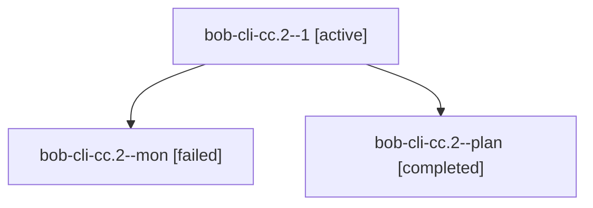

# Session: bob-cli-cc.2

[Agent Hoods](../README.md) / [bbugyi200](../users/bbugyi200/README.md) / [athena](../users/bbugyi200/machines/athena/README.md) / [bob-cli-cc](../users/bbugyi200/machines/athena/hoods/bob-cli-cc/README.md) / bob-cli-cc.2

Owner: `bbugyi200.athena` · Hood: `bob-cli-cc` · Members: 3 · Bead: [bob-cli-cc.2](https://github.com/bobs-org/bob-cli--beads/blob/main/pages/bob-cli-cc/bob-cli-cc.2.md)

## Lineage

The diagram is an optional enhancement; the ordered table below contains the same lineage in accessible text.

| Role | Agent | State | Model / provider | Timing | Commits | Prompt | Chat |
|---|---|---|---|---|---:|---|---|
| 1 | bob-cli-cc.2--1 | active | gpt-6-luna / codex | 2026-10-26T13:46:38.232189+00:00 | 0 | [Prompt](../agents/bbugyi200.athena.bob-cli-cc.2--1/prompt.md) | — |
| mon | bob-cli-cc.2--mon | failed | gpt-6-luna / codex | 2026-10-26T13:40:50.287866+00:00 → 2026-10-26T13:45:27.184129+00:00 | 0 | — | [Chat](../agents/bbugyi200.athena.bob-cli-cc.2--mon/chat.md) |
| plan | bob-cli-cc.2--plan | completed | gpt-6-luna / codex | 2026-10-26T13:03:55.903257+00:00 → 2026-10-26T13:42:58.521869+00:00 | 0 | [Prompt](../agents/bbugyi200.athena.bob-cli-cc.2--plan/prompt.md) | [Chat](../agents/bbugyi200.athena.bob-cli-cc.2--plan/chat.md) |

## Neighbors

| Agent | Relation | State |
|---|---|---|
| [bob-cli-cc.1](../agents/bbugyi200.athena.bob-cli-cc.1/README.md) | bob-cli-cc hood | completed |
| [bob-cli-cc.10](../agents/bbugyi200.athena.bob-cli-cc.10/README.md) | bob-cli-cc hood | waiting |
| [bob-cli-cc.3](../agents/bbugyi200.athena.bob-cli-cc.3/README.md) | bob-cli-cc hood | waiting |
| [bob-cli-cc.4](../agents/bbugyi200.athena.bob-cli-cc.4/README.md) | bob-cli-cc hood | waiting |
| [bob-cli-cc.5](../agents/bbugyi200.athena.bob-cli-cc.5/README.md) | bob-cli-cc hood | waiting |
| [bob-cli-cc.6](../agents/bbugyi200.athena.bob-cli-cc.6/README.md) | bob-cli-cc hood | waiting |
| [bob-cli-cc.7](../agents/bbugyi200.athena.bob-cli-cc.7/README.md) | bob-cli-cc hood | active |
| [bob-cli-cc.8](../agents/bbugyi200.athena.bob-cli-cc.8/README.md) | bob-cli-cc hood | waiting |
| [bob-cli-cc.9](../agents/bbugyi200.athena.bob-cli-cc.9/README.md) | bob-cli-cc hood | waiting |
| [bob-cli-cc.land](../agents/bbugyi200.athena.bob-cli-cc.land/README.md) | bob-cli-cc hood | waiting |
