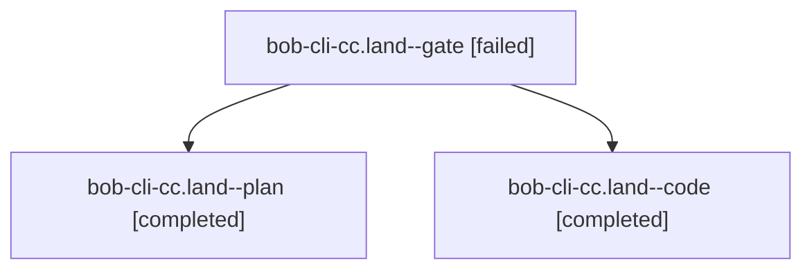

# Session: bob-cli-cc.land

[Agent Hoods](../README.md) / [bbugyi200](../users/bbugyi200/README.md) / [athena](../users/bbugyi200/machines/athena/README.md) / [bob-cli-cc](../users/bbugyi200/machines/athena/hoods/bob-cli-cc/README.md) / bob-cli-cc.land

Owner: `bbugyi200.athena` · Hood: `bob-cli-cc` · Members: 3 · Bead: [bob-cli-cc](https://github.com/bobs-org/bob-cli--beads/blob/main/pages/bob-cli-cc/README.md)

## Lineage

The diagram is an optional enhancement; the ordered table below contains the same lineage in accessible text.

| Role | Agent | State | Model / provider | Timing | Commits | Prompt | Chat |
|---|---|---|---|---|---:|---|---|
| gate | bob-cli-cc.land--gate | failed | opus / claude | 2026-10-26T18:12:50.020786+00:00 → 2026-10-26T18:13:27.126651+00:00 | 0 | — | [Chat](../agents/bbugyi200.athena.bob-cli-cc.land--gate/chat.md) |
| plan | bob-cli-cc.land--plan | completed | opus / claude | 2026-10-26T17:34:43.694374+00:00 → 2026-10-26T19:16:06.119334+00:00 | 0 | [Prompt](../agents/bbugyi200.athena.bob-cli-cc.land--plan/prompt.md) | [Chat](../agents/bbugyi200.athena.bob-cli-cc.land--plan/chat.md) |
| code | bob-cli-cc.land--code | completed | muse-spark-1.3-contributor / muse | 2026-10-26T18:13:52.305217+00:00 → 2026-10-26T19:16:06.119334+00:00 | [1](../agents/bbugyi200.athena.bob-cli-cc.land--code/README.md#commits) | — | [Chat](../agents/bbugyi200.athena.bob-cli-cc.land--code/chat.md) |

## Commits

| Role | Repo | Commit | Subject | Committed |
|---|---|---|---|---|
| code | bob-cli | [`534138d`](https://github.com/bobs-org/bob-cli/commit/534138ddeb98a76b90cd79bc61402d997fc666a5) | feat(ref): land bob-cli-cc with code tests, store gaps, and human metadata | 2026-10-26 15:13:01 EDT |

## Neighbors

| Agent | Relation | State |
|---|---|---|
| [bob-cli-cc.1](../agents/bbugyi200.athena.bob-cli-cc.1/README.md) | bob-cli-cc hood | completed |
| [bob-cli-cc.10](../agents/bbugyi200.athena.bob-cli-cc.10/README.md) | bob-cli-cc hood | completed |
| [bob-cli-cc.2](bbugyi200.athena.bob-cli-cc.2.md) (session · 9) | bob-cli-cc hood | completed 5, failed 4 |
| [bob-cli-cc.3](../agents/bbugyi200.athena.bob-cli-cc.3/README.md) | bob-cli-cc hood | completed |
| [bob-cli-cc.4](../agents/bbugyi200.athena.bob-cli-cc.4/README.md) | bob-cli-cc hood | completed |
| [bob-cli-cc.5](../agents/bbugyi200.athena.bob-cli-cc.5/README.md) | bob-cli-cc hood | completed |
| [bob-cli-cc.6](../agents/bbugyi200.athena.bob-cli-cc.6/README.md) | bob-cli-cc hood | completed |
| [bob-cli-cc.7](../agents/bbugyi200.athena.bob-cli-cc.7/README.md) | bob-cli-cc hood | completed |
| [bob-cli-cc.8](bbugyi200.athena.bob-cli-cc.8.md) (session · 3) | bob-cli-cc hood | completed 2, failed 1 |
| [bob-cli-cc.9](../agents/bbugyi200.athena.bob-cli-cc.9/README.md) | bob-cli-cc hood | completed |
